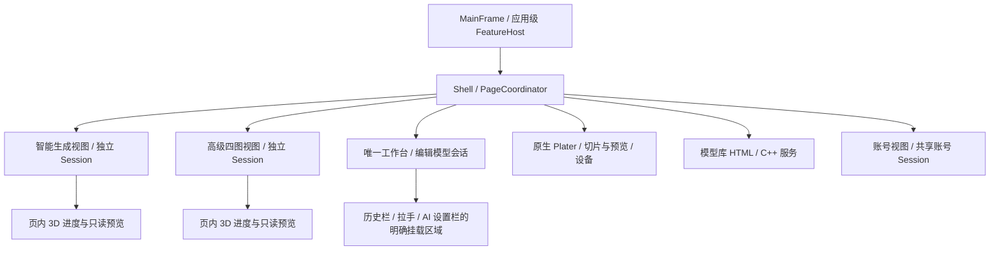
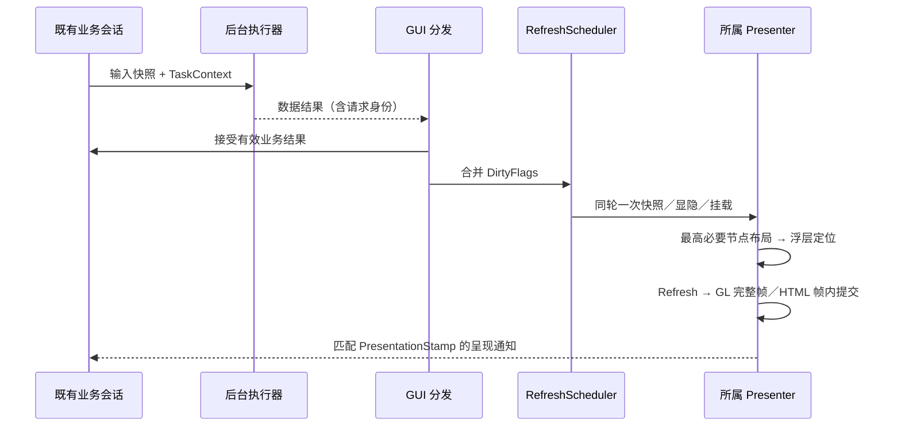
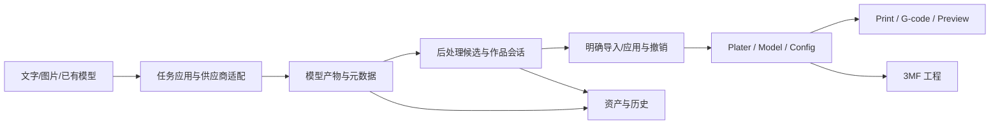

# 产品平台架构与解耦路线

审查基线：2026-11-02，`codex/team/integration` / `09bd370e0dc6e2572069469036d81863591bbab3`。这是当前源码导航与后续路线；图表、编译、自动测试、真实业务和实物打印分别取证。

2026-11-03进展：R1第一步已实现并通过相关自动回归，见下方“配色候选生命周期”。五层地图继续由review-map维护；2026-11-02交互报告及其统计保留为当时的审查快照。

已有边界可以继续保留：Orca 原生核心、AI 契约、智能切片核心各有构建目标；Python 侧车已有应用、能力和供应商适配拆分；账号有 Session / Client / Store；模型库已有 Application。主要问题是生成、后处理和作品操作仍汇集于 GUI 宿主，原生模型、候选、历史与撤销跨多个入口衔接。现状适合继续收紧模块化单体的边界。

能力、源码范围、状态归属、实际构建边界和验证入口的唯一结构化维护源是 [review-map.json](review-map.json) 的 `landscape`。平台首页分为五层、29 个能力，可继续下钻到文件和静态依赖。“目录默认归属”补齐原生大目录导航，单独标注，不能当作逐文件业务审查已完成。

## AI创作与工作台往返（2026-11-17）

侧栏页面导航只恢复已有工作场景／最近有效子视图，空工作台及业务处理中均可访问；不重新打开资产、导入或切片。成果的显式“进入工作台”保留文件／身份／替换保护，成功后由ModelGenerationFeatureHost的CreationWorkbenchContext提交创作来源及只读归属。Shell和高级页仅消费该上下文；普通切页及库资产回调不能解锁，明确“返回AI创作”通过现有写入／工程保护后才恢复原草稿编辑。业务锁不存入PageCoordinator，也不跨重启新增持久化格式。

智能与高级只读页的底部操作区复用GenerationCompletionActions：横向等宽的“返回AI创作”次按钮和“返回工作台”渐变主按钮，下方显示只读原因。高级2D／3D阶段均按现有创作锁显示该操作区，不以预览是否重新就绪隐藏返回入口；恢复按钮的启用和点击仍消费Shell的现有资格及显式恢复动作，忙碌结束只更新资格，不自动解锁。未交接的普通完成态保留“重新生成／进入工作台”，只读提示不重复占用中央状态区。

加载／首帧过渡在用户导航时释放展示租约和侧栏输入，已有请求／原生导入继续以自己的身份排空；迟到结果更新业务但不跳页。输入过滤只覆盖冲突内容区。历史worker完成先按当前请求身份结算loading／busy，再调用可能启动恢复的drained回调，旧请求不能清除新占用。工作台检查的有效结果按资产／修订／取消身份接收，隐藏页面只隐藏反馈，不取消后台检查或丢弃其结果。原生Plater继续唯一拥有工程、G-code及撤销链。

## 原生修复接收与大模型成果（2026-11-17）

长期契约见 [ADR-009](ADR-009-native-repair-acceptance.md)。严格拓扑事实由 libslic3r 保持，GUI 的统一证据读取器区分严格与真实原生兼容接收；保存、历史与导入不得各自放宽。当前成功路径不额外执行原生修复。颜色后备仅保留已接受几何并完成标签，v12／v13 和分块缓存分别验证身份。模型层 `ModelSurfaceSampler` 统一原始外观与修复候选的角点／纹理采样，原入口保留别名，业务状态仍由唯一工作台 Session 持有。

工作台发布失败时由原宿主保留完成分区的共享所有权，作用域限于同资产、代次及编辑修订。重试仍在后台实读源文件和外部纹理，逐字段比较全部解码内容后才省去修复和分区；取消、换模型或离开清理。已正式发布的成果继续优先走完整凭证恢复；不增加第二份业务会话或磁盘检查点，CPU／GPU完整安装仍独立验收。

libslic3r聚类的单次K试验允许有界精确距离复用：只读不可变工作色，中心位身份及当前线程浮点环境匹配才复用，不改变算法顺序或持久化身份。工作区不超过16MiB，跨调用与K试验不共享；业务状态仍由原Session持有。

容量策略区分16MiB处理块、256MiB暂存和原生／最终编辑数据；未知缓存版本、摘要与输出不一致继续拒绝。资源失败、缺纹理、几何失败、发布及安装失败分别记录。自动、差分、完整性能及用户实窗验收是独立门禁，当前实施记录以主计划为准。

颜色平滑的实际float输出复用原投影树检查移动面，失败退回已验证几何与未平滑标签。检查任务保留忙碌状态直到独立模型安装首帧通知通过；CPU检查点不得绕过上传／模型／尺寸／DPI校验，也不覆盖拉手和页面Presenter通知。新配色选择在上传期间暂不受理，取消或呈现失败恢复原画面和历史绑定并保留已发布成果。

## 页面生命周期、后台任务与刷新（2026-11-12）

长期决定见 [ADR-008](ADR-008-ui-lifecycle-and-refresh.md)。这是内部接入契约，不改变当前 UX，也不把生成／编辑会话迁入页面协调器。

**唯一所有权**：MainFrame／既有应用级 FeatureHost 创建唯一编辑工作台；智能与高级保留独立生成 Session，在各自创作页复用页内 3D 进度与只读预览组件，不再保留独立 Result 页面。Shell 持有 `RedesignPageCoordinator`，由它唯一保存当前 Page、ModelView、模式、页面代次及原 `RedesignPageTransition`。适配器按 prepare、apply_snapshot、presented、hidden、dispose 对保留页面交接；普通切页隐藏复用。资产、账号、打印／设备、原生切片仍使用其已有服务，不复制业务真值。



普通子窗口由 wxWidgets parent 销毁；Sizer 只拥有布局项。跨宿主控件使用 `WindowMountLease`，记录原 parent、Sizer 位置、布局参数、显示、焦点及租约代次；仅栈顶租约可还原。原 Sizer 被替换时改用原 parent 的有效布局，不能因临时宿主销毁而误删 Plater。挂载顺序固定为 Detach → Reparent → Add → 最终布局 → 呈现，失败反向回滚；同宿主重复挂载幂等。折叠意图继续由智能页／工作台各自保存，不能从 IsShown 推导。

| 工作 | 执行位置／所有者 | GUI 交接条件 |
|---|---|---|
| 创建／销毁、显隐、文字、Sizer、焦点、WebView | GUI 主线程／页面 Presenter | `assert_gui_thread`；有效页面和请求身份 |
| 视图准备、图片缓存核验、头像读取、模型解析／渲染几何／纹理 mip 准备、凭证恢复 | `TaskRunner` 中的数据任务 | `TaskContext` 请求代次、资产、账号代次、取消及 owner；GUI 再核对展示资格 |
| 已受理生成、HTTP、历史扫描、选择和语义算法 | 原客户端／Worker／Session 执行器 | 保留原业务取消及恢复契约，退出通过 shutdown hook 排空 |
| 同一模型写入、修复发布、原生导入 | 既有事务和忙碌门禁 | 提交边界、源模型／几何／外观证据不变；取消未排空仍禁冲突操作 |
| GL 上传、绘制、SwapBuffers | GUI 主线程、所属 GL context | 模型／页面／布局／尺寸／DPI 相同；部分上传不可绘制或发首帧通知 |
| 原生切片与打印传输 | 原 Job／Worker／原生内核 | 保留原执行器和工程状态；不在页面切换中等待它 |

新 `orca_ui_runtime` 目标只承担 GUI 分发、刷新和执行适配。TaskRunner 有两个线程，普通待执行队列与取消／结果交接分别以64项施加背压，拒绝必须先于移除旧请求；同预览 owner 至多一个运行和一个最新待处理请求；取消／替换仍交付清理回调。新任务内 TBB arena 为 1，避免外层两个任务各自铺满 CPU；可见准备优先，切片运行时暂停新 Low 任务。既有扫描／HTTP／语义执行器未被整个替换，不能把本上限宣称为全应用线程总数；新增算法必须明确其内层并行与资源边界。

本地缩略图结果最多积压64项，GUI消费者每轮仅取2／4项；网站Worker最多积压16项，每轮仅取4项。满队列使生产者等待消费，取消、换账号及关闭唤醒等待者，不再把全部图片移入GUI后反复defer。美颜耗材核对复用同owner的最新任务调度，完整摘要及保存绑定读取在后台进行，安装前保留短期只读凭据；读租约不进入长期预览缓存，也不阻塞后续保存。取消人像处理只发取消请求，原事务完成回调负责保留成果、恢复草稿并释放忙碌状态。

无Scope的适配任务在构造工作和完成回调前取得同一取消令牌。旧线程排空不经过普通任务的取消短路，即使最终stop也必须join；正常退出在排空之前保留owner及事件循环。析构／最终stop的同步join仅作退出兜底，不得作为普通切页或取消入口。

控件资格、状态投影及问题面定位读取已安装的模型身份，不在刷新中重复计算整份文件摘要；保存、发布及导入仍在各自事务中验证实际文件。工作台导入前的外观和原生凭证准备、切片页本地检查／配色使用任务适配器；美颜主要撤销／重做、放弃和对比在后台完成摘要及CPU准备，再使用原提交边界安装。按住对比松开后使旧源安装资格失效；时间线只有成功后才移动，失败保留草稿和候选；取消先失效，原请求排空后才解锁。裁切草稿读取、完整摘要及兼容解码在后台，取消及预览失败恢复成功后才清理；快照写入与清理按资产串行并合并最新意图，末次保存通过退出finalizer排空。美颜失败／取消／原生分区激活回滚及耗材适配同样先后台准备可验证恢复快照，再进行原子提交；异步失败释放忙碌门禁，保留候选和时间线，清理失效的自动进入意图。旧单图兼容导入只冻结输入与外观快照，后台核验后复用现有原生异步导入；取消等待真实完成后解锁，成功才执行原导航。不能将“请求已受理”当作同步恢复成功，或把文件时间戳当作内容凭证。

业务结果和展示资格分两次校验：有效后台结果可更新隐藏 Session，只有当前页面身份可更新控件。TaskScope 生命周期分 View／Session／Transaction；离开视图仅失效展示工作，不能丢失已受理生成或已发布成果。`PresentationStamp` 组合既有帧代次、页面／布局、视口及 DPI，实际模型摘要另行绑定；不再保存第二份业务修订。

原生切片状态回调只接受既有 Session 的展示快照，使用独立 dirty 保留隐藏页变化，由 Shell 同一合并提交应用控件、布局和浮层。普通进度仅更新浮层，同阶段 100ms 合并；阶段变化和终态立即提交。回调排队后离开页面不能绘制旧页；呈现过程中发生导航则停止提交旧宿主。原生完成事件在自身处理完成后重新读取运行状态，即使页面隐藏也解除低优先任务暂停。切片检查／配色持有原生不可变 mesh_ptr 快照，避免 GUI 复制完整网格；原生编辑和最终事务一致性保护保留。

Windows 的短期只读租约阻止验证后替换或改写，GUI 安装只核对租约身份；没有等价租约的平台在最终交接保留严格摘要复核，不能退化为大小和修改时间判断。该保守回退及切片配色原生最终 prepare／validate 的完整几何校验均须单列主线程耗时；跨平台优化、实际 P95 和不可切分原生提交未经验收时保持未完成，不用降低证据强度换取耗时指标。

历史预览的数据交接必须返回 `ModelPreviewLoadResult` 中最终选中的对象、阶段和错误。修复成果重选会替换 PreparedModel 指针，GUI 不能提前捕获初始空分配；冻结几何、外观、实际资产摘要和文件读租约随同一次结果交接。安装前仍核对请求、取消及文件资格。读取、冻结几何、文件验证、GUI安装和呈现的错误分别记录；回滚继续保留原模型。仅验证 CPU 准备及凭证，不能证明异步对象交接、GPU上传或实际页面已经成功。



`RefreshScheduler` 每 surface 一个待执行回调，提交中新增失效留到下一轮；隐藏／最小化保留 dirty，恢复显式 resume／flush。普通更新异步 Refresh；首帧及恢复屏障才由对应 Presenter 同步提交一次。Shell 不递归刷新工作台子树。工作台、智能历史栏、页内 3D 预览、账号和 HTML 消息已接入；业务轮询／动画保留原周期，不增加整页定时刷新。进度同阶段以 100ms 合并，阶段与终态即时。Freeze/Thaw 只允许短时布局，不跨后台等待；普通切页禁止 wait/get/join、wxYield 和嵌套循环。已完成线程的回收、退出兜底与不可切分原生调用需要分别评估，不能算成后台算法已全部迁出。

高级四图页同样通过单一 RefreshScheduler 应用最新会话及模型投影，文字、显隐和选择只更新变化项，几何关系变化才提交布局。四图、上传图和历史缩略图使用 `AsyncPreviewImage`：资源版本、目标像素尺寸及 DPI 构成展示缓存身份；解码、缩放及圆角处理在原有有界后台执行器，GUI仅安装匹配请求的完整位图。准备新图时保留旧位图，隐藏／最小化暂停展示及动画，业务继续；恢复显式同步。上传图的显式重新选择使展示缓存失效，不新增持久化字段。

高级2D四格和单大图由 `AdvancedCreationWorkspace` 按中栏空间布局。卡片同一层绘制图片、局部蒙层、标题及星芒，单大图另在图内绘制四个方向缩略图。命中使用相同坐标，悬停只刷新相关卡片。`AsyncPreviewImage` 的居中裁剪参与请求身份，按路径、版本及裁剪方式给2D卡片提供匹配位图。偏好和生成资格仍由会话投影提供。

窗口同尺寸同DPI平移不属于恢复事务：`WM_ENTERSIZEMOVE` 不截图、不布局、不触发图片重采样或GL读回。实际尺寸／DPI变化由合并刷新处理；最小化、最大化和恢复才由一个恢复事务保留画面，标题栏与系统消息共用一次采集保护。真实控件绘制后释放该控件的旧快照，防止后续擦除重放旧拉手或文字。原生拖动保持原样，不添加拖动计时器或整页刷新。

窗口动作的原生控件恢复采集由 `RedesignPaintPanel` 在GUI线程集中完成：收集前台可见叶控件，按祖先客户区及虚拟屏幕裁剪，联合物理像素矩形仅复制一次屏幕、执行一次采集 `GdiFlush`，再在内存中拆分bottom-up BGRA。容器仅保留背景；工作台仍使用自身完整帧。`RedesignRestorePixels` 只承接该模块的坐标、像素及资源释放辅助，不拥有页面或业务状态。批量DIB及本批输出容量合计至多256MiB，DC／DIB由作用域释放；无目标、超限或采集失败时使用原背景与真实绘制，不退回逐控件采集。安装及原生回放检查控件存活、HWND、父宿主、root、尺寸和DPI；隐藏页面清除子树旧原生帧，主窗口最小化则保留合法旧帧并跳过新采集。GL读回及上下文恢复继续走原路径。

`UiRestoreSnapshot` 按动作聚合控件数、一次采集／flush、像素量、预算／身份拒绝原因和分段耗时；恢复宿主另外记录排队、布局、Presenter、最终 `GdiFlush`／`DwmFlush` 与揭示。采集同步和最终呈现同步分别计数。窗口首次可见反馈P95≤100ms、稳定本地恢复P95≤500ms包含输入排队和系统动画；代码回归、分段日志及工具调用耗时均不能代替录像端到端验收。

GL 的 CPU 数据准备先于安装；GUI 分批上传顶点、索引、纹理，完成前等比呈现旧完整帧。上传错误拒绝首帧并沿原超时／回滚处理。普通切片 GL 消费者仍走原接口。HTML 用受限桥批量投影和浏览器一帧一次提交，账户变化清除排队旧消息，隐藏后停止 WebGL；普通状态更新不 reload。工作台保留完整原页→后台准备→最终挂载布局→有效首帧→一次揭示；15 秒只统计有效首帧呈现等待，历史文件解析、取消排空、页面切走及窗口隐藏／最小化不消耗该预算。解析仍受原请求取消及排空协议管理，不能因大模型解析超过15秒而误报首帧超时。创作页进度显示不等模型完成，工作台不等检查通过；凭证在自动检查前恢复。

**退出**：MainFrame 完成原工程／传输确认后，停止接收新任务 → shutdown hooks 失效页面请求、停计时和订阅 → View 取消、原线程后台排空 → GUI 完成回调排空 → 原 shutdown 释放控件／GL。事件循环保持响应，不 detach、不强杀、不在 GUI 等未完成算法；退出 watchdog 在排空后启动。系统强制终止不构成正常排空验收。

诊断复用 `ORCASLICER_UI_LATENCY_TRACE=1`，UiTask 分别记录排队、后台、GUI 分发及提交耗时；UiCommit 记录 surface、dirty、首次失效至提交的 queue_ms 和提交耗时，GPU 大调用超过 50ms 单列。日志不记录账号令牌、文件内容或私人模型路径。首次反馈 P95≤100ms、调度提交 P95≤8ms 是实机验收门槛，必须同机同样本采集；没有新日志／录像不能宣称达标。基础自动测试不代替逐帧、DPI、20 轮往返和资源稳定性。

移动补修增加同一诊断开关下的 UiRestoreSnapshot／UiAdvancedLayout／UiImage 分段耗时及 UiWindowMotion 摘要；移动消息按一次拖动聚合消息数、超过50ms次数、最慢消息和采集次数，不逐条记录。结合时间范围核对纯平移新增截图、布局及图片处理均为零；任务自身的状态更新另作归因，不以离屏控件单测时间代替拖动实机或P95。

**后续 UX 接入清单**：登记父宿主／生命周期／共享挂载区；快照取数、命令回 Session；声明算法线程、取消点、资源上限和身份；使用 dirty 合并；浮层声明输入锁、旧覆盖补绘及销毁；GL／HTML 提供呈现完成；测试离开、恢复、失败、取消和过期。新页面不得创建第二编辑工作台、恢复独立结果路由或复制生成／编辑状态。实施及未验项目只在原主计划维护，不能另建平行台账。

## 五层职责

| 逻辑层 | 职责 | 实际限制 |
| --- | --- | --- |
| 业务工作区 | 原生设计/准备/预览、AI 创作、3D 后处理、资产图库、账号、打印机 | 多个 GUI 类运行于同一桌面产品 |
| 应用编排与业务状态 | 任务、后处理会话、切片建议、模型库命令、身份会话 | 决定步骤、恢复、候选与状态；部分仍依附 GUI 宿主 |
| 契约与接入适配 | 产物/色板/区域 DTO、Orca 适配、AI 提供商、设备与移动 SDK | Ports/DTO 与具体实现分开；接口存在不等于全部消费者已隔离 |
| Orca 原生内核 | Model/几何、CAD、配置/预设、工程格式、切片/G-code、渲染 | 渲染实际依附 GUI，不能视为纯无界面内核 |
| 运行与工程支撑 | 桌面/侧车生命周期、文件/历史、DFX、平台服务、构建/打包 | 涉及多个运行与开发环境，不是一个新的统一服务 |

DFX 按用户确认定义为**诊断、日志、故障定位、性能与可靠性**，横跨各层。可打印性检查属于后处理/切片业务，可以向 DFX 输出证据。Android 参考图提供阅读粒度；允许依赖仍以 Ports、契约、原生适配与集成锁为准，不能根据层的位置自动判断所有依赖是否合法。

## 业务、状态真值与源码

| 业务 | 主要入口/状态归属 | 交接约束 |
| --- | --- | --- |
| AI 文本/图片/模型工作流 | `tools/ai/model_job_application.py`、`model_job_lifecycle.py`、`model_job_repository.py`；GUI 提交/展示在 ModelGenerationPanel / FeatureHost | 智能／高级每次有效操作新任务；当前操作内幂等和查询，停止／重启不恢复旧生成，完成资产独立保留；HTTP Handler 不产生第二套业务规则 |
| 高级多视角创作 | `AdvancedCreationSession*`拥有全局草稿、3D偏好、方案A临时候选、输入失效及一次性引导；Application计算all_inputs／single_view并冻结目标；Repository持有current和不可变版本；Host负责检查点、回执、候选计划及缓存；Workspace仅持有预览模式／方向和未提交局部文字 | 原认证路由不变；删除／替换立即清空对应current，失效旧图不回填，缺主图／空输入可保存但不能生成。首次与新建后的受理目标全部成功可用后引导一次，主动返回关闭；左栏固定全视角，2D单击不选图；四格／单图焦点不影响生成目标和3D偏好。局部浮层严格单方向直提，回显和基底须匹配，局部文字独立记录，受理／孤立回执恢复不推进全局提交基线。主图先上传，缺主图时保留／删除辅助及补主图可用，禁止生成与辅助新增／替换。首次3D仍原卡片选图；已有模型在原确认窗的方案A候选内改选，取消不保存，最终确认才保存偏好并提交匹配的版本／SHA／输入纪元／参数计划；发送前本地保存失败清理未发送回执并保留候选供同窗显式重试，已发送未知结果仍核对原请求。3D主图必选，失效辅助可取消，未选不可用图禁止加入，精确张数能力在候选计划校验。Job-v2和嵌套快照v2冻结所选1～4个版本，v1严格四图兼容；仅主图走所选服务单图能力，2～4图走多图，YOYOClaw混元3D保持默认面数。未选辅助普通失败不阻断手动建模，原未决／忙碌／停止／过期／历史及唯一工作台保护保留。验证分层见原主计划 |
| 3D 后处理/人像/配色 | `GUI/AI/ModelGeneration/BeautyWorkbenchSession*`、`BeautyWorkbenchTransactionController*`、`PostGenerationWorkbench*`、`GUI/AI/ColorMatching` | 候选、当前作品、预览和历史需区分；颜色、几何与实物打印质量分别验证 |
| 原生导入/应用 | `AI/Contracts/IModelArtifactConsumer.hpp`、`GUI/AI/Orca`、`PlaterWorkbenchImport*.ipp`、`PlaterAITransaction.ipp` | Plater/Model/Config 保有工程真值；明确应用和撤销；侧车不直接修改原生工程 |
| 智能切片 | `AI/SmartSlicing/{Domain,Application,Ports}`、`GUI/AI/SmartSlicing` | 按工程 revision 绑定几何分析、原生试切证据和正式应用。应用及恢复由 Plater 的快照事务维护 |
| 账号 | `Redesign/PlatformAccountService*`、AccountWorkspace、`Utils/HonorAccount/{HonorSession,HonorClient,HonorStore,HonorServices}*` | 共享会话为账号页、模型库和原生账户接口提供同一身份。凭据保留在原生安全存储，异步结果遵循账号范围与取消状态 |
| 模型库/资产 | `resources/web/model_library`、AssetsWorkspace、LibraryWorkspaceService、`Utils/PlatformLibrary`、ModelLibraryApplication、Repository/Loader | HTML只展示；C++管理查询、个人记录与下载，登记资产仍由本地库消费；用户目录保留原件与独立编辑成果 |
| 打印/设备 | 原生 Print/GCode、PrinterWorkspace/OrcaPrinterAdapter、DeviceManager、SendJob/PrintJob、Honor Forge/Moonraker agent、`orca_mobile_device_sdk` | Honor Forge 使用独立 agent ID，mDNS/受控子网候选通过 Moonraker 探测后进入既有 DeviceManager；UI 只选择导出、仅上传或上传并打印，传输继续由既有 Job 和 agent 执行，raw G-code 与 3MF 能力按 agent 显式声明 |
| CAD/原生编辑 | `libslic3r/CAD`、`GUI/CAD`、Model/Geometry、GLCanvas3D | CAD 文档与求解结果回到原生模型；SLVS/OCCT 版本和构建选项是依赖契约 |

下面是业务语义链路，实际代码通过交互图中的锚点核对：



## 2026-11-20 桌面账号与原生服务

`HonorSession` 保存本次登录的 PKCE verifier。`HonorClient` 发起 `POST /v1/identity/honor/desktop/authorize`，`AccountWorkspace` 用原有的内嵌 WebView 打开荣耀授权页。WebView 在当前登录代次内拦截 `honorforge://auth/callback`，交给原生会话交换。刷新和撤销沿用平台身份接口，安全存储仅恢复 `desktop` 会话。升级后的旧凭据需重新登录，应用配置与 WebView 登录记录仍按原配置隔离。

`HonorSession` 通过 `GET /v1/me` 确认头像地址。更换头像时，`HonorClient` 用 `PATCH /v1/me` 提交 96×96 PNG 的 `avatarUrl`，收到成功回执后回读资料。回读失败时，重试继续原会话内的读取。`PlatformAccountService` 负责头像解码和会话内展示状态，供账户页、侧栏及本地和自有模型卡片订阅。默认头像随账号状态选择。远程图片使用独立请求，晚到结果按账号与会话代次核对。模型库通过现有桥接收到 PNG 数据，更新对应图片。`HonorClient` 为平台鉴权请求设置五个 `X-Orca-*` 客户端标识头，由后端在成功的鉴权业务请求完成后统计活跃。

`HonorServices` 通过当前会话访问积分、容量和云文件。上传会话返回 `fileId`，传输失联后用原 ID 查询状态。票据和上传会话绑定账号生命周期，原件下载核对大小与 SHA-256 后返回。积分与云空间界面留待 UX 设计稿。现有模型生成入口继续读取供应商和模型配置。

## 2026-11-11：模型库与网站接缝

AssetsWorkspace只装配安装目录的HTML和受限消息桥，页面不能提交任意URL、本机路径或凭据。LibraryWorkspaceService拥有目录、详情、个人记录和下载状态；请求绑定页面代次及原生账号身份，切页、刷新、注销和取消使旧结果失效。PlatformAccountService统一轮询已有HonorSession，账号页继续负责登录展示及授权窗口，模型库受限操作进入原登录流程并在返回后重新验证详情资格。离线不妨碍本地资产。

安装文档每次加载先由 `LibraryPresentationChannel` 单独发送 init；网页必须回传匹配 nonce／文档代次的 ready，之后才接收账号和业务快照。账号变更不能删除初始化控制消息，重复展示会恢复未完成握手及合并消息；安装页URL经规范化同路径校验。业务消息另外绑定账号及网页请求代次，旧文档、旧账号、旧查询不能更新DOM。公共目录与分类分别加载，本人作品和活动记录渐进发布；失败保留同筛选中已取得的列表，坏条目和部分接口不可用不能伪装为空列表。

本地历史删除由同一 ModelGenerationPanel 命令承接，右侧历史、原生回退及网页本地资产共用 ModelLibraryDeletion 文件事务。GUI 只核对选择和编辑资格并立即确认；路径、元数据、依赖扫描和清理由现有 TaskRunner 执行，不在确认前同步读盘。事务在明确库根内拒绝越界和符号链接，允许缺少可选元数据的旧模型。先原子提交独立 `.removed` 删除记录，再清理独占文件；被其他成果引用或依赖无法核实的文件及精确原元数据保留，历史项仍可移除且刷新／重启不重现。取消在提交前生效，提交后完成有界清理并在关闭排空；不递归删除共享目录。删除记录不授权模型恢复，保留的隐藏来源仍进入只读修复关系索引，恢复／导入继续验证完整摘要和凭证。外观载体不作为独立历史卡片。菜单资格与执行入口一致，失败有可见中文反馈，远端生成不受删除影响；文件状态观察不用于模型检查凭证缓存。

历史筛选和邻项计算使用后台已核验的列表投影，不在GUI逐文件重新检查；外部已消失的文件仍可移除旧记录。删除受理、失败和成功进入已有工作台刷新调度，隐藏旧面板只发布状态，不同步全树布局；队列拒绝释放busy并恢复列表扫描。成功提交才回退邻项，独立任务模型同时清理所属旧job记录，防止残留设计再次登记；共享来源和原凭证的生命周期不随卡片显隐结束。

删除一致性补修（2026-11-17）：FeatureHost为既有历史消费者与ModelLibraryApplication共享GUI所有的ModelLibraryRemovalState，仅记录删除受理／提交代次及临时排除，不代替文件凭证。受理后从内存快照投影立即移除卡片，使用原RefreshScheduler合并卡片、计数、分页和操作更新；失败仅撤销本次排除，保留期间新增记录。文件事务在原子删除记录提交点通知GUI，独占文件继续后台清理，提交后的清理失败不恢复卡片。旧扫描代次不能恢复被删项；新扫描只有在同一删除代次、任务已排空且仓库确认没有删除记录时，才承认显式重新下载的登记。网页本地列表与原生回退同步同一投影，受理不作为完成重扫。

工作台保留历史原始选择与最终解析身份绑定；匹配删除时先关闭操作并使旧回调失效，提交时通过原Session重置解除检查、编辑、撤销／重做、原生上下文及GL完整帧。排空后按删除前筛选顺序优先下一项、再上一项；无可用项或邻项加载失败保留空态，不能恢复被删模型，也不能抢占用户后来选择的页面。历史解析在后台核对原始项与修复候选的删除记录，安装前再核对GUI删除代次；隐藏来源可作只读证据，不能成为已删除的编辑成果。任务镜像身份仅连接同一job的既有下载／任务副本，不以相同内容合并不同历史版本。

自动检查和纯拓扑修复发布的新资产必须延续原历史选择，连续检查交接也不能丢失该绑定。原生显示ID与历史登记ID不同时，仅在工作台展示绑定中用精确规范化模型路径识别同一实际资产；不扩大历史排除键或凭证授权。显式保存的编辑版本建立独立选择。删除原选择应卸载其当前检查成果；其他独立登记成果仍保留历史卡片，但不得自行重新装入已清空的工作台。

独占文件清理后只移除已空的所属目录，保留任何未知或共享内容，不递归删除。用户明确重新下载同一版本时，`StagedDownload` 在完整摘要校验及登记完成后清除身份匹配的删除记录；取消、普通扫描和后台任务更新不能恢复卡片。历史恢复失败保留已登记成果并允许重试，不能回滚删除已经发布的下载文件；外来或损坏记录不授权清理其他资源。

检查修复的严格默认门限保持不变。工作台显式采用原生兼容策略：原严格路径未接收时，复用身份一致的真实原生结果，必要时从不可变原件执行 `repair_mesh`。实际浮点输出仍记录完整拓扑事实；官方允许保留的交叠或不可用自交谓词不再被全局零自交条件重新否决，非法索引、非有限坐标及空成果继续拒绝。原生兼容凭证同时绑定执行来源、实际输出和报告，单个布尔值不能授权接收。保形通过与原生兼容分别记录，不把超限结果写成 `geometry_verified=true`；偏差和面积变化保留。历史恢复、保存和去切片共用校验，旧严格凭证仍按原门限验证。已有成功路径不增加官方修复；严格路径的颜色平滑只验证实际移动面，失败保留已验证几何和完整标签。未修改的私有网格复用已完成拓扑检查，偏差和面积变化记为零；实际修改仍使用原采样点和确定的汇总顺序。每任务最多4个计算线程。发布、外观、GUI／GPU安装及有效首帧条件保持，首次处理与凭证复用分别计时。

原生页面通过既有 `WebView::RunScript` 非阻塞适配器提交初始化、业务批次及隐藏通知，不等待脚本执行结果；握手完成仍由 nonce／文档代次匹配的 ready 确认。禁止直接调用会在内部循环 `wxYield` 的 `wxWebView::RunScript`，也不在显示、隐藏、Freeze 或 WebView 回调中等待网页；Windows WebView2 在这些原生消息内可能无法交付脚本完成通知。切页先提交 inactive 后立即返回原生布局，不能让浏览器回执阻断导航；发送受理失败保留现有控制消息或当前代次批次，恢复展示时重试。

网页 `FrameUpdates` 每轮合并列表快照与空态绘制。原生浏览器函数经闭包调用 `window.requestAnimationFrame`，保留 Window 接收者，不能把裸函数保存为调度器的方法后调用；否则浏览器会抛出 Illegal invocation，分类虽能独立更新，列表与空态却无法绘制。投递抛错时释放 pending 并保留脏状态，后续请求可以继续排帧，不能永久锁住刷新。网页测试同时约束浏览器接收者、投递失败恢复、首次空态和后续目录；独立浏览器 DOM 验证与客户端主窗口验收分别记录。

下载任务只有在有界队列受理后才进入忙碌状态，拒绝、取消和所有终态都解除对应状态。未登录下载保存原详情和文件选择，登录／单次401刷新后重新读取该版本资格；换账号、注销或主动返回撤销续接意图。网络、权限、文件下架、写入、大小及摘要错误分别显示中文原因，原始诊断不进入网页。既有完整文件保持可用；下载并不自动打开工作台、导入或打印。

LibraryClient直接使用平台`/v1/library`契约，图片只取已登记的相对预览资源，3D数据以有界分块交给本地WebGL展示。下载固定模型/版本/文件ID，在后台校验资格、大小和SHA-256；GUI复核当前请求及账号后原子登记，不发表临时文件。重复版本内容一致才复用；来源元数据不能代替内容校验或工作台检查凭证。原件被修改时仍保留本地资产，停止与网站原件合并显示。GLB/OBJ沿用完整首帧切换和修复成果索引；3MF/STL/STEP使用既有原生导入，3MF保留工程/几何选择及打印配置，不送入GLB历史解析。

网站独立仓库以迁移039追加账号浏览记录，并补齐`me/likes`、`me/downloads`、`me/views`及详情文件摘要；匿名统计口径、原收藏接口和网页兼容性保留。迁移和API在网站正式发布前，桌面个人记录端到端仍待真实环境验收。客户端不上传本机模型，不包含网站Next.js运行时；下载、导入及切片均不计为打印。

本人作品复用已上线的`GET /v1/me/models?offset=N`，以100条页协议读取完整列表；LibraryCatalog归一化模型／版本／发布状态后执行搜索、排序及24条展示分页。LibraryWorkspaceService只在当前账号代次内缓存成功来源，进入或刷新重新同步，换账号及注销清除；“全部”分别读取个人活动，单路失败保留其他成功来源。本地下载原件仍通过现有摘要规则关联，修复／改色成果保持独立。详情统计及互动为可选数据，缺少时展示未知，私有／草稿／撤回作品不提交公共互动；可选版本只来自当前账号的详情响应。安装页的根背景固定在视口，单一文档内容滚动，不随内容移动渐变。

## 2026-11-11：开发者日志导出

原生普通日志在既有libslic3r文件／控制台formatter输出前，统一将Windows用户目录及Unix home目录的绝对用户前缀替换为`<user-home>`，保留相对资产位置、任务ID、时间、阶段与错误；JSON转义内容保持可解析。Windows盘符路径紧接诊断标签、没有空格或分隔符时同样处理，Unix相对资源路径和普通URL保持。路径处理归核心日志输出，GUI／HTTP和供应商不另存日志业务状态；导出的凭据／URL脱敏仍由原DiagnosticLogs承担。旧日志作为原始故障证据保留，不回写伪造为新版本结果。

Preferences的日志级别下方通过DiagnosticLogExport适配保存对话框与现有ProgressDialog，无需启用开发者模式。DiagnosticLogs在后台仅快照当前data_dir/log下的日志文件，保留诊断ID、时间、阶段和错误，按AI诊断语义移除凭据及URL认证／查询参数；不读取模型、历史、账号存储或完整配置。有限大小快照避免运行中日志追加导致等待无界，轮转／占用产生清单遗漏；写入失败或取消不发布。生成版本／时间／文件及遗漏清单，复用从TroubleshootDialog提取的ZipArchive写入能力，完成后在同目录原子替换目标。故障排查页原目录选择及打包行为保持；导出不是日志上传或安装包制作。

内部桥只接受已登记身份和白名单命令：查询、详情、账号登录、点赞/收藏、下载/取消，以及本地库已提供的打开、导入、配色、导出、打印结果记录等操作；顶层安装URL、随机nonce、字段和消息大小共同校验。页面离开立即停止预览、失效请求与本地扫描；账号变更清理网站图片与个人操作投影，本地缩略图和已下载文件保留。3D传输限64MiB，以192KiB分块每100ms至多发送两块，单个预览准备期间拒绝重复请求。下载原件限100MiB，临时文件和登记文件均只写用户模型目录；SHA-256、大小、固定版本和当前原生身份全部成立后才能登记。

## 2026-11-10：历史加载反馈与设置栏生命周期

历史请求继续由ModelHistoryOpenRequest拥有，阶段通知绑定代次及不可变的原选择身份，实际解析到的修复副本身份另行传递。GUI过滤过期、重复和取消后的通知；请求保留到后台解析排空，不让取消释放第二次加载资格。显示卡仅呈现阶段／耗时，不拥有第二份模型业务状态。RedesignModelLoadingCard从导入切片原构造提取，两个操作共享样式、尺寸及定位算法，各自保持生命周期和取消操作。

AI设置栏是内容区外的同级控件，普通路由与历史呈现共用显隐规则。保留画面覆盖两者屏幕并集，在其后隐藏设置栏、恢复工作台历史栏并完成最终宽度布局，再验证当前模型的完整帧；回滚先恢复原路由、左栏和模型，再撤过渡画面。最小化隐藏反馈并暂停有效等待，恢复后重新核对；不新增持久化字段或外部API。

## 2026-11-11：单一工作台与创作资产交接

智能与工作台共用历史侧栏，负责完成模型的搜索、筛选、分页及打开。“失败记录”专用控件、弹窗及后台扫描已在源码退役，不删除原任务数据。当前任务失败仍通过原工作流的结构化阶段、脱敏日志与持久化尝试记录呈现，供同次受理核对、防重复与后续诊断；不能把撤掉历史浏览入口理解为删失败状态或放开重新提交。

高级目录查询按 image／geometry 分域，3D 查询不构造高级组运行时或依赖 2D 目录；Tripo 准入保持四图、版本、忙碌及确认保护。原目录总览兼容，窗口仅使用已验证且当前代次的响应。合并同一账户/角色的目录查询，付费准入另复核；查询与旧响应下载不持有组事务锁。启动只安排既有收据处理，回锁再检查操作、输入和停止状态，绝不把正在执行的新任务当成前次异常。YOYOClaw 3D 选模共用实际目录的数字版本规则，区分新任务推荐与冻结模型仍可用；已受理任务按原 ID 查询。按2026-11-19产品决定，单图与四图均用供应商默认面数，内部`face_limit=0`只表示默认，不发送面数字段、不做面数偏差提示。四图按既有外部脚本发送正面`image_base64`及具名left/right/back的`multi_view_images`；不猜测供应商图片／请求限额，保留本地有效输入、四图摘要及单次POST错误事实。目录以`single_image`／`named_four_view`投影支持，智能在GPT准备前冻结实际3D模型，高级在确认计划中冻结；执行前按完整目录复核原模型，不自动换版重买。任务轮询的已核验终态可在同一任务的下载阶段复用，不授予新任务或跨次恢复权限。旧智能pending配置清空代码已退役，不支持旧版回退；`image_preprocessing_debug.py`仅保留工程CLI／测试，不安装随包。

创作引导与每次新建（2026-11-17）：AdvancedCreationSession仅为当前会话明确受理的新组初次设计保留一次性引导；当前输入匹配、受理目标的全部当前版本本地校验可用且无活动／未决操作后，由可见Workspace消费原Tab切换。后台完成不导航，历史打开、重启及消费后的更新不布防，切Tab不提交3D。智能按钮先同步当前控件和模型选项，再新建flow／request／job并重新2D→3D；上次成功／失败／停止、输入是否相同均不选择旧恢复。编辑下一轮输入保留原呈现身份，避免Route拒绝合法草稿后回填旧值；旧options／保存回执不能覆盖更新输入。已发送但回执丢失时只重传本次冻结请求，仍使用原request；当前操作未决不放行第二次创建。高级基于当前确认的主图必选1～4图新plan／job，输入变更导致所选图失配时要求重新准备确认，不暗中重画。旧Job、错误和资产保留。

高级图像供应商切换由AdvancedCreationSession更新草稿。切回当前组已提交设计的供应商时，同步恢复该设计绑定的模型；同供应商重选不修改草稿，不另存跨组模型缓存或改变新草稿默认选模。描述、风格及上传的独立变更仍必须通过原输入匹配检查。

高级image／geometry能力查询的错误回调也经ModelGenerationStatusText本地化后发布；失效仅清理对应能力快照，原始英文传输说明不直接进入页面状态栏，其他作用域和当前输入保持各自状态归属。

停止收尾由原Panel／SmartGenerationFlow、高级Host／AdvancedModelTaskFlow和Python应用共同处理：立即撤销自动3D及旧产物安装意图，保留找到原请求所需的临时身份；`stopping`只是受理，确认本地终止后才提示“已停止生成”并解锁。停止失败仍可再次停止；停止早于受理时旧回执只用于终止，不重新绑定或导航。回调同时核对会话和请求身份，同组新任务也不能被旧请求释放命令锁或覆盖投影。高级换组或新建在重置观察器时同步清理旧停止标记和临时模型请求身份；持久化收据独立保留，用于原任务收尾，不使新页面沿用旧观察锁。已完成资产保留，显式本地查看可重新加载文件，不恢复供应商生成。质量报告、18%启发式、配色和粒子失败只作建议／展示回退，不阻止有效文件建模；真实文件、四图摘要及能力契约保持。YOYO具体错误经可选详情字段贯穿网关、attempt、public job及中文状态，公共终态不变，未知原因不推断积分。

高级3D受理与页内呈现（2026-11-13）：Job-v2响应先核对确认计划／收据及组、任务、来源身份，再登记Advanced Session的模型投影并通知适配器；完整四图缓存不作为进度显示门槛。当前组核对使用原epoch及普通快照，不重新恢复草稿／选择；旧缓存任务和旧任务更新时间不能回写受理／恢复后的投影。Workspace转交带group／job／epoch／操作代次的事件；Shell仅为当前新任务布防一次完成提示，任务更新不导航。智能与高级分别在各自中央区域展示进度与最终模型，点击“进入工作台”才交给唯一编辑工作台。临时过渡、最小化及离页沿既有生命周期和刷新队列处理，隐藏不取消已受理生成。中文说明统一由ModelGenerationStatusText按真实阶段及结构化错误投影，生成完成与工作台检查通过保持独立，不直接显示英文服务说明或高级流程不适用的智能人像准备提示。

`ModelGenerationFeatureHost` 唯一构造 `WorkbenchAssets`，租约在分配编辑 Session 和控件前拒绝第二份实例。智能与高级创作适配只持有各自任务及只读预览；旧单图仍复用高级创作控件。`WorkbenchOpenRequest` 将实际资产、预览摘要、创作代次及返回上下文交给原历史加载器，不借智能任务恢复打开高级产物。完整工作台控件先构造，再发布状态；高级解析中的新任务等待旧解析取消排空，不安装旧产物。

Shell 唯一管理路由、左栏及共享历史栏。后台创作通知只更新任务投影，不能改写当前工作台视图。历史加载完成核对共享工作台的实际资产，不等待检查或美颜资格，也不恢复、锁定智能创作路由；取消只回滚本次交接修改的返回上下文。供应商目录查询分别使用两种创作适配的缓存和请求代次。所有来源共用检查凭证恢复、编辑发布及原异步切片导入；导入成功进入切片设置，保留最终项目校验和未保存保护。不新增网站或侧车协议、历史字段或生成策略。

生成结果交接的下载副本可能没有历史栏附带的修复关系索引；历史解析工作线程通过原仓库读取器补建缺失或过期索引。来源别名仅接受同一任务的标准 task／downloads 路径，双向识别后仍逐项核对实际内容摘要及原检查凭证。任一原件变化都拒绝复用，不以路径别名代替检查证据，也不改写原件或既有凭证。

## 2026-11-10：工作台呈现与视角导航

创作页显式进入工作台沿用RedesignPageTransition令牌与现有统一刷新队列。RedesignWorkbenchPresentation只拥有源页面暂存、截止时间及整体揭示；原页转入暂存窗口前先以仅驻内存的完整源页画面遮住原生重挂载空帧，真实源页保留以供回滚，结束即释放画面。PostGenerationWorkbenchHost区分准备与正式presented，原生控件、历史栏及当前模型完整帧提交后通知Shell，再启动既有检查调度。ModelPreview3D的展示通知与人像帧回调独立，拒绝过期模型、布局、尺寸及DPI；最小化不消耗准备预算，失败恢复源页，不新增业务状态或持久化。

View3DNavigator提供不持有相机的共享绘制和坐标映射，切片页继续拥有原生Camera。工作台以独立ImGui上下文适配自身正交相机；ImGuizmo的点击、拖动和插值归各导航实例，切页／锁定／捕获丢失即清理。导航使用工作区独立GL小视口，与底栏底部对齐，不挤动底栏或模型视口；重用模型已提交完整帧的GPU纹理，按真实屏幕交集与上下方向合成底图，避免原生GL窗口的不透明背景遮挡放大模型，底栏区域不采样模型。切模型即清除底图，尺寸不匹配时等待新帧；首帧门控同时核对模型与导航提交。wx按下／松开依序交给各绘制帧，合并连续移动，避免快点击丢失或首次定位误判拖拽。ModelPreviewCameraRotation保留原有yaw／pitch路径，导航后的完整旋转统一供绘制、选区投影与内部视角快照恢复使用；不改变模型几何、历史格式和原生切片相机。

## 2026-11-09：手动人像工作台与首次配置

人像一键编排已删除，进入工作台不再自动串联检查、配色、底座、保存、导入或切片。智能生成仍由 SmartGenerationFlow 与原任务应用承接；入场检查与用户触发的检查修复共用自动复检及原子保存，后续美颜编辑／保存／导入仍由用户明确操作。首次配置以已创建的 RedesignShell 为真实背景，向导只拥有主窗口所属的中央卡片浮层和步骤状态，不再绘制第二套背景导航。浮层跟随主窗口位置与尺寸，阻断背景操作并兼容启动期延迟启用；卡片与宿主均接收取消按键，结束后恢复工作区交互与焦点。既有入场检查、原生分区和配色预览仍由共享工作台承接，不驱动后续整条流程。

共享原生分区和校验不属于已删除流程：`NativeWorkbenchPartition.cpp` 拥有当前模型／修订绑定的分区上下文、取消和凭证恢复；`WorkbenchArtifactValidation.hpp` 提供内容身份和证书验证；`NativeWorkbenchPublication.hpp` 与既有 BeautyMetadata 发布完整原生着色记录。候选、原子保存、历史及撤销仍由既有 BeautyWorkbenchSession／TransactionController 和工作台适配器维护。提交受理结果位于通用 `ModelGenerationSubmissionResult.hpp`。 检查调度独立于美颜耗材匹配资格，历史切换重置旧编辑上下文，视图重入或临时处理结束后补调度；UI 根据当前检查状态展示进度及通过／失败。修复候选只在 Session 内部停留，经拓扑、几何与外观校验后自动原子发布，失败／取消回滚原模型；不再提供候选确认或风险继续入口。CGAL 未达完整验证要求时从不可变原件尝试增强修复，保留增强后的 CGAL 复检，验证限值不变。

检查修复的 CPU 优化归 `TextureToColor` 与原生严格几何模块。`RegionSmoothingWorkspace` 只保存单次请求中不可变网格的半边邻接和工作缓冲；聚类重试沿原面／邻接顺序更新标签，最终采用的标签才执行一次几何平滑和有序导出。特征边、权重、迭代上限及原生 v12 身份保持原契约。精确投影使用不可变网格，保持 Windows Kd-tree 保护；顶点提示仅在精确距离谓词确认严格改善时采用，等距或更远时回到原查询，平面近零距离查询保留原遍历的浮点表示。优化查询异常时恢复原点后尝试一次原串行投影，取消后不重试。每次原生构建在局部 TBB arena 内最多使用四个计算线程，不更改全局调度上限。严格拓扑检查使用连续关联数据；只有几何未修改的相邻自交查询可以复用，实际浮点输出仍必须通过独立完整终检。

优化选择只能依据一般拓扑、实际读写依赖和不可变几何身份，禁止模型名称、路径、任务 ID、精确样本面数或样本专属阈值。半边兼容判定使用排序边及连续顶点面扇关联，保留原有有向边唯一性和面扇连通性；严格结果通过原闭合／半边校验后，颜色重采样期间仅复用该不变几何的判定。投影按真实读写冲突建立有界批次，冲突路径与同一顶点的投影次数／顺序保持原样，取消和诊断回调留在调用线程。`ColorDistancePalette` 只缓存本次色板的原 Lab 转换，工作线程共享只读值，保留 CIEDE2000、中心顺序及首次匹配规则。CGAL 自交布尔查询使用局部最多四线程并尊重更窄的外层 arena；并行异常必须执行原串行查询，不能解释为校验成功。两份现场模型仅作回归与热点测量，须同时通过独立拓扑／格式语料、原判定对照及完整有序输出验证；参考版的安全拒绝不计入修复成功。

聚类FPS只并行独立距离及每点最小距离更新，质心／中心选择和首次相等项始终按原顺序；局部arena遵守四线程及外层限制。CGAL公开visitor只作请求内被动计时，复制visitor共享调用栈内统计，不改stop、迭代或后备策略；初始化、发现与选择、组件、循环和返回前处理按钩子边界解释，异常不能冒称最终查询完成，诊断异常不能影响修复结果。

聚类诊断按预处理、FPS、完整分配轮、串行中心更新、半径和最终面标签分别汇总，不逐点写日志。诊断回调仅在调用线程报告，不参与聚类选择或取消资格；异常不得影响业务结果。原色差公式、参数方向、质心累加顺序、RGB量化、平局首项与取消检查位置保持不变。缓存资格必须来自当前不可变输入和已完成计算，不能通过样本身份决定。

Kmeans中心位模式不变次数只作测量，不用于跳过计算；达到迭代上限不等于正常收敛，也不授予旧距离复用资格。变化标志的范围级合并候选因五轮交替测量没有收益已撤下，原逐点写入保留。

新增 `kmeans.assignment_reusable_columns` 只记录上一轮更新后中心逐位未变、且已被下一轮完整assignment消费的列；首轮、末次更新后没有下一轮、取消和异常未完成轮不计。分母为已完成后续assignment的列比较数，另记不可变工作颜色数。这些仅为潜在精确复用机会，不是距离缓存命中或速度收益；当前未启用距离列缓存。任何新候选都须按数值／资源性质定义资格，不能从现场模型身份推导。CIEDE2000实数下界不足以证明现有double返回值的下界，平方下溢等边界未证明前，不启用lightness剪枝。

`PolygonSoupPreparation.hpp` 是严格修复内部的拓扑准备接缝。仅固定CGAL6.2.1、完整 `repair_polygon_soup` 之后且索引有效时，前移原 `is_polygon_soup_a_polygon_mesh` 判定；非空兼容soup可证明原默认visitor定向不会反转面或复制点，故原点字节及面序不变。前判false或新增前判抛出std::exception时仍执行原定向和原最终判定；原流程异常继续传播，不将orient返回false直接当失败。其他版本一律原流程。这里只证明拓扑可安装，不证明闭合或无自交；不得据此跳过normalize、原安装／导出、实际float检查或独立严格终检，也不能推广到会按顶点首次出现次序重排的其他清理器。对未触发此路径的输入不宣称该优化有收益。

`ColorDistancePrepared.hpp` 是内核内部的精确颜色距离测试接缝，不是外部API。仅在同一不可变工作色集合及单次K试验内缓存原式 `sqrt(a*a+b*b)`；中心每次按原顺序写入后立即更新对应缓存，空簇仍观察原混合新旧中心。CIEDE2000原标量实现及两两相关公式保持原样。编译期fast/finite-only模式直接拒绝；只有double求值、默认舍入及SSE2控制均符合时才可使用，读线程逐范围复核；其他架构、非有限数据及缓存内存不足使用原标量。不得改动全局浮点状态，不跨请求保存缓存，附加缓存为 `8*(U+K)` 字节。保留独立逐位距离和完整聚类oracle；不能仅以四舍五入后的颜色相同判定等价。取消检查位置不增加，O(U)准备会增加原有不可取消区间，实际最大取消响应仍需单独测量；未覆盖的编译配置、混合工作线程FP模式及空簇动态见证不能写成已验收。

CGAL6.2.1的本地配方补丁仅将已有concurrency_tag用于修复主循环的只读交集枚举和末次查询，未选择时仍为原串行实现。枚举结果进入原有std::set，局部网格修改保序；不推广到有状态输出过滤器。应用包装器在不可变候选副本保护下尝试局部查询并行，失败／异常恢复后再串行，取消不进入后备。所有尝试（包括低核和内存后备）均在最多四线程arena。源码archive、patch、安装头及应用产物分别记录；共享依赖不写入，不直接修改安装头，不把版本6.2.1改称上游新版本。

`ORCASLICER_UI_LATENCY_TRACE` 下的 `WorkbenchCheckUsable` 仅作诊断：从检查受理（含队列等待）计时，到当前模型、视口／DPI 的完整 GPU 首帧已呈现且编辑门禁解除才记录 `usable-first-frame`。该观察者独立于原页面呈现回调，不授予检查成功或编辑权限。资产更换、离开工作台、失败／取消终止旧计时并撤销其帧观察者，返回或重试不能沿用上次计时。算法报告、发布报告与完整可用时长分别解释，有效凭证复用不能混入首次修复统计。关闭诊断时不增加帧请求，不新增会话、历史字段或第二工作台。

手动保存及撤销／重做后重建当前上下文，按真实文件摘要、几何、外观、分区与元数据证书验证后恢复共享凭证；新候选在元数据创建前加载时，保存成功后通过其模型记录恢复，不继承上个模型的凭证。保存版本重开须包含完整语义区域、减色、槽位与着色后检查契约；普通导入沿用原生校验与失败回滚。人像 v12／六色套件仍是共享处理能力。

原色迁移由 `ModelOriginalAppearance.hpp` 维护：零面积来源面不参与最近面查询，颜色索引仍对应原始面；非法索引、非有限坐标或没有有效来源面仍拒绝保存。`PortraitNativePartition.cpp` 对无图片贴图的纯材质模型复用既有材质采样，再进入同一严格修复路径，不降低拓扑、几何或外观门禁。

普通改色保存也在发布事务内检查最终模型，并将完整编辑文档纳入 `saved_model_read_only` 检查凭证；该凭证不能替代原生分区证书。保存退出复用当前身份的检查结果，首次分区不会接管已有配色或原生几何。`WorkbenchModelInspection.hpp` 对旧改色记录逐一验证来源摘要、完整原生证书／精确缓存及全部有序面角点，确认仅颜色变化后恢复原生索引，并沿用原生发布／导入已有的完整拓扑凭证；提交前再次核对整个来源链及候选摘要，取消或变化不恢复。恢复不改写已保存文件、颜色或历史，不匹配仍执行完整检查。`WorkbenchImportTopology.hpp` 复用相同恢复规则，面绘制仍按原面序号保留。此路径的检查结果来自已绑定且重新验证的原生凭证，独立几何重检结果另行记录；两者存在差异时保留诊断证据，不将凭证复用记为独立几何检测通过。

`WorkbenchHistoryEvidence.hpp` 只解析保留的原发布位置：当前／原发布两份模型摘要、两份元数据文件摘要及完整文档均相同，才允许在检查、发布和原生导入中验证原路径绑定的凭证；不重写／重签凭证，也不跨内容继承状态。`ModelOriginalAppearance.hpp` 对缺失伴随文件沿既有摘要绑定来源链恢复原色；已有伴随文件篡改、无效路径、原件变化或取消仍拒绝，重建只发布新的不可变原色伴随文件，不替换模型和历史。

历史模型打开由原模型加载请求管理：`ModelHistoryOpen.hpp`只保存一次请求代次、实际目标、取消与回滚上下文，不持久化业务状态。两处历史入口共用加载完成通知，`RedesignShell`在该请求期间禁止通用状态监听改变页面路由；`RedesignWorkbenchPresentation`保留完整原页，目标模型、元数据、凭证、布局和首帧就绪后直接揭示工作台，检查不参与页面就绪条件。工作台内部切换复用同一宿主；失败／超时恢复原模型、视角和页面，关闭或过期结果不能安装。

`ModelHistoryRepairIndex.hpp`由既有历史扫描线程创建，只在内存索引来源关系和历史顺序，不改变摘要缓存或历史格式。它仅提出候选；`ModelHistoryPreview.hpp`在加载线程重新校验逐级来源路径与SHA、成功发布及无循环，并复用`WorkbenchHistoryEvidence`的完整普通／原生凭证校验。同一任务的任务目录／下载目录副本仅在两份路径及内容摘要都匹配时视为同一来源；不跨任务借用摘要相同的成果。具体选中的有效改色版本优先保留，否则取最新可验证修复副本；实际副本身份和通过结果在自动检查前原子安装，不触发重复修复。无有效成果仍走原首次检查，不能用标题、文件名或修复标记授予通过。

预览CPU准备通过 `PreparedModel::RenderPreparation` 区分未准备、准备中、就绪、失败、取消及已消费；所有几何和纹理子资源完整后才一次提交。重复完成不得再次移动几何或追加表面属性，GUI只采用完整有效结果。取消先归还已经移动的CPU几何及各外观输入，取消态不可安装，显式重试可完整重新准备；不执行GL操作，也不复用失败的部分结果。原生检查链路按“CPU准备一次→发布并验证凭证→GUI安装→GPU上传→有效首帧”交接，附加发布凭证不能重新准备几何。已发布但预览失败的重试先走同一历史索引与完整凭证验证，复用最终成果；有效成果的展示准备出错也不能回落为再次修复。检查、发布、预览安装和呈现错误分别诊断，失败不删除既有成果。

侧车仅将旧一键记录识别为不可执行的历史资产，重启不恢复推进；旧专属创建参数明确拒绝，已移除的重试命令返回不存在，不转换成普通生成。历史停止记录保存惰性标记以阻止再次授权，旧图片／模型继续保留。对应架构导航由 review-map 维护；编译／自动回归与实窗、用户视觉及打印验收分别记录于主计划。

历史栏属于宿主展示状态：`WorkbenchHistorySidebar.hpp` 保存 AI 创作页与工作台各自的会话内折叠偏好，临时隐藏、美颜和后台刷新不改写用户意图。共享历史栏的挂载／还原由 `PostGenerationWorkbenchHost` 管理，重复调用不重复加入布局；同宿主重新挂载仍恢复显隐、尺寸和拉手绘制，不抢占导入临时宿主。Shell模式切换与普通导航在最终布局前共用归属同步，智能页显示时取回历史栏，离开时归还唯一工作台；局部补绘在同一事件循环合并，执行时核对当前页面、模式、过渡、导入及最小化状态，同尺寸恢复也补绘。两页拉手分别固定在各自的原生父容器，避免随隐藏页面迁移，搜索框尺寸以 DIP 保存并按当前 DPI 恢复。工作台按钮与历史栏使用共同外层容器，布局／滚动后按真实侧栏边界定位，收起时保留可见展开入口；展开时仅按需滚动现有工作区。这些状态不写入模型、历史格式或生成任务。

检查卡片属于同一宿主的展示层：`PostGenerationWorkbenchPresentation` 在最终布局后定位并显示，显隐和覆盖区域变化合并为排队补绘；进度更新不冻结整个GL宿主，隐藏编辑控件不触发可见页布局。自动／手动检查共用原有阶段弹层和取消，不改变检查或发布状态所有者。`ModelPreviewFrame.hpp` 仅绑定模型／布局代次、视口和DPI，使绘制、提交及延后完成回调使用同一帧身份；GL仍用既有双缓冲。完整帧经既有GLTexture复制到GPU，原生尺寸事件先等比呈现上一完整帧，再由排队绘制提交新尺寸模型；过渡不完成模型回调，也不替换完整帧，切模型即失效并释放纹理。两页拉手统一复用18×42 DIP尺寸与原绘制资源。

工作台外层滚动／布局、页面展示及窗口恢复共用 `queue_workbench_surface_refresh`，在同一事件循环合并 dirty，不增加延时定时器。普通更新异步请求绘制；明确的恢复／首帧屏障才由工作台 Presenter 在最终布局和卡片定位后，批量提交原生背景及控件和浮层，再提交同一视口的 GL／XYZ 完整帧，最后局部补绘拉手。拉手使用独立一次呈现通知，不占用模型安装、检查诊断或美颜观察者；页面／布局代次、视口尺寸、DPI、父宿主和拉手边界匹配才采用，隐藏或重新挂载后旧通知失效。普通补绘不递归Update，明确恢复屏障才同步提交最后叶控件。XYZ相同边界不移动或失效，变更只补绘旧覆盖区域与实际视口交集。`MainFrameWorkspace.ipp` 的顶层恢复只处理自身背景，再调用 Shell 的恢复入口；不遍历子树，也不另行同步提交工作台。Shell 分别交给当前页面及智能历史栏的调度器，尺寸未变也恢复，完成后才解除原有恢复遮挡。外层滚动容器不再递归刷新。`RedesignPaintPanel` 对工作台 GL 和原生控件均不保存 CPU 恢复快照，GL 等比过渡由预览自身持有。拉手沿用 wx 绘图缓冲。重复展示和500ms耗材同步只通过已有 `queue_workbench_check` 补调度缺失检查；控件投影读取已安装身份，模型、元数据和来源链的严格内容校验由后台准备及原事务交接完成，不在刷新时读取整份模型。最小化期间暂停展示，恢复时重新核对首帧。

切片展示继续读取SmartSlicing Session，保留1秒巡检及原业务资格检查。Shell普通内容／状态通知只提交对应控件，不申请页面或GL绘制；布局、视口和恢复屏障分别显式失效。SlicingParameterPresentation只缓存展示值，按工程修订、推荐来源及显示方案识别完整参数组；推荐和当前方案估算完整后同轮提交，正式统计同组替换。分析中保留仍匹配的完整组，首次或身份变化显示原等待文案；取消、失败和估算不可用立即按原反馈替换，不等待其他方案。相同组不重复赋值、布局，文本仅尺寸／换行变化要求布局；隐藏页保留最新Session快照，返回应用一次，不复制业务状态、扩展切片等待或抢滚动／焦点。ORCASLICER_UI_LATENCY_TRACE聚合记录通知、提交、参数更新、布局及提交耗时，逻辑去重不替代动态闪烁验收。

高级草稿自动保存与独占命令共用FeatureHost的单一CommandState；后台保存串行请求但不禁用文本输入或打断IME，生成／换组／显式恢复仍保持原互斥门禁。Session应用保存回执时按原提交InputDraft保留请求期间的新描述、自定义风格和上传，未变上传采纳服务端规范缓存路径；普通缓存完成不重置草稿，确认保存仅清除已匹配的描述和上传脏状态。较新编辑在成功回执后继续去抖保存；旧组回执仍由epoch拒绝。Workspace只在文本实际变化时通知，不用强制SetFocus补救失焦，不新增刷新计时器。

高级四图以组／视角／版本／SHA区分真实生成和缓存核验：同版本同摘要的已验证图片保持就绪及位图，其他视角生成不使其转圈。重生成只更新对应视角进度并保留旧图展示，业务资格仍校验当前选中版本。解码和缩放在既有有界后台任务执行，迟到结果不能覆盖新资源。中央3D等待由共用粒子Canvas与下方缓冲文字／进度组合，父窗口裁除原生GL子窗口区域；其他页面恢复规则保持。相同进度不重复刷新，只有可见控件有效尺寸、详情换行高度或显隐关系改变才布局；隐藏控件文字及同高度进度变化不触发整页布局。`ORCASLICER_UI_LATENCY_TRACE` 聚合记录擦底、绘制、布局和准备／安装阶段，不能以静态截图或逻辑测试替代动态闪屏验收。

## 真实进程与构建边界

| 边界 | 源码证据 | 当前实际情况 |
| --- | --- | --- |
| 原生核心 | `src/libslic3r/CMakeLists.txt` | `orca_slicer_core` STATIC / `OrcaSlicer::Core`；大部分几何、配置、格式、切片共用该库 |
| 桌面 GUI | `src/slic3r/CMakeLists.txt` | `libslic3r_gui` STATIC；创作、后处理、账号和资产不是各自一个库或进程 |
| AI 契约 | `src/slic3r/AI/CMakeLists.txt` | `OrcaSlicer::AIContracts` INTERFACE；头文件数据/端口边界 |
| 智能切片核心 | 同上 | `OrcaSlicer::SmartSlicing` / `SmartSlicingCore` STATIC；GUI/原生接入位于 adapter |
| 本地侧车 | AIServiceManager、AISidecarClient、`tools/ai/orca_ai_sidecar.py` | 一个 Python 进程，认证回环协议；版本、运行树和资源需匹配 |
| 设备 SDK | `src/orca_mobile_device_sdk/CMakeLists.txt` | STATIC SDK 与 SHARED C API；协议适配有独立目标，桌面原生 PrintHost 路径仍存在 |
| 移动切片 SDK | `mobile-slicing/CMakeLists.txt` | SHARED SDK 链接 Core/SmartSlicingCore；Windows 桌面编译不证明 Android 已通过 |
| 商业服务端 | [ADR-004](../../docs/architecture/ADR-004-commercial-ai-product-line.md) | 商业 Provider Gateway 属目标架构；当前 Python ModelProviderGateway 是本地适配，不代表计费/权益已服务端化 |

## 旧图审查

用户提供的 [PR #57 历史页面](https://arsenaltj.github.io/OrcaSlicer/pr/57/be5ef60f0dfd12009a82aecf04406f6013306a5c/41414062625/) 及相应 report.json 本轮读取时返回 404。本轮核对该提交的 `review-map.json` 与当前源码，没有宣称完整审阅旧网页、当时报告或运行状态。

旧映射的 77 个锚点及其引用存在以下漂移，已修正：

- `workbench_check` 的函数签名新增 `bool automatic`，旧无参锚点失效。
- `slicing_cloud_ui` 控件已位于 RedesignShell.cpp，原路径失效。
- `gallery` 引用不存在的 `model_gallery` 证据，旧实现会忽略该链接。
- `library_export`、`install_model_storage`、`project_save` 的说明仍指安装目录；当前默认是 `data_dir()/models`，显式环境覆盖与保留迁移原件的规则仍适用。

结论：**导航和说明有局部漂移，原 AI 业务画布可以复用**。这些发现不能单独证明整个产品架构腐化；实际改动风险集中于宿主职责、共享状态和跨链路交接。

## 先优化哪里

已有 ADR-004/005、集成锁、Python 能力拆分、Library Application、账号 Session 和智能切片分层，应沿已有接缝推进。当前 `Plater.cpp` 24,158 行，`ModelGenerationPanel.cpp` 5,181 行、头文件 964 行，`CAD/DesignPanel.cpp` 12,584 行。2026-09-01 至基线提交的非合并历史中，分别出现 139、49、46、52 次文件变更；这包含继承的上游历史，不等于团队新增量，也不是缺陷评分。

| 优先级 | 风险证据 | 优化目标 |
| --- | --- | --- |
| P1 生成/后处理宿主 | Panel 同时依赖生成客户端、Beauty 会话/事务、Library、Preview 和多类元数据；部分实现通过面板成员衔接 | UI 渲染视图状态、发命令；既有应用与会话边界拥有业务规则和状态 |
| P1 原生应用/撤销/历史 | 候选来自工作台/侧车，工程真值在 Plater；关键事务实现位于 `.ipp` | 收紧明确应用、revision 和撤销契约；避免共享数据靠隐含调用顺序保持正确 |
| P1 DFX | AI 已有结构化脱敏日志与 job context，C++ 有原生日志/sidecar request_id，性能和恢复检查分散 | 同次操作从 UI、侧车、产物到原生应用可追踪；错误码、关联标识与版本一致 |
| P2 资产生命周期 | Library Application、job repository、工作台历史和 3MF 各有身份/文件逻辑，输出目录曾发生说明漂移 | 明确 Job / Artifact / Asset / Project 的身份、保存和迁移契约，减少 UI 自行拼路径 |
| P2 原生/CAD 大入口 | Plater、GLCanvas、配置与 CAD 界面持续集中，部分继承自上游 | 按需求拆应用操作和界面事件，再考虑文件/target；保留上游合并路径 |
| P2 构建/运行一致性 | OCCT/SLVS/libdatachannel/CGAL/Python 需匹配，当前仍有 CRT 链接警告 | 固定依赖和产物身份；编译、ABI、运行树、业务与性能分别验证 |

### DFX 四个落点

| 范围 | 已有入口 | 需要补齐的证据 |
| --- | --- | --- |
| 诊断/日志 | `ai_diagnostics.py`、GUI/sidecar 日志 | 可关联的错误码、job/request 标识、源码/运行身份，保持脱敏 |
| 故障定位 | AIServiceManager、AISidecarClient、失败流程回归 | 区分认证、网络、生成、下载、导入和原生应用失败，UI 提示能定位对应请求/阶段 |
| 性能 | SmartSlicing PerformanceAcceptance/资源预算、质量回归脚本 | 固定样本、硬件、配置、版本下的耗时/内存基线，再确定可执行阈值 |
| 可靠性 | Job 恢复、晚到响应保护、会话事务、撤销 | 取消、超时、重启、损坏文件、过期候选和重复应用的明确结果及回归 |

### 分阶段实施与验收

| 阶段 | 范围 | 完成标准 |
| --- | --- | --- |
| R0 已完成 | 平台地图、旧图审查、源码/验证入口、防漂移检查 | 能下钻；路径/引用可检查；目录默认与静态解析覆盖公开；方法和路线可复核 |
| R1 首步已完成 | 配色候选生命周期已收口；继续以 BeautyWorkbenchSession/TransactionController 为接缝，处理生成/保存副作用和视图状态 | 状态由一个会话拥有；UI 按视图状态展示；成功、取消/失败、过期结果有定向回归；操作与结果保持兼容 |
| R2 接续 | 原生导入/应用与撤销 adapter | 校验目标/revision、明确提交；撤销/重做及相关 3MF/历史往返验证；普通 Orca 兼容 |
| R3 接续 | DFX 操作链路和性能基线 | 跨 C++/Python/产物可定位；分类和脱敏一致；固定样本可复现性能和失败恢复 |
| R4 随资产需求推进 | 身份与生命周期 | UI 不另写 repository 规则；迁移/导出保留原件；旧记录可读；任务、作品和工程身份明确 |
| R5 商业能力 | 权益/配额/计费与服务端策略 | 单独落实服务端契约；不把登录或本地 Router 当作商业闭环完成 |

R1的首个用例已推进如下；R1其余职责和R2—R5继续作为后续路线。每次选一个可验证用例，继续遵守 [ADR-005](../../docs/architecture/ADR-005-guarded-incremental-ai-decomposition.md) 的增量拆分与预算。

### 2026-11-03：配色候选生命周期

本子步围绕“生成候选→接受/放弃→撤销”，沿用既有Session和TransactionController收口规则：

| 归属 | 当前职责与入口 |
| --- | --- |
| [BeautyWorkbenchSession](../../src/slic3r/GUI/AI/ModelGeneration/BeautyWorkbenchSession.hpp) | 私有保存草稿基线、撤销/文件检查点、候选与已发布文件清单、草稿revision；start_draft、complete_accept、discard统一改变这些状态 |
| TransactionController | 处理锁、操作历史和撤销/重做；接受后把本轮草稿编辑合并成一条可恢复的接受记录，较早历史继续保留 |
| Panel与现有适配代码 | 捕获/恢复真实预览快照，保存模型/元数据，校验并提交原生耗材配置，呈现操作结果；这些副作用仍在宿主，完整后处理尚未独立成库 |

Panel不再直接写上述五项生命周期状态的引用。进入配色、局部改色、候选生成、修复及耗材保存等共享调用点均通过Session建立检查点；保存完成回调同时校验面板序号、发布句柄与草稿revision。

放弃时先校验并恢复基线，恢复成功才截断草稿历史和移除未接受文件；失败保留候选与两条历史时间线。耗材应用失败时保留的恢复快照会移除本次未提交的原生配置，后续重试不会因此恢复旧的工程配置。已发布模型及会话拥有的原始外观载体在关闭时继续保留。

验证：Windows Release的GUI库和slic3rutils测试目标编译通过；新增[会话回归](../../tests/slic3rutils/test_beauty_workbench_session.cpp)8项，相关消费者共286项通过（50.08秒），覆盖接受/放弃、取消/保存失败、过期/重复回调、恢复失败、历史及文件保留。新增8项另以随机顺序、同一进程通过109条断言。AI集成守卫（Git未跳过）、92锚点/29能力映射、README同步和diff检查通过。

证据：`.tmp/dev/logs/20261103-110521-993/result.json`、`.tmp/dev/logs/20261103-112919-609/result.json`、`.tmp/dev/architecture-r1-20261103/verification.json`。应用EXE/DLL构建、独立安装及运行树/Python检查通过，共19,642个安装文件；产物位于`.tmp/dev/architecture-r1-20261103/run/`。原运行目录刷新时检测到占用进程，保留该目录和进程。原生身份与受测版本一致，未启动新应用。编译保留原有CRT链接警告；真实主窗口操作、真实服务与实物打印尚无本轮验收结论。后续应继续处理候选生成/持久化副作用与视图状态的边界，再按R2推进原生应用/撤销契约。

## 方法与 GitHub 工具调研

[C4](https://c4model.com/diagrams) 用上下文、组件、动态链路和代码组织阅读层次；本项目补上状态真值、真实 target、验证入口和覆盖缺口。按 [improve-codebase-architecture](https://github.com/mattpocock/skills/tree/main/skills/engineering/improve-codebase-architecture) 的方法，先定位高频改动与理解成本，再沿已有接缝形成小接口、深封装；目录迁移本身不是完成标准。

| 工具/方法 | 本项目价值 | 选择 |
| --- | --- | --- |
| [code-review-graph](https://github.com/tirth8205/code-review-graph) | 已有固定版本代码关系与反向两跳影响分析 | 继续复用 2.3.8，不建立第二个架构事实源 |
| [GitNexus](https://github.com/abhigyanpatwari/GitNexus) | query/context/impact/trace 与 diff 影响查询，适合开发检索试验 | 暂不替换流程。官方 analyze 默认写上下文/skills/hooks；后续试验先独立环境 `--index-only`，验证 C++/Python 覆盖、歧义、Windows 成本和新鲜度 |
| [Import Linter](https://import-linter.readthedocs.io/en/stable/contract_types.html) | forbidden / independence / layers 表达 Python 允许依赖，包括间接导入 | 借鉴规则。现有 verify_ai_integration 已管部分循环/反向依赖，先补具体缺口；不能代替 C++ include/target 检查 |
| [CodeCharta](https://github.com/MaibornWolff/codecharta) | 规模、改动、复杂度等热点可视化；官方 gate 标为实验功能 | 可选仪表板，先验证本仓语言/输入支持，不作为新强制依赖或业务真值 |
| [Archify](https://github.com/tt-a1i/archify) | 已有固定版本、布局校验与离线导出 | 继续用于可读图表；布局与代码正确性分别报告 |

未安装上述三个新工具、写全局 hooks/MCP 或上传源码到新服务。工具图谱仍需结合协议、事件、共享数据和回归，不能承诺影响零遗漏。

## 平台账号默认配置（2026-11-12）

`HonorSession` 随程序内置公共地址 `https://api.cutelion.top`，安装无需开发机环境变量。优先级为显式 `ORCA_PLATFORM_API_URL`、当前profile配置、应用共享配置、内置默认；无效显式覆盖仍报错。仅共享非敏感服务地址与浏览器profile键，账号令牌仍由用户安全存储隔离，不随安装包复制。

## 统一工作台与生成来源（2026-11-12）

工作台拥有智能页／工作台共用的历史模型快照，读取时保留智能、高级和本地导入的已有成果；`WorkbenchAssets` 禁止发起生成的资格不作为历史来源过滤条件。搜索、分类、翻页和打开继续使用原仓库条目及稳定资产身份，不复制历史、不重写 `workflow_mode`，也不恢复旧生成。历史卡片获得焦点后，回车、小键盘回车和空格沿与鼠标相同的资产打开命令执行，保留切换资格和原加载事务；Tab 及带修饰键的按键继续传播。

生成等待粒子（2026-11-16）：`ModelGenerationVisualReference`仅投影当前flow／job的只读图源，不拥有业务阶段。智能在本次设计图下载就绪后发布；高级读取该Job-v2受理时冻结的`inputs/front.png`，后台核对原`job.json`中的任务身份、正视图版本及摘要，不能用组中后来更新的图替代。缺图、不可读或前景不可靠时保留随包Logo，不阻塞生成、不新增识别服务或持久格式。

`GenerationParticleImage`按内容签名处理PNG／JPEG及高级缓存，在本展示模块内保留20MiB／16Mi像素限制及有界JPEG方向解析，复用现有图片尺寸读取和冻结主图收据，不依赖退役单图输入模块，再缩至384边。展示读取兼容v1严格四图及v2含主图的1～4图，核对v2方向集合、模式和输入代次；继续绑定本Job身份、冻结主图版本／路径／SHA，拒绝未知格式及错误绑定，不改写收据或替换为实时组图。快照拒绝与实际解码失败分开记录。有效主体alpha直接转换；普通RGB图由`GenerationForeground`使用固定U2NetP／ONNX Runtime 1.20.1 CPU模型提取遮罩，人物、手办、动物、建筑共用同一入口，不分类设置专属阈值。现有Job遮罩没有绑定实际建模图字节的摘要，不能按同名路径冒充同版遮罩；保持这些原件并从当前设计图重新提取。模型结果为空或无效不制造整屏主体；仅运行资源不可用／推理失败等无结果情况，可尝试保守边界颜色回退，最终不可靠则Logo。颜色路径需至少三侧一致、总边界75%支持；背景侧仍严格拒绝零散纹理，裁切侧允许多个正常色段，仅以随边长缩放的频率上限拒绝高频条纹。

`GenerationParticleModel`共用遮罩采样，保留透明区域／模型遮罩的孔洞及有效分离部件，仅去除微小噪点；多侧裁切拒绝只约束颜色猜测，不限制可信遮罩。空、近整屏、尺寸或面积不合格时回退。采样包含内部和特征，局部亮度帮助辨认形状，不代表真实几何或任意图片100%正确分割。准备沿既有TaskRunner与TaskScope；单缓存CPU会话、一个并发推理、两内部CPU线程，等待锁可取消。原生RunOptions每10ms观察取消及5秒总等待／推理截止；初始化和文件解码仍在后台但不承诺硬抢占。进度不重做提取，失败版本不轮询重试；任务／图源／生命周期过滤保持。日志记录method、reason、耗时及点数，不包含私人路径或凭据。

Windows x64默认启用`ORCA_GENERATION_FOREGROUND_NATIVE`；CMake模块`OrcaGenerationForeground.cmake`在独立缓存下载并校验固定SDK与4.57MB模型，随EXE安装`ai/generation_foreground/`的DLL、模型、manifest及许可证。只在后台动态加载安装路径，校验模型固定摘要和编译绑定的DLL摘要，不依赖用户Downloads、Python、GPU、网络推理或供应商。正常关闭先按既有协议排空展示worker，再在`GUI_App`析构中显式释放前景推理缓存和ONNX会话，早于依赖DLL卸载；释放可重复，之后显式推理可重新初始化，不能等静态析构阶段才销毁ONNX资源。其他平台／显式关闭时保留alpha及颜色路径／Logo，尚未提供原生模型推理验收；缺失或损坏资源不得阻塞业务。该运行资源属于GUI展示，不新增AI Contracts、供应商调用或libslic3r依赖。

`GenerationParticleCanvas`借用应用共享GL上下文，GL≥3.1批量绘制约8千点。连续两批完成帧P95超过50ms可降至3千点，但GUI／业务排队慢不能将有效GL切CPU或冻结；只有粒子自身CPU提交／绘制P95持续超过8ms才可进一步静态。低点数档连续四批恢复正常可回普通档，新逻辑任务复位质量及计时；GL失败标记保留，避免下一任务反复创建失败上下文。GL初始化／绘制失败才使用CPU备用，最低全局GL要求不变。共享GL状态独立保存／恢复，资源只在所属GUI线程安装或释放，CPU备用绘制不与有效GL画布重复运行。静态CPU档按形状／过渡权重及尺寸缓存位图，普通父窗口重绘只复用位图，不再次逐点栅格化。Logo→主体采用约300ms交叠过渡，局部环流、移动明暗波及随深度变化的点径只作2.5D视觉；文字／进度在下方，动画不驱动真实进度。逻辑flow／job与上下文epoch确定身份，恢复同任务的本地会话号变化不重置形状，模型解析代次变化不重置粒子；停止／隐藏暂停时间，切任务先清旧形状与异步资格。模型安装前保留一次已完成粒子帧，原首帧保护层复用位图而不创建第二粒子GL画布；当前模型有效首帧仍是完成判据。`ORCASLICER_UI_LATENCY_TRACE=1`记录后台准备、完成帧间隔和不含SwapBuffers等待的CPU提交；诊断用`ORCASLICER_GENERATION_PARTICLES_CPU=1`可验证CPU回退。这些测量不替代用户视觉评审。

高级模式历史套图卡片的“在文件夹中打开”由 `AdvancedCreationWorkspace` 适配本地文件管理器：按被右键卡片的稳定组ID和现有模型输出根目录进入 `advanced-multiview/<group>/designs`，保留视角／版本分层。目录缺失或无法访问时显示主窗口所属提示；菜单不打开创作组、不触发保存、下载或生成，也不改写原图／缓存及模型记录。名称编辑保留原生文本菜单；顶层窗口承载套图菜单，避免历史刷新销毁卡片后访问旧对象。

智能和高级的创作 Session、输入和任务继续独立。高级的 `AdvancedModelTaskFlow` 通过 Ports 观察明确 Job，wx 适配器负责轮询、共享下载及本地解析；它不拥有编辑控件、Beauty Session、Plater或生成提交能力。目录请求不取消任务下载。智能沿原2D准备→3D链，高级只观察既有四图的3D阶段，保留原进度算法。

`InlineModelGenerationView` 在两个创作页分别展示生成、下载／解析和真实3D预览；`InlineModelGenerationState` 只拥有来源／上下文／任务／成果绑定、本地呈现代次和提示去重，生成资格与恢复规则仍归原Host／Session。模型解析及渲染几何由有界TaskRunner与TaskScope在后台准备，协作取消并过滤旧回调，普通切页和取消不在GUI线程join；GL安装在GUI线程。RefreshScheduler合并普通状态更新，隐藏保留dirty并在恢复时续接，仅可见动画与首帧等待启用计时器；当前路径／摘要／色板匹配的有效首帧才使完成双按钮可用。高级2D／3D按用户所选阶段展示，轮询不强切阶段；任务刷新不导航、不重提生成或替换编辑资产。成功提示是独立非模态展示，隐藏／切来源／进入工作台时消失。

中央绘制由引导／生成反馈控件的完整缓冲paint拥有背景，不在普通进度更新前独立擦底。智能快照始终更新原业务状态与资格，图片位图按成功解码的内容代次、目标尺寸及DPI缓存；隐藏图片不重采样，显隐关系改变才重排中央区域。智能同一flow的设计确认／选项保存交接保留反馈，不修改原busy或提交资格；新阶段先准备反馈再显示，普通进度沿原合并刷新。开始生成时，源图隐藏与反馈显露／布局在同一短时更新锁内交接；重新生成先绘出新反馈，再清除旧GL。上传Loading保留已显示引导或原图，仅同步控件交接短时冻结，文件处理及输入同步不在冻结范围。模型安装至有效首帧之间，页内展示使用不激活窗口的中央反馈保护层，复用相同绘制数据及原首帧观察器，让GL保持最终尺寸并继续绘制；有效首帧后的完成布局及本地同步绘制交接结束才撤下保护，失败／隐藏／关闭同样撤下，旧任务回调仍按原呈现代次排除。保护层不拥有任务状态，不影响工作台的原呈现事务。

高级3D顶部与中央通过既有 `ModelGenerationStatusText` 对临时UI投影使用中文状态说明，通用阶段复用智能映射，高级特有阶段和未知错误使用相符的中文兜底。原Host快照中的诊断、任务身份、阶段、进度及动作资格保持原值；重连说明不被最后一次远端阶段覆盖。智能准备阶段只明确参考图准备与校验含义，不改变原准备及自动衔接规则。

应用级 `ModelGenerationFeatureHost` 唯一创建 `Role::WorkbenchAssets` 面板及 Beauty 编辑会话，`WorkbenchInstanceLease` 拒绝第二实例；智能及旧单图面板只承载创作。实际编辑路径／哈希、格式、色板、ColorIntent和参考图归资产面板，`WorkbenchOpenRequest` 只携带模型交接身份与返回上下文，不增设第二份可写状态。生成状态刷新及新建创作不替换编辑对象；显式打开产物或3D历史才经原 `ModelHistoryOpen` 准备、代次过滤、首帧呈现和回滚安装。历史3D打开不恢复生成输入；明确的未完成任务恢复仍走原来源命令，Job-v2不能从旧单图重试。FeatureHost保存打开请求的返回上下文，Shell按该上下文适配导航；历史切换及本地保存不改来源，返回使用对应Session的最新创作工作区。

智能／高级重启不恢复旧生成：`ModelJobLifecycle`读取旧记录时终止未完成生成，不启动工作流；智能latest只保留完成资产候选，创作页不自动恢复最近任务，也不提供停止／失败任务恢复按钮。高级组仍可读取草稿、四图和诊断；旧模型收据仅核对终止，已终止旧creating／ambiguous记录不阻挡新plan，当前未决创建仍防重复。当前会话未停止任务在切页／短时断线后继续GET展示，不新增请求。已完成模型从历史或显式本地预览入口打开，资产操作不能重新授权供应商。旧非智能消费者保留其兼容接口，不批量删除历史或改写质量报告。

独立生成等待／结果页及 `Result` 路由已移除，工作台Tab直接进入唯一编辑区；无模型时直接显示空态及历史，不等待模型帧。`RedesignCreationModel.cpp` 从当前可见成果冻结 `WorkbenchOpenRequest`，复用原资产摘要校验、编辑保护及工作台呈现事务。事务保留智能／高级来源画面，目标布局及首帧有效后才提交；取消、失败及超时恢复原编辑对象与可见来源页。同一已编辑资产的重入保留编辑现场，切片／预览继续使用明确的原入口。

切片预览的自动取景与首帧校验共用 `check_preview_first_frame` 就绪路径，由原idle和50ms计时器驱动，避免繁忙事件队列阻止取景消费。取景后仍须匹配当前结果、视口和后续已提交帧；超时保留G-code并允许原入口重试，不重切片或放宽有效帧条件。

历史打开与导入共用 `RedesignModelLoadingCard` 的加载反馈布局：宽度保持原规格，高度由实际内容计算，确保阶段、计时和取消按钮全部进入窗口。取消资格与回滚继续由各自原请求／导入Session管理，显示卡片不决定事务状态。

高级页内第二套完整宿主、独立导入进度框和导入跳打印分支已移除。两个来源的检查／修复、美颜、保存、撤销及导入都消费当前编辑模型，导入继续通过Shell原确认／进度／工程提交／切片／预览，Plater仍持原生工程真值。既有统一工作台验证见[原测试报告](../plans/ui-redesign/2026-11-08-advanced-multiview-test-report.md)；本次页内生成的41条验收状态及执行证据由[主计划](../plans/2026-09-25-product-convergence-and-lightweight-plan.md)当前执行节引用，不由源码说明推断实窗通过。

高级Host、创作页面与模型监控的异步回调只跨线程传递标准弱生命周期令牌，主线程调度后检查令牌及原任务／草稿代次再访问对象。关闭先失效令牌并清理监听器、计时器及请求，避免网络线程复制／销毁wxWeakRef时并发修改窗口追踪链；本地预览使用TaskScope取消并过滤旧结果，退出沿TaskRunner排空。
高级受理先登记Session，再以组／任务／请求／导航代次通知Shell；图片缓存与manifest强校验使用有界后台队列，不阻塞进度页。多收据核对、YOYOClaw模型目录和失败恢复保留。高级页内第二套完整宿主、独立导入进度框和导入跳打印分支已移除。耗材匹配完成先发布解除忙碌状态，再继续导入；Shell和异步宿主受理时重读唯一资产快照，继续校验模型及检查摘要，避免旧UI忙碌投影静默拒绝。两个来源的检查／修复、美颜、保存、撤销及导入都消费当前编辑模型，导入继续通过Shell原确认／进度／工程提交／切片／预览，Plater仍持原生工程真值。实现验证及未覆盖项见[本轮测试报告](../plans/ui-redesign/2026-11-08-advanced-multiview-test-report.md)，不由源码说明推断实窗通过。

### 工作台本地智能切片

`PartPlate` 在真实热床轮廓和喷嘴可达区就绪后初始化自动塔位。原生 `Print` 使用导入后的有效耗材配置校验候选落点。工程保存和撤销管理塔坐标及自动或手工来源，3MF 中无可靠来源的旧坐标按固定位置恢复。选中智能档已验证的坐标用于当前正式任务，保留工程的自动来源。自定义切片可在实际塔底冲突时从正式任务补位一次。试切和正式切片都用原生塔底检查扩边、旋转、禁打区与首层占地。

切片工作台内的「Orca原生切片」挂载原生全局工艺编辑。挂载的参数列表按当前分类展开，由工作台左侧栏统一滚动并定位搜索和键盘焦点。`PresetBundle` 保持自定义工艺。`PartPlateList` 持有独立智能基线，`PartPlate` 持有对应盘的智能工艺覆盖、生成层高曲线和正式采用的模式。人工对象与层设置仍由 Orca 模型管理。正式切片将对应工艺合并到任务配置，生成曲线仅投影到切片输入。原生 3MF 继续写入自定义工艺和人工设置，带版本的工作台记录恢复智能基线、应用工艺、塔位来源及曲线。 归档曲线随盘和对象关联读取，工程装载复制对象并重新分配 ID 后，盘工艺将曲线绑定到工作台实际对象。

`SmartSlicingEngine` 用共享的几何特征从独立基线生成三档建议参数，卡片展示建议层高。已验证产物提供当前档的正式统计。`SmartSlicingFeatureHost` 只对选中档请求完整试切，默认综合最优。自动塔位可在试切快照内按估算底面校正一次并复做预检。生成实际塔底后若仍有位置冲突，最多用实际底面求得的固定落点补试一次。会话以档位、盘、输入和代次接受结果。相同原生工艺输入可跨档复用已验证统计。导入含多个实例的对象时，`ObjectList` 逐个通过 `PartPlateList` 登记；试切快照按当前盘成员保留实例，包含缩放和位移。试切时保留用户曲线及支撑覆盖，自动支撑推荐需要兼容现有可变层高。用户主动发起朝向比较后验证备选，确认后进入原生应用事务。云端与移动 SDK 使用三目标接口。

仅修改当前盘塔的 X/Y 时，工艺凭证仍可复用，旧预估和 G-code 失效。Orca 适配层用已验证的塔底和首层占地校验新坐标。即便试切未返回，侧栏也显示当前盘的最新塔坐标。正式切片采用当前塔位和工艺，原生产物决定打印资格。失败以应用前的快照恢复工艺和塔位。预览耗材克重按原生用料统计及各耗材密度计算。 换盘时，用当前盘的有效输入、已切片档位和原生 G-code 结果 ID 恢复正式统计及已应用参数。跨档试切复用只传递试切证据。

## 开发时怎样用

1. 找业务能力，确认状态归属和原生修改 adapter。
2. 从配色/供应商/账号/资产/切片等需求检查清单出发，再沿源码与静态关系找消费者。
3. 在状态所有者中改规则，UI、HTTP 和组合入口只做各自适配，避免第二份业务状态。
4. 选择实际相关的成功、失败、恢复和消费者回归；两跳影响不是测试范围上限。
5. 维护变化的映射并检查，普通需求不需要重画全部布局。

```text
python scripts/architecture_review.py --check-map
python scripts/architecture_review.py --readme update
python scripts/architecture_review.py --readme check
python scripts/verify_ai_integration.py --json
```

报告沿用 `dev.ps1 Review` 或 `architecture_review.py --base HEAD --worktree`；环境准备见[架构评审](../coordination/architecture-review.md)。PR 使用实际 base/head。`--check-map` 以标准库检查锚点、引用、代码/测试路径和层级，不能证明说明语义仍正确。

## 覆盖与验证边界

文件/哈希清单覆盖全平台选定语言；符号解析聚焦 AI、账号、重设计界面、SDK 和部分原生边界头文件，范围由 `index_scope/index_exclude` 版本化。关键 `.ipp` 有入口与文件身份，尚无完整符号关系；资源、依赖和非选定语言不纳入源码计数。

R0全平台符号解析试跑的临时 SQLite 超过 1 GiB 仍未完成，已主动停止，不能作为完整图证据。2026-11-02快照的866文件范围首次图生成约151秒，解析出6,128条跨文件关系，另有163,159个未解析端点。后者包括外部库、同文件符号和无法消歧调用，不能换算成正确率，也不能把没有连线的文件当成安全。

R0前的Windows Release基线编译/安装/运行身份/Python检查通过，见`.tmp/dev/logs/20261102-160809-960/result.json`。R0仅改文档、映射与报告工具，没有重复编译产品；2026-11-03的R1原生构建与回归见上述用例记录。真实GUI、提供商、移动端与实物打印仍独立验证。

R0工具回归、离线交互回归、集成检查和图表回执随本地交付保留。内置浏览器安全策略禁止代理直接打开`file://`报告，因此交互页面无浏览器实测结论；离线DOM回归只证明导航逻辑。R0平台独立概览图已检查四种桌面尺寸、浅/深色和截图。全部改动保留本地，后续产品拆分按实际用例推进。

## 2026-11-13：固定 Nightly 的消费边界

自动耗材映射由原生 `Print` 持有。`apply` 单独记住调用方的映射与喷头／材料身份输入；同一模型、同一输入再次提交时，在派生展开与回抽覆盖之前复用实际生成缓存所用的映射。映射、喷头库存或材料身份变化时仍走正常失效，不能无条件忽略自动映射差异，也不能把引擎结果重新覆盖成旧输入而保留旧路径。该快照仅驻内存，清空打印对象时释放，不写入工程或历史格式。

上游来源及准入由 [ADR-003](ADR-003-upstream-lineage-ai-integration.md) 和 v5 集成锁持有；`version.inc` 维护官方 `2.6.0-dev` 兼容版本，产品身份继续为 Honor Forge Studio 1.0.3。依赖更新使用本 checkout 独立安装前缀，旧共享 Beta 前缀只读；切换前清除指向旧前缀的 CMake 查询缓存并核验实际链接输入，不能混用 OpenSSL 3.5.9 头文件与旧版库。源码配方、安装库、运行版本和交付 EXE／DLL 各自留证。

官方 `PAINTED_MODIFIER` 是宿主表面的参数注释。AI 原生导入的接缝检查跳过该注释，普通实体和原有参数修改器的检查规则保持。原生层检查快照保留其宿主关系、涂绘与深度，证明身份纳入这三项；修改后必须失效，不能复用旧的层检查结论。官方 Model 克隆、撤销和 3MF 负责保存关联；完整工程与几何导入继续使用既有选择入口，不将该注释当作颜色分区或待修复碎片。

原生修复适配器在私有模型暂存中调用官方 `ModelVolume::repair`，保留本地接缝、分片和取消保护；已闭合模型仍需走官方方向及拓扑核验。只有完整成功且发生修改才发布；无修改保留模型ID、网格及涂色身份。涂绘修改器本体跳过，携带该注释的宿主交给完整体修复，避免旧分片清理使注释仅跟随一块。此入口不替代工作台强检查凭证或放宽自动发布条件。OBJ高层导入先保存官方原生UV，再交由现有颜色策略消费；GL场景缓存与工具栏输入分别采用官方分层，实际交换及首帧身份继续由所属canvas管理。

硬件喷嘴容量与已装载材料槽位继续分离。官方预设测试中按工具数量补齐材料的四个场景与此产品契约冲突，保留原始官方来源和逐项映射，由本地用例覆盖1／2材料、启动／切机、喷嘴增量、空槽同步及混合尾槽，不添加不存在的已装载材料。同步时已有项目材料继续保留，新出现的空硬件槽不新增通用耗材；映射数组按实际保留的材料数对齐。发布3MF的混合定义、槽位上限、重定位、颜色引用及拒绝路径仍执行官方回归；不能以该语义差异删除无关官方断言。

预设选择恢复和工程载入共用 `PresetBundle::update_filament_count` 对齐材料表：颜色、多色、混色配方、路由及清洗数组按实际材料数归一化，保留已有值，不按喷嘴数补齐。清洗矩阵仍由原生归一化器按材料／喷嘴两维迁移；这与修改器、工作台强凭证及硬件容量分别归属，不在 GUI 中补建另一份耗材表。

Moonraker 的文件消费由其设备适配器负责。原生切片显式提供的 `dst_file` 优先，缺失时失败，不静默改传其他文件；仅未提供它的直接调用可使用 `filename`，由官方 `UploadFile` 按打印机能力原样传包或安全提取选定盘的 G-code。通用 RawGcode 规则保持严格，其他代理不因此接受工程包。上传名采用官方清洗和长度边界，并保留显式任务名优先级。发现通知中的设备身份和连接端点分离；端点从 URL 取得主机／端口及 IPv6 括号，不能从不透明设备 ID 推导。

本地虚拟打印机位于 [`tools/virtual_printer`](../../tools/virtual_printer/README.md)，作为独立进程和自包含 Windows 应用交付。`VirtualPrinterSession` 唯一持有虚拟设备配置、文件、打印任务、温度、耗材、路径与异常；HTTP/JSON-RPC、浏览器中控和服务端摄像头均消费此状态，后台时钟不依赖浏览器。实体设备和桌面 Job 仍使用原有所有者。配置导入只移动硬件参数，安装 UUID 留在当前用户目录；重启将活动任务记录为中断。

Honor Forge 发现链先读取当前用户的 schema-1 运行声明，只接受 `127.0.0.1:7125–7135`，再通过 `/server/info` 核验虚拟标志及同一 UUID。声明不是设备连通的凭证。相同虚拟 UUID 的本机和 mDNS 结果去重并保留本机地址，同时允许发现其他真实设备；无网络接口时也可发现已验证的本机设备。局域网共享由用户显式启用，默认 loopback；中控管理入口始终只允许本机且校验来源。摄像头返回实际主机与端口的绝对快照/MJPEG 地址。客户端自动发现补丁与独立安装包分别版本化，旧客户端仍可手动指定连接地址。

虚拟服务的 HTTP 与两个 WebSocket 共用 `require_connection`：先验证唯一、合法的 Host 及实际监听端口，再核对网络模式、连接端与可选 Origin；Origin 只能与已获准地址同源，不能反向授信陌生 Host。中控同时要求 loopback 连接和 loopback／localhost Host；局域网协议保留数字 IP 及本设备准确 mDNS 名称，不接受任意域名或域名后缀。无 Origin 的原生客户端保留访问。后台就绪及重复启动探测使用请求局部的无代理 opener，禁止重定向，保留超时、声明范围和 UUID 校验，不改全局代理。颜色合法性仍由配置领域校验器持有，严格接受六位 ASCII 十六进制；非法请求在保存前拒绝，不能留下下次摄像头初始化失败的配置。

官方 b3f8d0af15 在CGAL转换副本上移除未引用顶点，防止体积判定访问不存在的半边；原网格和检查凭证不被改写。原本地“转换后仍拒绝孤立顶点”的辅助函数测试已按该已核实语义改为验证副本压缩、面数／体积及原始顶点／面索引不变，并保留官方开放网格拒绝用例。工作台完整原始资产、来源、拓扑和外观检查仍由原消费者负责，CGAL转换结果不替代强凭证。

`ApplicationUpdatePolicy.hpp` 是官方软件升级唯一开关，保持关闭。自动与手动查询、帮助命令、偏好项、通知、强制升级事件生产和消费都先核对它；旧配置中的升级缓存不触发安装地址或关闭程序。预设同步、网络插件、设备固件和账号仍遵守各自规则。新版依赖的 TLS 主机名与证书验证保持开启；不因此禁用正常业务网络。


## 自研退役边界与交付门禁（2026-11-16）

当前创作布局与导航归 RedesignShell；未构建的 DesktopWorkspaceNavigation、旧输入布局及静态 model_gallery 已退役。当前模型库仍使用 resources/web/model_library，WebView 创建／加载失败时由原生回退面板承接。唯一工作台归 WorkbenchAssets 面板和 BeautyWorkbenchSession，跨入口只传 WorkbenchOpenRequest；不保留无消费者的第二套编辑上下文或测试专用预览状态。

原生 MediaPipe 识别、历史外观、细节锁及凭证校验继续保留。FaRL／Torch 子进程客户端、推理入口、raster DLL、权重装配和安装链已退役；旧 CMake 缓存显式开启研究能力时配置报错，能力字段 legacy_farl_enabled 固定 false。离线渲染、几何／边界分析及其实际消费者仍保留，不能据旧安装清单整批删除。历史缓存只读兼容不意味着允许重新启动旧算法；workflow_removed 对旧一键请求的拒绝继续生效。

工作台不再维护 force-import／deferred-repair 展示状态。旧 ModelImportRequest 字段保留格式兼容，但不能授权导入；当前资产、严格检查、摘要、候选及事务门禁同时满足才准入。发布、CPU 准备、GUI 安装及首帧链路沿用原实现。

内部与正式交付均要求完整集成检查零错误。KnownIntegrationReport、--known-report 及测试中的 --internal-package-report 作为退役参数显式报错；历史失败报告可供追溯，不能作为新候选的通过期望。预算阈值、官方来源锁及历史集成收据不改变。


### 历史发布与视口展示边界

本地模型登记成功是历史变更的事实来源。ModelGenerationFeatureHost分发ModelLibraryCommit（条目、记录摘要、请求／提交代次、原因与前台展示资格）；ModelLibraryApplication维护列表身份和提交投影，Repository仍读取原格式记录。智能／高级生成、检查成果、美颜保存均从实际提交路径通知，不能以忙碌结束或进度推断保存成功。扫描使用开始时的提交／删除代次合并，最多保留一轮扫描和一个合并后待刷新意图；旧扫描不能抹掉新提交，删除投影始终最后应用。卡片和计数先于缩略图可用，缩略图失败不取消登记。仅当前前台新生成清除右侧筛选并高亮，不自动打开；后台成果、恢复和核对保持浏览上下文。

高级模型本地准备的前台结果保留本次解析的模型路径及模型字节SHA-256。历史发布回读的轻量条目仅用于`ModelLibraryCommit`，不能覆盖准备结果：轻量条目省略模型摘要，认证历史也可能指向另一个已保存路径。事件的`record_sha256`标识元数据文档，与交接的模型摘要分开使用；前台完成、发布、取消及过期回调继续遵守原任务代次和编辑资格。

创作生成按钮的点击资格与业务生成资格分别投影：智能输入／服务规则仍由`ModelGenerationPanel`维护，高级四图／草稿规则仍由`AdvancedCreationSession`维护，Host叠加原命令、回执、monitor本地模型加载及只读保护。两个创作页另消费`InlineModelGenerationState::loading()`现有解析／首帧阶段的只读投影，并通过视口changed回调刷新点击资格；智能Shell在本次生成命令入口复查，高级经Host仅生成资格使用的generation_guard消费，不扩大到历史导航守卫。Ready、Failed或上下文失效即解除该展示保护，隐藏的高级3D页不阻塞2D生成。配置或输入不满足允许点击以获得局部拒绝反馈；忙碌保护独立取事实，不从首个错误原因反推。同步失败不提交旧Host输入，命令资格失败不创建flow／组／计划／任务；原`can_generate_*`及高级生成资格继续供自动衔接和提交边界使用。仅本次点击的原因经`GenerationRejected`传回Shell，由同一`GenerationCompletionToast`错误变体展示3000ms；Windows错误变体以逐像素透明表面承载阴影，避免跨不同背景时出现矩形留白，成功变体保留原绘制。异步错误、恢复、成功提示及非生成入口保持各自既有处理。Toast仅展示受控文案，不承载任务状态或原始服务诊断。

图片归档、记录写入／摘要和条目准备使用既有TaskRunner事务，记录先写同目录临时文件、成功关闭后原子替换。失败保留模型和最后完整记录，重试加载复用原产物，不重复生成；队列拒绝与保存失败均通过当前历史错误快照反馈，不能只写已隐藏的旧状态控件。业务成果的提交资格与当前页面展示资格分别核对；展示过期不能丢弃已经落盘的有效成果。前台来源标记只消费一次，恢复／重新打开不重用旧标记；重上色任务以服务实际返回的新job关联成果。

WorkbenchViewNavigator在最终布局后用GL视口、底部工具区和实际工具控件共同计算位置，绘制与命中共用同一surface坐标；缩窄时上移，无法容纳时隐藏且不阻断模型首帧。切片预览过渡窗口只覆盖实际GL画布与主窗口客户区交集；零尺寸／隐藏不回退整页，最小化暂停有效等待并要求恢复后新帧。离开时取消展示令牌／计时／遮罩而保留已完成G-code；结果ID、取景、最终尺寸及有效后续帧校验保持。
