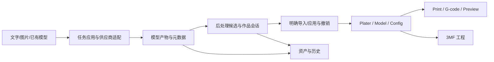

# 产品平台架构与解耦路线

审查基线：2026-11-02，`codex/team/integration` / `09bd370e0dc6e2572069469036d81863591bbab3`。这是当前源码导航与后续路线；图表、编译、自动测试、真实业务和实物打印分别取证。

2026-11-03进展：R1第一步已实现并通过相关自动回归，见下方“配色候选生命周期”。五层地图继续由review-map维护；2026-11-02交互报告及其统计保留为当时的审查快照。

已有边界可以继续保留：Orca 原生核心、AI 契约、智能切片核心各有构建目标；Python 侧车已有应用、能力和供应商适配拆分；账号有 Session / Client / Store；模型库已有 Application。主要问题是生成、后处理和作品操作仍汇集于 GUI 宿主，原生模型、候选、历史与撤销跨多个入口衔接。现状适合继续收紧模块化单体的边界。

能力、源码范围、状态归属、实际构建边界和验证入口的唯一结构化维护源是 [review-map.json](review-map.json) 的 `landscape`。平台首页分为五层、29 个能力，可继续下钻到文件和静态依赖。“目录默认归属”补齐原生大目录导航，单独标注，不能当作逐文件业务审查已完成。

## 五层职责

| 逻辑层 | 职责 | 实际限制 |
| --- | --- | --- |
| 业务工作区 | 原生设计/准备/预览、AI 创作、3D 后处理、资产图库、账号、打印机 | 多个 GUI 类运行于同一桌面产品 |
| 应用编排与业务状态 | 任务、后处理会话、切片建议、模型库命令、身份会话 | 决定步骤、恢复、候选与状态；部分仍依附 GUI 宿主 |
| 契约与接入适配 | 产物/色板/区域 DTO、Orca 适配、AI 提供商、设备与移动 SDK | Ports/DTO 与具体实现分开；接口存在不等于全部消费者已隔离 |
| Orca 原生内核 | Model/几何、CAD、配置/预设、工程格式、切片/G-code、渲染 | 渲染实际依附 GUI，不能视为纯无界面内核 |
| 运行与工程支撑 | 桌面/侧车生命周期、文件/历史、DFX、平台服务、构建/打包 | 涉及多个运行与开发环境，不是一个新的统一服务 |

DFX 按用户确认定义为**诊断、日志、故障定位、性能与可靠性**，横跨各层。可打印性检查属于后处理/切片业务，可以向 DFX 输出证据。Android 参考图提供阅读粒度；允许依赖仍以 Ports、契约、原生适配与集成锁为准，不能根据层的位置自动判断所有依赖是否合法。

## 业务、状态真值与源码

| 业务 | 主要入口/状态归属 | 交接约束 |
| --- | --- | --- |
| AI 文本/图片/模型工作流 | `tools/ai/model_job_application.py`、`model_job_lifecycle.py`、`model_job_repository.py`；GUI 提交/展示在 ModelGenerationPanel / FeatureHost | 确认、供应商 task id、本地 job id、取消和重启恢复分别处理；HTTP Handler 不产生第二套业务规则 |
| 3D 后处理/人像/配色 | `GUI/AI/ModelGeneration/BeautyWorkbenchSession*`、`BeautyWorkbenchTransactionController*`、`PostGenerationWorkbench*`、`GUI/AI/ColorMatching` | 候选、当前作品、预览和历史需区分；颜色、几何与实物打印质量分别验证 |
| 原生导入/应用 | `AI/Contracts/IModelArtifactConsumer.hpp`、`GUI/AI/Orca`、`PlaterWorkbenchImport*.ipp`、`PlaterAITransaction.ipp` | Plater/Model/Config 保有工程真值；明确应用和撤销；侧车不直接修改原生工程 |
| 智能切片 | `AI/SmartSlicing/{Domain,Application,Ports}`、`GUI/AI/SmartSlicing` | revision 约束候选；分析、试切、正式应用与撤销分开；AI 离线保留普通 Orca |
| 账号 | `Redesign/AccountWorkspace*`、`Utils/HonorAccount/{HonorSession,HonorClient,HonorStore}*` | Session 管身份状态；异步 Task 隔离取消/晚到结果；应用配置和用户凭据分开 |
| 模型库/资产 | `Redesign/AssetsWorkspace*`、`ModelLibraryApplication*`、Repository/Loader、`AIModelOutputDirectory.hpp` | 图库、任务产物、草稿、导出副本和 3MF 工程有不同生命周期；默认使用用户数据目录 |
| 打印/设备 | 原生 Print/GCode、PrinterWorkspace/OrcaPrinterAdapter、DeviceManager、SendJob/PrintJob、Honor Forge/Moonraker agent、`orca_mobile_device_sdk` | Honor Forge 使用独立 agent ID，mDNS/受控子网候选通过 Moonraker 探测后进入既有 DeviceManager；UI 只选择导出、仅上传或上传并打印，传输继续由既有 Job 和 agent 执行，raw G-code 与 3MF 能力按 agent 显式声明 |
| CAD/原生编辑 | `libslic3r/CAD`、`GUI/CAD`、Model/Geometry、GLCanvas3D | CAD 文档与求解结果回到原生模型；SLVS/OCCT 版本和构建选项是依赖契约 |

下面是业务语义链路，实际代码通过交互图中的锚点核对：



## 2026-11-10：历史加载反馈与设置栏生命周期

历史请求继续由ModelHistoryOpenRequest拥有，阶段通知绑定代次及不可变的原选择身份，实际解析到的修复副本身份另行传递。GUI过滤过期、重复和取消后的通知；请求保留到后台解析排空，不让取消释放第二次加载资格。显示卡仅呈现阶段／耗时，不拥有第二份模型业务状态。RedesignModelLoadingCard从导入切片原构造提取，两个操作共享样式、尺寸及定位算法，各自保持生命周期和取消操作。

AI设置栏是内容区外的同级控件，普通路由与历史呈现共用显隐规则。保留画面覆盖两者屏幕并集，在其后隐藏设置栏、恢复工作台历史栏并完成最终宽度布局，再验证当前模型的完整帧；回滚先恢复原路由、左栏和模型，再撤过渡画面。最小化隐藏反馈并暂停有效等待，恢复后重新核对；不新增持久化字段或外部API。

## 2026-11-10：工作台呈现与视角导航

结果页进入工作台沿用RedesignPageTransition令牌与现有统一刷新队列。RedesignWorkbenchPresentation只拥有源页面暂存、截止时间及整体揭示；原页转入暂存窗口前先以仅驻内存的完整源页画面遮住原生重挂载空帧，真实源页保留以供回滚，结束即释放画面。PostGenerationWorkbenchHost区分准备与正式presented，原生控件、历史栏及当前模型完整帧提交后通知Shell，再启动既有检查调度。ModelPreview3D的展示通知与人像帧回调独立，拒绝过期模型、布局、尺寸及DPI；最小化不消耗准备预算，失败恢复源页，不新增业务状态或持久化。

View3DNavigator提供不持有相机的共享绘制和坐标映射，切片页继续拥有原生Camera。工作台以独立ImGui上下文适配自身正交相机；ImGuizmo的点击、拖动和插值归各导航实例，切页／锁定／捕获丢失即清理。导航使用工作区独立GL小视口，与底栏底部对齐，不挤动底栏或模型视口；重用模型已提交完整帧的GPU纹理，按真实屏幕交集与上下方向合成底图，避免原生GL窗口的不透明背景遮挡放大模型，底栏区域不采样模型。切模型即清除底图，尺寸不匹配时等待新帧；首帧门控同时核对模型与导航提交。wx按下／松开依序交给各绘制帧，合并连续移动，避免快点击丢失或首次定位误判拖拽。ModelPreviewCameraRotation保留原有yaw／pitch路径，导航后的完整旋转统一供绘制、选区投影与内部视角快照恢复使用；不改变模型几何、历史格式和原生切片相机。

## 2026-11-09：手动人像工作台与首次配置

人像一键编排已删除，进入工作台不再自动串联检查、配色、底座、保存、导入或切片。智能生成仍由 SmartGenerationFlow 与原任务应用承接；入场检查与用户触发的检查修复共用自动复检及原子保存，后续美颜编辑／保存／导入仍由用户明确操作。首次配置以已创建的 RedesignShell 为真实背景，向导只拥有主窗口所属的中央卡片浮层和步骤状态，不再绘制第二套背景导航。浮层跟随主窗口位置与尺寸，阻断背景操作并兼容启动期延迟启用；卡片与宿主均接收取消按键，结束后恢复工作区交互与焦点。既有入场检查、原生分区和配色预览仍由共享工作台承接，不驱动后续整条流程。

共享原生分区和校验不属于已删除流程：`NativeWorkbenchPartition.cpp` 拥有当前模型／修订绑定的分区上下文、取消和凭证恢复；`WorkbenchArtifactValidation.hpp` 提供内容身份和证书验证；`NativeWorkbenchPublication.hpp` 与既有 BeautyMetadata 发布完整原生着色记录。候选、原子保存、历史及撤销仍由既有 BeautyWorkbenchSession／TransactionController 和工作台适配器维护。提交受理结果位于通用 `ModelGenerationSubmissionResult.hpp`。 检查调度独立于美颜耗材匹配资格，历史切换重置旧编辑上下文，视图重入或临时处理结束后补调度；UI 根据当前检查状态展示进度及通过／失败。修复候选只在 Session 内部停留，经拓扑、几何与外观校验后自动原子发布，失败／取消回滚原模型；不再提供候选确认或风险继续入口。CGAL 未达完整验证要求时从不可变原件尝试增强修复，保留增强后的 CGAL 复检，验证限值不变。

手动保存及撤销／重做后重建当前上下文，按真实文件摘要、几何、外观、分区与元数据证书验证后恢复共享凭证；新候选在元数据创建前加载时，保存成功后通过其模型记录恢复，不继承上个模型的凭证。保存版本重开须包含完整语义区域、减色、槽位与着色后检查契约；普通导入沿用原生校验与失败回滚。人像 v12／六色套件仍是共享处理能力。

原色迁移由 `ModelOriginalAppearance.hpp` 维护：零面积来源面不参与最近面查询，颜色索引仍对应原始面；非法索引、非有限坐标或没有有效来源面仍拒绝保存。`PortraitNativePartition.cpp` 对无图片贴图的纯材质模型复用既有材质采样，再进入同一严格修复路径，不降低拓扑、几何或外观门禁。

普通改色保存也在发布事务内检查最终模型，并将完整编辑文档纳入 `saved_model_read_only` 检查凭证；该凭证不能替代原生分区证书。保存退出复用当前身份的检查结果，首次分区不会接管已有配色或原生几何。`WorkbenchModelInspection.hpp` 对旧改色记录逐一验证来源摘要、完整原生证书／精确缓存及全部有序面角点，确认仅颜色变化后恢复原生索引，并沿用原生发布／导入已有的完整拓扑凭证；提交前再次核对整个来源链及候选摘要，取消或变化不恢复。恢复不改写已保存文件、颜色或历史，不匹配仍执行完整检查。`WorkbenchImportTopology.hpp` 复用相同恢复规则，面绘制仍按原面序号保留。此路径的检查结果来自已绑定且重新验证的原生凭证，独立几何重检结果另行记录；两者存在差异时保留诊断证据，不将凭证复用记为独立几何检测通过。

`WorkbenchHistoryEvidence.hpp` 只解析保留的原发布位置：当前／原发布两份模型摘要、两份元数据文件摘要及完整文档均相同，才允许在检查、发布和原生导入中验证原路径绑定的凭证；不重写／重签凭证，也不跨内容继承状态。`ModelOriginalAppearance.hpp` 对缺失伴随文件沿既有摘要绑定来源链恢复原色；已有伴随文件篡改、无效路径、原件变化或取消仍拒绝，重建只发布新的不可变原色伴随文件，不替换模型和历史。

历史模型打开由原模型加载请求管理：`ModelHistoryOpen.hpp`只保存一次请求代次、实际目标、取消与回滚上下文，不持久化业务状态。两处历史入口共用加载完成通知，`RedesignShell`在该请求期间禁止通用状态监听转入结果页；`RedesignWorkbenchPresentation`保留完整原页，目标模型、元数据、凭证、布局和首帧就绪后直接揭示工作台，检查不参与页面就绪条件。工作台内部切换复用同一宿主；失败／超时恢复原模型、视角和页面，关闭或过期结果不能安装。

`ModelHistoryRepairIndex.hpp`由既有历史扫描线程创建，只在内存索引来源关系和历史顺序，不改变摘要缓存或历史格式。它仅提出候选；`ModelHistoryPreview.hpp`在加载线程重新校验逐级来源路径与SHA、成功发布及无循环，并复用`WorkbenchHistoryEvidence`的完整普通／原生凭证校验。同一任务的任务目录／下载目录副本仅在两份路径及内容摘要都匹配时视为同一来源；不跨任务借用摘要相同的成果。具体选中的有效改色版本优先保留，否则取最新可验证修复副本；实际副本身份和通过结果在自动检查前原子安装，不触发重复修复。无有效成果仍走原首次检查，不能用标题、文件名或修复标记授予通过。

侧车仅将旧一键记录识别为不可执行的历史资产，重启不恢复推进；旧专属创建参数明确拒绝，已移除的重试命令返回不存在，不转换成普通生成。历史停止记录保存惰性标记以阻止再次授权，旧图片／模型继续保留。对应架构导航由 review-map 维护；编译／自动回归与实窗、用户视觉及打印验收分别记录于主计划。

历史栏属于宿主展示状态：`WorkbenchHistorySidebar.hpp` 保存 AI 创作页与工作台各自的会话内折叠偏好，临时隐藏、美颜和后台刷新不改写用户意图。共享历史栏的挂载／还原由 `PostGenerationWorkbenchHost` 管理，重复调用不重复加入布局；两页拉手分别固定在各自的原生父容器，避免随隐藏页面迁移，搜索框尺寸以 DIP 保存并按当前 DPI 恢复。工作台按钮与历史栏使用共同外层容器，布局／滚动后按真实侧栏边界定位，收起时保留可见展开入口；展开时仅按需滚动现有工作区。这些状态不写入模型、历史格式或生成任务。

检查卡片属于同一宿主的展示层：`PostGenerationWorkbenchPresentation` 在最终布局后定位并显示，显隐和覆盖区域变化合并为排队补绘；进度更新不冻结整个GL宿主，隐藏编辑控件不触发可见页布局。自动／手动检查共用原有阶段弹层和取消，不改变检查或发布状态所有者。`ModelPreviewFrame.hpp` 仅绑定模型／布局代次、视口和DPI，使绘制、提交及延后完成回调使用同一帧身份；GL仍用既有双缓冲。完整帧经既有GLTexture复制到GPU，原生尺寸事件先等比呈现上一完整帧，再由排队绘制提交新尺寸模型；过渡不完成模型回调，也不替换完整帧，切模型即失效并释放纹理。两页拉手统一复用18×42 DIP尺寸与原绘制资源。

工作台外层滚动／布局、页面展示及窗口恢复共用 `queue_workbench_surface_refresh`，在同一事件循环合并更新，不增加延时定时器。完成最终布局和卡片定位后，原生背景／控件通过一次原生子树批量绘制完成，避免逐控件同步Update；拉手最后置顶并完整补绘，检查浮层首次显示／阶段变化同批绘出，然后提交同一视口的GL完整帧。`MainFrameWorkspace.ipp` 的顶层恢复跳过工作台子树，周边宿主控件也批量绘制；尺寸／最小化恢复共用一个队列，尺寸未变也能恢复。工作台提交后再解除原有恢复遮挡，避免另一套整树Update覆盖刚绘制的拉手。外层滚动容器不再另行递归刷新。`RedesignPaintPanel` 对工作台GL和原生控件均不保存CPU恢复快照，避免重放旧的裁剪内容；GL等比过渡由预览自身持有。拉手只用现有wx绘图缓冲，不叠加原生组合缓冲。重复展示和500ms耗材同步只通过已有 `queue_workbench_check` 补调度缺失检查，不在刷新路径重复读取并哈希整份模型；首次入场／离开重入、保存和导入仍验证内容身份，最小化期间不执行该同步。其他页面恢复绘制沿用原路径。

## 真实进程与构建边界

| 边界 | 源码证据 | 当前实际情况 |
| --- | --- | --- |
| 原生核心 | `src/libslic3r/CMakeLists.txt` | `orca_slicer_core` STATIC / `OrcaSlicer::Core`；大部分几何、配置、格式、切片共用该库 |
| 桌面 GUI | `src/slic3r/CMakeLists.txt` | `libslic3r_gui` STATIC；创作、后处理、账号和资产不是各自一个库或进程 |
| AI 契约 | `src/slic3r/AI/CMakeLists.txt` | `OrcaSlicer::AIContracts` INTERFACE；头文件数据/端口边界 |
| 智能切片核心 | 同上 | `OrcaSlicer::SmartSlicing` / `SmartSlicingCore` STATIC；GUI/原生接入位于 adapter |
| 本地侧车 | AIServiceManager、AISidecarClient、`tools/ai/orca_ai_sidecar.py` | 一个 Python 进程，认证回环协议；版本、运行树和资源需匹配 |
| 设备 SDK | `src/orca_mobile_device_sdk/CMakeLists.txt` | STATIC SDK 与 SHARED C API；协议适配有独立目标，桌面原生 PrintHost 路径仍存在 |
| 移动切片 SDK | `mobile-slicing/CMakeLists.txt` | SHARED SDK 链接 Core/SmartSlicingCore；Windows 桌面编译不证明 Android 已通过 |
| 商业服务端 | [ADR-004](../../docs/architecture/ADR-004-commercial-ai-product-line.md) | 商业 Provider Gateway 属目标架构；当前 Python ModelProviderGateway 是本地适配，不代表计费/权益已服务端化 |

## 旧图审查

用户提供的 [PR #57 历史页面](https://arsenaltj.github.io/OrcaSlicer/pr/57/be5ef60f0dfd12009a82aecf04406f6013306a5c/41414062625/) 及相应 report.json 本轮读取时返回 404。本轮核对该提交的 `review-map.json` 与当前源码，没有宣称完整审阅旧网页、当时报告或运行状态。

旧映射的 77 个锚点及其引用存在以下漂移，已修正：

- `workbench_check` 的函数签名新增 `bool automatic`，旧无参锚点失效。
- `slicing_cloud_ui` 控件已位于 RedesignShell.cpp，原路径失效。
- `gallery` 引用不存在的 `model_gallery` 证据，旧实现会忽略该链接。
- `library_export`、`install_model_storage`、`project_save` 的说明仍指安装目录；当前默认是 `data_dir()/models`，显式环境覆盖与保留迁移原件的规则仍适用。

结论：**导航和说明有局部漂移，原 AI 业务画布可以复用**。这些发现不能单独证明整个产品架构腐化；实际改动风险集中于宿主职责、共享状态和跨链路交接。

## 先优化哪里

已有 ADR-004/005、集成锁、Python 能力拆分、Library Application、账号 Session 和智能切片分层，应沿已有接缝推进。当前 `Plater.cpp` 24,158 行，`ModelGenerationPanel.cpp` 5,181 行、头文件 964 行，`CAD/DesignPanel.cpp` 12,584 行。2026-09-01 至基线提交的非合并历史中，分别出现 139、49、46、52 次文件变更；这包含继承的上游历史，不等于团队新增量，也不是缺陷评分。

| 优先级 | 风险证据 | 优化目标 |
| --- | --- | --- |
| P1 生成/后处理宿主 | Panel 同时依赖生成客户端、Beauty 会话/事务、Library、Preview 和多类元数据；部分实现通过面板成员衔接 | UI 渲染视图状态、发命令；既有应用与会话边界拥有业务规则和状态 |
| P1 原生应用/撤销/历史 | 候选来自工作台/侧车，工程真值在 Plater；关键事务实现位于 `.ipp` | 收紧明确应用、revision 和撤销契约；避免共享数据靠隐含调用顺序保持正确 |
| P1 DFX | AI 已有结构化脱敏日志与 job context，C++ 有原生日志/sidecar request_id，性能和恢复检查分散 | 同次操作从 UI、侧车、产物到原生应用可追踪；错误码、关联标识与版本一致 |
| P2 资产生命周期 | Library Application、job repository、工作台历史和 3MF 各有身份/文件逻辑，输出目录曾发生说明漂移 | 明确 Job / Artifact / Asset / Project 的身份、保存和迁移契约，减少 UI 自行拼路径 |
| P2 原生/CAD 大入口 | Plater、GLCanvas、配置与 CAD 界面持续集中，部分继承自上游 | 按需求拆应用操作和界面事件，再考虑文件/target；保留上游合并路径 |
| P2 构建/运行一致性 | OCCT/SLVS/libdatachannel/CGAL/Python 需匹配，当前仍有 CRT 链接警告 | 固定依赖和产物身份；编译、ABI、运行树、业务与性能分别验证 |

### DFX 四个落点

| 范围 | 已有入口 | 需要补齐的证据 |
| --- | --- | --- |
| 诊断/日志 | `ai_diagnostics.py`、GUI/sidecar 日志 | 可关联的错误码、job/request 标识、源码/运行身份，保持脱敏 |
| 故障定位 | AIServiceManager、AISidecarClient、失败流程回归 | 区分认证、网络、生成、下载、导入和原生应用失败，UI 提示能定位对应请求/阶段 |
| 性能 | SmartSlicing PerformanceAcceptance/资源预算、质量回归脚本 | 固定样本、硬件、配置、版本下的耗时/内存基线，再确定可执行阈值 |
| 可靠性 | Job 恢复、晚到响应保护、会话事务、撤销 | 取消、超时、重启、损坏文件、过期候选和重复应用的明确结果及回归 |

### 分阶段实施与验收

| 阶段 | 范围 | 完成标准 |
| --- | --- | --- |
| R0 已完成 | 平台地图、旧图审查、源码/验证入口、防漂移检查 | 能下钻；路径/引用可检查；目录默认与静态解析覆盖公开；方法和路线可复核 |
| R1 首步已完成 | 配色候选生命周期已收口；继续以 BeautyWorkbenchSession/TransactionController 为接缝，处理生成/保存副作用和视图状态 | 状态由一个会话拥有；UI 按视图状态展示；成功、取消/失败、过期结果有定向回归；操作与结果保持兼容 |
| R2 接续 | 原生导入/应用与撤销 adapter | 校验目标/revision、明确提交；撤销/重做及相关 3MF/历史往返验证；普通 Orca 兼容 |
| R3 接续 | DFX 操作链路和性能基线 | 跨 C++/Python/产物可定位；分类和脱敏一致；固定样本可复现性能和失败恢复 |
| R4 随资产需求推进 | 身份与生命周期 | UI 不另写 repository 规则；迁移/导出保留原件；旧记录可读；任务、作品和工程身份明确 |
| R5 商业能力 | 权益/配额/计费与服务端策略 | 单独落实服务端契约；不把登录或本地 Router 当作商业闭环完成 |

R1的首个用例已推进如下；R1其余职责和R2—R5继续作为后续路线。每次选一个可验证用例，继续遵守 [ADR-005](../../docs/architecture/ADR-005-guarded-incremental-ai-decomposition.md) 的增量拆分与预算。

### 2026-11-03：配色候选生命周期

本子步围绕“生成候选→接受/放弃→撤销”，沿用既有Session和TransactionController收口规则：

| 归属 | 当前职责与入口 |
| --- | --- |
| [BeautyWorkbenchSession](../../src/slic3r/GUI/AI/ModelGeneration/BeautyWorkbenchSession.hpp) | 私有保存草稿基线、撤销/文件检查点、候选与已发布文件清单、草稿revision；start_draft、complete_accept、discard统一改变这些状态 |
| TransactionController | 处理锁、操作历史和撤销/重做；接受后把本轮草稿编辑合并成一条可恢复的接受记录，较早历史继续保留 |
| Panel与现有适配代码 | 捕获/恢复真实预览快照，保存模型/元数据，校验并提交原生耗材配置，呈现操作结果；这些副作用仍在宿主，完整后处理尚未独立成库 |

Panel不再直接写上述五项生命周期状态的引用。进入配色、局部改色、候选生成、修复及耗材保存等共享调用点均通过Session建立检查点；保存完成回调同时校验面板序号、发布句柄与草稿revision。

放弃时先校验并恢复基线，恢复成功才截断草稿历史和移除未接受文件；失败保留候选与两条历史时间线。耗材应用失败时保留的恢复快照会移除本次未提交的原生配置，后续重试不会因此恢复旧的工程配置。已发布模型及会话拥有的原始外观载体在关闭时继续保留。

验证：Windows Release的GUI库和slic3rutils测试目标编译通过；新增[会话回归](../../tests/slic3rutils/test_beauty_workbench_session.cpp)8项，相关消费者共286项通过（50.08秒），覆盖接受/放弃、取消/保存失败、过期/重复回调、恢复失败、历史及文件保留。新增8项另以随机顺序、同一进程通过109条断言。AI集成守卫（Git未跳过）、92锚点/29能力映射、README同步和diff检查通过。

证据：`.tmp/dev/logs/20261103-110521-993/result.json`、`.tmp/dev/logs/20261103-112919-609/result.json`、`.tmp/dev/architecture-r1-20261103/verification.json`。应用EXE/DLL构建、独立安装及运行树/Python检查通过，共19,642个安装文件；产物位于`.tmp/dev/architecture-r1-20261103/run/`。原运行目录刷新时检测到占用进程，保留该目录和进程。原生身份与受测版本一致，未启动新应用。编译保留原有CRT链接警告；真实主窗口操作、真实服务与实物打印尚无本轮验收结论。后续应继续处理候选生成/持久化副作用与视图状态的边界，再按R2推进原生应用/撤销契约。

## 方法与 GitHub 工具调研

[C4](https://c4model.com/diagrams) 用上下文、组件、动态链路和代码组织阅读层次；本项目补上状态真值、真实 target、验证入口和覆盖缺口。按 [improve-codebase-architecture](https://github.com/mattpocock/skills/tree/main/skills/engineering/improve-codebase-architecture) 的方法，先定位高频改动与理解成本，再沿已有接缝形成小接口、深封装；目录迁移本身不是完成标准。

| 工具/方法 | 本项目价值 | 选择 |
| --- | --- | --- |
| [code-review-graph](https://github.com/tirth8205/code-review-graph) | 已有固定版本代码关系与反向两跳影响分析 | 继续复用 2.3.8，不建立第二个架构事实源 |
| [GitNexus](https://github.com/abhigyanpatwari/GitNexus) | query/context/impact/trace 与 diff 影响查询，适合开发检索试验 | 暂不替换流程。官方 analyze 默认写上下文/skills/hooks；后续试验先独立环境 `--index-only`，验证 C++/Python 覆盖、歧义、Windows 成本和新鲜度 |
| [Import Linter](https://import-linter.readthedocs.io/en/stable/contract_types.html) | forbidden / independence / layers 表达 Python 允许依赖，包括间接导入 | 借鉴规则。现有 verify_ai_integration 已管部分循环/反向依赖，先补具体缺口；不能代替 C++ include/target 检查 |
| [CodeCharta](https://github.com/MaibornWolff/codecharta) | 规模、改动、复杂度等热点可视化；官方 gate 标为实验功能 | 可选仪表板，先验证本仓语言/输入支持，不作为新强制依赖或业务真值 |
| [Archify](https://github.com/tt-a1i/archify) | 已有固定版本、布局校验与离线导出 | 继续用于可读图表；布局与代码正确性分别报告 |

未安装上述三个新工具、写全局 hooks/MCP 或上传源码到新服务。工具图谱仍需结合协议、事件、共享数据和回归，不能承诺影响零遗漏。

## 开发时怎样用

1. 找业务能力，确认状态归属和原生修改 adapter。
2. 从配色/供应商/账号/资产/切片等需求检查清单出发，再沿源码与静态关系找消费者。
3. 在状态所有者中改规则，UI、HTTP 和组合入口只做各自适配，避免第二份业务状态。
4. 选择实际相关的成功、失败、恢复和消费者回归；两跳影响不是测试范围上限。
5. 维护变化的映射并检查，普通需求不需要重画全部布局。

```text
python scripts/architecture_review.py --check-map
python scripts/architecture_review.py --readme update
python scripts/architecture_review.py --readme check
python scripts/verify_ai_integration.py --json
```

报告沿用 `dev.ps1 Review` 或 `architecture_review.py --base HEAD --worktree`；环境准备见[架构评审](../coordination/architecture-review.md)。PR 使用实际 base/head。`--check-map` 以标准库检查锚点、引用、代码/测试路径和层级，不能证明说明语义仍正确。

## 覆盖与验证边界

文件/哈希清单覆盖全平台选定语言；符号解析聚焦 AI、账号、重设计界面、SDK 和部分原生边界头文件，范围由 `index_scope/index_exclude` 版本化。关键 `.ipp` 有入口与文件身份，尚无完整符号关系；资源、依赖和非选定语言不纳入源码计数。

R0全平台符号解析试跑的临时 SQLite 超过 1 GiB 仍未完成，已主动停止，不能作为完整图证据。2026-11-02快照的866文件范围首次图生成约151秒，解析出6,128条跨文件关系，另有163,159个未解析端点。后者包括外部库、同文件符号和无法消歧调用，不能换算成正确率，也不能把没有连线的文件当成安全。

R0前的Windows Release基线编译/安装/运行身份/Python检查通过，见`.tmp/dev/logs/20261102-160809-960/result.json`。R0仅改文档、映射与报告工具，没有重复编译产品；2026-11-03的R1原生构建与回归见上述用例记录。真实GUI、提供商、移动端与实物打印仍独立验证。

R0工具回归、离线交互回归、集成检查和图表回执随本地交付保留。内置浏览器安全策略禁止代理直接打开`file://`报告，因此交互页面无浏览器实测结论；离线DOM回归只证明导航逻辑。R0平台独立概览图已检查四种桌面尺寸、浅/深色和截图。全部改动保留本地，后续产品拆分按实际用例推进。
