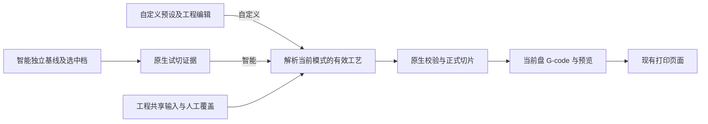

# 切片工作台软件开发方案与测试用例

主线 `MAINLINE-BUGFIX-001` · 2026-11-20 已批准实施与验收

实施基线为 `codex/team/integration` 的本地工作树，HEAD `63a1e34401`。审批对象是首批 `REQ-01` 至 `REQ-07` 和对应测试。`REQ-08` 及档位收益、窄盘求位和等待时间优化按现有顺序跟进。本文是实施方案及测试定义，产品验证从批准实施后的匹配构建起计。 [定稿需求](2026-11-20-workbench-slicing-requirements.md) · [主计划](2026-09-25-product-convergence-and-lightweight-plan.md#smartslice-next-fixes-review-20261120)

## 一、首批交付判定

用户可以在同一工作台用自定义 `0.20 mm` 和智能质量 `0.12 mm` 分别切片。从任一标签保存工程后，两个标签分别恢复工艺。质量档正式出片后切回速度档时，速度档使用自己的层序和结构参数。多色盘在工艺改变后识别自动塔位，有可验证落点则按新位置出片。两种方式均通过同一个打印入口交接当前盘的有效 G-code。

首批自定义面板覆盖工程级全局工艺、简单／高级／专家显示、匹配机型及喷嘴的工艺预设和参数搜索。工程中已有的盘、对象、零件和分层覆盖继续按原生规则读取。首批包含当前工作台对应的样式、失败恢复和打印交接，已有设备发现与发送流程作为下游消费者进行回归。

## 二、现有实现与改动接缝

| 接缝 | 当前行为 | 拟改动 |
| --- | --- | --- |
| 标签、布局和命令 | 切到「Orca 原生」会展开旧侧栏并隐藏工作台共用操作。切片按钮和工作台快捷键已有不同分支。 | 标签驱动左栏的内容切换。工作台按钮和快捷键走同一入口，向正式切片流程传入当前模式。保留工作台画布与结果预览路由。 [标签](../../src/slic3r/GUI/Redesign/RedesignModelWorkflow.cpp#L2216) · [共用按钮](../../src/slic3r/GUI/Redesign/RedesignModelWorkflow.cpp#L2781) · [快捷键入口](../../src/slic3r/GUI/MainFrameWorkspace.ipp#L1135) |
| 原生全局工艺编辑 | `ParamsPanel` 的标题区和参数区分别挂在原生侧栏，`TabPrint` 使用 `PresetBundle::prints` 并驱动原生预设通知。 | 调整原生面板挂载点并提供工作台布局适配。复用工艺选取、字段定义、校验及搜索，监听有效的项目参数变更。 [现有挂载](../../src/slic3r/GUI/Plater.cpp#L3578) · [原生字段](../../src/slic3r/GUI/Tab.cpp#L3018) · [预设变更](../../src/slic3r/GUI/Tab.cpp#L2809) |
| 试切和正式输入 | 试切捕获有效配置和工程对象，正式原生流程从 `PartPlate`、预设集合和背景切片器读取配置。背景切片器会合并一次盘级配置。 | 统一两个入口构造有效输入的规则。在背景切片器接缝明确盘覆盖的合并位置，保证读入已核对的有效工艺。默认调用沿现有原生入口。 [试切捕获](../../src/slic3r/GUI/AI/Orca/OrcaSmartSlicingAdapter.cpp#L346) · [盘有效配置](../../src/slic3r/GUI/PartPlate.cpp#L3907) · [原生配置合并](../../src/slic3r/GUI/BackgroundSlicingProcess.cpp#L749) |
| 智能工艺应用和取消 | 现有轻量应用将盘补丁和变层高写入工程，切片完成后按有效配置刷新建议。事务以原生撤销快照做恢复。 | 从独立智能基线生成候选。将已应用的智能覆盖和人工工程覆盖分开记录，切片输入按当前模式选取。复用精确事务快照和结果回调。 [应用事务](../../src/slic3r/GUI/AI/SmartSlicing/SmartSlicingFeatureHost.cpp#L1783) · [回滚](../../src/slic3r/GUI/AI/SmartSlicing/SmartSlicingFeatureHost.cpp#L1879) |
| 塔位来源 | 试切后的坐标写入会使用默认来源，3MF 加载也会把已保存的塔位设为固定。 | 写坐标时显式传递来源，将本次任务的落点约束和工程的自动／固定标记分别管理。3MF 读取按有无可靠来源恢复。 [应用坐标](../../src/slic3r/GUI/AI/SmartSlicing/SmartSlicingFeatureHost.cpp#L1849) · [坐标写入](../../src/slic3r/GUI/PartPlate.cpp#L6348) · [旧工程恢复](../../src/slic3r/GUI/PlaterNativeWorkspace.ipp#L2) |
| 3MF 和打印资格 | 3MF 已有原生盘级工艺字段及对象层高曲线。打印入口依赖当前盘的原生切片结果。 | 扩展项目序列化，存取两套已确认工艺和塔位来源。工作台及打印消费者共同核对当前盘、工艺与正式产物。 [既有 3MF 字段](../../src/libslic3r/Format/bbs_3mf.cpp#L411) · [导出入口](../../src/slic3r/GUI/Plater.cpp#L20614) · [打印状态](../../src/slic3r/GUI/Redesign/OrcaPrinterAdapter.cpp#L91) |

## 三、工艺状态、配置优先级与任务身份

### 3.1 归属及写入时机

| 内容 | 状态归属 | 更新规则 |
| --- | --- | --- |
| 模型、盘、机型、喷嘴、耗材及映射，含人工局部覆盖 | Orca 工程、`Plater`、`PartPlate`、`PresetBundle` 中现有状态 | 通过原生工程操作或已有设置入口变更。各模式根据实际输入重新校验。 |
| 自定义全局工艺 | 原生 `PresetBundle::prints` 的工程所选预设与已编辑值 | `TabPrint` 按现有规则提交编辑。切换标签恢复该预设与修改值。工程读写保留选择和项目修改。 |
| 智能工艺基线及候选 | 工程绑定的智能基线快照及 `SmartSlicingFeatureHost` 的推荐会话 | 新建或加载工程时建立兼容基线。现有 3MF 可从读入的原生工艺建立初值，随后各模式独立维护。机型、喷嘴或耗材变化时用原生兼容规则重新验证基线。 |
| 已应用智能工艺及生成曲线 | 当前工程的对应 `PartPlate`，曲线关联盘内对象并记录来源 | 针对所选档、当前输入的已确认试切证据应用。正式成功后提交，失败或取消按该次事务回滚。新候选从智能基线生成。 |
| 塔位坐标、旋转和来源 | 现有工程塔位与 `PartPlate` | 人工拖动按固定位置写入。系统摆放按自动位置写入。当前任务的落点、补试次数随任务身份管理。工程保存、撤销和重做包含塔位来源。 |
| 当前标签、可见字段、报告和提示 | `RedesignShell` 及现有切片工作台状态 | 展示模式、三档建议、实际有效字段及任务状态。发出选择、编辑和正式切片命令。 |
| 预览和正式结果 | 原生 `Print`、`PartPlate` 及现有 `NativeSliceSession` | 以任务提交的身份关联有效工艺和原生结果 ID。工作台按钮、打印页入口及发送前复核使用同一判定。 |

### 3.2 一次解析，两条业务入口

1. 以当前工程和盘绑定机型、喷嘴、材料、耗材映射和床面条件，复用原生完整配置组装。工艺部分按模式选取。自定义使用原生所选预设与编辑值，智能使用独立基线和所选档的试切效果。智能基线在工程进入可编辑状态前建立，以免首次点击智能标签时捕获已修改的自定义值。
2. 先把所选工艺合入原生工艺层，再按原生顺序处理真正的盘级、对象、零件和分层设置。用户层高和支撑覆盖作为约束交给智能试切。系统生成的曲线作为对应智能方案的输入，使用盘和对象身份定位。接在现有 `Print::apply` 读取模型配置的位置，采用只读的当前任务覆盖，保证同一模型在其他模式或盘仍使用其人工参数。配置组装与曲线解析的输入为原生值类型，依赖方向从工作台适配器指向 Orca 原生。
3. 以当前盘、有效参数、完整摆放与塔位、模型及耗材状态计算任务输入身份。推荐侧另记录所选档和尝试代次。建议层高可共享分析。试切统计、失败原因及可应用状态随身份匹配，只有选中档提交完整试切。相同的原生工艺可按现有规则复用，命中时核对证据适用的档位与输入。
4. 自定义「开始切片」按原生工艺和盘规则校验。智能「开始切片」先比对所选档试切证据，单独移动塔位走既有位置复核。正式流程接收已解析的输入，通过现有 `Plater::reslice`、后台切片和事件回调完成出片。工艺校验、塔检查、速度表、试切、正式和结果有效期核对使用同一组装口径。 [完整配置](../../src/libslic3r/PresetBundle.cpp#L5539) · [正式切片回调](../../src/slic3r/GUI/PlaterAIFeatureHosts.ipp#L52)

### 3.3 正式结果与失败恢复

- 按钮和快捷键经现有工作台路由发起一次切片。保留忙碌及导航守卫。选中标签和有效输入跟随本次任务，试切和正式回调分别按任务身份接收。工作台随现有事件展示进度、取消、错误和成功预览。
- 浏览两标签时允许展示最近有效的 G-code，侧栏标明实际出片来源和层高。预览和正式统计绑定原生结果 ID。打印资格核对当前盘、当前有效工艺和原生校验结果。有效工艺变化时，旧产物按其实际匹配状态处理。打印页入口和发送前复核走现有打印守卫。 [正式切片会话](../../src/slic3r/GUI/AI/SmartSlicing/SmartSlicingFeatureHost.cpp#L2823) · [打印页面入口](../../src/slic3r/GUI/Redesign/RedesignModelWorkflow.cpp#L1945) · [发送前复核](../../src/slic3r/GUI/Redesign/OrcaPrinterAdapter.cpp#L431)
- 在提交智能效果或提交自定义任务中的自动塔位变化前建快照。快照涵盖两种工艺的相关工程状态及塔坐标和来源。快照基于用户已提交的手工编辑。启动失败、取消或输出失败时，以工程、盘和事务身份恢复。相同输入的已验证工艺可按现行规则重试。撤销／重做后从工程状态重新核对正式结果。原生自动重切调度需要识别工作台操作。编辑、浏览标签及预设联动以重新校验当前盘为止，正式任务由共用开始入口受理。 [原生撤销复原](../../src/slic3r/GUI/PlaterUndoRedo.ipp#L236)

## 四、页面接入

1. 抽出工作台页签内容区。将现有「Orca 原生」入口改成「自定义切片」，在当前左栏挂载全局工艺面板和工艺标题。原生面板的创建、销毁、激活及恢复归当前宿主持有，标题区和内容区的挂载都纳入同一次更新。视图、当前盘和共用按钮由现有工作台布局持有。 [工作台控件构建](../../src/slic3r/GUI/Redesign/RedesignModelWorkflow.cpp#L529) · [第二个原生挂载点](../../src/slic3r/GUI/Plater.cpp#L3655)
2. 复用 `TabPrint` 全局工艺类别、选项依赖和原生搜索。首次进入的显示级别在工作台面板范围内初始化为简单。高级和专家按原生选项可见性展开。切换显示级别和往返标签时，已提交的字段值随自定义工艺保留。预设选择使用现有兼容筛选与修改值处理，搜索定位结果在当前左栏打开。工艺行由预设下拉和参数搜索组成，工程保存沿上方 3MF 入口。
3. 将当前工作台主题应用到输入框、下拉及弹出列表、分组文字、滚动区、搜索、选中与错误状态。以当前窗口尺寸和现有控件规范为参照，实际检验窄侧栏的文字截断、滚动、下拉定位和键盘焦点。打印机发现与发送确认在打印页面验收入口交接。

## 五、3MF 和擦料塔

### 5.1 3MF 兼容与恢复

- 复用原生 3MF 存取流程。在同一文件增加带版本的工程扩展记录。工程级记录包含自定义预设标识、有效项目修改和恢复智能基线所需数据。盘级记录包含已应用智能档及其工艺、曲线来源和塔位来源。对象引用走现有 3MF 对象与盘成员映射，在载入时解析到新工程对象。运行期任务编号和切片资格由当前输入重新核验。 [导出参数](../../src/libslic3r/Format/bbs_3mf.hpp#L216) · [现有对象曲线写入](../../src/libslic3r/Format/bbs_3mf.cpp#L8371) · [盘数据写入](../../src/slic3r/GUI/PartPlate.cpp#L8413)
- 从任一标签保存都取两套已确认工艺。标准工程条目写入原生工程及自定义预设有效值，人工覆盖和人工曲线保留原生表示。智能基线、已应用智能工艺及曲线来源保存在扩展。原生 3MF 读取基础项目后再应用可识别的扩展。无扩展的旧文件用其原生工艺及人工设置初始化。扩展版本未知或某条数据损坏时保留可读原生设置，并按原生错误提示和当前有效输入处理。
- 载入时校验工艺字段类型和原生允许范围、对象映射、曲线数据及塔位来源。恢复后从两个标签读取各自参数。显式「保存工程」沿现行项目归档方式恢复工艺，用户发起重新切片后取得当前产物。对于现有可附带 G-code 的导出，交接时按对应盘、实际切片工艺及文件身份核验。数据映射和撤销均核对盘、对象及来源。 [盘数据读入](../../src/slic3r/GUI/PartPlate.cpp#L8528)

### 5.2 自动塔位按当前工艺重摆

1. 拆开当前任务采用的坐标和工程自动资格。正式应用智能效果时以证据中的坐标为本次已验证落点，同时把系统来源传给盘。后续换档、切换模式或重开新 3MF，自动标记由盘状态恢复。没有可靠来源的旧记录按固定塔位处理。人工拖动按现有操作写成固定并保留旋转。
2. 复用 Orca 对估算及生成塔底的校验与求位。智能保持一次正常试切，估算校正计入首次尝试，实际塔底触发的完整补试上限为一次。智能正式切片校验已经试切的落点。自定义沿原生预检，若自动位在生成塔底后冲突，拟在同一正式任务内作一次恢复。实际塔底校验在输出 G-code 前完成，后台处理只产出当次的实际轮廓或求位候选。工程线程在当前任务仍有效时校验候选及来源，再写入坐标并复用原生切片。期间保留同一事务快照和共用进度。恢复次数计入本次任务，重试失败统一回滚。证据过期、手工固定位置、无验证通过的落点按原生错误路径结束。 [原生预检入口](../../src/slic3r/GUI/PlaterNativeWorkspace.ipp#L8) · [实际塔底校验](../../src/libslic3r/Print.cpp#L5903) · [试切补试调度](../../src/slic3r/GUI/AI/SmartSlicing/SmartSlicingFeatureHost.cpp#L1024) · [正式出片阶段](../../src/slic3r/GUI/BackgroundSlicingProcess.cpp#L223)
3. 以实际塔底及扩边、旋转后轮廓复核真实热床、喷嘴共同可达范围、禁打区和首层模型及支撑。成功结果才进入导出完成和打印就绪状态。错误区分手工坐标冲突与自动搜索未得到合规落点。撤销、重做和失败恢复同时核对坐标及来源。

## 六、实施顺序与每阶段验证

| 阶段 | 实施和改动范围 | 阶段验证 |
| --- | --- | --- |
| 1 工艺解析与串档补修 | 在 `PartPlate`／Orca 适配层建立工艺分离和统一输入。更新智能基线、曲线来源、试切与正式应用接缝。 | 工艺独立、人工覆盖、双向换档、证据身份定向回归。对应 TC-05 至 TC-09。 |
| 2 正式流程与擦料塔 | 更新工作台正式路由、背景切片输入和结果发布，接入自动塔位来源及有界恢复。核对导出与打印资格消费者。 | 正式回滚、任务过期、自动及固定位置、无解夹具和实际塔底校验。对应 TC-10 至 TC-14、TC-19 至 TC-24。 |
| 3 工程保存与撤销 | 扩展既有 3MF 存取、盘与对象关联和工程快照。 | 从任一标签保存，兼容旧工程，读入错误处理和盘级关联。对应 TC-15 至 TC-18。 |
| 4 工作台面板与联合验收 | 挂载原生全局工艺面板，补齐样式、搜索、显示级别。用匹配 Windows 运行树走用户路径。 | TC-01 至 TC-24 依据用例列出的证据类型执行。实窗用例使用当前工作台入口及现有打印页面。 |

开发使用本 checkout 的 `dev.ps1` 和 `.tmp/dev/{build,run,data}`。源码与产物身份按现有规则记录。契约、架构接缝或运行时变更按 `python scripts/verify_ai_integration.py --json` 校验。模块归属或锚点变化时同步既有维护说明及 `review-map.json`，并运行 `python scripts/architecture_review.py --readme update`。 [快速开发入口](../coordination/quick-development.md) · [文档同步](../coordination/documentation-sync.md) · [测试规则](../../tests/AGENTS.md)

## 七、测试环境和证据口径

- 用户路径在 Windows 真实工作台验证，使用匹配的 EXE、DLL、资源和侧车，独立配置、原件副本及原有预设。打印交接检查到现有打印页面的输入和使能状态。
- 轻件可用仓库 `20mmbox-LF.stl`。工艺下拉使用 WonderMaker ZR Ultra 适配 `0.2 mm` 喷嘴的预设。双向工艺测试另选支持 `0.20 / 0.12 mm` 的 `0.4 mm` 喷嘴配置和无局部覆盖的恒定层高控制件。用选定工艺确定期望层序，分开核对首层、常规层和末层。智能变层高用现有适用曲面样本。人工设置、双盘、多色姿态、边缘塔位及无位样本沿既有验收资产取副本。 [轻件样本](../../tests/data/test_stl/ASCII/20mmbox-LF.stl) · [预设样本](../../resources/profiles/WonderMaker/process/fdm_process_wm_0.12_nozzle_0.2.json) · [既有样本与验收](2026-11-20-smartslice-tower-and-on-demand-plan.md)
- 记录模式、盘、档、有效参数、任务身份、实际试切次数、G-code 结果 ID、层序、耗材统计、塔坐标及实际塔底。在需复验的配置和模型副本上记录源及产物身份。用 G-code 层高／层序、原生统计与相关配置作断言。塔位断言依据轮廓是否合规及来源是否正确。
- 工艺、试切及工作台状态从现有 `slic3rutils_tests` 用例扩展。3MF 和几何沿现有 `libslic3r_tests`，新增原生 G-code 或背景行为用例按 `tests/AGENTS.md` 选择对应测试组。编译、自动化、实窗和实物分别登记。 [工艺试切用例](../../tests/slic3rutils/test_smart_slice_applier.cpp) · [工作台定向用例](../../tests/slic3rutils/test_ui_redesign.cpp) · [3MF 用例](../../tests/libslic3r/test_3mf.cpp) · [塔位几何用例](../../tests/libslic3r/test_wipe_tower_estimate.cpp)

## 八、首批测试用例

| 编号 | 需求与验证 | 前置条件与操作 | 通过标准 |
| --- | --- | --- | --- |
| TC-01 | REQ-01 · 实窗 | 导入轻件并进入切片。智能、自定义往返切换三次，记录打印盘、模型画布、页签、返回及保存按钮。 | 两页签在同一工作台切换，模型及当前盘一致，共同操作可用。浏览标签触发的正式切片次数为零。 |
| TC-02 | REQ-02 · 定向＋实窗 | 首次打开自定义。简单设置改一个可编辑值，依次切高级、专家再回简单。往返智能后复核。 | 首次为简单设置。三档按原生等级逐级显示选项。已选预设与自定义修改值在往返后保留。 |
| TC-03 | REQ-02 · 定向＋实窗 | 使用适配 0.2 mm 喷嘴的工程，切换 0.10 mm Standard 和 0.12 mm Draft。比较载入的工艺，搜索「层高」并定位。用原生设备设置改变喷嘴再查预设列表。 | 选中的整套工艺参数来自对应预设，工程喷嘴由设备配置决定。兼容列表随配置刷新。搜索定位原生字段，工艺下拉旁只有搜索入口。 |
| TC-04 | REQ-01、REQ-02 · 实窗 | 在常规和窄侧栏窗口以常用及高 DPI 设置查看质量、强度、速度、支撑、多材料和其他类别。操作下拉、搜索、滚动和键盘，使用原生支撑联动及一个校验错误。 | 当前主题下文字、下拉列表和状态可读，各控件可操作。字段联动、禁用与错误反馈符合原生编辑规则。 |
| TC-05 | REQ-03 · 定向＋实窗 | 在同一受控输入下以自定义 0.20 mm 和智能质量 0.12 mm 参数分别切片。顺序自定义→智能→自定义，记录参数、有效层序和正式统计。 | 各自恢复预设和编辑值。正式结果对应发起模式。核对正常层高和首层，证明两套工艺独立。 |
| TC-06 | REQ-02、REQ-03 · 定向＋实窗 | 打开包含真实盘、对象、零件或层范围覆盖的工程，将自定义全局层高改为不同值。切片并核对有覆盖与继承全局的对象。 | 工程已有局部覆盖按原生顺序生效。全局继承对象采用新值，详情及实际层序能区分两类来源。 |
| TC-07 | REQ-03、REQ-04 · 定向＋实窗 | 先改自定义工艺再首次进入智能。随后变更当前盘两模式实际使用的机型、喷嘴、耗材或映射。对照变更前证据。 | 首次智能使用独立兼容基线。物理输入变化后，两套工艺按实际依赖重新校验，旧试切或不匹配的产物无法取得当前资格。 |
| TC-08 | REQ-04 · 定向＋实窗 | 适用变层高的模型先直接切速度并记录，再在同源副本正式切质量后切速度。并测速度→质量及保存重开后换档。分别固定机型、喷嘴、耗材、模型和摆放，使用恒定塔位或无塔样本对照。 | 相同输入下，后选档的有效层高曲线、壁数、填充、速度、支撑和切片统计与直接选择该档的工艺一致。用户人工层高与支撑设置按原生规则保留。 |
| TC-09 | REQ-04 · 定向＋实窗 | 首次进智能、只选一档并记录试切数。定向测试控制旧结果在取消、换档或关闭工程后才返回。实窗使用真实试切执行取消、切换到新输入并复验。 | 三档建议层高就绪后可见。完整试切只服务选中档。旧回调的统计、提示及资格无法覆盖当前输入。正常样本每次有效输入一次完整试切。 |
| TC-10 | REQ-04、REQ-05 · 定向＋实窗 | 智能档在预估中、失败和受控超时条件下尝试开切，取消后修正条件或重试。另在合法自定义工艺下发起正式切片。 | 智能只在所选档具备有效证据或已通过现有位置复核时开切。自定义用原生校验进入正式切片。每次有效开切只启动一个正式任务，侧栏显示对应模式的状态。 |
| TC-11 | REQ-01、REQ-05 · 定向＋实窗 | 两个标签分别用按钮和工作台快捷键开始切片。在运行中重复触发，再从共用入口取消。 | 每个有效操作只启动一个正式任务。快捷键与按钮采用相同的参数来源和门槛。进度、取消和失败提示在同一工作台呈现。 |
| TC-12 | REQ-05 · 定向＋实窗 | 先正式切完智能，再仅浏览自定义标签。改变自定义有效层高并重新切片。在两种成功结果上分别点击「去打印」。 | 浏览时能识别最近结果来自智能。旧预览和统计保留其来源，打印资格与当前工艺匹配。重新出片后由新产物更新，两个标签均进入现有打印页面。 |
| TC-13 | REQ-05、REQ-07 · 定向＋实窗 | 保存应用前的人工工艺和塔位。分别触发启动拒绝、正式取消和隔离输出文件锁导致的失败，解除异常后重试。 | 对应事务恢复到应用前状态，人工已提交编辑和塔位来源可核对。失败产物不可打印。修正后以当前输入取得正式结果。 |
| TC-14 | REQ-05 · 定向＋实窗 | 正式结果有效时触发一个影响工艺或摆盘的变更，再尝试打开打印页面。用越界路径样本核对已切片但错误的状态。 | 预览与正式统计绑定当前结果。过期或越界产物无法通过“去打印”及下游守卫，合法出片后恢复。 |
| TC-15 | REQ-06 · 定向＋实窗 | 同一工程的自定义预设带实际修改值，智能已有一套已应用的工艺及曲线。分别从两个标签另存 3MF，关闭、重开并各切一次。 | 每份 3MF 分别恢复自定义预设、修改值与已应用的智能工艺。人工与系统层高曲线来源正确，实际结果对应各自工艺。 |
| TC-16 | REQ-06、REQ-07 · 定向＋实窗 | 打开无新扩展的旧 3MF，包含原生项目工艺、对象或层覆盖及非零旋转的塔坐标。切换标签并保存重开。 | 旧工程的原生工艺及人工覆盖可读，塔坐标和旋转保持兼容。无可靠来源的旧塔位按固定位置恢复。 |
| TC-17 | REQ-06 · 定向 | 用夹具改变扩展版本、损坏单条工艺值或对象关联，分别加载。对照同文件的有效原生工程数据及切片状态。 | 有效的原生工程数据可继续读入。异常扩展产生可诊断结果，无法据此使用错误工艺或获得打印资格。 |
| TC-18 | REQ-06、REQ-07 · 定向＋实窗 | 双盘各有不同的智能工艺或塔位来源，工程自定义全局工艺带修改。保存重开，往返切盘并核对盘成员和曲线目标。 | 工程全局工艺恢复一次。每盘的已应用智能工艺、曲线和塔位来源映射到正确对象与打印盘。双盘缓存隔离由后续用例验收。 |
| TC-19 | REQ-04、REQ-07 · 定向＋实窗 | 多色盘用自动塔位先正式切速度，再切质量。在反向和 3MF 重开后各验一次，选择已知有合法落点的摆盘。 | 系统塔位经过正式应用和重开仍为自动。会按当前工艺保留合法位置或重摆。正式实际塔底合规，智能完整补试至多一次。 |
| TC-20 | REQ-05、REQ-07 · 定向＋实窗 | 在自定义切片用有效多色工艺扩大实际塔底，使自动位置出现冲突并存在可用落点。触发原生正式切片。 | 自定义流程从原生入口检查实际塔底。对应任务中使用验证过的新坐标并完成出片，记录初始或补救结果。 |
| TC-21 | REQ-07 · 定向＋实窗 | 对同一多色工程把塔设为合法手工位置和非零旋转。切换两模式和三挡，另存后重开。再改变工艺使原固定位置冲突。 | 合法时坐标和旋转保留。出现冲突时提示调整固定位置，问题结果不可打印。 |
| TC-22 | REQ-07 · 定向＋实窗 | 用真实有凹口的热床轮廓、禁打区、多喷嘴共同可达区及被模型占满的盘做夹具。另测塔底扩边或旋转跨界。 | 校验完整实际轮廓。遇到无可验证落点时给出对应诊断，重试次数在约定边界内，未通过几何校验的结果不可打印。 |
| TC-23 | REQ-04、REQ-07 · 定向＋实窗 | 智能已有有效证据，单独拖塔至合法位置、冲突位置，再拖回。核对位置校验、正式 G-code 和试切次数。 | 工艺证据按现行条件复用。合法位置变化更新坐标和老产物资格，适用时不增加完整试切。冲突位置拦截，正式结果使用新坐标。 |
| TC-24 | REQ-05、REQ-07 · 定向＋实窗 | 记录自动塔位，人工移动后开始应用再取消。随后撤销、重做这次手工移动并再次正式切片。 | 取消回到本次应用前的人工位置。撤销恢复原先坐标和自动来源，重做恢复人工位置及固定来源。实际产物与当前状态一致。 |

首批用例复用 `SS-02-A`、`SS-03`、`SS-05-A`、`SS-09-A`、`SS-11-A`、`SS-16`、`SS-22`、`SS-28-B` 和 `SS-34-A` 相关证据与样本。原故障工程 `SS-01` 和实物质量 `SS-36` 继续等待原工程或实物结果，使用同源副本的验证另行标注。 [既有总验收记录](2026-09-25-product-convergence-and-lightweight-plan.md#smartslice-case-results-20261120) · [塔位及按需试切用例](2026-11-20-smartslice-tower-and-on-demand-plan.md)

## 九、后续多盘缓存验收

| 编号 | 需求与验证 | 前置条件与操作 | 通过标准 |
| --- | --- | --- | --- |
| TC-25 | REQ-08 · 定向＋实窗 | 双盘按各自工艺正式切片。仅编辑第二盘独有对象，切回第一盘并记录缓存和正式结果 ID。沿 `SS-06-A` 取证。 | 第一盘未变的试切证据、正式统计及打印资格可复用，新增完整试切次数为零。 |
| TC-26 | REQ-08 · 定向＋实窗 | 改变两盘实际使用的共享工艺相关条件，再逐盘查看结果。 | 按双方实际依赖重新校验。旧产物和仍有效的证据按当前盘身份判断。 |

## 十、审批与交付证据

已采用独立智能基线、带版本的双工艺 3MF 扩展，以及自定义自动塔位的一次实际塔底恢复。Windows 验收使用独立配置、工程副本及工作台入口，实际打印交接核对到设备选择页。

### 首批用例结算

**22 项通过，2 项部分覆盖。** Windows Release 验收运行 `20261121-013005-955`。运行树核验 `19,598` 个文件，原生定向测试 `208/208` 通过。工作台预览使用选盘缩略图，正式任务由当前标签的共用按钮或快捷键发起。 [构建记录](../../.tmp/dev/logs/20261121-013005-955/result.json) · [定向测试](../../.tmp/dev/logs/20261121-013005-955/final-targeted-ctest.log)

验收证据含不同阶段的运行、G-code 或归档检查。构建号、源码身份、完整日志和样本哈希列在[实窗证据索引](../../.tmp/dev/evidence/workbench-slicing-20261120/validation.json)。

| 用例 | 结果 | 证据及范围 |
| --- | --- | --- |
| TC-01 | 通过 | 方块、肖像和双盘均在同一工作台内往返浏览，保留当前盘、画布及共用入口。实窗日志显示，标签浏览和点击未切片的盘缩略图均未启动正式任务。 |
| TC-02 | 通过 | 最终构建默认简单设置，依次切高级、专家、简单。高级显示速度类，专家显示更多字段，所选工艺和已修改的 `0.24 mm` 保留。 |
| TC-03 | 通过 | 同机型用 `0.2 mm` 与 `0.4 mm` 喷嘴的工程在同一实例对照。`0.10 mm Standard` 与 `0.12 mm Draft` 均适配 `0.2 mm`。Draft 正式 167 层、首层 `0.10 mm`。载入 `0.4 mm` 工程时列表更新，工作台搜索能定位原生层高字段。 |
| TC-04 | 通过 | 实窗检查正常及半屏布局，系统缩放 `200%`。最终构建切换分类后保持样式，支撑下拉显示完整选项和状态。原生支撑联动、搜索、滚动和键盘可操作，零层高提示并修正为 `0.08 mm`。 |
| TC-05 | 通过 | 同一肖像的智能质量 `0.12 mm` 正式出 1087 层，首层 `0.20 mm`，实际层高 `0.08–0.20 mm`。自定义 `0.20 mm` 正式出 500 层，实际恒定 `0.20 mm`。回到不同工艺时显示对应预览来源，先验方块覆盖反向切换。 |
| TC-06 | 通过 | 双盘共享全局 `0.24 mm`。第一盘按人工盘级 `0.16 mm` 及对象分层覆盖出片，实际 `0.11–0.22 mm`。第二盘继承全局工艺，首层 `0.20 mm`、常规层 `0.24 mm`，两盘分别由共用入口出片。 |
| TC-07 | 部分覆盖 | 先选自定义 `0.24 mm Draft`，首次智能仍采用 `0.20 mm` 综合基线。换载同一机型的喷嘴配置后旧结果失去资格，定向覆盖自动和人工耗材路由的输入身份。原位改变耗材与映射的实窗组合待相应设备工程。 |
| TC-08 | 通过 | 相同肖像、设备、摆放和塔位 `(191, 193.80)` 下，直接速度与质量转速度的 `0.22 mm`、455 层、`144.77 g` 一致。直接 G-code 对照换档后的归档基线和档位覆盖，核对十一项有效工艺。反向及重开后的质量档均正式出片。 |
| TC-09 | 通过 | 三档建议层高同时可见。日志中的完整试切绑定选中档，四实例实窗取消了实际试切。定向覆盖旧证据延迟回调、换档和输入更新。 |
| TC-10 | 通过 | Windows 实窗观察到智能试切中和塔位失败时开切禁用、自定义合法输入可直接正式切片。定向用受控时限验证超时和后续重试。 |
| TC-11 | 通过 | 智能与自定义使用共用按钮和 `Ctrl+R`。四实例任务运行中重复触发只启动一次，取消由共用入口处理。预览缩略图仅选盘，日志记录 `need_slice 0`，第二盘等用户点击开始才切片。 |
| TC-12 | 通过 | 浏览另一标签显示上一次匹配来源，修改有效层高后重新切片。智能及自定义的正式结果都进入现有设备选择页。 |
| TC-13 | 通过 | 实窗验证固定塔位启动拦截、正式取消、输出文件共享锁导致写入失败和解锁后重试。原有 `0.24 mm` 自定义编辑及取消前手动位置均保留。 |
| TC-14 | 通过 | 工艺变更使旧结果失效，重切恢复。算法找不到可验证落点、固定塔位越界或实际塔底不合规时，相关产物不得进入打印。 |
| TC-15 | 通过 | 从自定义标签保存的方块重开后以 `0.24 mm` 自定义和 `0.26 mm` 智能分别出片。从智能标签保存的肖像重开后，以 `0.12 mm` 智能质量和 `0.20 mm` 自定义出片。 |
| TC-16 | 通过 | 旧 3MF 无工作台扩展。原生 `0.20 mm`、固定坐标 `(191, 197)` 和 `25°` 旋转经过实窗另存重开，智能正式 G-code 仍使用该旋转和坐标。人工局部覆盖兼容另由 TC-06 核对。 |
| TC-17 | 通过 | 双盘畸形夹具覆盖未知版本、负层高、曲线格式和无对应对象。日志分别记录诊断，仍读到原生全局 `0.24 mm` 和盘级 `0.16 mm`，打印禁用。 |
| TC-18 | 通过 | 两盘分别恢复速度和质量。实窗换盘并另存后，全局 `0.24 mm`、两盘自动或固定来源，以及第二盘层高曲线的对象关联均与原档一致。 |
| TC-19 | 通过 | 速度出片转质量时，实际塔底越界后补试一次，自动塔移到 `(191, 193.80)`，正式 `252.17 g`。重开确认质量档采用该位置，反向换速度正式 `144.77 g`。再切自定义后保存仍为自动来源。 |
| TC-20 | 通过 | 自定义 `.12 mm` 在实际塔底越界后从 `Y=229` 迁到 `216.30`，正式出片。 |
| TC-21 | 通过 | 固定 `(191, 197)`、`25°` 的工程中，综合和速度正式 G-code 均保留坐标及旋转。质量档实际塔底达到 `Y=277.555`，超过 `270 mm` 打印范围并显示越界，开始与打印均禁用。 |
| TC-22 | 部分覆盖 | 几何定向覆盖凹口、完整旋转轮廓、擦料塔底扩边及无空位。Windows 实窗覆盖固定旋转塔越界、模型占满导致无解和打印拦截。多喷嘴共同可达区与禁打区的组合实窗待匹配工程。 |
| TC-23 | 通过 | 合法拖动、拖至冲突、撤销恢复后核对原生位置复核日志，完整试切增量为零。正式 G-code 使用 `(241.275, 67.882)`。 |
| TC-24 | 通过 | 四实例应用中取消，保留手动摆位，打印禁用。撤销归档为自动 `(144, 110)`，重做归档为固定 `(152.437, 97.1225)`，随后正式 G-code 与坐标一致。 |

`REQ-08` 跟踪多盘缓存隔离。`SS-01` 需要原现场工程，`SS-36` 需要实物结果。

## 十一、试用反馈的 UX 修改方案（最终版实窗 9/9 通过）

本节对应 `MAINLINE-BUGFIX-001` 的 2026-11-21 切片工作台试用反馈。实施范围为切片页文案、控件布局和滚动交互。工艺配置和正式切片使用既有流程作为回归对照。用户已确认实施。 [主计划试用反馈](2026-09-25-product-convergence-and-lightweight-plan.md#workbench-slicing-ux-feedback-20261121)

### 11.1 修改位置与预期行为

| 修改项 | 实施方案 |
| --- | --- |
| 标签与预览来源 | 在 `RedesignModelWorkflow.cpp` 将标签改为「Orca原生切片」，同步两处原生工艺的「当前预览」来源文案。复用当前标签切换入口和结果来源判断。点击标签后在同一工作台编辑参数、切片和查看预览。 [标签](../../src/slic3r/GUI/Redesign/RedesignModelWorkflow.cpp#L593) · [预览来源](../../src/slic3r/GUI/Redesign/RedesignModelWorkflow.cpp#L2740) |
| 控件左对齐 | 以工作台内容区为基准，让挡位下拉框、工艺预设下拉框及参数分类栏使用同一条左起线。预设与搜索同排，参数区内部按标签和值两列排布。工作台外壳负责公共边距，原生预设行需要配合时，通过仅在工作台挂载期间生效的界面布局调整 `Tab`。用 DIP 布局及现有主题样式。 [挡位挂载区](../../src/slic3r/GUI/Redesign/RedesignModelWorkflow.cpp#L668) · [原生预设行](../../src/slic3r/GUI/Tab.cpp#L462) |
| 参数高度与单滚动 | 调整工作台挂载区现有的 404 DIP 最小高度约束，让原生参数的当前分类按可见控件的内容高度参与左栏布局。`ParamsPanel` 在工作台挂载时采用展开布局，由现有左侧栏 `WorkbenchScrolledWindow` 管理纵向滚动位置和滚动条。上方的「返回模型编辑」「保存工程」和下方的「开始切片」「去打印」留在滚动区外。 [左侧栏](../../src/slic3r/GUI/Redesign/RedesignModelWorkflow.cpp#L485) · [内层参数视口](../../src/slic3r/GUI/ParamsPanel.cpp#L492) |

### 11.2 布局、定位与挂载生命周期

1. 首次挂载、参数分类或挡位切换、预设或联动字段改变可见内容、窗口尺寸或 DPI 变化后，先布局当前字段，再更新外层滚动范围。用户主动切换分类时显示新分类开头。挡位、预设、联动字段和窗口变化时尽量保留当前滚动位置，内容变短时将位置收回有效范围。页面能容纳当前内容时收起滚动条。
2. 参数搜索复用已有分类激活、焦点和高亮逻辑。搜索和键盘焦点的滚入视野请求由当前工作台的外层滚动容器处理，搜索目标优先于分类起始位置。目标控件完成布局后再定位，延迟请求仅作用于当前挂载内仍有效的目标。参数列表区域的滚动和拖动左栏滚动条移动同一视口。已打开的下拉列表按自身交互接收滚轮与选择。 [现有搜索定位](../../src/slic3r/GUI/Tab.cpp#L2752) · [参数页焦点](../../src/slic3r/GUI/ParamsPanel.cpp#L505)
3. 将展开布局和外层滚动定位的启用与 `mount_custom_process()` 的成功挂载绑定。卸载时清理外层目标和挂载期布局，并恢复参数面板原有布局、视口与焦点处理，再由现有挂载机制复原面板。切回智能切片时按其可见内容重新计算滚动范围。实现入口限定在工作台 `RedesignShell`、`ParamsPanel` 及工作台原生工艺行的布局适配。 [挂载与复原](../../src/slic3r/GUI/Redesign/RedesignModelWorkflow.cpp#L418)

实施顺序为文案与公共左边线、参数内容展开与外层定位、Windows Release 增量构建及回归。业务回归取同一工程副本，对照两种模式实际采用的工艺、正式切片结果及打印交接。

### 11.3 测试用例

使用 Windows 主窗口的切片工作台、匹配的运行树、独立用户配置和工程副本。选用既有轻件和兼容预设，其中工艺参数包含一个在专家挡需要滚动的长分类与一个较短分类。常规窗口与紧凑窗口分开检查，缩放可用 100% 与试用验收用过的 200%。业务对照复用当前试用版 `20261121-013005-955` 的运行身份及可取得的验证资产。 [轻件样本](../../tests/data/test_stl/ASCII/20mmbox-LF.stl) · [试用版证据](#workbench-slicing-acceptance-20261121)

| 用例 | 操作 | 通过标准 |
| --- | --- | --- |
| UX-01 标签与同页切换 | 中文界面打开工程，进入切片，往返切换「智能切片」与「Orca原生切片」三次。 | 新标签全文可见。工作台、当前盘和画布连续保留。仅浏览标签新增的正式切片任务数为 0。 |
| UX-02 预览来源 | 用原生工艺正式出片，分别触发当前原生结果、换标签后保留原生预览的来源提示。再对照智能切片结果。 | 现有来源提示分支显示「当前预览：Orca原生切片」。智能结果显示其对应来源，提示与当前实际展示的产物匹配。 |
| UX-03 左对齐与窗口适配 | 在常规和紧凑窗口、常用和高 DPI 缩放下，分别检查三个挡位。比较挡位下拉、工艺预设下拉及分类栏起点。 | 在同一窗口中三条左边缘重合，允许最多 1 个物理像素的缩放取整差。标签、搜索和输入框清晰可操作，参数列及边距一致。 |
| UX-04 参数高度与单滚动条 | 在专家挡打开长分类，用与试用版相同的窗口尺寸和 DPI 对照首屏可用参数高度。将光标置于参数标签或空白处用滚轮上下滚动，再拖动左栏滚动条到两端。 | 参数区使用左栏可用空间，首项和末项均能完整出现。表单只用左栏这一条纵向滚动条。拖动时内容位置与滑块同步，上方返回与保存、底部切片与打印按钮始终可见。 |
| UX-05 内容变化与滚动范围 | 用独立新配置首次进入原生切片，依次切简单、高级、专家。在专家挡将长分类滚到末尾，再切短分类及简单挡。改变窗口高度、切换兼容预设，再改一个会显隐关联字段的选项。 | 主动切分类后显示新分类开头。其余变化后视口位于当前内容的有效范围。短内容能装下时滚动条收起。三挡字段按原生等级显示，首次进入默认简单设置。 |
| UX-06 搜索定位 | 在专家挡搜索当前分类之外、位于该分类下部的一个可见字段，并选择该结果。 | 切到对应分类，外层滚动把目标字段完整带到视野内，原生高亮可见，目标可以编辑。 |
| UX-07 键盘与下拉交互 | 用 Tab 和 Shift+Tab 依次经过超出上下可见边界的字段。打开工艺预设或参数下拉列表，用滚轮浏览并选择一项。 | 焦点顺序可用，跨越边界时外层滚动将焦点带入视野。下拉列表正常响应输入和选择。 |
| UX-08 往返挂载 | 选定工艺预设，提交一个参数值，在长分类较深位置切往智能切片再返回。到模型编辑后重新进入切片，再做一次搜索或滚动。 | 已选预设和已提交值可核对。两种模式各自的可见内容都能正常滚动，往返后的搜索定位作用于当前参数页。 |
| UX-09 两种模式的业务回归 | 在试用版和新版本用同一工程、设备和配置，分别用原生工艺与智能模式正式切片。比较两版中每种模式的结果，分别查看有效结果的「去打印」。 | 同一模式的实际生效参数、G-code 层数与 Z 层序、用时及耗材统计在相同显示精度下相符。「去打印」按现有资格进入统一设备选择页面。 |

批准后使用 `./dev.ps1 -NoLaunch` 准备 Windows Release 试用运行树。复跑 `slic3rutils_tests` 中 `SliceDetails` 相关定向用例作为工作台结果状态回归，布局、滚轮、搜索定位和跨模式交互以对应新版本的实窗操作验收。记录源码和运行身份、窗口尺寸与 DPI、逐项结果、关键截图及同工程切片对照。 [工作台定向测试](../../tests/slic3rutils/test_ui_redesign.cpp#L501) · [本地开发验证入口](../coordination/quick-development.md)

### 11.4 首轮实施和验收记录

首版构建 `20261121-123504-280` 曾通过 9 项定向测试。用户打开隔离窗口后，Windows 实窗发现原生切片页只显示挡位框。原生面板继承的初始化高度提示在嵌入后仍生效，导致表单被压成零高。`20261121-173426-268` 仅在工作台挂载期间释放该高度约束，在恢复旧父容器时恢复原尺寸提示。该构建实窗恢复预设、分类及参数表单，验证了滚轮、滑块拖动和跨分类搜索。其键盘测试发现 Tab 焦点可移出视口，左栏没有跟随。最终修正版 `20261121-175319-667` 在挂载期跟踪实际获得焦点的参数字段，将目标交给左栏滚动定位。

最终修正版的 Windows Release 增量构建、19,598 项运行树校验、原生加载及随附 Python 环境均通过。定向测试 11/11 通过，其中 `SliceDetails` 6 项，`WorkbenchNavigation` 5 项。 [构建收据](../../.tmp/dev/logs/20261121-175319-667/result.json) · [运行树校验](../../.tmp/dev/validation/workbench-slicing-ux-20261121/evidence/r3-runtime-check.json) · [定向测试日志](../../.tmp/dev/logs/20261121-180333-591/cpp-tests.log)

实窗环境使用相同的 20 mm 方块副本和对应的 Honor Forge 配置。旧版为 `20261121-013005-955`（PID 26736），首版为 `20261121-123504-280`（PID 23288），参数区修正版为 `20261121-173426-268`（PID 7000）。常规窗口截图尺寸为 1544 × 981。最终修正版 PID 5364 已启动，Windows 安全中心弹出网络访问提示，系统弹窗未向自动化工具提供可绑定窗口。该次原生测试操作受阻，用户取消提示后的复测见下节。

| 验收项 | 已观察结果 | 最终修正版 |
| --- | --- | --- |
| UX-01 | 首版中文标签完整，来回切换三次，仍在同一工作台和同一模型盘，首次正式切片前没有标签浏览触发的正式切片。 | 待快速复验。 |
| UX-02 | 首版原生出片后显示完成状态。在智能标签保留原生结果时显示「当前预览：Orca原生切片」，反向显示「当前预览：上一次智能切片」。 | 待复验来源与当前预览匹配。 |
| UX-03 | 参数区修正版的常规窗口中，三个挡位下的下拉框、预设行及分类栏视觉左对齐。 | 待测紧凑窗口和另一 DPI 档位，1 px 容差尚未量化。 |
| UX-04 | 参数区修正版在专家挡质量分类使用一根外层滚动条，滚轮下移，拖动滑块可见首尾字段。上下操作按钮保留在视口之外。相同常规窗口下，首屏参数字段延伸到左栏下部，旧版参数视口在内层提前结束。 | 待快速复验。 |
| UX-05 | 参数区修正版默认简单挡，切过简单、高级、专家。简单挡短质量表单全部可见，无滑块。 | 待测长转短、预设变更、联动显隐和窗口缩放。 |
| UX-06 | 参数区修正版从质量分类搜索「加速度」，选择外墙后切入速度分类，左栏显示并选中可编辑的 5000 mm/s² 字段。 | 待快速复验。 |
| UX-07 | 参数区修正版可用下拉列表选挡。按 Tab 后焦点移到屏外字段，左栏未跟随。最终修正版已改焦点处理。 | 待验证 Tab、Shift+Tab 跨边界定位及下拉列表滚轮。 |
| UX-08 | 首版已观察两标签往返。 | 待验证参数编辑值和预设在模型编辑往返后的保持及再次搜索。 |
| UX-09 | 新旧版分别完成两种模式的正式切片。原生 0.20 mm 为 100 层、8m38s、3.59 g，智能质量 0.16 mm 为 125 层、11m05s、4.10 g。两版各自模式的生效配置、完整 Z 与层高序列、用时与耗材一致。首版两种结果均进入统一的设备选择页，该动作是本用例的验收终点。 | 待用最终修正版复出两种正式切片，并核对产物与交接。 |

[方块 G-code 对照](../../.tmp/dev/validation/workbench-slicing-ux-20261121/evidence/initial-window-gcode-comparison.json) · [首版完整窗口日志](../../.tmp/dev/validation/workbench-slicing-ux-20261121/evidence/initial-window-debug.log) · [最终修正版 EXE](<../../.tmp/dev/validation/workbench-slicing-ux-20261121/run-r3/Honor Forge Studio.exe>)

### 11.5 2026-11-21 最终版实窗复测

用户取消网络访问提示后，重新启动 `run-r3`，使用 `data-r3`，PID 41688。确认载入最终修正版 `20261121-175319-667` 的 DLL，SHA-256 为 `848f2232b72985497d2f01f6fc7677b4c8f96f47354321e2148a9a3eb3a75648`。启动日志记录 `dpi=2`。常规和紧凑窗口的截图分别为 1544 × 981 和 1189 × 780，另覆盖左半屏和最大化。最终修正版的既有定向测试结果为 11/11。 [运行树校验](../../.tmp/dev/validation/workbench-slicing-ux-20261121/evidence/r3-runtime-check.json) · [定向测试日志](../../.tmp/dev/logs/20261121-180333-591/cpp-tests.log)

| 用例 | 结果 | 实际观察 |
| --- | --- | --- |
| UX-01 | 通过 | 两标签往返三次，原生标签完整，画布、当前打印盘及默认工艺仍在同一工作台。首次点「开始切片」前日志没有正式任务。 |
| UX-02 | 通过 | 原生出片后显示切片完成及全局和实际层高。切到智能标签时，原生产物显示「当前预览：Orca原生切片」。智能出片后切回原生，显示「当前预览：上一次智能切片」。两次保留旧预览时去打印禁用。 |
| UX-03 | 通过 | 100% 和 200% 下的常规、紧凑窗口均覆盖简单、高级、专家挡。挡位下拉框、工艺预设下拉框和参数分类栏的左边缘最大偏差均为 0 个物理像素。预设下拉、搜索与层高输入可用。 [缩放补测记录](#workbench-slicing-ux-dpi-20261121) |
| UX-04 | 通过 | 专家挡质量长分类由左栏单根滚动条驱动。滚轮和拖动滑块可达首尾字段。在同尺寸下，旧版内层视口较早裁切，新版用到左栏底部。顶部返回和保存、底部切片与打印区持续可见。 |
| UX-05 | 通过 | 首次为简单挡，高级和专家分别展开字段。切换长分类与较短分类回到新分类开头。短质量表单在常规窗口收起滑块，缩短窗口后出现外层滑块，末项可达。擦拭塔关闭后隐藏关联字段，开启后恢复。切换到 `0.24mm Draft` 后显示对应层高。 |
| UX-06 | 通过 | 从质量分类搜索「加速度」并选择外墙，自动切到速度分类，把 5000 mm/s² 输入框滚入视野并高亮。模型编辑往返后搜索「稀疏填充图案」，再次定位到强度分类的对应字段。 |
| UX-07 | 通过 | Tab 从可见下缘的外墙加速度移到屏外的内墙，左栏同步滚动。Shift+Tab 从可见上缘的缝隙填充移到屏外的顶面速度，左栏向上跟随。稀疏填充图案下拉内滚轮独立浏览，并选中原先处于下拉视口外的「3D 蜂窝」。 |
| UX-08 | 通过 | 选 `0.24mm Draft` 后提交 0.22 mm 层高，往返两个切片标签仍保留。用本地 OBJ 副本进入模型编辑的正常交接流程，滚动长表单后返回模型编辑并再次进切片，仍显示原预设和 0.22 mm，搜索和滚动可用。Ctrl+I 直接进切片的 STL 位于原生打印盘，本轮的编辑往返使用已加载的独立 OBJ 资产验证。 |
| UX-09 | 通过 | 用同一份 20 mm STL 方块、Honor Forge 0.4 喷嘴和对应配置对照旧版实窗产物。两种模式的实际工艺配置、全部 Z 和层高序列、用时和耗材一致。原生 0.20 mm 为 100 层、8m38s、3.59 g，智能质量 0.16 mm 为 125 层、11m05s、4.10 g。最终版两个有效结果均进入设备选择页。 |

两种切片模式的结果与正式交接证据见下列记录。 [G-code 逐层对照](../../.tmp/dev/validation/workbench-slicing-ux-20261121/evidence/r3-retest-gcode-comparison.json) · [最终版实窗日志](../../.tmp/dev/validation/workbench-slicing-ux-20261121/data-r3/log/debug_Sat_Nov_21_18_26_10_41688.log.0) · [最终修正版 EXE](<../../.tmp/dev/validation/workbench-slicing-ux-20261121/run-r3/Honor Forge Studio.exe>)

### 11.6 2026-11-21 UX-03 显示缩放补测

使用同一 `run-r3` 验收窗口（PID 41688、构建 `20261121-175319-667`）。Windows 每显示器 DPI 实测为 96 和 192。每种窗口下依次检查简单、高级、专家三档。下表三项坐标以窗口左缘为原点，顺序为挡位、工艺预设、参数分类栏。

| Windows 缩放 | 窗口及物理尺寸 | 三档各自的左缘坐标 | 最大偏差 |
| --- | --- | --- | --- |
| 100% | 常规 1477 × 913 px | 126 / 126 / 126 px | 0 px |
| 100% | 紧凑 1187 × 779 px | 126 / 126 / 126 px | 0 px |
| 200% | 大窗（最大化）3120 × 1984 px | 240 / 240 / 240 px | 0 px |
| 200% | 紧凑 1500 × 970 px | 242 / 242 / 242 px | 0 px |

100% 使用与 DWM 物理窗口尺寸一致的截图逐像素测量。200% 的截图为物理窗口尺寸的 1/2，由具备每显示器 DPI 感知的诊断线程读取控件的物理矩形，并配合截图核对。200% 紧凑窗用左栏滚动将对齐控件移入视口。 [100% 测量和截图清单](../../.tmp/dev/validation/workbench-slicing-ux-20261121/evidence/ux03-100pct/alignment.json) · [200% 测量和截图清单](../../.tmp/dev/validation/workbench-slicing-ux-20261121/evidence/ux03-200pct/alignment.json)

100% 时，紧凑窗口打开工艺预设列表。常规窗口搜索「层高」、选择结果并定位到输入框，提交 0.21 mm 后全局层高同步更新，再恢复 0.22 mm。补测结束后恢复 100% 缩放，验收窗口保留在「Orca原生切片」专家挡。 [层高编辑截图](../../.tmp/dev/validation/workbench-slicing-ux-20261121/evidence/ux03-100pct/regular-layer-height-applied.jpg) · [恢复 100% 后的窗口验证](../../.tmp/dev/validation/workbench-slicing-ux-20261121/evidence/ux03-100pct/restored-window.json)

本次补测关闭 UX-03，切片工作台 UX 实窗用例 9/9 通过。
