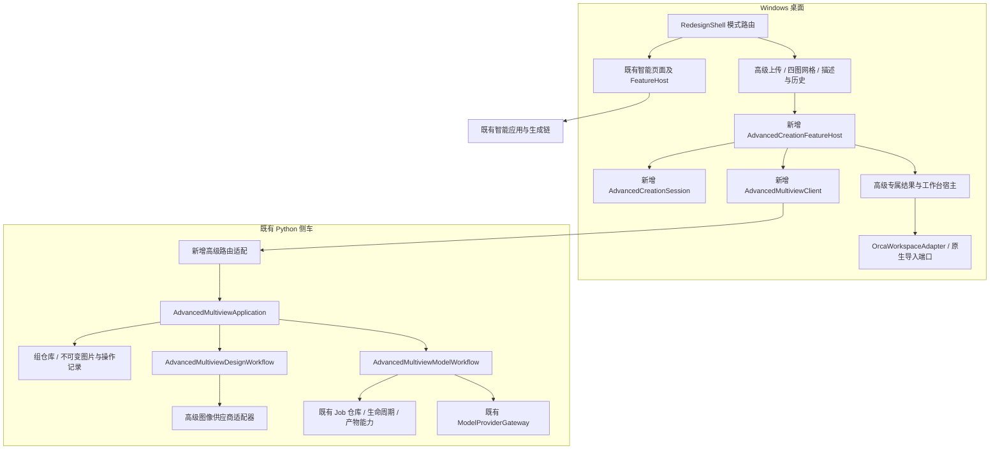
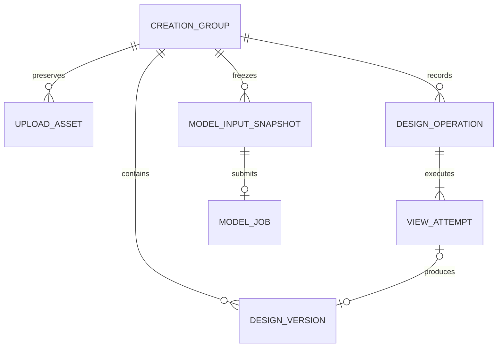

# AI 创作高级模式：多视角软件架构方案

- 日期：2026-11-07；版本：设计 V1.2（2026-11-09历史套图展示／重命名补充）。
- 任务：`UX/ADVANCED-MULTIVIEW-20261107`。
- 输入：[需求 V1.4](2026-11-07-advanced-multiview-requirements.md)、[76 条原验收用例及增补](2026-11-07-advanced-multiview-acceptance.md)。
- 配套：[详细设计](2026-11-07-advanced-multiview-detailed-design.md)。
- 设计审查基线：`codex/team/integration` / `99b8bee679110ad0f43b080c3a695c9d54d7406c`。下文现有能力表保留该基线事实；2026-11-08 已在同分支工作树实施，具体类名及维护入口见下方实施对照。
- 验证结论见[测试报告](2026-11-08-advanced-multiview-test-report.md)，设计及代码存在不表示全部供应商、窗口或用户视觉验收通过。

## 实施对照（2026-11-08）

| 职责 | 实际维护入口 | 边界 |
| --- | --- | --- |
| 草稿、选择、点击及资格 | `GUI/AI/ModelGeneration/AdvancedCreation{Types,Session}.*` | `AdvancedCreation::Session` 独立持有；UI只派生标签／范围／选中态 |
| 桌面命令、持久提交收据、缓存及回调 | `AdvancedCreationFeatureHost.*`、`AdvancedMultiviewClient.*` | 认证回环传输；异步 epoch／revision；未知提交须显式对账 |
| 高级界面及独立工作台 | `GUI/Redesign/AdvancedCreationWorkspace.*` | Shell懒创建；单击延迟与双击分离；润色使用高级独立客户端，WebP本地派生PNG，不改智能文本接口 |
| 组、四图版本及2D命令 | `tools/ai/advanced_multiview_{repository,application,design_workflow}.py` | 首次主参考相机0°锚点后按左转90°／180°／右转90°固定顺序逐项发布；定向编辑冻结当前图，旧图不因失败清空 |
| 图像供应商 | `advanced_multiview_image_gateway.py` | GPT具名多参考与当前图编辑；明确左右朝向和非镜像约束；不保证生成模型必然遵守方向 |
| 四图建模 | `advanced_multiview_{model_contracts,models,model_workflow}.py` | 冻结四图副本／哈希，Job-v2；Tripo真实四图接入；旧单图入口拒绝将新任务降级 |
| HTTP及组合 | `advanced_multiview_{transport,runtime}.py` | `/v1/orcaslicer/advanced-multiview` 独立命名空间；保存草稿返回完整快照，包含current图及model投影 |

组位于用户模型根目录的 `advanced-multiview/<group-id>`，桌面缓存及待核对收据位于 `advanced-cache`；安装目录只读。3D沿既有工作台、原生导入与工程保护。旧单图Job-v1仍可读取，新四图Job-v2不被旧读取器作为单图重生。智能宿主保持默认构造参数与原链路；新增 `advanced_only` 仅用于高级专属工作台实例。

“历史套图”右栏只消费既有高级组列表和Session当前组，不新增仓库、迁移或可写历史状态；隐藏旧单图入口不删除旧数据。智能右栏仍消费原模型历史，只通过呈现上下文把标题改为“历史模型”。模式选中配色、标题和套图卡片均停留在GUI适配层，不形成到Session、侧车或供应商的新增依赖。

套图显示名称是高级组聚合上的向后兼容可选字段`display_name`，由`PUT /groups/{id}/name`在revision守卫和空闲守卫下更新；它不复制或改写设计描述。GUI的单击／双击计时、原地编辑和标题回退属于展示适配，FeatureHost负责保存当前草稿、发出重命名、吸收当前组快照或只刷新非当前组历史。仓库继续是名称、revision及四图版本的唯一持久所有者。

供应商边界：GPT与Tripo已有真实主窗口证据；YOYOClaw图像多参考／编辑能力未核实，提交受阻；用户确认其3D底层为腾讯混元，本轮延期且只测Tripo，不做单图降级。用户最新授权2D调用不限次数，Tripo最多20次；确认仍按每次计划展示调用范围，恢复优先复用已得结果。

## 1. 架构结论和边界

采用现有桌面程序＋Python 侧车的模块化结构，新增**高级多视角应用模块**。不引入数据库、微服务、新进程或新的生成供应商。智能模式继续走原 `ModelGenerationFeatureHost → ModelGenerationPanel → SmartGenerationFlow` 和原侧车应用链；高级多视角走独立的 Session、Application 和存储模型，共用无业务状态的传输、文件校验及供应商适配能力。

高级流程仍为：准备输入 → 显式确认生成 2D → 查看／局部修改 → 另行确认生成 3D → 原 3D 工作台／导入。首次固定生成四张设计图，局部修改使用目标视角的当前设计图；3D 始终绑定当前整组四图，不受 2D 勾选范围影响。

| 边界 | 本方案约束 |
| --- | --- |
| 智能业务 | 不改变输入、自动推进、确认、重试、供应商选择及人像策略；不向其 Session 填入高级输入／结果 |
| 高级与智能 | 分开持有草稿、运行任务、回调令牌、历史恢复和工作台上下文；共享只读服务状态不等于共享业务状态 |
| 旧高级单图历史 | 保留原链路；不自动生成四图，不按新四图资格强制解释 |
| 原生工程 | 继续由 Plater／Model／Config 和现有导入适配器管理；生成与导入不直接触发切片或打印 |
| 实施停止线 | 若实现某项必须改变智能业务逻辑，停止该项并告知用户；不能用“共享重构”绕过此边界 |

## 2. 现有能力与差距

下表是源码事实，不表示对应新功能已具备端到端能力。

| 已核对入口 | 当前事实 | 本次设计处理 |
| --- | --- | --- |
| `RedesignShell.cpp::build_workspace_modes` | 高级按钮禁用，尚无完整模式切换动作 | 增加模式路由与高级独立页面，保留智能页面实例 |
| `ModelGenerationHost.hpp` | `ModelGenerationUIInput.image_path`、`ModelGenerationUIState.design_image_path` 都是单图 | 新增高级专用契约，不将旧单图字段改成兼容含糊的数组 |
| `ImageDesignDraft.hpp` | 已有待提交输入与历史结果的保护语义 | 高级 Session 按同样原则区分草稿与已提交组，不复用其单图状态 |
| `ModelGenerationSubmission.cpp` | 原 2D／3D 确认、输入变化检查、智能状态推进 | 保留原调用路径；新高级确认绑定独立快照，复用确认呈现及原资格语义 |
| `model_job_application.py`、`model_job_repository.py` | 单图／文字 Job，有真实任务引用和原子 JSON 保存 | 新组仓库保存 2D；3D 使用既有 Job，附加只读四图快照来源 |
| `openai_preprocessor.py::edit_image` | 精确提示词的单图编辑接口；不是现成的多参考图接口 | 新增高级专用多参考输入适配器，旧函数及调用语义保持 |
| `model_provider_gateway.py::ModelTaskRequest` | 已有 `source="multiview"` 和命名 `image_paths`；Tripo 网关要求正／左／后／右完整四图 | 复用该供应商契约及付费授权机制，新增高级编排直接交付四图 |
| `tripo_client.py::create_multiview_task` | 已调用 `/generation/multiview-to-model` | 可作为优先接入候选；账号、当前模型限制及实际质量仍需核实 |
| `yoyoclaw_provider_gateway.py::start_or_reuse_model_task` | 当前仅接受 `source="image"` | 高级四图建模不可用；不静默改供应商或拼图冒充四图接入 |
| `model_generation_workflow.py::generate` | 部分人像策略可能选择正视单图；旧多视角准备可能产生额外图像步骤 | 新高级不进入该参考图决策路径，防止已确认四图被替换／丢弃 |
| `ModelGenerationFeatureHost.cpp`、`PostGenerationWorkbenchHost.cpp` | 创作与工作台仍关联到同一个 Panel 实例 | 高级使用独立宿主实例承接结果，不能把高级历史载入智能宿主 |
| `ImageHistorySidebar.cpp`、`ModelHistoryMetadata.hpp` | 现有历史有单图摘要、后台缩略图和元数据恢复保护 | 新增组历史投影；旧历史和模型资产元数据原件保留 |

现有 `capability_catalog.py` 是原子能力目录，`ProviderCatalog::ready()` 只说明服务／模型可用。二者均不能直接证明“多参考生成＋当前图定向编辑＋四图建模”可用，需要新增独立的高级能力描述。

## 3. 总体结构和依赖方向

依赖由界面向 Session／应用端口、由应用向仓库及供应商端口。HTTP Handler 只做解析、认证、限额及结果编码；界面只发命令、显示快照。不允许 Session 引用 wxWidgets、HTTP 或供应商类型，不向 `libslic3r`、`AI/SmartSlicing` 注入本功能规则。

桌面业务 Session 可放在既有 `src/slic3r/GUI/AI/ModelGeneration/` 接缝，保持无 wx 依赖；目录位置不意味着业务归控件所有。只有实际形成跨模块消费的中性契约才进入 `src/slic3r/AI/Contracts`，不把供应商请求或 UI 布局放入该目录。

## 4. 组件职责与状态唯一来源

| 组件（新增名称为拟定） | 状态与职责 | 禁止承担 |
| --- | --- | --- |
| `RedesignShell` 模式路由 | 当前可见模式、页面挂载和导航；智能共享侧栏按原 restore／mount 成对归还 | 四图版本、付费重试及提示词业务 |
| `AdvancedCreationSession` | 未提交草稿、选中视角、描述正文、当前打开组 ID、UI 回调 epoch、确认快照 | 服务端任务真值、真实任务 ID 的重新推断 |
| `AdvancedCreationFeatureHost` | 命令资格、弹窗协调、HTTP 调用、服务状态适配、结果／工作台交接 | 直接写组 JSON、在 Shell 内复制业务状态 |
| `AdvancedMultiviewApplication` | 受理初次／编辑／重试／停止／建模，版本校验、幂等与授权；仓库为其持久真值 | 控件选择、窗口尺寸、供应商 HTTP 细节 |
| `AdvancedMultiviewDesignWorkflow` | 按固定视角执行首次四图与局部编辑，逐张提交成功结果 | 修改未选图、因失败自动付费重跑 |
| `AdvancedMultiviewRepository` | 上传原件、组摘要、不可变设计版本、操作记录；原子更新和路径校验 | GUI 偏好、原生工程状态 |
| `AdvancedMultiviewModelWorkflow` | 使用冻结四图提交／恢复一个逻辑 3D Job；复用网关、下载、产物处理端口 | 重新生成设计图、调用旧人像单图选路策略 |
| 既有 Job 仓库／生命周期 | 3D Job、供应商 task ID、状态及产物的唯一写者 | 将四个 2D 设计任务重新解释为四个模型任务 |
| 高级专属工作台宿主 | 本实例的模型、候选、编辑与导入会话 | 加载或覆盖智能创作实例中的草稿和模型 |

桌面中的组快照是只读投影，不能和侧车争抢写入。组仅保存 `model_job_id` 和输入快照关联；3D 进度从 Job 查询／关联投影，不在组内维护另一套可写 3D 状态。图片版本、操作记录可独立落盘，组摘要不无限追加全部历史。

## 5. 模式与工作台隔离

1. 保留现有智能 FeatureHost、Panel、`SmartGenerationFlow`、单图 DTO 及监听器。不能依靠切换同一 Panel 的 `smart_mode` 布尔值完成隔离。
2. 懒创建高级页面与 `AdvancedCreationFeatureHost`。其 2D 草稿／任务独立，服务发现复用 `AIDesktopFeatureHost` 的既有管理器，不能再启动一个侧车。
3. 高级需要旧单图历史或 3D 工作台时，使用另一个 `ModelGenerationFeatureHost` 实例作为**高级专属承接宿主**。新增显式上下文 `AdvancedOnly`：禁用该实例的智能生成入口和无范围的自动 latest 恢复，只允许显式打开高级／旧高级任务；默认上下文维持原实例行为。
4. 不直接裸建第二个默认宿主：现有初始化、历史扫描、输出元数据和监听器有隐含归属，必须先接入上下文和宿主所有权令牌。若其隔离必须修改智能业务，停止该接入并反馈。
5. 模式切换只改变展示归属，按原任务／未接受候选保护决定是否允许离开；禁止取消旧任务、清空草稿或自动生成。允许离开时后台任务继续更新所属组；旧模式事件不得把当前页面导航走。
6. 页面实例保留各自输入和选择；后台快照可以更新所属 Session，但界面应用必须同时匹配 mode、group、epoch。销毁时失效令牌、取消本地监听／待执行点击，不宣称远端任务已取消。

全局模型资产库继续是共享资产入口，并不等于共享创作状态。新模型保存明确的 `creation_kind`、`group_id` 来源，打开“设计来源”时路由高级组；打开普通模型工作台沿既有工程保护。不能把高级组伪装成智能创作历史。旧智能历史的内容解释和恢复规则保持原样。

## 6. 领域结构与一致性

视角使用枚举 `front / left / back / right`，所有请求、存储、UI 和供应商映射均使用名称；禁止以数组下标猜方向。建议中央位置为左上正、右上左、左下后、右下右，属于本方案排版选择。

- 组聚合根：输入来源、上传视角映射、当前描述／风格快照、四个当前成功版本指针、单个活动写操作和版本号。
- 设计版本：不可变图像、视角、哈希、基础版本、操作／真实任务来源；失败不产生“当前成功版本”。
- 尝试：独立保存 submitted／running／failed／ambiguous 等状态；有旧图与本次失败可同时存在，不能用一个失败布尔值抹掉可用图。
- 首次四图操作冻结原始输入；补齐失败方向继续使用该首次快照。普通编辑冻结当前目标设计图和当前描述，未选方向不写入结果。
- 模型输入快照：精确保存四图版本与哈希、供应商及参数；可用的旧图和成功新图可以共存。确认之后输入变动则拒绝旧确认。

同一组一次只允许一个改变结果的操作，新增高级图像执行器初版并发为 1，不改变智能模式的原执行器配置；不同组件通过组锁和 revision／operation token 协作。长网络调用不持仓库锁。设计版本文件写完校验后才原子切换当前指针。停止、崩溃、断连及晚到响应均保留已成功提交的图片。

## 7. 图像生成策略

推荐“共享主参考相机锚点＋逐相对视角产出”，而不是四张互不关联的文字生成，也不把一张四格拼图直接当成四个结果。主参考图不是对象语义正面的声明；持久化`front`只作兼容键。

1. 首次有图：正视图为必填主参考，其余已上传方向作为命名辅助约束。先生成正视设计，输入最多四张原图。纯文字首次先生成同一对象的正视设计。
2. 正视成功后，生成左／后／右，每次输出一张独立图片；输入以新正视设计为对象锚点，结合已上传辅助视角，提示词锁定方向、主体、比例、风格与共同配件。首次操作总目标仍是四个方向。
3. 初版按固定顺序执行，每个输出成功立即保存并显示。主参考图失败时其它相对方向为依赖阻塞；重试主视角后只执行尚未完成且仍获授权的目标。
4. 局部修改每次以目标的当前设计图为编辑主图，其他当前图可作为只读一致性上下文；操作开始时统一冻结输入，不能让前一个成功结果悄悄改变后一个目标的基础版本。
5. 不在 3D 提交时调用旧人像多视角生成／付费视觉复核，不增加隐藏的 AI 统一修图。局部修改不一致由用户决定后续修改范围。

该策略是实现建议，不是质量保证。需要支持多参考输入、指定方向和当前图编辑的图像模型；现有单图 `edit_image` 尚不满足完整接口。首个技术核实应确认真实模型与网关的输入数量、角色表达、限额、单次输出及收费语义；不满足时不能宣称多上传图已全部生效。调用预算、重试和恢复见详细设计。

## 8. 四图到 3D 的接入

新增高级建模编排，直接创建 `ModelTaskRequest(source="multiview", image_paths={front,left,back,right})`。复用现有 `PaidTaskAuthorization`、供应商上传／查询、产物下载／转换／拓扑检查及工作台导入能力。四张图保持独立输入，不以正视图填入旧接口后依赖旧逻辑自行猜测。

3D 使用既有 `Job` 存储和产物目录，新增可选来源字段 `creation_kind="advanced_multiview_v1"` 及 `approved_multiview_snapshot`。后者保存冻结文件引用及哈希，是该 Job 的输入真值；组中只引用 Job ID。旧 `source="image"` 可保留为历史兼容分类，不能据此选择单图提交。

新来源 Job 必须经显式 dispatcher 进入高级工作流；旧 `/generate`、`reuse-design` 及创建新任务的旧重试入口遇到新来源时明确拒绝，要求高级计划与确认，不能把旧单图确认直接升级为四图授权。已有任务的查询／停止和按真实 ID 恢复可复用既有能力，生命周期恢复显式分派；不能落回旧单图选路。旧版本 Job 仍按原路径执行。元数据缺损、快照未知版本或不可读四图均应阻止重新提交，不能自动去掉字段解释为旧数据。

适配器现状：Tripo 有源码接入，可列为待实测候选；YOYOClaw 当前实现不能四图提交。能力协商必须将“已配置／已连接”和“四图建模支持”分开。UI 显示原因，选择由用户决定，不自动替换供应商；能力不足状态不是需求已完成。

## 9. 接口、存储与兼容策略

- 新增 `/v1/orcaslicer/advanced-multiview/` 命名空间及新客户端，不给旧单图请求偷偷增加默认多图行为。
- 专用能力接口报告高级协议版本和每个模型的 initial／edit／named-four-view 支持；旧侧车缺失接口时高级生成明确不可用，智能及普通 Orca 继续使用原兼容路径。
- 组存放于用户模型根的 `advanced-multiview/<group_id>/`，保存上传原件、不可变设计、操作及组摘要；不把组文件命名为旧 `job.json` 冒充旧任务。
- 3D Job 继续位于用户模型根 `<job_id>/`，保证原模型库与工作台可消费；只有组历史按组呈现，内部 2D 尝试不冒充独立创作条目。
- 组有自己的 schema；新四图 3D Job 使用记录版本 2，严格要求已确认四图结构，新 loader 同时读旧版本 1 与新版本 2。旧 Job 继续按版本 1 写入，不能直接改全局常量导致旧历史失读。旧侧车只接受版本 1，因此会拒绝读取新四图 Job，防止忽略附加字段后按单图重生；模型产物的普通查看不等于获得重新生成授权。
- 安装目录保持只读；根目录沿用 `Slic3r::data_dir()/models` 和既有显式覆盖规则。HTTP 不接受任意本机路径，供应商凭据不进入组、提示词日志或源码。
- 不为一个可选能力擅自整体升级现有协议 2／sidecar v11；如果实施确实改变 runtime 兼容契约，再按集成锁维护版本、打包和消费者。

## 10. 实施顺序与验证出口

| 步骤 | 交付范围 | 进入下一步所需证据 |
| --- | --- | --- |
| D1 能力与接缝核对 | 只读确认供应商协议、图像多参考限制；验证高级宿主隔离方案 | 明确能力表、共享文件范围和智能不变条件；真实调用另需预算 |
| D2 契约／Session／仓库 | 枚举、快照、幂等、每视角版本、部分失败与恢复 | 定向逻辑／存储／版本失效测试；旧 Job 兼容 |
| D3 高级 2D 应用 | 初次四图、当前图编辑、显式重试、独立客户端 | 输入哈希与真实任务身份可追踪；不隐式付费重试 |
| D4 页面与模式切换 | 上传、2×2、点击／双击、黄色反馈、标签、侧栏适配 | 对应新版本 Windows 主窗口操作、智能草稿恢复证据 |
| D5 3D 与工作台 | 四图冻结确认、单逻辑 Job、恢复分派、产物交接 | 四图实际到达供应商、旧历史与工作台兼容证据 |
| D6 集成验收 | 按既有 76 条用例执行并复用证据 | 编译／自动测试／GUI／图像质量／模型质量分别结论 |

顺序可按依赖交错，不能提前只放开入口便宣称交付。产品实施需后续明确授权。实际修改边界、能力或状态所有者时同步 `Docs/architecture/review-map.json`、维护文档，运行 `scripts/verify_ai_integration.py --json` 和 `scripts/architecture_review.py --readme update`；本轮设计不修改反映现有源码的映射。

## 11. 需求追踪与尚待核实项

| 需求 | 架构落实点 |
| --- | --- |
| ADV-01／02 | 独立模式 Session／宿主、默认智能不变、明确历史路由 |
| ADV-03／04／15 | 命名原图、首次四图操作、共享锚点与供应商能力 |
| ADV-05～09 | 独立高级页面、统一选择投影；布局和事件详见详细设计 |
| ADV-10／11 | 当前版本编辑、逐视角提交、幂等、恢复和过期结果保护 |
| ADV-12 | 冻结整组四图、专用建模编排、一个逻辑 Job |
| ADV-13／14 | 组仓库、旧单图兼容、原工作台与原生工程端口 |

尚需工程核实：图像模型的多参考／编辑能力和费用，Tripo 当前账号／模型的四图限制，真实 Windows 窗口和 DPI 下的可读尺寸，高级专属宿主初始化及历史来源接缝。它们不重新打开已确认需求，也不能被视为已通过。本文未新增批量自动分配视角、版本浏览器、选择跨重启保存、额外自动生成或打印要求。

## 12. 已核对源码导航

| 关注点 | 当前维护源 |
| --- | --- |
| 模式与页面 | [RedesignShell.cpp](../../../src/slic3r/GUI/Redesign/RedesignShell.cpp) |
| 单图契约 | [ModelGenerationHost.hpp](../../../src/slic3r/GUI/AI/ModelGeneration/ModelGenerationHost.hpp) |
| 宿主与工作台组合 | [ModelGenerationFeatureHost.cpp](../../../src/slic3r/GUI/AI/ModelGeneration/ModelGenerationFeatureHost.cpp) |
| 确认与智能提交 | [ModelGenerationSubmission.cpp](../../../src/slic3r/GUI/AI/ModelGeneration/ModelGenerationSubmission.cpp)、[ModelGenerationPanel.cpp](../../../src/slic3r/GUI/ModelGenerationPanel.cpp) |
| 应用、保存与恢复 | [model_job_application.py](../../../tools/ai/model_job_application.py)、[model_job_repository.py](../../../tools/ai/model_job_repository.py)、[model_job_lifecycle.py](../../../tools/ai/model_job_lifecycle.py) |
| 旧参考图选路 | [model_generation_workflow.py](../../../tools/ai/model_generation_workflow.py) |
| 图像接口 | [openai_preprocessor.py](../../../tools/ai/openai_preprocessor.py) |
| 四图供应商契约 | [model_provider_gateway.py](../../../tools/ai/model_provider_gateway.py)、[tripo_client.py](../../../tools/ai/tripo_client.py) |
| 当前单图接入限制 | [yoyoclaw_provider_gateway.py](../../../tools/ai/yoyoclaw_provider_gateway.py) |

上述链接定位现状，不表示这些文件已完成本文新增设计。后续文件／状态边界变化以实际实现和更新后的架构映射为准。
