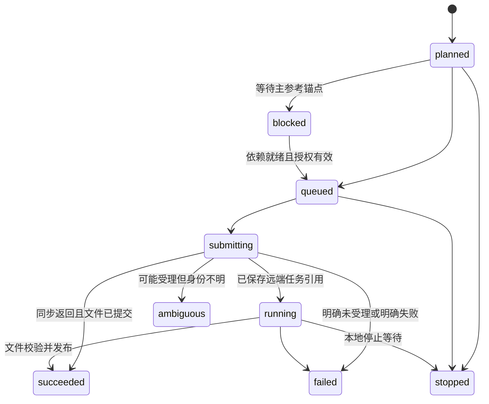
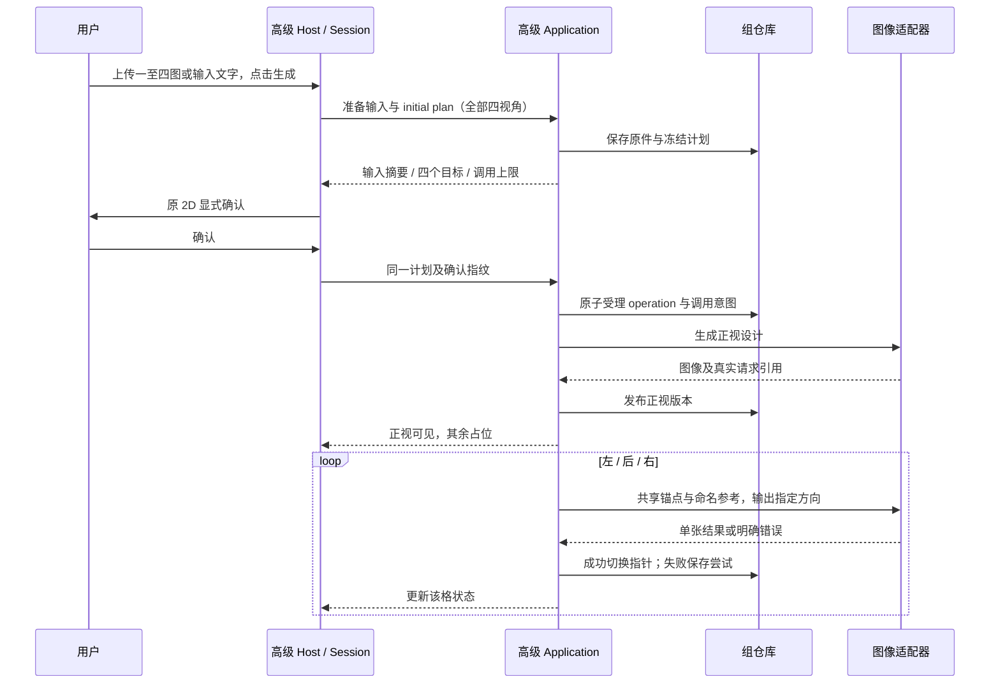

# AI 创作高级模式：多视角详细设计

2026-11-12实施更新：用户已确认本方案及80条用例并授权实施；本任务2D生图不限次，Tripo新增3D最多3次（失败新增提交计数）。下方2026-11-11的“待确认／预算0／均未开始”仅为原方案基线，由本条授权与主计划当前状态取代；不更改已确认业务规格。实际验收按既有测试报告逐层记录，尚未完成实窗验收。

- 日期：2026-11-07；当前提案：设计 V3.0（2026-11-11统一工作台开发方案待确认）；任务：`UX/ADVANCED-MULTIVIEW-20261107`。原V2.0的2D整改授权及实施证据保留。
- 当前对应：[需求V3.0（已确认）](2026-11-07-advanced-multiview-requirements.md#mv-workbench-requirements)、[目标架构](2026-11-07-advanced-multiview-architecture.md#mv-workbench-architecture)、[80条用例（待确认）](2026-11-07-advanced-multiview-acceptance.md#mv-workbench-acceptance)。原V2.0的2D整改见下方独立章节。
- 本文保留2026-11-07设计基线；2026-11-08已实施的实际模块名及接缝见[架构实施对照](2026-11-07-advanced-multiview-architecture.md#实施对照2026-11-08)。下文“拟”指原设计名称，实际类型以 `AdvancedCreationTypes.hpp` 及对应Python契约为准；测试结论见[测试报告](2026-11-08-advanced-multiview-test-report.md)。

<a id="mv-workbench-development"></a>

## 2026-11-11 统一工作台开发方案V3.0（待确认，未实施）

输入为[已确认的WB-01～11及WB-A／B](2026-11-07-advanced-multiview-requirements.md#mv-workbench-requirements)，对应[80条完整验收用例](2026-11-07-advanced-multiview-acceptance.md#mv-workbench-acceptance)。用户本轮仅授权编写方案／用例，确认后才开始产品实现、代码删除、构建和验证。以下类型名是拟新增或调整的接缝，不表示源码已经存在；执行状态只维护于主计划／短状态，实际测试结果以后增量写入既有测试报告。

### WB-D1 目标、基线和约束

- 当前审查基线：本会话／`codex/team/integration`／`5d6602171f6fa1edb061a679ac74cf4e55c67cb1`；产品尚未实施本整改。前轮截图、日志、双实例与独立导入根因及原R2未结保留。
- 交付一个工作台页面体系和一个当前编辑上下文，覆盖等待／结果／编辑／导入／切片／预览及原后续打印。智能／高级创作Session、任务和原供应商协议继续独立。
- 原检查、修复、美颜、配色、底座、文件发布、撤销、原生导入、切片算法及既有工程保护继续复用，不因本次收敛重写其业务规则。保留原入场检查策略；进入工作台不自动串联后续处理。
- GPT全部参数（包括size=auto、input_fidelity=high）、YOYO模型选择及请求、多视图规则、3D模型参数、Job-v1/v2、历史格式、输出目录和执行并发策略不变。
- 本轮不新增生成预算，不复用上一轮收口后的剩余额度，不提交／推送／合并／发布。不以全量重构、回滚整个高级功能或删除有效历史能力代替定向整改。

### WB-D2 现状问题和所需接缝

| 已核对的现状 | 实施处理 |
| --- | --- |
| Shell已共用Page::Model下的等待／结果页；高级打开完成工作台却进入AdvancedCreationWorkspace内部实例并跳Page::Image | 等待与结果继续留在原工作台导航，完成产物显式交给唯一编辑实例；删除内部编辑及其错误导航。 |
| show_model_view(Result)的重入／幂等刷新仍直接读取智能m_model_generation_state | 所有入口共用来源选择，不能只有高级首次进入正确。 |
| AdvancedCreationWorkspace内部model_host同时承担重复编辑、任务观察、下载、目录和旧历史适配 | 将仍需的观察／下载／目录能力转入无工作台UI的任务适配器及既有服务；再删除整个高级专属ModelGenerationFeatureHost实例。 |
| request_open_history会reset／restore_job；load_library_entry成功后停轮询、取消客户端、清job ID并回填生成选项／单图输入 | 拆出显式产物打开入口和仅加载3D对象的模式；完成高级模型和工作台历史切换均不通过“恢复生成输入”安装到智能上下文。 |
| ModelGenerationPanel同时持有SmartGenerationFlow、显示模型字段和BeautyWorkbenchSession，m_sequence等被多种回调共用 | 按生成任务与当前编辑模型拆开身份、请求代次和安装条件，审查所有受影响消费者，避免仅增加一个UI标志。 |
| 编辑导入仍有字段从m_job_palette／m_artifact_format等生成现场读取 | 从当前工作台模型上下文读取格式、色板、ColorIntent及历史身份，防止高级模型借用智能参数。 |

### WB-D3 状态所有者与依赖方向

| 状态／能力 | 唯一所有者 | 可以做什么／不能做什么 |
| --- | --- | --- |
| 智能草稿、生成意图、2D→3D阶段和进度 | 既有智能Session／SmartGenerationFlow／ModelGenerationFeatureHost生成部分 | 保持现有提交、停止、恢复及自动衔接；打开另一来源3D对象不重置这些状态。 |
| 高级输入、四图版本、套图、模型计划／任务与命令资格 | AdvancedCreationSession／FeatureHost及原侧车Application | 提交、停止、恢复仍走高级入口；工作台不能改变四图计划或用旧单图接口重建Job-v2。 |
| 高级3D任务观察与本地产物获取 | 拟AdvancedModelTaskMonitor，由AdvancedCreationFeatureHost持有 | 只观察明确Job、投影状态并调用共享下载／校验；不持有BeautySession、原生工程或编辑控件，不新增生成业务真值。 |
| 等待页当前来源、页面切换、返回锚点 | RedesignShell现有路由上下文扩展 | 保存来源及任务／工作区身份、路由代次；消费两模式快照。不能在Shell再编排供应商生成或持久化第二份草稿。 |
| 当前3D资产身份、路径／哈希、格式／颜色及工作台元数据 | WorkbenchAssets面板及原Beauty Session，归唯一应用级宿主 | WorkbenchModelContext仅保留纯值契约，不设第二可写状态；PostGenerationWorkbenchState只是投影，不能与生成字段各维护一份编辑真值。 |
| 未保存编辑、候选、保存事务和工作台撤销 | 既有BeautyWorkbenchSession及TransactionController | 保留原事务／文件恢复及revision；与当前模型身份组合校验，不另建高级编辑Session。 |
| 项目、耗材配置、原生撤销、切片和G-code | Plater及既有Orca Adapter | 保持原生工程真值；生成、导航和UI不静默更改工程。 |

依赖为Shell／GUI适配器→既有Session／Ports／Contracts→文件／HTTP／原生Adapter。GeneratedModelArtifact继续是无wx／供应商对象的不可变跨模块产物契约；来源模式、组ID和返回页面属于GUI上下文，不塞入libslic3r或供应商参数。仅在当前ModelGeneration模块内增加必要接缝，不新增服务、DLL或循环依赖。

### WB-D4 身份、交接与生命周期

#### 1. 路由与编辑身份分离

来源标识由来源模式、生成会话、明确job／flow ID及高级group／工作区epoch组成；每个来源内部使用自己的revision，不能直接比较智能和高级的revision数值。Shell另持路由请求代次。当前编辑模型使用asset ID、规范化路径、实际文件哈希及Beauty revision。

生成来源与当前编辑资产分开：保存修复／美颜版本或切换历史后，当前asset会改变，返回锚点仍指向进入前创作工作区。任务状态更新不能默认安装到编辑器；只有当前有效的显式打开请求可以替换当前模型。

#### 2. 高级观察与共享下载

AdvancedCreationFeatureHost在原model-jobs受理／显式恢复后，向AdvancedModelTaskMonitor传递明确Job及CallbackContext。观察器使用AIModelGenerationClient的get_status、download_artifact、download_color_intent及现有状态解析，不调用get_latest、generate或retry_preparation。

保留当前轮询节奏和单次在途互斥。图像／几何目录查询使用既有catalog API及独立请求代次，不与任务下载共用可被相互取消的请求句柄。停止／恢复仍由AdvancedCreationFeatureHost原高级端点执行，观察器只重新跟随同一Job。

从ModelGenerationArtifactFlow提取共享的产物获取／校验协作代码，拟放ModelArtifactAcquisition；智能原调用点与高级观察器共用现有文件命名、格式／颜色限制、ColorIntent校验、元数据／模型库发布和错误处理。临时下载完整校验后按原流程发布，保持用户模型目录，不向安装目录写入。失败只允许现有本地重新下载／加载入口，不能自动重发模型生成。

任务观察、下载、文件校验和UI模型安装是不同阶段。高级生成状态可持续发布；被切换的旧请求只能保留归属明确的已有结果，不能安装到新工作区。关闭后取消本地请求／timer，回调使用弱引用及代次检查，保留已取得的有效文件。

#### 3. 显式工作台产物打开

在ModelGenerationFeatureHost／Panel增加面向工作台的产物打开入口，拟request_open_workbench_artifact。请求包含GeneratedModelArtifact、已核实的asset／metadata引用、色板roles／ColorIntent及源路由令牌；读取的参考图可供原工作台显示，但不回填创作输入控件。

打开按原有ModelHistoryOpen／预览准备接缝分两阶段：

1. 检查目标及WB-A保护，获得当前打开请求代次；保留原页／原模型及必要回滚上下文。
2. 读取元数据、校验路径／格式／哈希／ColorIntent、解析模型，在后台准备可用预览数据。
3. GUI线程重新检查源请求、当前目标、取消状态及模型身份；布局和首帧按原呈现门槛准备。
4. 就绪后提交唯一WorkbenchAssets／Beauty上下文并揭示工作台；提交前失败或取消恢复原模型、视角、页面和有效编辑现场。

取消后台解析仍沿用原drain规则，不能解析尚在使用旧状态时提前解除busy。临时文件只清理当前请求拥有的未发布文件，不删除原件、接受版本或历史。首次产物和历史模型共用底层准备／提交过程，不复制另一套GL加载或回滚算法。

#### 4. 历史读取与生成恢复分开

工作台侧栏、全局模型库、智能／高级已完成3D结果均使用“打开3D对象”语义，保持草稿及当前生成任务。显式恢复未完成生成任务继续走对应模式原命令，不被历史3D打开替代。

旧Job-v1、四图Job-v2、修复／美颜衍生版本及本地导入模型均按其原记录读取；沿原修复链和证书解析规则解析实际目标，不能把任务ID、资产ID、历史选中项和修复文件路径混作一个ID。模型库打开设计来源的既有显式业务保留，与普通3D历史打开区分。

#### 5. 消费者迁移

检查／修复、配色／美颜／底座、保存、候选接受／放弃、模型历史、导入请求和原生工程上下文均改从当前工作台模型读取资产身份与元数据。生成请求仍只读其所属生成Session。已有m_sequence共享调用点须明确使用生成代次、模型打开代次还是Beauty revision，不能简单把所有检查换成一个新全局序号。

### WB-D5 页面、任务与返回行为

| 场景 | 页面／状态和命令目标 |
| --- | --- |
| 智能准备／生成 | 工作台等待页；智能阶段和原组合进度，原条件满足才自动衔接一次3D。 |
| 高级已受理3D | 工作台等待页；仅3D阶段和原3D进度，停止／恢复指向该高级Job。 |
| 远端完成、下载／本地预览未完成 | 仍在工作台加载／等待状态；未满足门槛不呈现可编辑完成。 |
| 失败／停止 | 留在对应任务结果状态，显示安全错误及原可用恢复入口；另一个模式的状态不替换当前诊断。 |
| 点击打开工作台 | 通过明确产物交接进入唯一编辑实例，工作台导航保持高亮；不跳AI创作。 |
| 左导航／Tab／历史入口重入 | 在原资格内进入，等待页统一按当前来源选快照，编辑页按当前asset恢复；页面互斥，隐藏浮层及时撤销。 |
| 工作台导入 | 原Shell统一确认／进度／原生提交／目标视图；成功进入原切片流程，失败／取消按原保护回滚。 |
| 已提交导入但目标视图未呈现 | 保留工程提交结果，复用原视图恢复入口，不能为补画面重复添加模型。 |

保留原生成／加载／停止／保存／导入／编辑中的导航资格，不新增“生成中自由切换两任务”或并发产品能力。状态刷新只允许更新当前路由对应呈现，不触发隐式导航；新的明确用户提交仍按原规则打开新任务。

WB-A统一适用于另一结果、历史或模型库替换当前模型。复用现有忙碌／候选／未保存保护及保存／放弃方式；取消则原模型、视角、选择、候选和文件保持。目标打开失败不能留下半安装模型。本轮只保持一个编辑上下文，不新增两模式未保存3D会话的切换恢复。

WB-B使用GUI内的返回锚点：来源模式、组／创作工作区身份及进入时epoch，不复制另一份套图／草稿。历史切换和保存衍生版本不改锚点；从模型库直接进入时使用进入前的创作上下文。返回时查询该模式现有Session；若用户已明确新建／切组，使用其最新工作区，不重放旧模型的历史输入。返回失败沿原保护保留原页并提示，不静默新建；返回本身不产生生成调用。重启后无内存锚点时沿既有当前创作工作区处理，不新增持久化返回会话。

### WB-D6 文件范围和删除清单

| 文件／模块 | 计划修改及完成输出 |
| --- | --- |
| Redesign/RedesignShell.{hpp,cpp}、RedesignModelRoute.hpp、RedesignModelWorkflow.cpp | 统一来源／返回上下文、全部等待页重入、结果交接与导航互斥；移除高级完成后跳Image和高级导入跳Print的分支。 |
| Redesign/RedesignWorkbenchPresentation.cpp及现有页面过渡接缝 | 复用原保留页、加载进度、取消／首帧门槛和回滚，接入明确的目标产物／打开代次；不复制呈现实现。 |
| Redesign/AdvancedCreationWorkspace.{hpp,cpp} | 只保留高级创作UI和必要动作适配；移除内部工作台、完整ModelGenerationFeatureHost、独立导入和相关显隐／返回状态。原润色、图片预览、套图历史和目录消费者保持。 |
| AI/ModelGeneration/AdvancedCreationFeatureHost.{hpp,cpp}及拟AdvancedModelTaskMonitor.{hpp,cpp} | 接管明确高级3D的观察／下载状态和目录接缝；保留原高级提交、停止、恢复与Session资格，不改端点。 |
| AI/ModelGeneration/ModelGenerationFeatureHost.{hpp,cpp}、GUI/ModelGenerationPanel.{hpp,cpp} | 增加产物打开入口，隔离生成和编辑上下文／代次；只保留一个编辑实例。 |
| ModelGenerationArtifactFlow.cpp及拟ModelArtifactAcquisition.{hpp,cpp} | 提取已有下载、校验和发布能力供两来源使用；保留格式、路径、元数据及本地恢复语义。 |
| ModelGenerationHistoryOpen.cpp、ModelGenerationLibraryView.cpp、ModelGenerationWorkbenchHistory.cpp、ModelGenerationSubmission.cpp | 普通3D打开与生成恢复拆开；历史打开不污染草稿，不误恢复latest／误重建Job-v2。 |
| WorkbenchModelContext.hpp／WorkbenchOpenRequest.hpp及PostGenerationWorkbenchHost.cpp、ModelGenerationBeauty*的相关消费者 | WorkbenchModelContext保留为纯值契约，不持有第二份编辑状态；当前编辑身份／元数据由唯一资产面板及原Session持有，打开令牌沿现有事务和Ports传递，不重写美颜／修复算法。 |
| ModelWorkspaceSources.cmake、对应CMake清单与tests/slic3rutils | 注册实际新增接缝及定向测试，删除确无消费者的专用依赖；不复制构建缓存。 |
| 本需求／设计／架构／验收文档、平台架构说明、原子能力说明及review-map | 同步真实状态所有者、共享工作台入口、历史／返回行为和失效锚点；方案阶段只标明目标，实际映射随代码维护。 |

删除按引用／消费者核实后执行：

| 已有实现 | 处理方式 |
| --- | --- |
| AdvancedCreationWorkspace的workbench面板、mount_workbench、workbench_open、opening_model、open／close／model_changed中自动显示内部编辑的分支 | 迁移任务观察和结果查看入口后实际删除；高级历史查看同样进入统一工作台。 |
| import_session、import_progress、import_model、after_import／navigate_after_import、wxProgressDialog及仅用于独立导入的头文件 | 统一导入接线完成后连同构造参数、shutdown分支、guard引用一并删除。原WorkbenchImportSession类仍被共享导入使用，不能整删。 |
| request_open_model_workbench及Shell高级专属完成／导入绕行 | 删除旧声明、定义和调用，以有效的共享产物交接替代，不留同名空包装。 |
| 高级专属完整model_host及实例级advanced_only参数／成员／专用分支 | 观察、目录、历史消费者迁移后移除。Job-v2防误走旧生成入口的保护改由实际任务来源／协议检查承接，不能因移除标志而丢失。 |
| legacy面板／open_legacy等旧接线 | 先核查真实可达消费者；确无入口的死代码删除，仍有用户入口的旧历史能力经共享接缝保留，不按legacy名称整段删除。 |
| 专用资源、绑定、无用include／构建项及旧路径测试 | 仅在全仓引用和构建消费者确认无用时删除；共享资源与有效断言保留，测试迁至统一流程语义。 |

不以恒定开关、隐藏备用工作台、注释旧实现、复制宿主或空转兼容壳交付。删除的是当前源码中的废弃路径，正常Git历史及问题证据保留，不重写提交历史。

### WB-D7 开发顺序、输出及完成条件

以下WBD-1～8为同一任务内的实施顺序，当前均未开始。默认单代理、沿用现有分支，按依赖推进；构建期间不改源码。

| 步骤 | 输出 | 验证和完成条件 |
| --- | --- | --- |
| WBD-1 身份与返回接缝 | 明确来源／任务／编辑资产身份、独立代次、WB-A保护及WB-B返回锚点；梳理所有消费者 | HAND／RET／JOB对应纯逻辑用例可检验草稿不变、旧结果失效和替换保护，不新增第二份业务状态。 |
| WBD-2 高级观察与共享获取 | 无工作台UI的高级任务观察、共享产物下载／校验／元数据能力和目录请求 | WAIT／JOB离线端口序列验证阶段、耗时、停止恢复、下载故障、取消、调用次数及shutdown；高级观察器不能提交生图。 |
| WBD-3 单工作台交接 | 明确产物打开、模型元数据上下文和两阶段安装／回滚，历史3D打开与生成恢复分离 | HAND／RET／EDIT验证准确资产／色板、草稿隔离、失败回滚和旧打开请求不能安装。 |
| WBD-4 页面全入口收口 | 结果按钮、左导航、Tab、历史／模型库、返回、等待重入统一接线与互斥 | NAV／WAIT／RET验证两模式全入口；高级不再跳Image或被智能空状态覆盖。 |
| WBD-5 编辑与原生导入消费者 | 检查／候选／保存／撤销消费正确模型；导入接回原Shell进度、提交和切片／预览 | EDIT／PIPE覆盖文件、证书、原生配置／撤销、取消／失败／已提交视图失败，普通Orca保持。 |
| WBD-6 废弃实现删除 | 按清单删除高级重复宿主、独立导入及无效接口／依赖，承接有效兼容能力 | CLEAN及REG引用／diff审查，最终不保留备用第二实例和死包装，不通过删有效测试弱化验收。 |
| WBD-7 自动回归与维护文档 | 定向测试、架构边界／锚点、实际使用说明同步，保存源码与测试收据 | 受影响离线测试通过；架构检查不新增失败且不弱化；既有四项集成diff预算缺口单列，不冒充全部通过。 |
| WBD-8 Windows实窗及交付 | 匹配源码的EXE／DLL／资源／sidecar、独立数据、真实主窗口证据及逐项测试结论 | 两来源已有资产覆盖编辑→导入→切片→预览；真实等待／生成条目按V前置执行。未满足预算或服务条件则保留未执行，不拿历史或fixture冒充。 |

### WB-D8 测试入口、证据和验收限制

验收定义共80条：NAV 8、WAIT 12、JOB 10、HAND 8、EDIT 8、PIPE 10、RET 8、REG 10、CLEAN 6。每条有前置、操作、预期、优先级、需求映射和证据层级，全部当前未执行。用例数量不等于真实生成次数或自动测试数量。

实施后的定向命令示例（本轮不执行）：

```powershell
./dev.ps1 CppTest -TestSuite slic3rutils_tests -TestLabel 'UnifiedWorkbench|ModelGenerationRoute|SmartGenerationFlow|AdvancedCreation|ModelHistoryOpen|BeautyWorkbenchSession|WorkbenchImport|PostGeneration' -Jobs 2
./dev.ps1 Test -TestPattern test_advanced_multiview.py,test_advanced_multiview_models.py,test_sidecar_contract.py,test_yoyoclaw.py
python scripts/verify_ai_integration.py --json
python scripts/architecture_review.py --check-map
python scripts/architecture_review.py --readme update
python scripts/architecture_review.py --readme check
python scripts/check_documentation_sync.py --base HEAD --worktree
./dev.ps1 Build -Jobs 2
./dev.ps1 Run -NoLaunch -Jobs 2
```

新接缝测试使用拟UnifiedWorkbench标签，已有标签按实际受影响测试核对匹配数；无匹配不能算通过。Python定向回归保护参数和既有边界，若未改动且仍与已有收据条件一致可引用原证据，不能因列了命令就重复无关全量测试。C++单元使用离线Ports／fixture模拟状态与故障，禁止另起mock服务伪装主窗口验收。原生几何／切片算法未改动时不自动扩大到全量核心套件，导入与切片行为仍须真实主窗口验证。

复用本checkout的dev.ps1和.tmp/dev/build，核对CMAKE_HOME_DIRECTORY，单写者增量构建。使用完整匹配运行树与独立datadir／既有样本副本，保留用户运行实例与工程；运行目录占用按现有快速开发规则安装独立完整目录并核对，不终止用户进程。记录源码提交及未提交生产源码快照、EXE／DLL／资源／sidecar身份、样本哈希、任务／资产／组ID、配置、原生日志和截图。

**付费与验收前置**：目前新增GPT／YOYO／Tripo调用预算为0。已有真实模型／任务历史副本可验证查看、编辑、导入、切片、预览和返回；不能证明新任务的实时生成、停止／恢复或完整2D→3D衔接。带V的子断言必须有可用的真实在途／可安全恢复任务或另行批准的具体输入、服务和最大调用数；恢复若可能重新提交／计费，同样先确认。已有任务观察／本地下载不视为获得新的生成授权。V条件未满足时标未执行或部分覆盖，整体端到端验收不能标全部通过；本轮不提前申请或消耗新预算。

日志沿既有诊断入口记录来源模式、明确任务、路由代次、资产／模型哈希、阶段、拒绝过期回调原因、导入是否提交及错误码／安全message；不记录凭据、照片、Prompt全文或Data URL。测试结果以后只追加到既有测试报告的新WB结果节，保留原76条、R2的42条及质量／集成缺口，主计划维护执行状态。

### WB-D9 风险与完成判定

| 风险 | 控制与证据 |
| --- | --- |
| 删除高级model_host连带丢失进度／目录／本地加载 | WBD-2先迁移有效职责，WAIT／JOB／REG验证，再执行WBD-6删除。 |
| 工作台打开覆盖智能草稿、任务或进度 | 明确产物入口、来源内revision及生成／编辑代次隔离，HAND-03／04、RET、JOB竞态覆盖。 |
| 高级编辑保存或导入借用智能格式／色板／身份 | 唯一WorkbenchAssets面板及原编辑Session为编辑元数据源，WorkbenchModelContext仅传递值；HAND-01／08、EDIT及PIPE断言绑定文件／哈希。 |
| 取消／首帧失败丢失原模型或候选 | 复用ModelHistoryOpen的准备、drain、提交／回滚及保留页门槛，HAND-06／07、RET-05及PIPE故障覆盖。 |
| 移除advanced_only后Job-v2误走旧重试 | 按实际任务来源／协议守卫，JOB-02／03及REG-05／06；不新增后端协议或降级输入。 |
| 导入已提交但视图失败重复添加模型 | 沿用原提交结果及视图恢复，PIPE-07检查工程对象数与提交次数。 |
| 旧单图历史因清理被误删、用旧局部测试掩盖新链问题 | 审查真实消费者，REG-06／07和CLEAN全引用核对；旧证据原样保留并重验本次链路。 |

完成需要：当前源码只有有效的统一工作台路径；确认需求均有对应证据；受影响自动测试和Windows构建通过；两模式真实主窗口覆盖原编辑／导入／切片／预览；V项达到其真实前置并完成后才可宣称完整实时端到端通过。历史集成守卫缺口按实际结果单列，不能修改预算阈值、跳过Git检查或删除有效断言以取得通过。若实现必须改变未讨论的参数、协议、历史格式、并发或交互，停止该扩展并向用户确认。

<a id="mv-r2-development"></a>

## 2026-11-11 整改开发方案（已确认）

用户已确认统一产品需求、软件开发方案和42条用例验收，授权实施。下方R2方案替代旧基线中卡片恢复／重试、缺图不可选、未决失败全局阻塞和保存成功后新建的处理；其它已对齐规则继续有效。状态只维护于[主计划](../2026-09-25-product-convergence-and-lightweight-plan.md)及短状态；本节是设计规格，不另建执行台账。

### R2-A 修改范围与状态所有者

| 层／维护文件 | 修改内容与输出 | 责任边界 |
| --- | --- | --- |
| `tools/ai/advanced_multiview_application.py`、`advanced_multiview_contracts.py` | 统一新生成计划支持旧图编辑与无图补生成；按当前模型冻结这次计划，计算必要主视角依赖／实际范围／最大次数；允许已结束旧失败后的新计划；提交／停止原子检查 | Application拥有目标、输入、预算和资格，不由UI拼第二套业务计划。每次新意图新command ID，原请求幂等ID仍可核对。 |
| `advanced_multiview_design_workflow.py`、`advanced_multiview_image_gateway.py` | 按目标选择现有编辑或补生成参考规则；完整结果才发布；失败保留旧图、结束真实占用、保留错误与已得结果；旧结果不覆盖新意图 | workflow拥有执行／依赖／发布；gateway仅适配。复用原提示词与GPT／YOYOClaw参数，不改SDK、模型大小或供应商重试策略。 |
| `advanced_multiview_runtime.py`、`advanced_multiview_transport.py`、`advanced_multiview_repository.py` | 保持单执行器；快照暴露真实排队／执行／终态，按需增加可选投影字段；按操作保存停止意图与受理核对，兼容旧记录 | repository拥有组／版本／回执事实；runtime组合并投影，不新增调度平台、并发池或到GUI的反向依赖。 |
| `AdvancedCreationTypes.hpp`、`AdvancedCreationSession.hpp/.cpp` | 失败空位选择、资格去除旧失败全局锁、当前可显示版本及加载结果投影；真实忙碌和必要输入限制保留；新建epoch隔离 | Session拥有草稿、选择、资格及展示投影；服务端group/current版本仍为业务真值。 |
| `AdvancedCreationFeatureHost.hpp/.cpp`、`AdvancedMultiviewClient.hpp/.cpp` | 统一主按钮计划；逐图资源获取不阻止任务状态刷新；任务级提交／核对／停止回执；新建立即复位、异步清理旧任务 | Host／Client适配应用命令、缓存和回调，不另行推断费用或供应商是否已受理。 |
| `Redesign/AdvancedCreationWorkspace.cpp` | 删除卡片按钮的创建、成员、布局、事件和显示分支；右下角状态／安全原因；排队、成功清错与缩略图刷新；复用现有确认／停止 | Workspace只消费投影、传递选择与命令；不改共享`RoundedActionButton`行为来修局部问题，不新增卡片操作入口。 |
| 既有测试及文档 | 在`test_advanced_multiview.py`、`test_advanced_creation.cpp`、`test_sidecar_contract.py`等现有入口定向补测；按实际契约影响补3D／供应商回归；同步维护文档与映射 | 42条验收定义见配套文档，不代表必须新增42个独立测试函数或42次真实生成。 |

上表C++文件均在`src/slic3r/GUI/AI/ModelGeneration/`，Workspace在`src/slic3r/GUI/Redesign/`。不修改libslic3r、智能生成、供应商凭据、原始图片或用户在用运行目录。

### R2-B 计划、依赖与调用规则

1. 用户选中后点击主按钮，先结算待处理单击，再取当前草稿／选择／组revision准备计划；未选图仍为全部四视角，已有pending范围继续纳入。每次新生成按当前模型准备，不调用绑定旧模型的卡片retry路径。
2. 以每个目标是否有已确认基础设计图决定编辑／补生成，允许一个计划含两种目标。现有上传优先级、相机角色、有序参考上限与逐目标`n=1`保持；缺图不走“编辑不存在图片”。
3. 缺图目标优先使用既有可用参考；确实需要补主视角才加入依赖，主视角先执行。确认窗口列出实际目标和最多调用数，缺依赖失败则相关目标结束失败／未执行，不额外追加调用；其它视角继续／停止沿已有规则。
4. 已结束旧`ambiguous/result_pending/result_saved`不作为下一次2D计划的全局拒绝理由；原错误和结果不确定事实保留，不将未知状态伪写成服务端确定失败，不自动付费重提。
5. 重复受理同一command ID返回同一操作；用户下一次明确重新生成使用新command ID和当前模型。重新生成全部四图允许更新之前成功图，但新结果可用前保留各自旧图。
6. 确认取消、失效、模型下架或输入不满足时不提交；恢复准备状态，保留选择／旧图／既有失败。确认与实际提交期间revision变化必须重新核对，禁止把新输入或新模型暗塞入旧确认。

### R2-C 状态、图片与缓存的一致性

| 投影状态 | 卡片显示 | 主按钮／图像处理 |
| --- | --- | --- |
| 尚未发起 | 等待生成；已有图保持设计图 | 依原输入／服务条件计算资格，不造失败。 |
| 排队 | 保留旧图／空位，右下“排队中”，提示等待前一个请求 | 真实已受理任务单飞，不能重复提交；新建仍立即响应。 |
| 执行／获取结果 | 保留旧图／空位和加载提示 | 真实在途保护继续，逐张完成，不因一张结束改掉其它目标。 |
| 成功 | 可用新图替换旧图，显示设计图，清掉该卡片旧失败和过期总体错误 | 按终态释放占用，刷新当前套图／历史缩略图。 |
| 结束未成功 | 旧图／空位保留，右下“生成失败”，安全原因提示 | 旧失败不锁下一次2D；按其它真实条件判资格。 |

必须修复现有`ingest`任一资产失败就不应用整组snapshot的路径。先接收真实任务终态／revision，再逐图接收可用资产；单图下载失败不得让已结束任务持续busy或吞掉其它图的更新。已有响应／文件／版本不因缓存获取失败删除，不自动新增生图来掩盖下载故障。

服务端current版本与Session的可见图片版本分开表达。下载失败保留上一次已验证可见图；计划明确记录用户看到并确认的基图ID，同时冻结计划时服务端current／group revision，服务端验证版本属于同组且未被并发更新。发布使用计划时版本的比较保护；不得拿尚未展示的新版本静默替代编辑基图。该设计仅保证显示／命令一致，不增加版本浏览器或撤销UI。3D仍按既有四图与版本／输入约束消费明确的快照，不因2D解锁而提交错图。

### R2-D 新建、提交竞态与任务回执

- 新建在本地立即取消旧单击／草稿保存计时、递增会话epoch、清空当前输入／组投影／选择／提示并发布初始界面。沿既有初始化默认值回到2D页／顶部，YOYOClaw子模型默认规则保持；不等待网络、旧保存成功或模型配置可用，也不直接创建空历史组。
- 重置前捕获旧group／operation及仍在准备、已提交但未确认的命令引用，按原任务持久保留停止／核对意图，异步停止尚未提交的视角。停止与受理须在同一仓库事务规则下收敛：无论stop先到还是execute先到，都不能在新建后继续启动旧批次剩余视角。
- 已发送供应商请求保留其响应、候选／错误和可能费用事实；返回后归旧任务，不回填新工作区。队列中尚未开始的旧任务应结束而不调用供应商；新组仍按全局串行规则排队。
- 当前单一`pending-submission.json`不能作为跨新建的全局锁。改为按operation关联的独立回执／核对集合，兼容读取旧单收据；写入／迁移失败保留原记录，核对只归档相应操作，不删除其它任务回执。新建不以丢弃回执换取解锁。
- 所有异步成功／失败／完成回调校验原group、operation、会话epoch与命令归属；过期回调可以完成旧任务持久记录，但不能修改新草稿、弹出旧确认、改变新组选择或释放新命令busy。润色／上传保存也适用。

### R2-E 兼容与维护文档

现有group／operation／plan／version记录保持可读；新增字段采用可选投影或兼容默认，旧`initial`及旧受理记录可以解析；不批量改写旧供应商错误，不删除原始组、文件或用户照片。历史打开和重启只核对已有结果，不自行新增供应商调用。保留后端已有内部取回结果能力，卡片控件删除不扩大成删除3D恢复／受理对账等共享契约。

GPT编辑`size=auto`、`input_fidelity=high`及其余参数，GPT纯文字原参数和提示词，以及YOYOClaw三种请求协议／尺寸／顺序均对照原实现回归。白名单失败／模型不可用保持真实状态，不静默换模型。智能链路、原生Orca、独立Job-v2及四图建模预算保持。

实现时同步本需求／设计／验收、`tools/ai/README_atomic_capabilities.md`、`Docs/architecture/PLATFORM_ARCHITECTURE.md`及实际受影响的工程导航；契约／能力／状态锚点变化更新`review-map.json`并运行生成同步。2026-11-11本机实现、定向自动回归及完整Windows构建已完成，实窗使用历史副本；具体执行证据和未验层级见[整改实际结果](2026-11-08-advanced-multiview-test-report.md#mv-r2-results)，设计规格本身不作为全部验收通过的证据。

### R2-F 开发顺序、输出与验证

| 步骤 | 具体输出 | 验证与完成条件 |
| --- | --- | --- |
| D1 计划和兼容契约 | 当前模型的统一编辑／补图计划、实际范围及依赖预算；旧记录解析及停止／受理竞态规则 | GEN组及ASY-01／08／12对应离线用例先验证；不得靠UI隐藏后端409。 |
| D2 执行与状态投影 | 串行真实排队、失败释放、依赖执行、响应／版本保留和安全诊断 | 全成功、部分失败、502未知、下载／保存失败、停止及call-count断言；不增加自动重发。 |
| D3 Session与Host生命周期 | 缺图选择、新建同步重置、逐图缓存更新、可见基图一致及任务级回执／回调隔离 | C++ Session回归与ASY组竞态、REG-07；单图资源故障不锁整组。 |
| D4 界面适配 | 控件实际删除、右下失败／排队、安全原因、确认取消和缩略图更新 | UI组实窗与相应自动逻辑证据，双击／单击、右栏和DPI布局正确。 |
| D5 定向集成与文档 | 受影响Python／C++／HTTP／3D消费者回归，维护文档与映射一致 | 按下方命令运行，逐项记录范围与源码身份，保持既有守卫不弱化。 |
| D6 Windows交付验证 | 同源码的完整EXE／DLL／资源／sidecar及独立数据目录实窗证据 | 复用本checkout构建和完整运行树；保留用户运行实例；真实调用只在另有明确预算时执行。 |

定向验证入口（Python测试在本机用`-PythonPath`指定已有完整解释器，构建仍使用配置的Python 3.12+）：

```powershell
./dev.ps1 Test -TestPattern test_advanced_multiview.py,test_advanced_multiview_models.py,test_sidecar_contract.py,test_yoyoclaw.py
./dev.ps1 CppTest -TestSuite slic3rutils_tests -TestLabel AdvancedCreation -Jobs 2
python scripts/verify_ai_integration.py --json
python scripts/architecture_review.py --readme update
python scripts/check_documentation_sync.py --base HEAD --worktree
./dev.ps1 Build -Jobs 2
./dev.ps1 Run -NoLaunch -Jobs 2
```

Python／C++定向测试按修改范围执行，不添加无关全量测试；新边界有失败再补测。构建／安装分阶段使用：`Build`可在用户实例保留期间执行；`Run -NoLaunch`只在运行树可安全刷新时安装，不终止用户进程，也不在构建期间改源码。运行目录占用则按既有快速开发规则处理；验收使用匹配的Windows真实主窗口，不能以fixture或另建mock服务冒充真实生成。

42条用例是验收定义，实际执行及证据在既有测试报告中增量记录。离线测试记录调用计数、输入／版本／文件哈希、任务ID和安全诊断；GUI记录源码／产物身份、窗口／DPI和截图。真实供应商验证须单列输入、模型、最大调用数和实际预算消耗，复用已有证据，不把文档中的历史额度自动当作新授权。未执行的真实服务／视觉项明确保留未执行。

## 历史基线与已实施说明（2026-11-07至10）

实施补充：草稿 `PUT /groups/<id>/draft` 返回与GET相同的完整运行快照，保留四图current及3D任务投影；上传原件和设计版本均不可被描述保存替换。高级润色单独将支持的源图解码为最长边不超过2048像素的PNG临时副本，跨异步请求保留到回调释放，保留原件；正文仍排除视角标签。图像提示词规定左侧视图朝画布左、右侧视图朝画布右，并保持非对称附件的实际侧别；画面质量须另验，不能用提示词存在作为通过证据。

调用授权更新：用户2026-11-08确认2D不限调用次数，Tripo 3D最多20次，YOYOClaw 3D延期。下面每次计划的最大调用数、显式确认、幂等与恢复规则继续有效，额度不限不等于自动重试授权。

实施补充（2026-11-10）：高级确认建模后立即打开该次已受理的同一Job并复用既有3D模型等待页；高级页面的第一阶段固定为3D建模，不显示智能流程的2D设计准备或生图阶段。Shell分别保存高级`m_advanced_model_state`／`m_advanced_model_route`，高级宿主单独承接提交、停止、恢复、完成、返回高级创作和打开工作台，智能宿主监听器不得写入高级页面。正常提交后的自动对账静默完成并清除受理阶段临时消息；只有用户显式恢复时显示恢复提示。该隔离只改变高级模型呈现和路由，不改变智能模式自动2D→3D流程、状态所有者或历史。

实施修正（2026-11-12）：应用只持有一个3D进度／结果页及一个工作台，智能／高级仅切换任务投影。确认后的真实Job响应先核对计划、收据及组来源，再登记当前Session并发带组／任务／会话epoch／操作代次的受理事件；不等待完整组或四图缓存。Shell独占前台路由意图，绑定导航代次，匹配的任务投影即可进入共用3D页；临时过渡／最小化解除后续接，成功提交才消费，主动离开／切模式／换组／关闭撤销资格。高级3D当前组核对不是历史恢复，不重新open或清选择；2D及显式跨组／重启恢复沿原恢复流程。所有进度及说明按真实状态／阶段与错误码中文呈现，未知消息中文兜底；供应商／格式／任务ID／错误码保留原值，原始服务说明留已有诊断日志。高级建模不显示智能人像准备，生成完成不等同工作台检查通过。未改网站或侧车协议与历史格式。

## 1. 设计约定

| 项目 | 约定 |
| --- | --- |
| 视角标识／排序 | 持久化兼容键仍为`front, left, back, right`；中央展示名为“主视角、左视角、后视角、右视角”，相机角度仍分别为相对主参考图的0°、左转90°、反向180°、右转90° |
| 左侧上传 | 标题“上传多视角图片”与信息图标、黄色“新建创作”同行；312×240容器内为等大2×2，顺序主／左、后／右；主参考图必填；悬停信息图标显示完整操作和格式提示 |
| 左侧阶段页签 | 标题“生成模型”下为312×40双段控件；2D／3D只切换高级左栏输入投影，每次高级页重新显示时复位2D并滚到顶部 |
| 高级2D输入 | 上传组件保持不变；描述、AI润色、风格分类／三列卡片、自定义风格复用智能页面视觉常量；GPT／YOYOClaw状态来自既有provider catalog，状态不复制为高级业务真值 |
| 高级3D输入 | Tripo单选；100万／200万面下拉；几何质量、贴图质量、输出格式只读；旧30万只为历史兼容；200万联动`geometry_quality=detailed` |
| 右侧历史 | 智能标题为“历史模型”且原逻辑不变；高级标题为“历史套图”，保留新建、搜索、刷新、分页和收展，以两列2×2缩略图卡片恢复整组 |
| 中央格位 | 建议左上正、右上左、左下后、右下右；四格等大，不随成功顺序或选择换位 |
| 选择 | 空集合或全选四张的有效范围均为全部；部分选择只影响 2D 编辑 |
| 首次 | 上传一至四张或纯文字，目标始终是全部四视角；不以选择集合缩减首次任务 |
| 修改 | 以每个目标当前成功设计图为主输入；其他方向只作冻结的只读上下文 |
| 状态 | 图片是否可用与本次尝试是否失败分开表达；禁止失败即清空旧图 |
| 3D | 四图齐备是新增必要条件，同时保留原服务、忙碌、输入、参数及工作台保护 |
| 方案参数 | 本文具体格位、初始并发、控件拆分和内部限额是工程建议；真实窗口阈值、模型能力与费用尚未验证 |

## 2. 数据模型与所有权

### 2.1 桌面 Session

拟新增以下 C++17 中性类型，采用 `std::array<...,4>` 及 `enum class ViewId`。序列化必须使用视角名，`std::array` 只用于内部固定容量。

| 类型 | 主要字段 | 所有权与规则 |
| --- | --- | --- |
| `AdvancedInputDraft` | 四槽本地文件引用、prompt、style/custom_style、design provider/model、geometry options、draft revision | Session 持有；校验图片内容／哈希后生成提交快照 |
| `AdvancedSelection` | `selected_views` | Session 唯一选择来源；标签、边框和范围文案均由其派生 |
| `AdvancedGroupSnapshot` | group ID、revision、input epoch、四视角当前图、尝试摘要、active operation、模型引用 | 服务端只读投影；UI 不直接修改 current version |
| `AdvancedPresentationState` | 当前打开组、前台 mode、view epoch、预览对话框状态、右栏状态、待处理点击 | 本次页面生命周期状态；不进入生成提示词 |
| `AdvancedCommandPlan` | plan ID、命令／目标、输入哈希、参数、最大调用数、过期时间 | 确认弹窗展示并绑定；失效后重新准备，不复用旧确认 |
| `AdvancedEligibility` | can_generate_design/model/retry/stop、具体不可用原因 | 由快照、草稿匹配及既有宿主守卫计算，控件不另写规则 |

`effective_views = selected.empty() || selected.size()==4 ? AllViews : selected`。首次计划的 target 固定 `AllViews`；重试按钮按失败尝试计划自己的 target，不暗改中央选中集合；3D 固定 `AllViews`。

描述正文限制沿用 `MAX_PROMPT_BYTES=2000` 的 UTF-8 字节校验及原用户提示，自定义风格沿用 `MAX_CUSTOM_STYLE_BYTES=1000`。正文计数、润色请求和输入哈希均排除范围标签；不能把字节数当中文字符数显示。

### 2.2 服务端组摘要（拟 schema：`advanced-multiview-group-v1`）

| 字段 | 含义 |
| --- | --- |
| `id / schema / workflow_kind` | UUID、schema、固定 `advanced_multiview_v1` |
| `revision / input_epoch` | 组内容单调版本；原始创作输入身份，不由图片成功次序推断 |
| `source` | `image` 或 `text`，只上传辅助图不得解释为 text |
| `uploads` | 按视角映射到保留原件及可选归一化副本，缺失明确为 null |
| `initial_input` | 首次接受的输入／风格／供应商快照及哈希，后续编辑不能改写 |
| `saved_draft` | 最后保存的描述与选项草稿，独立标识是否匹配已提交输入；不冒充生成依据 |
| `views` | 四个固定视角的 `current_version_id`、最近尝试引用；不内嵌无限版本历史 |
| `active_operation_id / stop_intent` | 单写操作归属与真实本地停止意图 |
| `latest_submitted_draft` | 最近受理的 2D 描述／风格快照，用于原输入匹配保护及历史恢复 |
| `model_links` | 已创建模型的 job ID、输入 snapshot ID；3D 运行状态从 Job 投影 |
| `created_at / updated_at / published` | 历史排序及是否成为可见创作；准备／取消确认不伪造成功历史 |

组摘要由高级仓库单写；桌面保存草稿通过应用命令提交，不能绕过 revision。输入时先修改 Session 草稿，显式保存或离开前完成有版本的草稿保存；保存只写草稿，不生成图片。

### 2.3 原件、设计版本和尝试

| 记录 | 必要字段 |
| --- | --- |
| `UploadAsset` | asset ID、view、原始文件相对路径、SHA-256、实际 MIME、宽高、字节数、归一化副本引用 |
| `DesignVersion` | version ID、view、不可变相对路径／哈希／宽高、operation ID、base version、输入引用、provider/model、供应商任务／请求引用、时间 |
| `DesignOperation` | operation／command ID、kind=`initial/edit/retry`、frozen input、显式 targets、最大付费调用数、授权／计划摘要、每视角尝试、stop epoch |
| `ViewAttempt` | view、attempt ID、base version、状态、remote task/request ID、提交歧义、结构化错误、候选文件、已发布 version ID |
| `ModelInputSnapshot` | snapshot ID、四图 version／hash／冻结副本、group／input epoch、provider/model、generation options、confirmation fingerprint |

版本 ID 不复用；哈希验证的是实际提交文件。上传原件永久与生成设计区分，WebP 解码／必要格式转换写派生文件，不覆盖原件。设计版本属于所属组；跨组资产引用只能经过受控复制和来源登记。

## 3. 状态机和命令资格

### 3.1 视角尝试



`succeeded / failed / ambiguous / stopped` 是本次尝试状态，不能决定删除 `current_version`。`blocked` 说明尚未调用，不计为付费失败。停止后远端可能继续运行，恢复以原任务身份查询；恢复记录保留停止前状态，不把 stopped 解释为远端取消成功。

组展示状态由当前图和活动任务推导，不独立写一套易冲突状态：`draft / initial_running / partial / ready / edit_running / recovery_required / model_running / model_ready`。其中 `ready` 只表示四图可用，是否能提交 3D 仍检查所有守卫。

### 3.2 资格计算

| 命令 | 必要条件／拒绝原因 |
| --- | --- |
| 首次 2D | 服务与多参考／文字能力可用；输入有效；有图片则正视图有效，无图片则正文有效；没有活动写操作或未决提交；原费用确认通过 |
| 当前图编辑 | 属于新多视角组；目标都有可用 current version；输入／风格匹配可编辑上下文；无原忙碌或恢复阻塞；确认绑定目标基础版本 |
| 缺图补齐 | 使用首次 frozen input 的 retry plan；不能对不存在的 current image 发 edit |
| 失败重试 | 优先恢复已有 task；明确失败可新尝试；ambiguous 且无法查询时阻止新付费提交并给出可定位原因 |
| 3D | 四个 current 文件可读且通过既有参考图有效性检查；draft 匹配规则成立；没有活动编辑／停止／恢复未决；原工作台、服务和参数资格满足；所选模型明确支持四图 |
| 停止 | 所属组／Job 有运行或排队任务；只操作它，不影响另一模式或其它组 |
| 打开历史／切换模式 | 遵守原忙碌、未接受候选、工程保护；允许离开时保留原 Session 和后台归属 |

四图资格不能只数 URL 个数。首次失败缺图、文件丢失、哈希不匹配和未知来源都应禁止建模并指明方向。局部失败保留旧图时，任务已结束且其它守卫满足，可以用成功新图＋可用旧图建模。

编辑正文／风格后的未提交草稿遵守原 `inputs_match_job` 保护，不能仅因四图存在绕过。新的高级匹配规则比较**组级最近接受的草稿**，不要求四张图都来自同一条提示词；否则会错误禁止正常局部编辑和部分失败后的混合版本。图片／创作风格等根输入更换按第 10 节处理，模型选项按原同步与确认规则处理。

## 4. 桌面交互详细设计

### 4.1 控件与事件边界

`AdvancedCreationWorkspace`由四个展示组件组成：高级专用上传画布、`MultiviewDesignGrid`、`AdvancedPromptEditor`、`AdvancedGroupHistorySidebar`。上传画布不复用结果`ViewCard`：`UploadAreaPanel`固定312×240，四个`UploadSlot`子控件形成等大2×2；每个可见槽约144×108，按主／左、后／右固定定位，使用8圆角、虚线边框和cover裁切。标题行由标题、`UploadInfoIcon`及112×32黄色新建按钮组成；`UploadInfoIcon`悬停创建带`wxBORDER_SIMPLE`的`UploadInfoPopup`，背景`#F8F8F8`、正文`#202020`、次要文字`#585858`，并使用显式换行保证主参考语义、操作和格式三段文字不裁切。已有上传／方向／信息／移除SVG继续保存在`resources/images/advanced_upload_*.svg`。Shell只挂载页面、转交模式和导航，不加入多图状态数组及任务逻辑。

左栏在上传画布之前增加高级专属阶段投影：`AdvancedStageTabs`只维护当前显示2D或3D输入面板的瞬时状态。`wxEVT_SHOW`进入高级页时调用`switch_stage(false, true)`，恢复2D页和滚动顶部，但不写Session草稿。2D面板继续使用高级Session的设计草稿；风格图片、字体、间距和按钮外观复用智能页面现有展示常量，不复用智能草稿或命令。图像／几何供应商状态通过既有`ModelGenerationFeatureHost::get_provider_catalog`只读取得，并以sequence和弱引用丢弃过期回调。

3D面板将Tripo和面数保持为可操作项。新建选项只提供100万／200万面；旧组的30万面只在恢复该历史值时追加“历史设置”。面数变化只更新高级Session的`GeometryOptions`：200万对应`detailed`，其它新建选项对应`standard`；贴图质量和输出格式从现有草稿投影为只读文字。2D／3D常态各只显示一个对应主按钮；停止、恢复、查看模型和不确定提交对账仍由原资格状态临时显示，不能作为常驻表单控件。

上传每槽独立点击／拖放，已占用槽点击图片区域替换，18×18右上角动作移除；空态不显示外置“移除”按钮。cover位图按槽尺寸缓存，图片或窗口DPI／尺寸变化时失效重建，不能拉伸原图。不能按文件名或投放次序猜视角。一次向一个槽投入多个文件时拒绝并提示一次选择一张；不新增未确认的批量分配界面。主槽是相机0°基准而非对象语义正面；应用不能自动识别并保证辅助图恰好为相对左转90°／180°／右转90°，槽位标识和提示帮助用户正确提供，结果方向仍需内容验收。

未有可用图的格位保留视角名及占位／错误／重试状态；不进入图片选择或大图预览。已有图且本轮失败，图继续显示，状态区域注明“本次修改失败，保留原图”；重试按钮是独立命中区域，不冒泡成选图。忙碌期沿原输入锁定和提交保护，查看大图可继续；不新增后台编辑覆盖正在提交快照的行为。

### 4.2 单击与双击

采用**延迟确认单击**，避免双击先触发一次选中造成目标闪变。

1. 第一轮图片单击暂存 view、坐标、时间、group 和 view epoch，启动系统双击间隔计时器，暂不更改选择。
2. 在间隔内收到同一图片的有效双击：取消待处理单击；打开大图；不改变 selection、范围标签、正文和按钮文案。
3. 计时结束且上下文有效：只执行一次 `toggle(view)`。
4. 快速单击不同图片：先提交前一张明确的单击，再挂起后一张；不能因全局计时器只保留最后一张。
5. 鼠标拖动超过系统阈值、页面销毁、切组或 mode epoch 失效时取消待处理点击；过期事件不能改变新组。
6. 点击生成／重试等命令前，先结算已确定的待处理单击再取得范围快照，避免用户刚点选就提交时遗漏选择。

Windows 使用系统双击时限与距离设置，不能硬编码 200ms；其它平台通过隔离的平台适配取得阈值。原生双击事件以及第二次鼠标抬起均须被本控件状态机消费，避免预览关闭后再补一次 toggle。双击前已选和未选两种状态都必须保持；大图关闭也保持。

### 4.3 黄色选中效果

- 使用既有 `RedesignTheme::accent_colour()`：`#FFC227`。正常、悬停、选中、焦点和失败提示分别绘制，不修改全局主题。
- 卡片预留同样的边框空间，选中绘制黄色细边框及角落黄色底深色勾；不使用覆盖图片主体的黄色遮罩。
- 圆角、内边距及标记尺度随 DPI 转换。选择仅重绘，不改变 sizer 约束、卡片尺寸和图片绘制矩形。
- 状态和标记不能只靠颜色区分；视角名及勾选标记始终可辨。失败文字不能遮挡主体。

### 4.4 描述框与范围

`AdvancedPromptEditor` 是一个外观统一的边框容器，内部依次为标签流布局、正文编辑区和原字数／润色入口。标签位于框内开头，不贴在框外，不把字符串插入原生文本值。

| selection | 框内标签 | 生成按钮下方 |
| --- | --- | --- |
| 空／四张 | `[全部视角]` | `全部视角设计图生成` |
| 后 | `[后视角]` | `后视角设计图生成` |
| 左＋后 | `[左视角] [后视角]` | `左视角＋后视角设计图生成` |

标签按正／左／后／右排序并换行，正文编辑控件不随选择重建，保留输入法、光标、选区和滚动位置。标签只展示范围，不独立删除／选择，不参与正文复制、字符计数或 AI 润色。润色使用原能力和覆盖／取消保护；回调另校验 mode、draft revision，不能修改标签或套用到另一模式。

### 4.5 中央布局及侧栏

以中央实际 `GetClientSize()` 为计算依据。设可用尺寸为 `W,H`，外边距 `p`，横／纵间距 `gx,gy`，卡片内部留白 `i`，必要标题与状态保留高度为 `h`：

```text
cardW = floor((W - 2p - gx) / 2)
cardH = floor((H - 2p - gy) / 2)
imageBoxW = max(0, cardW - 2i)
imageBoxH = max(0, cardH - h - 2i)
scale = min(imageBoxW / sourceW, imageBoxH / sourceH)
drawW = sourceW * scale; drawH = sourceH * scale
```

四卡使用相同 cardW／cardH，图片在图框中居中 contain；不拉伸、不裁掉主体。初始建议外边距 16 DIP、间距 12 DIP，具体以既有 UX 和实窗结果校准，不能把这些建议当已验收像素标准。标题／状态只占必要空间，不增加大说明面板。

`queued/submitting`时，卡片图像区只绘制深色圆底、浅色完整圆环和黄色旋转圆弧；活动卡片不再绘制中央“等待生成”。卡片底部状态仍显示“生成中…”，未开始的其它视角继续显示静态占位。局部重新生成时旧图保留在加载层下方，状态结束后停止计时器并立即移除加载层。

右栏 Layout 完成后、窗口 size 及 DPI 变化时，以合并后的 `CallAfter` 重新测量；不能在每次 resize 中重复解码原图或网络下载。右栏收起释放宽度后扩展卡片及图片，允许高度成为放大瓶颈；不能要求超出实际高度强行放大。右栏展开仍保持四格、标签和选中标记完整可见。

高级右栏是现有`host.history()`组快照的展示投影，不增加第二份历史状态。卡片从`current_version_id`解析四个缓存资产，当前打开组优先使用Session中的可用图；两列网格每页最多8组，只解码当前页缩略图。刷新签名只包含各套图id／`display_name`／四个`current_version_id`，以及当前group id／`display_name`／四个version ID；描述、风格、普通revision、选择和其它控件状态不触发卡片重建。最终空闲轮询在设计版本变化后刷新持久历史，避免任务结束后卡片仍显示占位。搜索在内存中同时匹配`display_name`和保存描述；刷新仍调用既有历史读取命令。缩略图区单击立即调用`open_group(id)`，名称区单击延迟一个系统双击间隔，双击先停止待加载再显示原地编辑框。编辑框Enter／小键盘Enter和失焦调用窄范围rename命令，Esc取消；保存键必须被编辑框消费，不能冒泡到卡片键盘加载。旧高级单图数据不删除也不迁移，但本栏不提供可见入口。

智能右栏继续使用原工作台历史控件，仅在智能呈现上下文把标题设为“历史模型”。Shell顶部两个模式按钮共用同一黄色选中绘制；这些均为展示适配，不改智能Session、命令资格或历史消费者。

最小可读图片尺寸和软件支持窗口范围需在真实 Windows 主窗口核定。低于支持尺寸时先按原窗口最小尺寸／滚动容器机制处理，不挤成无法阅读的缩略图，不擅自改成 1×4 或中央一大三小。侧栏开关只改变布局，保留 group、selection、正文、图像版本及任务，不产生生成请求。

### 4.6 大图弹窗与资源

弹窗打开冻结 `{group_id,view,version_id,hash}`，使用完整图像按窗口 contain 显示，标明视角；Esc／关闭按钮退出。后台结果更新不无提示地替换弹窗中查看的版本，关闭后网格显示最新成功版本。

原图解码／下载在后台执行，GUI 线程只创建／替换 wxBitmap 和重绘；回调检查弱引用及 epoch。四图缓存按 version/hash、DPI 和目标尺寸索引，放大图独立缓存；缩放优先使用已解码尺寸层级，保持有界内存，历史仅加载可见缩略图。大图关窗／组切换释放非必需资源，不删除原图或设计文件。

## 5. 高级侧车接口（拟议 v1）

### 5.1 路由

统一前缀 `P=/v1/orcaslicer/advanced-multiview`。新增 `AdvancedMultiviewClient`，复用既有受控本机连接／认证、超时、取消和错误编码机制；不从浏览器直接调用供应商。

| 方法与路径 | 语义 | 可产生付费调用 |
| --- | --- | --- |
| `GET P/capabilities` | 查询高级协议与具体模型能力，含不可用原因 | 否 |
| `POST P/groups` | 受理 image multipart 或 text JSON，创建未发布组；原件复制成功后返回 ID | 否 |
| `GET P/groups?cursor=...` | 按组分页返回已发布历史摘要，内部尝试不单列 | 否 |
| `GET P/groups/{g}` | 返回组快照／恢复所需引用及 ETag | 否 |
| `PUT P/groups/{g}/draft` | 有版本地保存描述／选项草稿，不改变已生成版本 | 否 |
| `POST P/groups/{g}/plans` | 准备 initial／edit／retry／model 计划，冻结范围／版本／参数和调用上限 | 否 |
| `POST P/groups/{g}/operations` | 用户确认后执行 2D 计划；相同 command ID 幂等返回同一 operation | 是，受计划约束 |
| `GET P/groups/{g}/operations/{o}` | 查询真实操作与视角状态；不重新发起生成 | 否 |
| `POST P/groups/{g}/operations/{o}/stop` | 记录停止意图，不再开始后续视角 | 否 |
| `POST P/groups/{g}/model-jobs` | 用户确认后以 model 计划创建／返回一个现有体系的 3D Job | 是，最多一个新模型任务 |
| `POST P/groups/{g}/model-jobs/{j}/resume` | 恢复已知真实任务，参数／输入不能更换 | 不创建新任务 |
| `GET P/groups/{g}/assets/{asset}` | 按受控 ID 下载上传／设计图片 | 否 |

3D Job 的查询、停止和产物下载复用既有 Job API；生成／重试／恢复按来源 dispatcher 路由。无对应高级能力的旧侧车返回不可用时不能改发旧单图接口。HTTP 解析器与路由分模块实现，`orca_ai_sidecar.py` 只增加注册／转发。

能力响应使用 `schema="advanced-multiview-capabilities-v1"`，至少提供 `protocol_version`、每个 provider/model 的 `initial_text`、`initial_named_references`、`max_reference_images`、`edit_current_with_context`、`named_four_view_model`、支持格式／限额、`remote_task_resume` 和不可用原因。所有能力用 `supported / unsupported / unknown` 三态，未知不能当支持；生成资格还需与既有连接／配置状态合并。收费尚不明确时只说明计划最大调用数，不虚构金额；实际计价核实后再显示费用。

### 5.2 字段与示例

组创建 image multipart：`request_id`、正文／风格／供应商模型和四个文件字段 `front_image / left_image / back_image / right_image`；不传文件的槽位明确缺失。text JSON 显式 `source="text"`，不允许辅助图丢弃后假装纯文字。请求 ID 使用规范 UUID。

准备局部编辑计划示例（示意 ID 不用于真实提交）：

```json
{
  "command_id": "<uuid>",
  "kind": "edit",
  "expected_group_revision": 18,
  "target_views": ["left", "back"],
  "base_versions": {"left": "<version-left>", "back": "<version-back>"},
  "prompt": "保留主体造型，调整这两个方向的配件细节",
  "style": "<existing-style-id>",
  "design_provider": "<selected-provider>",
  "design_model": "<selected-model>"
}
```

响应包括 `plan_id`、规范化 targets、四图／上传输入的哈希快照、`confirmation_fingerprint`、`max_new_image_calls`、`max_new_model_tasks`、是否仅恢复、过期时间及提示原因。确认执行只提交 `{command_id,plan_id,confirmation_fingerprint}`；服务端重新校验计划归属、版本、能力和授权，没有用户可见确认的计划不能通过后台自动执行。

错误返回沿用结构化 `code/message/retryable`，可补 `view/operation_id/recovery_action`。重要错误：`missing_front`、`invalid_image`、`unsupported_multiview`、`revision_conflict`、`stale_confirmation`、`group_busy`、`missing_current_view`、`provider_task_ambiguous`、`snapshot_unavailable`、`persistence_failed`。400 用于字段／输入，409 用于状态／版本／恢复冲突，413 用于大小，503 用于能力／服务不可用；应用错误不伪装成 HTTP 成功。

### 5.3 限额与安全

每槽最大沿用 `20*1024*1024` 字节、真实解码及最小源边 64；只接受 PNG、JPG/JPEG、静态 WebP，拒绝动画、伪扩展名、重复槽位、未知视角、超限及损坏文件。EXIF 方向修正写派生副本。解码像素／内存预算复用既有图像校验器，不因压缩体小而允许无限像素。

新 multipart 上限建议单独定义为 `4*MAX_IMAGE_BYTES + MAX_REQUEST_BYTES`，即 80 MiB 图像＋256 KiB 元信息；保持旧单图 `MAX_MULTIPART_BYTES` 不变。流式／临时文件解析并逐字段限额，不能为扩大上限把所有图像和多份编码一次性留内存。供应商更小限额由高级适配器在付费前校验，不能因此删掉某个参考图。

组／操作／Job／asset ID 都需验证、校验归属；相对路径 resolve 后不得离开允许根目录，不能跟随指向外部的链接。沿用现有本地服务认证与来源保护。日志记录 ID、阶段、耗时、哈希和结构化错误，不记录 token、完整个人描述、原图二进制、供应商上传凭据或可滥用的下载链接。

## 6. 图像工作流、提示词与调用预算

### 6.1 首次四图



图像适配器只接收显式命名输入，并为每个目标最多发出一次生图请求。四条路径均直接组合现有`build_geometry_reference_prompt`／`build_text_geometry_reference_prompt`，不复制缩水版通用提示。原合同中的来源权威、主体隔离、原场景背景替换为统一不透明纯色棚拍背景、无纹理／渐变／场景／地面阴影／光晕、完整轮廓和四周留白、几何可读性、身份／结构、光照、支撑、裁切及单主体规则继续有效；传输沿原流程显式使用`background=opaque`，目标是去掉原背景而不是输出透明alpha。首次有对应方向上传图时，只把该图作为生成权威，提示保持其主体、形状、姿势、相机、构图、裁切和可见范围；不再混入其它视角原图。局部编辑以当前目标设计图为第一参考，要求只应用正文／风格修改并保留相机和未要求改变的内容；若存在对应方向上传图，只作为第二参考。

首次缺少对应方向上传图时，使用主参考上传图和成功主设计图中的可用项，最多两张。在完整原合同之后增加窄范围多视角覆盖：只把主参考相机定义为0°，给出左转90°／180°／右转90°的相机观察位置和旋转角度，要求保持人物、手办、萌宠、建筑或其它物体的形状与姿势，并允许对不可见区域做与同一主体一致的合理推理；原合同其它规则不受覆盖。不增加人物专属关节、鼻尖、耳朵、物理解剖左右、镜像检测或其它复杂质量门禁；部分上传推理结果不作质量保证。

纯文字先生成主参考锚点并把其相机定义为0°，再由同一锚点生成其余相对方向。每次只请求一张独立结果，初次最多四个新图像调用；没有额外隐含的分析、自动质检、自动纠偏、第二次生图或 best-of 调用。主参考图失败时旋转视角依赖阻塞，不拿四次独立文字生成冒充同一对象。

主参考图失败后重试计划须明确列出“重试主视角＋尚未生成的依赖方向”及最多调用数，由用户确认；已经成功的方向不重跑。如果只是某个旋转视角失败，则只重试该视角。等待依赖不等于已经失败收费，不能在重试提示中混淆。

### 6.2 局部编辑与补齐

- 提交前冻结 targets 的 current version，以及用于一致性上下文的其它当前图。每个目标一次新图像调用；输入顺序和角色中明确第一张为当前目标，禁止退回上传图作为编辑主图。
- 已成功的目标立即发布；其余 target 使用操作开始时的上下文，不因发布次序产生不可重复输入。
- 非 targets 无调用、无版本指针写入、无文件覆盖，选中标记和位置保持。
- 首次缺图重试使用最初 frozen uploads／文字与该次成功锚点；没有锚点时按前述依赖计划处理，不编辑空图片。
- 失败编辑的普通重试复用失败尝试的冻结正文与基础图；若用户已改变描述／基础版本，则准备新的 edit plan，不能把新意图塞进旧 task 恢复。
- 自动检测方向、对象一致性和“更好看”不产生付费重试。基础文件／尺寸检查失败只保存错误与供应商结果，重复下载／本地处理可复用原结果；语义质量另做真实样本验收。
- 多参考GPT编辑固定使用`input_fidelity=high`和`size=auto`，质量档继续沿用已有图像供应商配置；这些传输参数不替代真实样本的身份、姿态和裁切验收。

多参考适配器需在真实接口中确认文件数组、顺序／角色、模型和 endpoint 的支持。旧 `edit_image` 保持原样；新增适配器不得把多图参数静默丢到第一张。图像能力不足时明确阻塞该模型的高级生成。

中央`ViewCard`只把`queued`／`submitting`投影为生成动画。动画为卡片图像区域居中的主题黄色旋转弧；已有结果时覆盖在旧图上，空卡时覆盖占位。成功、失败、阻塞、停止和恢复状态均停止定时器；右栏收展和窗口布局只重新计算卡片位置，不创建第二份任务状态。

## 7. 幂等、提交原子性和晚到结果

### 7.1 幂等键与提交意图

`command_id` 绑定规范化内容哈希：组、kind、targets、基础图哈希、正文、风格、provider/model、相关选项。相同 ID／相同内容返回原操作；相同 ID／不同内容返回 409。前端超时重发同一 ID，不另造 ID。

每个视角持久化 `attempt_id` 和 `submitting` 意图后才调用供应商；远端 task ID 返回后先持久化，再开始轮询。供应商支持幂等键时传入稳定 attempt ID；不支持时，本地幂等只能防本地重复，不能声称网络与崩溃之间恰好执行一次。

同步图像返回也有“远端已收费但本地未保存”的窗口。收到响应尽快写 attempt 独立记录和暂存文件；如果失去结果且无法查询，标记 ambiguous，停止新调用并保留输入与错误。不能把它当普通连接失败自动再试。

### 7.2 发布结果

1. 写候选文件到本操作目录，完成解码、边长／大小及哈希检查。
2. 移动至唯一不可变 version 路径，写版本元数据。
3. 持组锁检查 group／input epoch、active operation、view attempt、expected base version 和 stop epoch。
4. 原子保存新组摘要并切换对应 `current_version_id`，保存成功后才向 GUI 宣布成功。
5. 失败保留候选及尝试证据；摘要未提交时原 current 不变，不让内存与持久化状态分叉。

不同视角成功会推进 group revision，不能要求后到视角等于整个操作开始前的 group revision，否则会误拒绝同一操作的正常第二张图。发布 CAS 校验操作归属及**该视角基础版本**；外部新命令在操作结束前不得抢写。网络调用及解码不持组锁。

桌面应用快照同时检查 mode、group、view epoch 及单调 snapshot revision；服务端成功落在旧组可保留，当前页面不必显示。过期结果不得覆盖更新设计、另一个组、智能草稿，也不能触发自动跨模式导航。

## 8. 四图建模与工作台交接

### 8.1 确认与提交

```text
按钮资格通过
→ 冻结当前四图版本／文件哈希与模型参数
→ 准备 model plan
→ 原 3D 显式确认（说明整组四图，不展示 2D 选择过滤）
→ 再校验组、草稿、能力、原忙碌／工作台条件和确认指纹
→ 幂等创建一个 Job 与冻结输入副本
→ 持久化付费意图
→ Gateway.start_or_reuse_model_task(source=multiview, four named paths)
→ 保存 task ID、查询／下载／产物处理
→ 高级生成适配查询该 Job，显式产物交接唯一工作台
```

确认框会泵送事件，不能只在打开前校验。图像、provider、model 或选项变化使指纹失效；取消不创建供应商任务。2D 选择仅后视也必须提交四图。

建议 Job 增加可选结构：

```json
{
  "creation_kind": "advanced_multiview_v1",
  "approved_multiview_snapshot": {
    "schema": "approved-multiview-input-v1",
    "group_id": "<uuid>",
    "snapshot_id": "<uuid>",
    "fingerprint": "<sha256>",
    "views": {
      "front": {"version_id": "<id>", "path": "inputs/front.png", "sha256": "<hash>"},
      "left": {"version_id": "<id>", "path": "inputs/left.png", "sha256": "<hash>"},
      "back": {"version_id": "<id>", "path": "inputs/back.png", "sha256": "<hash>"},
      "right": {"version_id": "<id>", "path": "inputs/right.png", "sha256": "<hash>"}
    }
  }
}
```

冻结文件进入 Job 自有目录，避免组未来删除／编辑使已付费 Job 失去输入。Job 可保留 front preview 作为列表封面，但提交端必须读取完整 approved snapshot，不能读取封面当单图。

### 8.2 建模编排与恢复分派

新增 `AdvancedMultiviewModelWorkflow` 使用现有网关、下载／转换／拓扑与产物提升端口，不复制供应商 HTTP 实现，不调用旧 `ensure_portrait_multiview`、identity-first 单图选路或设计图再生成。每次确认最多创建一个新模型任务，沿用 `MAX_GENERATION_ATTEMPTS=1` 和无自动 fallback 语义。后处理复用既有本地能力，任何额外付费能力仍需其原有授权。

`model_job_repository` 为新四图 Job 写记录版本 2 并严查上述四图路径／schema，新增 loader 同时支持版本 1／2；版本 1 的旧 Job 继续按原格式保存，版本 2 必须有正确 creation kind 和完整快照，缺失字段不能回退旧语义。旧侧车只读版本 1，因而不能忽略四图字段后重新提交为单图。上面 JSON 仅示意附加结构，实际新 Job 顶层还包含 `version: 2` 及原 Job 字段。

`model_job_lifecycle` 和命令 dispatcher 对来源作显式分派：新来源只进新工作流，旧数据仍进原工作流。旧 generate／创建新任务的 retry／reuse-design 入口对新来源返回 `advanced_plan_required`，只能通过高级计划授权新付费调用；重启／已有 task 恢复按高级输入快照路由；retexture 等无法满足新来源语义的命令明确拒绝。查询、停止、合法产物读取保留兼容，不降级。

组与 Job 不做跨文件伪事务：以确定的 command ID／预分配 Job ID 建立关联，先写 Job 及快照的受理记录，提交供应商前必须可持久定位；再原子登记组链接。崩溃恢复按同一 command ID 对账：有 Job 无组链接则补链接，有已分配链接无可用 Job 则标可恢复受理失败；不通过新建另一个模型任务“修复”。

实际请求证据保存四个 view/hash 到供应商上传引用的对应与 task ID，避免只证明 UI 四图齐备。供应商模型质量、主体完整性和多图输入传递分别验收；不能从接口 200 推断模型质量合格。

### 8.3 工作台所有权（2026-11-11替代高级专属工作台方案）

应用级 `ModelGenerationFeatureHost` 唯一创建和持有 `WorkbenchAssets` 面板。其 `WorkbenchInstanceLease` 在编辑会话和控件初始化前拒绝第二个实例。原检查、美颜、配色、保存、历史、XYZ及布局仍使用原实现；创作面板不构造工作台和 Beauty 编辑 Session。

智能创作与高级四图 Session 继续独立。高级界面只接应用宿主端口；旧单图兼容面板只含创作控件。`AdvancedModelTaskMonitor`／`AdvancedModelTaskFlow` 在高级生成适配中查询 Job-v2、加载进度，借助 `ModelArtifactAcquisition` 下载、校验及登记原始产物；不再使用旧单图面板观察四图任务。智能任务恢复、自动推进、确认和供应商策略不被调用或覆盖。高级计划、提交收据、停止及恢复继续归 AdvancedCreationFeatureHost。

`WorkbenchOpenRequest` 使用 GeneratedModelArtifact 及现有资产元数据携带来源、返回上下文、创作代次和预览摘要。资产面板另有取消令牌和代次；解析前核对源摘要，安装前复核实际模型及记录摘要，旧回调不能覆盖新资产。未保存、候选、检查及导入锁继续阻止替换。有效修复成果按现有索引恢复，凭证在自动检查前安装，不新增历史字段。

新生成保持原确认、等待、只读结果及显式“打开工作台”时机；历史直接打开共享工作台。Shell 统一所有页面显隐与历史栏挂载，先保留完整原页，加载卡／最终布局／有效首帧完成后整体揭示；取消、失败和超时恢复原模型及原路由。后台完成只更新所属创作投影，不能抢占工作台。返回创作只切页面，不把高级任务塞进智能历史或用不完整UI快照恢复草稿。

“去切片”只走原工作台异步导入事务及工程／最终一致性保护，成功进入切片设置页；高级页不持有导入会话、不创建系统进度框、不直达打印准备。模型库的GLB／OBJ导入亦经同一资产加载和检查后发起；3MF原生工程处理保留。

## 9. 存储、恢复和资源生命周期

建议布局（`<models_root>` 沿用用户模型目录策略）：

```text
<models_root>/
  advanced-multiview/<group-id>/
    group.json
    uploads/<asset-id>/original.<ext>
    uploads/<asset-id>/normalized.png        # 必要时派生
    designs/<view>/<version-id>/image.png
    designs/<view>/<version-id>/version.json
    operations/<operation-id>/operation.json
    operations/<operation-id>/<view>/attempt-<id>.json
    staging/                               # 未发布候选，可定位归属
  <model-job-id>/
    job.json                               # 既有 Job，附四图输入来源
    inputs/front.png, left.png, back.png, right.png
    <既有模型产物及工作台元数据>
```

组摘要与独立记录采用临时文件＋原子替换并设置明确大小上限；建议组摘要 256 KiB、单操作摘要 256 KiB，长尝试记录分文件分页，不放大旧 Job 64 KiB 限额。达到上限明确报错，不能静默丢任务身份。Job 的四图快照只放必要引用／哈希，必须仍满足原限额。

同一条组命令由一个仓库写者执行，组锁跨 HTTP 请求共享，不能每次请求创建独立锁。复用现有侧车进程单实例约束；不同进程写同目录时文件锁失败应拒绝写入。保存／磁盘满失败发生在付费前则不调用；发生在付费后保留可恢复意图／暂存结果，阻止自动新提交。

### 恢复对照

| 保存状态／异常 | 恢复动作 | 禁止行为 |
| --- | --- | --- |
| 已成功设计版本 | 核验引用和文件，恢复 current 指针 | 因旧失败标签清空成功图 |
| running 且有 remote task ID | 显式恢复查询／下载原任务，沿用原任务身份 | 新建同一视角付费任务 |
| submitting 且无 task ID | 支持稳定幂等查询则查原提交；否则 ambiguous | 以普通失败自动重试 |
| 原确认后尚未开始的 queued | 保留计划与停止状态，显式恢复／重新确认剩余调用 | 应用重启自动花费剩余图像预算 |
| stopped 或 stop intent | 恢复本地停止状态，保留已成功与远端引用 | 宣称远端已取消或自动恢复新调用 |
| 版本文件缺失／哈希不符 | 对应视角标不可用，保留记录，提供可定位恢复提示 | 用正视副本填补或把缺图判为四图齐备 |
| 版本文件已保存、组指针未提交 | 核对 attempt／基础版本及停止状态，恢复本地发布；需要恢复意图时由用户确认 | 重新请求供应商生成已取得的图片 |
| group.json 损坏／未知 schema | 显示不可恢复原因，保留原文件和可核对记录 | 覆盖原文件重置为空成功组 |
| 新来源 Job 缺四图快照 | 阻止生成／恢复提交，仍允许读取已有合法产物 | 改成旧单图 Job 重跑 |

打开历史是纯读取与草稿恢复，不开始新生成；初始失败组及局部失败组分别恢复真实占位／旧图／新图。未上传辅助槽仍空，不能将对应 AI 设计图显示为上传图。选中集合和右栏偏好跨重启不作新增承诺；同一页面开关侧栏／弹窗必须保留。

清理只处理无引用且超过保留策略的暂存副本／缓存，不删除原件、已确认设计版本、模型冻结输入或未决远端任务证据。组删除的完整新交互不在本需求内；若复用既有删除入口，需引用检查并保持 Job 自有输入与产物完整。

## 10. 输入变化、旧历史与版本兼容

| 场景 | 处理 |
| --- | --- |
| 尚未首次生成的槽位修改 | 只改变草稿与对应预览，无付费调用 |
| 已有设计后更换上传图／根创作风格 | 创建待提交新输入草稿；旧组结果保留为旧结果，不作为匹配新输入的 3D 依据。确认新首次生成才发布新组，取消确认保留旧历史 |
| 调整描述准备局部编辑 | 保持当前设计及选择；新 edit plan 绑定当前目标图，原输入匹配保护仍生效 |
| 从另一个组恢复 | 原组保存草稿，递增 view epoch；取消旧点击／润色应用，载入明确归属的四图 |
| 旧高级单图历史 | 在高级兼容子上下文由原宿主打开；不伪造其余三图或自动升级；开始新的多视角创作须用户明确操作 |
| 旧智能历史 | 原宿主按原语义恢复，不传入高级 Session |
| 新客户端＋旧侧车 | 能力接口缺失／版本不符仅禁用高级生成并说明；保留旧智能与普通 Orca |
| 新侧车＋旧 Job | 版本 1 按旧路径读写，不重写原件，不强升全部任务版本 |
| 较旧软件读取新来源任务 | 新四图 Job 版本 2 由旧侧车拒绝，不能恢复为单图；普通产物查看与重生成分开。本轮交付仍需匹配 EXE／资源／侧车，runtime 门槛按实际兼容变化核定 |

上述输入变化使用既有“草稿与已提交结果分离”的语义，不新增未确认的强制整组清空弹窗。相同工作区可保留旧结果供查看，但按钮资格必须明确对应当前草稿／组，不能误用旧图。

## 11. 拟修改文件与依赖

以下是后续实施的文件范围建议，不是本轮代码变更。优先新增专用文件、通过既有端口接入，不在大文件堆积第二套工作流。

| 范围 | 拟新增／局部修改 | 目的／限制 |
| --- | --- | --- |
| `GUI/AI/ModelGeneration/` | 新增 `AdvancedCreationTypes/Session/FeatureHost`、`AdvancedMultiviewClient`；具体 .hpp/.cpp 成对 | 无 wx 的 Session 与有 wx 的组合器分离 |
| `GUI/Redesign/` | 新增高级 workspace／upload／grid／prompt／history 组件 | 只消费快照和命令，不写存储与供应商策略 |
| `RedesignShell.*` | 模式入口、独立页面挂载、历史归还与导航 ownership | 保留智能原输入和监听器，不把单图成员替换成数组 |
| `AIDesktopFeatureHost.*` | 懒接入高级宿主，转交原服务状态，统一 shutdown | 不新增侧车 manager，不复制账号配置 |
| `ModelGenerationFeatureHost.*` 及必要 Panel 接缝 | 唯一资产面板及创作／资产生命周期分离，明确产物交接范围 | 默认智能实例行为不变；不改 `SmartGenerationFlow` 和原自动推进 |
| `tools/ai/` 新模块 | `advanced_multiview_contracts/application/repository/design_workflow/model_workflow/transport`、高级图像 gateway | 应用、存储、供应商适配与 HTTP 分离 |
| `model_contracts.py`、`model_job_repository.py` | 可选来源与已确认四图快照字段 | 既有 Job 为 3D 唯一状态源，保留旧 schema 读取 |
| `model_job_application.py`、`model_job_lifecycle.py` 组合入口 | 对新 creation kind 的命令／恢复分派 | 不改智能规则，未知四图快照不得降级 |
| `orca_ai_sidecar.py` | 新命名空间注册，注入已有端口 | 不把组业务放入 Handler，不突破现有行数／集成预算 |
| `model_provider_gateway.py`／`tripo_client.py` | 优先复用现有 multiview request；确有缺口才作增量 | 不开启自动 fallback 或改智能默认；YOYOClaw 不能假称支持 |
| 工程与文档 | 对应 CMake 源列表、维护文档、review-map 及集成锁（确实变化时） | 实现后更新实际能力锚点；不提前把拟模块标为已实现 |

新增代码所处目录沿用实际构建目标，不创造虚假的独立库边界。若无法在列出的窄接缝完成高级宿主隔离，应先形成具体冲突证据并告知用户，不能扩展为全量生成／工作台重构。

## 12. 验证设计与追踪

现有 76 条验收用例保持为产品验收来源，本轮全部未执行。下表区分后续自动验证、实窗和真实供应商证据，不能互相替代。

| 用例组／数量 | 设计覆盖 | 后续验证重点 |
| --- | --- | --- |
| MV-ISO-01～07（7） | 第 2／8／10 节、架构第 5 节 | 原智能调用／状态回归；真实往返切换不丢草稿；无跨模式回调 |
| MV-UPL-01～09（9） | 第 1／4.1／5.3／10 节 | 槽位、输入有效性、原件、纯文字和前视必填；真实点击／拖入 |
| MV-GEN-01～08（8） | 第 3／6／7 节 | 一至四原图及纯文字都产四图；命名引用和内容／方向实际正确 |
| MV-LAY-01～08（8） | 第 4.3～4.6 节 | 实际宽高／DPI／侧栏两态；contain、无跳动、清晰可读 |
| MV-SEL-01～09（9） | 第 4.2／4.3／4.6 节 | 重复单击、多选、系统双击阈值、大图前后选择恒定、事件顺序 |
| MV-TAG-01～08（8） | 第 2.1／4.4 节 | 三处投影同源；正文／字节数／润色／输入法及换行保护 |
| MV-EDIT-01～08（8） | 第 3／6.2／7 节 | 当前设计图哈希、局部更新、未选不调用、部分失败与首次补齐 |
| MV-MODEL-01～07（7） | 第 3.2／8 节 | 确认取消／失效、整组四图真实提交、单任务、工作台及导入兼容 |
| MV-HIS-01～06（6） | 第 2／9／10 节 | 整组保存、原件／设计分离、重启／损坏、旧单图与智能恢复 |
| MV-ERR-01～06（6） | 第 5／7／8.2／9 节 | 幂等、停止、断连、ambiguous、崩溃对账、过期回调、普通 Orca |

定向自动测试应覆盖：有效范围、命名视角、点击状态机、计划指纹、基础版本 CAS、部分失败保留、磁盘失败、幂等冲突、供应商提交歧义、恢复不新增任务、跨组／模式过期响应、Job 附加字段兼容，以及新来源所有旧命令入口的拒绝／分派。使用可控端口做逻辑验证，不以 fixture 冒充真实生成。

真实验收复用同一组已授权样本和任务：至少取证首次四图、一次定向编辑／部分失败恢复、确认后的四图建模、整组历史恢复及工作台。付费调用数按实际计划事先可见，不因覆盖 76 用例而自动生成 76 次。编译、定向自动测试、Windows GUI、四图视觉质量、3D 质量及打印各自记录版本与结论。

文档阶段只核对需求一致性、源码引用、链接与 diff；本轮不运行产品门禁或 GUI。实施修改架构／契约／runtime 后按工程规则运行集成检查并维护实际映射；用户承接的视觉判断仍保持待反馈。

## 13. 设计完成标准与剩余核实

本方案已经给出模块边界、唯一状态源、模式隔离、命名数据结构、界面事件／布局、HTTP 契约、四图生成与编辑、付费幂等、失败恢复、建模交接、旧数据兼容和验收映射。它可以作为后续实施评审输入，不能当作产品实施完成。

实施前仍需核实四项事实：当前图像供应商实际支持的多参考数量／编辑格式与费用；Tripo 当前模型的完整四视角输入；单一工作台在Panel初始化／历史／首帧及导入中的独立资产生命周期；实际支持窗口／DPI 下的图片可读尺寸。没有这些证据时对应能力保持“待核实”，不静默降级，也不改智能流程补偿。
