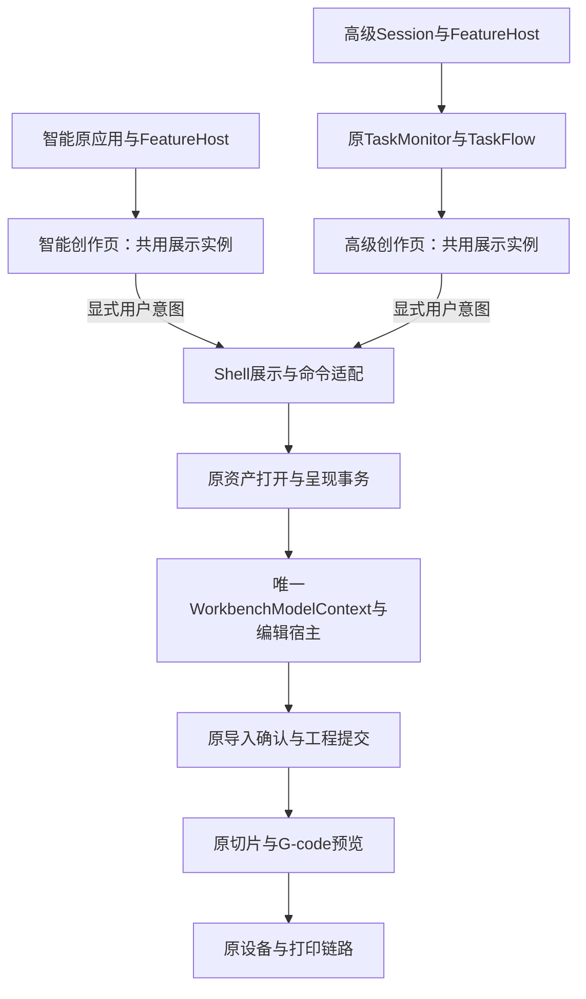
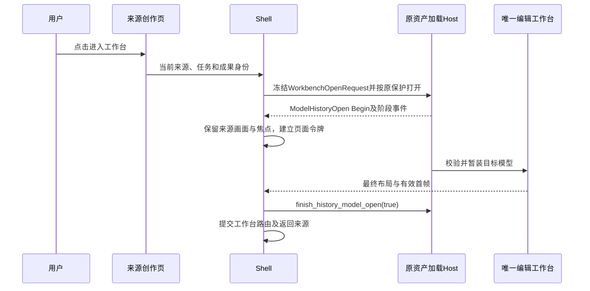

# AI 创作页内 3D 生成与工作台直达编辑：软件开发方案

| 项目 | 内容 |
| --- | --- |
| 日期／版本 | 2026-11-12／V1.0 |
| 所属主线 | MAINLINE-BUGFIX-001 |
| 需求依据 | [页内3D生成完整需求V1.0](2026-11-12-inline-3d-generation-requirements.md) |
| 分析基线 | codex/team/integration，072f52d5e8 |
| 交付性质 | 技术方案、实施顺序和验证设计；本文中的新增类型／接口是拟议设计，尚未实现 |
| 当前范围 | 按用户最新指示继续输出方案文档，产品修改和41条用例验收未开始 |

开发状态、授权和验证结果仅维护于[主计划](../2026-09-25-product-convergence-and-lightweight-plan.md)及[短状态](../../../docs/coordination/current-development.md)。本文定义怎样实现，不另建执行进度台账，不将方案或源码阅读当作产品验收。

2026-11-13已确认的局部维护按[四项反馈修改方案与测试用例](2026-11-13-inline-3d-generation-feedback-fix-plan.md)执行：输入空态按钮和必要恢复接入、原透明图标、高级中文展示投影及智能准备说明；沿原状态所有者，不重构任务、工作台或下游。远端ready但尚无本地模型／发布记录仍属待恢复，不能因隐藏按钮而丢失下载入口。

## 1. 方案结论与范围

采用“共用生成展示组件＋两模式独立业务状态＋显式资产交接”的方案：

1. 智能和高级继续沿用各自原有提交、轮询、下载、恢复及资格规则。
2. 两个创作中央区分别挂载共用的进度／只读3D预览组件；两份视图实例不共享可变任务状态。
3. 当前模型本地加载并成功呈现有效首帧后，才展示完成双按钮和顶部提示。
4. 点击“进入工作台”时冻结所见成果，经原保护及加载事务进入现有唯一编辑工作台。
5. 工作台Tab直接进入编辑；取消独立Result页面，保留切片、G-code预览和打印业务。

本次主要修改 GUI 展示、Shell 路由及已有 Host 的展示适配。预计不改供应商协议、生成算法、历史格式、2D四图规则或切片内核。新增的资产只读快照接口属于既有 GUI Host 接缝，不新增跨模块领域状态。

三条底线 BL-01／BL-02／BL-03 分别以智能8条、高级9条、下游14条目标用例记录，另有展示及兼容10条，共41个编号。按需求第13.1节2026-11-13用户确认，AC-S03不适用，实际适用40条，不适用不计通过。测试通过范围及真实服务／GUI／实物证据须独立记录。

## 2. 当前代码事实与改造原因

下表是对分析基线的只读核对结果，函数名用于定位；后续源码变化后重新确认调用关系。

| 已有位置 | 当前行为 | 本次处理 |
| --- | --- | --- |
| [RedesignShell.cpp](../../../src/slic3r/GUI/Redesign/RedesignShell.cpp)中的build_model_workspace | 创建独立结果页及其进度、预览、侧边动作 | 迁移有效展示及动作后删除该页面创建逻辑 |
| 同文件apply_model_generation_state | 按任务变化更新Result子视图，并自动导航Page::Model | 保留任务代次过滤，移除由任务更新触发的页面导航 |
| 同文件apply_advanced_model_state | open_route为真时清理共享预览并导航Result | 改为更新高级页内展示，不触碰全局编辑路由 |
| 同文件ensure_model_preview／clear_model_preview | Shell持有一个结果预览、线程及路径级缓存 | 迁到共用页内展示组件，增加来源／任务／资产和首帧约束 |
| 同文件request_primary_action／request_generate_design | 智能使用request_generate_smart完整链 | 生成与重新生成均复用该链，不改成仅提交3D |
| [AdvancedCreationWorkspace.cpp](../../../src/slic3r/GUI/Redesign/AdvancedCreationWorkspace.cpp) | 中央固定为四图，底部另有查看3D模型入口 | 增加四图／页内3D互斥展示及完成双按钮 |
| [AdvancedCreationFeatureHost.cpp](../../../src/slic3r/GUI/AI/ModelGeneration/AdvancedCreationFeatureHost.cpp)中的generate_model | 按原确认计划和四图资格提交，保存待核对回执 | 复用该命令，不绕过确认、回执和四图冻结 |
| [RedesignModelWorkflow.cpp](../../../src/slic3r/GUI/Redesign/RedesignModelWorkflow.cpp)中的show_model_view | 只有从Result进入编辑时调用保留来源画面的工作台呈现事务 | 将来源扩展为智能／高级创作页，并保留历史事务接缝 |
| [RedesignWorkbenchPresentation.cpp](../../../src/slic3r/GUI/Redesign/RedesignWorkbenchPresentation.cpp) | 已有来源画面保留、首帧提交、超时和失败回滚 | 复用并适配来源控件，不重写第二套切页事务 |
| [ModelGenerationHistoryOpen.cpp](../../../src/slic3r/GUI/AI/ModelGeneration/ModelGenerationHistoryOpen.cpp) | 校验显式资产、摘要并异步打开，保护原编辑模型 | 作为两来源进入工作台的统一资产加载入口 |
| navigate_to_workbench及[RedesignWorkspaceNavigation.hpp](../../../src/slic3r/GUI/Redesign/RedesignWorkspaceNavigation.hpp) | 工作台Tab恢复原子视图，可能返回Result／切片／预览 | Tab固定请求Workbench，其他明确业务入口仍按原目标进入 |

仅删除两处navigate_to调用会丢失中央进度、预览及恢复入口；仅把旧预览控件挪位置还会留下单实例状态串用和旧返回路由。因此需要同时调整展示、身份、动作和导航。

## 3. 目标架构与依赖方向



| 所有者 | 真值及职责 | 本次界限 |
| --- | --- | --- |
| 智能原Host／应用 | 当前输入、智能flow、任务、资格、停止与恢复 | 展示组件只读投影，不自行发HTTP或重建智能规则 |
| 高级Session／FeatureHost | 草稿、四图、选择、套图、确认及任务提交 | 不引入智能草稿；共用展示不成为高级Session |
| AdvancedModelTaskMonitor／Flow | 观察明确高级任务，沿Ports轮询／获取／本地准备 | 不创建编辑宿主，也不取得智能任务提交能力 |
| 页内展示实例 | 本实例的解析／GL资源、相机、加载错误及有效首帧 | 仅保存可重建的呈现状态，不保存第二份业务任务 |
| Shell | 来源适配、显式导航、显示互斥、来源焦点及提示管理 | 状态回调只刷新；导航由明确意图触发 |
| WorkbenchModelContext／原编辑Session | 当前编辑资产、候选、检查凭证及编辑事务 | 生成B完成不替换编辑A |
| Plater／切片／设备原模块 | 工程、预设、撤销、切片、G-code及设备状态 | 不由新展示组件接管 |

依赖继续从GUI适配指向既有应用、契约及预览能力，不新增内核到GUI／供应商的反向依赖，也不让两个模式相互调用对方的业务命令。

## 4. 组件划分及拟议接口

### 4.1 共用组件

| 拟议文件／组件 | 职责 |
| --- | --- |
| InlineModelGenerationState.hpp | 来源／任务／资产标识、局部预览状态及纯展示投影；不包含wx控件或HTTP |
| InlineModelGenerationView.hpp／.cpp | 中央进度／错误／真实3D预览、异步本地加载及首帧回调；同模块提供左栏完成动作控件 |
| GenerationCompletionToast.hpp／.cpp | 一个由Shell管理的顶部提示实例，负责布局、生命周期及可替换的提示策略 |
| RedesignCreationModel.cpp | RedesignShell的来源适配、页内动作分发及资产快照交接，避免继续堆入Shell主文件 |

两模式各持有一个InlineModelGenerationView实例，GL预览按首次需要懒创建。中央展示和左栏动作采用同一投影，但分别挂载在中央容器和左栏固定底部，不能把动作随中央区一起滚动。

以下为目标接口草案，名称可随既有命名规范细化，不代表当前已有API：

```cpp
enum class CreationSource { Smart, Advanced };

struct InlineModelCallbacks {
    std::function<void()> regenerate;
    std::function<void()> open_workbench;
    std::function<void()> stop;
    std::function<void()> resume_task;
    std::function<void()> retry_local;
};

// 实际声明还需提供构造／关闭及明确的绑定类型。
void apply_snapshot(const GenerationBinding&, const ModelGenerationUIState&);
void set_presented(bool active);
void retry_preview();
void invalidate_context();
```

回调由拥有对应业务Host的适配层注入，中央组件不按一个全局advanced布尔值选择业务服务。重复apply_snapshot不能触发生成、资产交接或重复注册轮询。

### 4.2 最小Host接缝

智能Host现有request_open_generated_artifact会在内部组装WorkbenchOpenRequest。为使页内预览和“进入工作台”绑定同一成果，拟增加一个只读快照入口，例如snapshot_generated_artifact()，返回可选的WorkbenchOpenRequest值副本：

- 只从已有生成资产字段组装路径、任务、摘要、颜色、参考图和历史信息，不加载编辑对象，不发请求。
- 现有request_open_generated_artifact复用同一个组装函数，避免两份元数据映射。
- 高级继续从model_artifact()取得ModelLibraryEntry，并通过既有结构组装同类请求。
- UI不自行扫描历史寻找“最新模型”，不把工作台当前资产当作生成结果。
- 调用request_open_workbench_artifact前再次核对当前展示绑定；Host仍执行原有有效性／替换保护。

变更只读接缝时同步检查原调用方和GUI契约测试；不向AI/Contracts追加UI专用的提示／导航字段。

## 5. 身份、状态及完成条件

### 5.1 三类身份

| 身份 | 内容 | 用途 |
| --- | --- | --- |
| 来源上下文 | Smart／Advanced；高级套图ID与Session epoch，或智能原会话上下文 | 识别新建、切组和跨模式，不把旧组回调装到新组 |
| 任务身份 | 原model_generation_session、smart_flow_id／job_id及该来源上下文 | 保留原代次过滤，绑定任务动作；revision仅用于同任务快照新旧判断 |
| 成果身份 | asset_id、规范化路径及已有期望SHA256／资产修订 | 区分同路径不同内容，绑定本地加载、首帧和编辑交接 |

智能准备阶段尚无最终job_id时使用原smart_flow_id保持连续，不因获得job_id误认成另一轮生成。高级使用原套图／任务上下文；恢复同一远端任务与新建任务明确区分。

呈现代次另外由组件递增，用于本地线程和GL回调。它不能替代业务任务身份，也不能作为判断是否应该重新计费提交的依据。

### 5.2 局部预览状态

局部状态为Empty、Preparing、AwaitingFirstFrame、Ready、Failed；它描述当前实例的本地呈现，不写回远端任务状态或持久化历史。

| 原业务投影与本地状态 | 呈现 | 动作 |
| --- | --- | --- |
| Input／DesignReady且未启动当前3D | 原引导、输入或高级四图 | 原生成资格 |
| 智能GeneratingDesign | 输入准备，沿原智能阶段／估算 | 原停止／恢复资格 |
| GeneratingModel／Stopping | 实际生成／停止反馈 | 正确来源任务动作 |
| LoadingModel及下载／校验阶段 | 真实本地处理反馈 | 不提前显示完成入口 |
| ModelReady＋Preparing | 本地预览准备 | 不显示完成双按钮 |
| ModelReady＋AwaitingFirstFrame | 显示最终尺寸的GL视口并等待有效首帧，保留加载反馈 | 不显示完成双按钮 |
| ModelReady＋Ready | 当前真实模型 | 完成双按钮，各自按实际资格启用 |
| 业务失败／停止 | 原诊断及恢复说明 | 原任务恢复／服务重检 |
| 远端成功但预览Failed | 本地预览失败 | 重新加载，不重新提交远端任务 |

完成条件为：当前来源和任务有效、当前成果有效、必要本地准备成功、当前模型在正确尺寸及DPI下成功呈现。打开工作台的动作资格与完成显示分别判断，不能用can_edit、检查通过或可导入代替预览完成条件。

### 5.3 首帧与窗口恢复

1. 复用ModelPreview3D::prepare_model和load_prepared_model，CPU准备完成后在GUI线程安装GL资源。
2. 进入AwaitingFirstFrame时必须将预览挂到最终容器、完成布局并显示；不能先隐藏GL等待首帧，否则会形成等待死锁。
3. 使用原observe_presentation_frame及ModelPreviewFrameState的模型／尺寸／DPI校验，外层再核对来源、成果摘要和本地呈现代次。
4. 首次有效提交才进入Ready；旧尺寸、旧模型或已隐藏实例的回调不生效。
5. 首帧等待可复用RedesignPresentationDeadline当前15秒的有效可见等待机制，作为本地呈现技术超时；计时从本地安装并请求可见帧后开始，不计CPU解析或远端生成时间。
6. 隐藏／最小化时暂停本地可见等待，业务观察仍按原流程；恢复后重新布局并请求当前尺寸帧。
7. 本地等待超时仅进入可重载的预览失败，不改变远端任务状态，也不重新生成。

## 6. 智能模式改造

### 6.1 页面挂载

在原image_center内新增页内生成视图，与引导区、图片展示区按同一布局投影互斥显示。保留模式选择、上传、描述、风格、参数及原历史侧栏；不把这些业务控件迁入新组件。

将update_image_state中与中央显隐相关的分支收口为一个展示选择函数，避免旧图片分支在生成后重新盖住GL。左侧action_panel增加固定底部完成动作行，完成态替换单个生成按钮；原停止／恢复等动作按阶段显示。

### 6.2 命令流程

首次生成和“重新生成”均进入原request_primary_action／request_generate_design，继续同步当前输入及选项，最终调用request_generate_smart。保留原智能输入准备、幂等身份、待核对flow、资格及任务保护和后续自动衔接。原智能流程没有生成确认弹框，按用户确认保留该原流程；AC-S03记为不适用，不新增确认步骤。

新任务未受理前保留旧成果；受理后新绑定清除旧完成态并展示进度，旧模型及历史仍由原业务保存。资格失败或未受理时不得新增任务。失败时不把旧成果冒充新任务成功，也不删除旧文件。

apply_model_generation_state继续接收原快照并更新草稿及历史，但任务状态只能刷新对应页内视图。原model_generation_route_action中的过期回调保护迁到新的展示绑定判断，取消Model／Image自动导航副作用。

已完成3D历史的显式编辑打开和未完成任务恢复要分开处理，不能因不再自动导航而丢掉历史的明确用户动作。

## 7. 高级模式改造

### 7.1 中央四图与3D互斥显示

在现有center容器增加共用页内视图，保留grid四图及其事件绑定。2D阶段显示四图；用户进入3D阶段并提交、恢复或明确查看该成果时，中央显示相应3D状态。

保留原每次进入高级默认2D的规则及已有返回2D入口；3D任务更新不强制把用户手动选择的2D阶段切回3D。切组／新建时按Session上下文失效旧展示绑定，四图选择和草稿不由3D视图改写。

### 7.2 命令与资格

- 首次生成和完成态“重新生成”均复用generate_model(model_confirmation())。
- 保留save_draft、model-plans／model-jobs原协议、四图冻结、确认指纹、pending receipt和全局串行约束。
- 四图资格继续由Session／FeatureHost计算，UI不复制一份“有四张图就可生成”的判断。
- 设计输入变化仍先按原规则更新2D；3D重新生成不调用generate_design，不改回智能入口。
- 停止、resume_model、retry_local_model及回执核对分别保留，不把所有“重试”接到同一个新生成命令。

### 7.3 状态监听与展示意图

保留AdvancedCreationWorkspace原Session刷新监听和FeatureHost原model_state监听，新增组件由既有适配层分发，不用另设监听覆盖原消费者。

原open_route只表示来源面板中的展示意图，不再导航Page::Model。可在局部改为明确的Refresh／ShowInline枚举；ShowInline仍核对发起时的来源上下文和阶段选择代次，不能让晚回调切走用户后来选择的四图视图。

原“查看3D模型”动作迁为页内查看当前3D成果，完成态使用指定双按钮，不保留通往旧结果页的隐藏入口。

## 8. 路由与页面生命周期

### 8.1 路由目标表

| 触发 | 目标 |
| --- | --- |
| 智能／高级生成、轮询、下载及完成更新 | 刷新来源创作区，不改变全局页面 |
| 用户恢复未完成任务 | 原资格通过后显式定位来源创作区及正确任务 |
| 当前成果“进入工作台” | 显式资产交接成功后进入Workbench |
| 工作台Tab | 请求Workbench；原忙碌／弹层保护仍生效 |
| 已完成3D历史／本地／模型库打开 | 原显式资产加载事务直达Workbench |
| 工作台返回创作 | 原进入来源及该来源最新工作区 |
| 导入成功、切片、G-code预览、设备／打印 | 原明确业务路由，保留Slicing／Preview／Print |

工作台Tab的编辑目标不能误改为所有业务入口的统一目标；TAB_ID_PREPARE、TAB_ID_PREVIEW及设备入口继续保留自己的语义。原m_busy等业务保护若拒绝当前切换，保留现场及说明，不能为让Tab可点而放开并发编辑规则。

### 8.2 删除Result及引用清理

迁完有效能力后删除RedesignModelView::Result及对应创建、显隐、布局、返回和焦点分支。保留Workbench、Slicing、Preview，默认模型子视图改为Workbench。

重点同步：

- m_model_view_focus数组大小及按枚举索引访问；所有switch分支及旧Result比较。
- page_route_root、active_page_focus_root、present_active_page、refresh_workflow_layout及窗口恢复的GL刷新目标。
- set_workbench_results_handler与history_navigation_handler：重新映射明确意图，不再调用show_model_view(Result)。
- m_model_route_locked／route_id／session：移除仅为锁Result导航服务的部分，保留到新绑定中的任务安全语义。
- m_advanced_model_route：不再作为全局共享预览的来源开关，相关消费者改为明确来源参数。
- m_model_page旧结果页控件、Shell单实例预览线程及无消费者的成员／include，在迁移验证后删除。

### 8.3 页面注册和初始化顺序

当前build_image_workspace先把旧结果页放入m_pages[Model]，而真实m_workbench_page在后续build_model_workflow才创建。改造时需调整注册时机，确保：

1. Page::Model的正式页面根在工作台构建完成后指向有效编辑容器。
2. 导航在目标根尚未就绪时不会访问空指针；状态快照可暂存，在挂载后应用。
3. 同一wxWindow不会在m_pages和工作流专用逻辑中被重复加入Sizer、重复销毁或互相隐藏。
4. 普通导航、切片及呈现事务对页面显隐使用一致的主责；删除“只有Result才显示m_pages[Model]”等旧条件。

不保留一个空的旧结果页充当兼容壳，不增加能重新启用旧中转页的开关。

## 9. 显式进入工作台的资产事务

### 9.1 正常时序



实际函数先后以原事务要求为准；不得先提交可见路由后再补保护或校验。文件校验、读取、原模型检查点及失败恢复仍由原Host／HistoryOpen链负责。

### 9.2 交接规则

- 点击时从当前预览绑定取得不可变的WorkbenchOpenRequest副本，校验成果与当前视图一致。
- 若同一成果已在工作台，沿原保护恢复当前编辑现场，不从生成原件重载覆盖未保存编辑。
- 不同成果通过request_open_workbench_artifact进入原未保存／候选／处理中保护、摘要校验及历史加载事务。
- 来源锚点在成功提交时写入；用户取消或加载失败不能改变旧编辑对象的返回来源。
- 资产打开的异步完成不以“最新生成任务”为索引，后续新任务不能改变已冻结的打开目标。

### 9.3 来源保留、失败及共享历史栏

扩展show_model_view(Workbench)的来源判断，使智能及高级创作页进入时复用begin_workbench_presentation，而不是只有Result才走该事务。

智能左侧设置与中央内容是并列控件，保留来源画面时继续使用workbench_transition_bounds及既有设置显隐逻辑；高级使用完整AdvancedCreationWorkspace作为来源。快照保留、原控件重挂载、焦点及输入过滤均由已有呈现事务处理。

共享历史栏仍复用mount_smart_model_history／restore_smart_model_history：目标工作台准备前恢复原挂载，失败回到智能时重新挂载；高级套图历史保持自身所有权，不迁入共享3D历史。

失败、取消或有效可见等待超时，先等待原加载工作者安全结束，再由finish_history_model_open(false)恢复原资产及页面；迟到首帧不能提交。最小化暂停等待，恢复后核对最终布局，不改为等待can_edit或检查通过。

## 10. 异步加载、资源与关闭

### 10.1 本地工作者

- CPU模型准备在线程执行，GL安装、控件访问和首帧登记只在GUI线程执行。
- 每个展示实例最多一个本地准备工作者；切任务时取消旧请求，保留最新待处理绑定，旧工作者完成退出后再启动最新请求。
- 采用组件拥有的线程及共享请求数据：取消标记、成果身份、准备结果、错误、代次。工作者不直接捕获已可能销毁的wx控件裸指针。
- GUI回调使用wxWeakRef及代次校验，旧回调先排除再安装；不能像旧路径一样仅凭相同文件路径认为结果仍有效。
- 原ModelHistoryOpenRequest的cancel_after_drain模式可作为参考；创作预览请求不复用编辑事务对象来保存业务状态。
- 普通切页不能在GUI线程等待一个尚未结束的大模型解析join；结束回调仅回收已完成线程。关闭时协作取消并完成线程回收，不detach后台线程。

### 10.2 资源与显示

GL实例按需创建；隐藏实例暂停进度动画及主动绘制，不启动新的预览解析，业务轮询仍归原Host。模型切换、失效和销毁释放本实例旧CPU／GPU资源，不引入新的全局几何缓存。

进入工作台过程中保留来源预览到目标提交或回滚完成；成功进入后隐藏来源视图。使用100万／200万面本地样本检查内存、切页响应和模型等比缩放，记录实测结果，不预先宣称性能达标。

关闭顺序为停止提示／局部定时器、断开视图回调、递增本地代次、取消并回收工作者、解除帧观察、销毁视图。原Host的关闭及远端任务保留规则不因展示关闭而改变。

## 11. Figma落地及提示策略

原始规格以[需求第11节](2026-11-12-inline-3d-generation-requirements.md#11-figma-原始-ux-规格)为唯一参数依据。实施时重新读取所需图标资源，不能靠截图重画或把会过期的导出URL写成长期资源。

### 11.1 完成动作

采用局部完成态控件样式，不修改全局所有按钮的默认视觉。复用现有事件、键盘和焦点能力，在本次专用样式中实现：

- 动作行312×44 DIP，120／6／186布局，左栏底部16 DIP。
- 重新生成的白色15%填充／描边及底色层60%透明度、文字65%白。
- 主按钮三色渐变及中间停点、正确渐变方向和底部40%光效。
- 图标20 DIP、图文间距6 DIP、16px Medium文字及原圆角参数。

现有RoundedActionButton的generation_gradient只有双色，图文间距为7 DIP且使用统一透明度，不能直接视为匹配。可给其增加明确的局部样式参数，默认分支不变；或在同一完成动作模块内使用专用绘制控件，复用原输入行为。最终选择以减少重复交互实现及保持其他按钮不变为准。

三色渐变通过wxGraphicsGradientStops及设计gradientTransform换算，不直接把CSS角度作为原生端点。模糊光效可按当前DPI缓存透明位图，在尺寸／DPI变化时重建，避免每帧CPU模糊。

### 11.2 字体与进度

沿用smart_creation_font的96 DPI逻辑像素到点换算，以及现有HONOR Sans Design→HarmonyOS Sans SC→Microsoft YaHei UI回退。16px不应直接传成16pt；不重复按DPI放大字体。

透明文字／背景按实际父表面合成，避免Windows原生文字忽略alpha。中央反馈使用334×95、288×8轨道及#FFC227；阶段、估算、耗时仍来自原业务，静态36%不参与运算。

### 11.3 顶部提示

由Shell管理一个GenerationCompletionToast，建议采用不抢焦点的原生浮动提示，避免普通子Panel被GL画面遮挡。锚定Shell完整主内容客户区顶部16 DIP并整体居中，不仅在中央3D视口内居中。

298×48、黑底、圆角12、14px／24行高、20图标及阴影使用原参数。窗口移动／缩放／DPI变化重算屏幕坐标，最小化、隐藏、来源切换及页面呈现事务期间同步隐藏，销毁时清理定时器和回调。

非模态、3秒消失、首次显示一次、后台完成后的提示处理及无点击／关闭按钮，仍是需求第14节中的建议。本方案将其封装为可替换的展示策略，不写进业务Session、远端状态或历史格式，也不将建议标为用户已确认。

去重策略若采用“同任务一次”，键应基于来源、原套图／稳定flow或job及成果，不含进度revision、窗口尺寸或本地呈现代次；否则重绘和重新加载会重复弹出。去重不需要新增持久化格式。

## 12. 异常与下游兼容处理

| 情况 | 处理及保持的边界 |
| --- | --- |
| 资格失败／原有确认取消（确认仅适用于原有该步骤的模式） | 保留原输入、四图、旧成果及历史；释放本次准备状态，不改变编辑A |
| 远端失败／请求不确定 | 在来源页展示原错误，保留flow／job／receipt，按原核对或恢复，不自动新增付费任务 |
| 下载／校验失败 | 原Host恢复同一产物，不通过重新生成规避本地失败 |
| 本地解析／首帧失败 | 当前视图提供重新加载；原远端成功状态和文件保持 |
| 用户新建／切组／跨模式 | 新来源上下文失效旧呈现；旧请求结果仍归原任务和历史 |
| 后台完成 | 仅刷新所属状态，不切Tab、不替换编辑对象；提示按待定策略处理 |
| 工作台打开取消／失败 | 原事务恢复旧对象、来源画面、焦点及历史挂载 |
| 重启恢复 | 使用原任务／套图持久化，未完成任务回来源页，已完成模型保留原查看／编辑入口 |
| 导入成功／失败／取消 | 继续confirm_workbench_import和原工程提交事务，不因来源改变为直接打印 |
| 切片／预览／打印 | 继续start_workbench_slice、有效G-code及open_print_preparation原资格，不自动切片或改预设 |

本次不修改导入颜色匹配、候选保存、修复算法、切片配方或设备协议。相关回归发现问题时先区分本次引入与既有缺陷，必要修复须对应本需求受影响路径，并保留原失败记录。

## 13. 文件级改动范围

以下是预计范围，后续依实际消费者细化，不代表文件全部必须修改。

| 路径 | 预计改动 |
| --- | --- |
| src/slic3r/GUI/Redesign/RedesignShell.cpp／.hpp | 挂载、监听、路由、副作用拆分；删除旧结果控件及共享结果预览成员 |
| src/slic3r/GUI/Redesign/RedesignCreationModel.cpp（新增） | 来源适配、快照交接及页内用户动作 |
| src/slic3r/GUI/Redesign/InlineModelGenerationState.hpp（新增） | 纯展示投影、身份及完成门控 |
| src/slic3r/GUI/Redesign/InlineModelGenerationView.hpp／.cpp（新增） | 中央展示、本地加载及底部完成动作组件 |
| src/slic3r/GUI/Redesign/GenerationCompletionToast.hpp／.cpp（新增） | 顶部提示及可替换行为策略 |
| src/slic3r/GUI/Redesign/AdvancedCreationWorkspace.cpp／.hpp | 四图／3D显示切换、完成动作及原命令接线 |
| src/slic3r/GUI/Redesign/RedesignModelRoute.hpp | 删除生成驱动导航，保留或迁移来源／任务新旧判断 |
| src/slic3r/GUI/Redesign/RedesignWorkspaceNavigation.hpp | 删除Result，Tab编辑目标与明确切片／预览目标分离 |
| src/slic3r/GUI/Redesign/RedesignModelWorkflow.cpp | 创作页直达编辑、页面根／焦点／恢复及返回适配，原下游命令继续复用 |
| src/slic3r/GUI/Redesign/RedesignWorkbenchPresentation.cpp | 来源控件、历史栏、首帧提交和回滚适配 |
| src/slic3r/GUI/Redesign/RedesignWidgets.hpp | 必要时增加局部样式参数，不改变默认按钮行为 |
| src/slic3r/GUI/AI/ModelGeneration/ModelGenerationFeatureHost.cpp／.hpp | 只读生成资产快照接缝 |
| src/slic3r/GUI/AI/ModelGeneration/ModelGenerationHistoryOpen.cpp | 共用快照组装，保留原校验和加载事务 |
| src/slic3r/GUI/ModelGenerationPanel.hpp | 只读快照声明所需最小变更，不扩展业务状态 |
| src/slic3r/GUI/AI/ModelGeneration/AdvancedCreationFeatureHost.cpp／.hpp | 必要时收口ShowInline展示意图，保持提交／轮询／回执规则 |
| src/slic3r/GUI/Redesign/RedesignSources.cmake | 新GUI源文件注册；复用现有target |
| resources中既有重设计图标目录 | 经Figma核对的局部图标／光效资源，准确目录在资源复用检查后确定 |
| tests/slic3rutils及其CMakeLists.txt | 新展示门控回归、旧路由预期更新及相关消费者回归 |
| Docs/architecture/PLATFORM_ARCHITECTURE.md及review-map.json | 实施后同步真实入口／锚点；不提前描述为已实现 |

默认不改MainFrame／Plater业务实现、tools/ai供应商及数据库、libslic3r、模型格式或预设。发现必须触及这些边界时，先给出与需求的直接关系及兼容影响，不能顺手接管其他未结任务。

## 14. 实施顺序与阶段出口

按单代理、现有分支和本checkout构建目录顺序推进。下列阶段是依赖及验证边界，不是新增分支、独立进度台账或逐阶段审批流程。

| 阶段 | 实施内容 | 阶段出口 |
| --- | --- | --- |
| P1 保护与展示投影 | 核对当前源码／运行身份；定义来源和成果绑定；冻结原下游回归；增加纯投影及关键行为用例 | 旧任务、跨模式、同路径变更、完成资格等逻辑可定向验证 |
| P2 共用展示与资源 | 迁入进度／预览、本地工作者和首帧门控；实现局部完成动作及提示组件 | 可用已有本地真实模型验证显示／失败／DPI，原业务命令尚不被重写 |
| P3 智能接入 | 智能中央显示及完成动作、原完整重生成命令、状态只刷新 | BL-01对应逻辑与主窗口路径有效，旧成果和历史保持 |
| P4 高级接入 | 四图／3D互斥、同四图重生成、恢复／本地重载及来源过滤 | BL-02对应逻辑与主窗口路径有效，四图业务和回执保持 |
| P5 交接与路由收口 | 创作页进入原工作台事务，Tab编辑直达，返回／历史／空态；迁完后删除Result及无消费者代码 | 两来源资产正确、取消和失败回滚有效，旧中转页不可达，切片／预览入口仍有效 |
| P6 消费者回归与交付 | 对应Windows构建、41条用例、受影响测试及架构／文档检查，修复本次失败并按变更补测 | 三条底线及必需交互有对应证据；未执行内容明确，不虚报验收 |

迁移期间先保留能力再删除旧实现，最终交付不留下隐藏的旧等待／结果页。确认实施后，在已授权范围内连续完成相关验证和失败修正，不以阶段结束自动停止。

## 15. 41条用例的验证设计

### 15.1 需求到用例追溯

| 需求 | 主要验证落点 | 对应原验收编号 |
| --- | --- | --- |
| IG-01／IG-02 | 任务刷新不导航；原恢复入口；删除Result及旧返回 | AC-S01、AC-S04、AC-A02、AC-U06、AC-U07、AC-U10 |
| IG-03 | 工作台Tab编辑目标、空态及运行中业务保持 | AC-W01、AC-W13 |
| IG-04／IG-05 | 智能原资格及任务保护、完整链、重生成及恢复，保留无确认弹框原流程 | AC-S01～AC-S08（AC-S03按用户确认不适用） |
| IG-06／IG-07 | 高级四图、资格、同图重生成和新建隔离 | AC-A01～AC-A09 |
| IG-08／IG-09 | 阶段投影、真实预览、首帧门控及Figma效果 | AC-S04、AC-A02、AC-U01～AC-U05、AC-U08 |
| IG-10 | 两来源准确交接、编辑A保护及失败回滚 | AC-W02～AC-W04 |
| IG-11 | 检查／编辑／导入／切片／预览／打印／普通Orca | AC-W05～AC-W06、AC-W08～AC-W14 |
| IG-12 | 历史／本地／模型库直达与返回来源 | AC-S08、AC-A07～AC-A08、AC-W07、AC-W12、AC-U10 |
| IG-13／IG-14 | 失败恢复、请求不确定、新建／切组、过期回调 | AC-S02、AC-S06～AC-S07、AC-A03～AC-A04、AC-A08～AC-A09、AC-W04、AC-W09、AC-U06～AC-U09；AC-S03保留编号、不适用 |
| IG-15 | 原件、工程、历史／凭证、重启及手动兼容 | AC-S08、AC-A01、AC-A07～AC-A09、AC-W03～AC-W14、AC-U09 |

### 15.2 测试分层

| 层级 | 内容 | 证据界限 |
| --- | --- | --- |
| 纯逻辑 | 来源／任务过滤、展示投影、完成门控、动作资格、路由目标、提示策略 | 不能证明wx布局、GL首帧或真实服务生成 |
| 原消费者回归 | 智能flow、四图Session／Monitor、资产摘要、HistoryOpen、候选／撤销、导入及G-code资格 | 保留既有保护断言，不能删掉失败用例换取通过 |
| Windows构建与运行身份 | 新源文件／接口注册、EXE／DLL／资源／sidecar匹配 | 编译通过不等于41条验收通过 |
| 真实主窗口 | 两模式生成展示、双按钮、提示、导航、历史、工作台编辑和下游操作 | 使用对应新版本及隔离样本，逐项说明实测范围 |
| 真实服务 | 两模式原提交、停止／恢复、同任务核对及真实成果 | 需要有效输入／服务及已有明确预算，不使用离线fixture冒充 |
| 设备／实物 | 原打印入口、设备发送及实际打印所执行步骤 | GUI入口通过不能声称实物打印通过 |

原41个编号中的智能8条、高级9条、下游14条、展示兼容10条，应在执行时逐条关联证据和结论。按需求第13.1节用户确认，AC-S03单列不适用，实际适用40条，不适用不计通过；智能输入、历史及旧成果保护仍保留已有证据，其余用例标准不变。自动断言数量不能折算为适用用例均通过；未执行、环境阻塞和失败分别记录在主计划引用的执行证据中。

### 15.3 自动回归落点

新增test_inline_model_generation.cpp，拟使用InlineModelGeneration标签；重点覆盖任务刷新不导航、跨来源同job不串用、初始准备到job的身份连续、ModelReady但未首帧不可完成、旧首帧无效、同路径不同摘要重载、停止／本地重载动作分离。

更新现有test_ui_redesign.cpp中“新任务离开设计页进入Result”等旧预期，改为任务刷新保留当前页面，同时保留旧任务拒绝、历史显式打开、切片／预览资格和返回来源的行为断言。

复用：

- test_advanced_creation.cpp、test_unified_workbench.cpp：四图资格、任务恢复与观察隔离。
- test_model_generation_submission_state.cpp：原提交／回执及过期操作保护。
- test_model_history_open.cpp、test_workbench_artifact_validation.cpp：显式资产、摘要、取消／回滚和原件保护。
- test_model_preview_state.cpp：有效尺寸／DPI帧、模型与回调代次。
- test_post_generation_workbench.cpp、test_beauty_workbench_session.cpp及实际相关消费者：导入资格、编辑候选及撤销。

不写仅比较控件常量或复刻实现分支的无效测试。局部UI改动以真实窗口核对，状态／持久化／异步交接使用有行为意义的自动回归。

### 15.4 主窗口执行顺序

1. 核对源码与完整运行身份、隔离配置及原件哈希；优先使用已有模型副本验证预览、工作台、失败回滚及下游路径。
2. 分别执行智能和高级生成／重新生成及停止／恢复，确认取消仅在原有该步骤的高级模式执行；智能保留无生成确认弹框原流程，AC-S03单列不适用。记录真实任务身份、四图版本和成果引用，并保留智能输入、历史及旧成果保护证据。
3. 验证工作台A存在时生成B，覆盖B完成不覆盖A、取消替换、目标失败、成功替换及返回来源。
4. 从两个来源分别覆盖编辑、导入成功／失败／取消、切片、预览、打印衔接和往返；完整使用原业务入口。
5. 验证窗口缩放、最小化／恢复、项目支持的DPI、历史及重启；保留未覆盖环境和异常截图／日志。

若真实服务、预算或设备不可取得，可继续完成独立的逻辑／本地路径验证，但相应用例保持未执行或阻塞，不能以mock服务替代验收结论。

## 16. 构建、检查与交付边界

以下命令是实施阶段的计划入口，本轮文档编写没有执行产品构建或测试：

```powershell
./dev.ps1 Check
./dev.ps1 CppTest -TestSuite slic3rutils_tests -TestLabel 'InlineModelGeneration|ModelGenerationRoute|UnifiedWorkbench|AdvancedCreation|ModelGenerationSubmissionState|ModelHistoryOpen|WorkbenchArtifactValidation|ModelPreviewFrame|WorkbenchNavigation|WorkbenchPresentation|PostGenerationWorkbench|BeautyWorkbenchSession'
./dev.ps1 Build
./dev.ps1 -NoLaunch
python scripts/verify_ai_integration.py --json
python scripts/architecture_review.py --check-map
python scripts/architecture_review.py --readme update
python scripts/architecture_review.py --readme check
python scripts/check_documentation_sync.py --base HEAD --worktree
git diff --check
```

- 继续使用本checkout的.tmp/dev/build、run、data及本机设置，不复制别处缓存；同一构建目录单写者，构建时不改源码。
- 上述测试标签按最终实际注册及消费者确定；未匹配不能算通过。仅相关输入、依赖或新失败变化后补测。
- -NoLaunch会准备运行目录；若目录被用户实例占用，先保留实例和工程，不强制关闭。真实主窗口验证另按独立配置和匹配产物执行。
- 修改入口／状态投影／Host接缝后同步平台说明和review-map；不弱化原集成检查，也不把已有四项MainFrame／Plater预算失败改写成通过。
- 仅文档输出阶段检查内容、引用与差异，不运行产品构建、生成或打印。
- 本地开发不要求先提交或推送；远端PR、发布和团队通知继续按用户明确请求处理。

## 17. 风险、回退与未定项

| 风险 | 处理 |
| --- | --- |
| 两模式串任务或过期回调抢页 | 来源／任务／成果及局部代次分别校验；所有状态刷新不触发全局导航 |
| 移动展示后仍引用旧Result | 全量搜索实际消费者，迁移有效能力后删除旧页、枚举、成员和无消费者回调 |
| 从创作页进入编辑失去回滚 | 扩展原呈现事务的来源，不重写资产安装／恢复；首帧有效后提交 |
| 首帧等待死锁或最小化误超时 | 先显示最终GL视口，复用帧校验和有效可见等待 |
| 200万面解析阻塞UI／资源上涨 | 工作线程协作取消、旧请求排空、懒建及停止隐藏绘制，使用真实本地样本量测 |
| 新按钮影响其他UX | 局部样式参数与资源，不更改通用默认分支；按Figma节点核对 |
| Tab强制编辑误改设备路由 | 区分Tab默认目标与切片／预览／设备的明确目标，保留原业务资格 |
| 展示恢复变成新付费任务 | 恢复／重新加载与重新生成分开映射，不在状态回调发提交 |

运行期失败回退依赖原页面令牌、资产检查点及失败恢复，不通过重新生成或重新导入“恢复”。源码级回退以本轮准确差异为范围，保留用户改动和生成原件，不使用reset／clean回滚整棵工作树。

尚未确定的产品细节继续沿需求第14节记录：提示形式、3秒时长、同任务去重、后台触发及点击／关闭行为。它们影响局部展示策略，不阻断其余架构设计；后续确定时同步需求和方案，不能默认为已获用户确认。

进入实施时，以本方案及需求V1.0作为修改边界；本轮软件开发方案的输出本身不产生实现、付费调用或41条验收通过结论。原首次配置诊断、工作台旧验收及其他主线未结保持各自来源，不在本需求中扩展处理。
