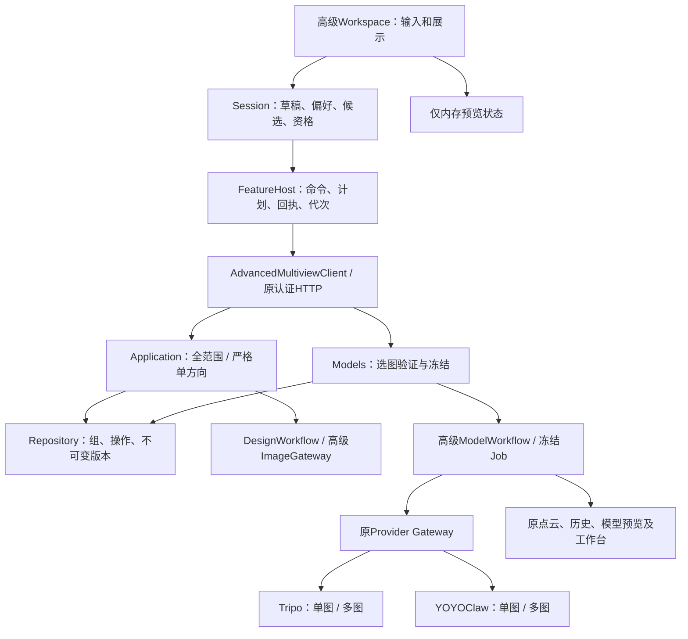
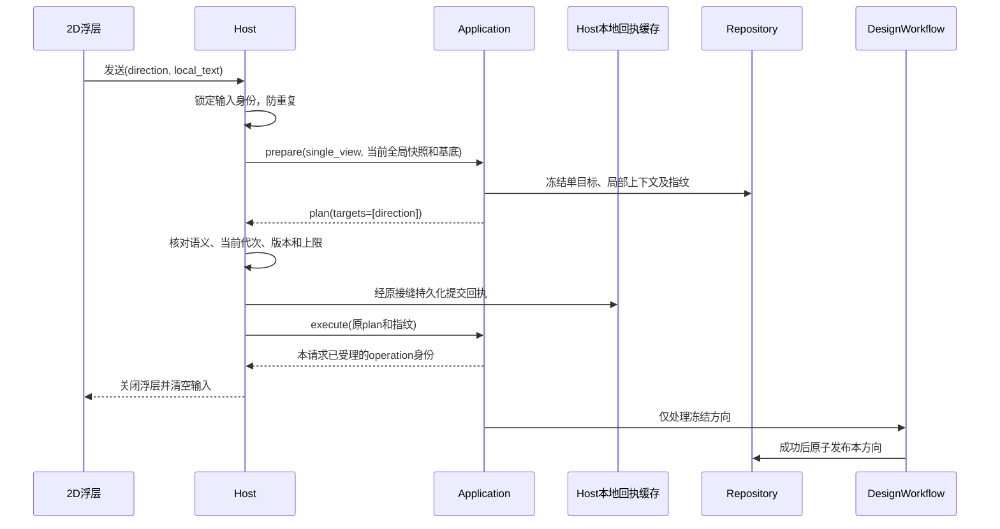
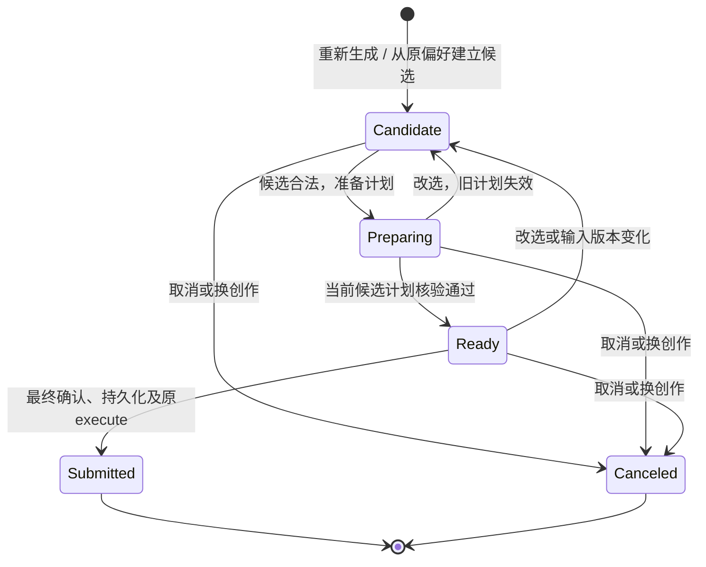

# 高级模式2D描述与预览：软件架构设计

版本：V1.0。日期：2026-11-24。归属：`UX/ADVANCED-MULTIVIEW-20261107`／`ADV-2D-01`～`06`。

需求依据：[已确认需求清单](2026-11-24-advanced-2d-description-preview-requirements.md)。源码核对基线：`codex/team/integration`／`10b47141bb5521cb9faa56a48d197f79d8770815`。配套：[详细开发方案](2026-11-24-advanced-2d-description-preview-development-design.md)、[测试用例](2026-11-24-advanced-2d-description-preview-test-cases.md)。

本文规定本次实施架构；需求已整体确认，用户随后明确授权按架构／开发方案实施及完成验收，2D和YOYOClaw不限次，Tripo新生成累计最多10次。设计条目本身不代表测试已通过。实施与执行事实只在[主计划](../2026-09-25-product-convergence-and-lightweight-plan.md#advanced-2d-description-preview-alignment-20261124)维护。

## 1. 范围与设计约束

本次改动集中于高级模式2D页面的全局描述、原图操作约束、两种预览及局部重生成，并以已确认的3D方案A承接已有模型后的改选。首次3D选图、供应商单／多图路由、生成保护、历史与工作台沿原接缝保留。

设计遵守[平台开发入口](../../architecture/PLATFORM_ARCHITECTURE.md#开发时怎样用)和[集成锁](../../../docs/architecture/ai-integration-lock.json)：状态在现有所有者内修改，UI负责展示和意图适配，HTTP负责传输，供应商适配器负责协议。不上移供应商策略，不建立第二份组／选图业务状态，不改变libslic3r、普通Orca、智能模式、公共Job契约或工作台规则。

已披露的必要关联范围包括高级专用请求／记录字段、严格单图计划、方案A的候选选择和冻结顺序、共享控件的高级上下文适配、测试及文档。若实施发现必须改变上述边界外的契约或行为，先说明具体影响并取得确认。

## 2. 当前实现与需要改变的接缝

| 核对位置 | 当前行为 | 本次设计 |
| --- | --- | --- |
| [Session](../../../src/slic3r/GUI/AI/ModelGeneration/AdvancedCreationSession.cpp)：`effective_views`、`click`、`toggle_selection` | 2D选择决定编辑范围；已有模型时2D显式改选同步下一次3D偏好 | 左栏固定全范围；2D不再产生业务选择；3D偏好继续由Session拥有 |
| [Workspace](../../../src/slic3r/GUI/Redesign/AdvancedCreationWorkspace.cpp)：`ViewCard`、`render`、`model_confirmation`、`accept` | 2D／3D共用点击与选中投影；动态标签；确认只展示冻结计划；上传接受缺少主图先后门禁 | 按上下文投影；新增限定的2D预览及浮层；已有模型确认中暂存候选；点击／拖入走同一上传校验 |
| [Host](../../../src/slic3r/GUI/AI/ModelGeneration/AdvancedCreationFeatureHost.cpp)：`generate_design`、`prepare`、`run_plan`、`generate_model` | 设计统一经过Confirm；3D先校验旧选择，再准备计划，再Confirm | 全局保留确认，局部直接提交；已有模型先可改选，再准备匹配候选的计划，在同一弹窗最终确认 |
| [Application](../../../tools/ai/advanced_multiview_application.py)：`prepare`、`_execute` | `edit`合并请求方向与`pending_views`；受理时更新组级已提交草稿；部分重试可能扩张方向 | 新命令明确全范围／严格单图；局部不并入pending、不隐式补主图、不覆盖组级全局提交基线 |
| [Repository](../../../tools/ai/advanced_multiview_repository.py)：`replace_inputs`、`load`、`version` | 已有输入失效、不可变版本及旧记录读取；允许保存缺主图中间态 | 继续保留中间态；新增／替换辅助图受主图约束，删除允许；新局部上下文随操作保存 |
| [DesignWorkflow](../../../tools/ai/advanced_multiview_design_workflow.py)／[ImageGateway](../../../tools/ai/advanced_multiview_image_gateway.py) | 按冻结方向生成；当前设计／原图按角色进入参考；提示词只有全局描述 | 严格单方向执行；当前图作为局部编辑基底；独立传递局部文字及优先级，仅高级提示词适配 |
| [Models](../../../tools/ai/advanced_multiview_models.py)／[ModelWorkflow](../../../tools/ai/advanced_multiview_model_workflow.py) | 已支持冻结含主图的1～4图及两家单／多图 | 复用现有选图请求和快照，不重写供应商能力；增加方案A端到端一致性验证 |

旧可变视角设计中的“2D返回改选下一次建模输入”由方案A替代；其它仍有效规则不因本次设计失效。旧2D范围数组不再是新UI生成范围或3D偏好的来源，其兼容读取不赋予新的选择行为。

## 3. 状态所有者

| 状态 | 唯一所有者 | 生命周期与消费者 |
| --- | --- | --- |
| 全局描述、风格、上传草稿及失效标记 | `AdvancedCreation::Session` | Host保存，Workspace投影；上传变化立即隐藏对应结果 |
| 当前可见版本、3D偏好／曾见方向、首次引导 | 同一Session | 当前可用性与人工偏好分开；恢复同方向结果不重置人工选择 |
| 方案A候选选择 | Session内临时选择事务，拟新增 | 从原偏好复制；候选不是已保存偏好；取消／换创作丢弃，最终确认才提交 |
| 全范围／单方向目标与计划资格 | `AdvancedMultiviewApplication` | 在当前保存输入上计算并冻结；客户端计算仅为交互投影和响应复核 |
| 组修订、原图关系、current、不可变设计版本、操作上下文 | `AdvancedMultiviewRepository` | 原子保存；删除当前关系不删除历史资产 |
| 计划请求代次、回执、停止、缓存及错误反馈 | `AdvancedCreationFeatureHost` | 使用原命令／回执接缝；新操作不能消费旧回调 |
| 2D／3D输入页的四格／单大图与当前预览方向，悬停与浮层文字 | Workspace展示状态 | 模式和方向由同一创作的页内控件共享。3D勾选从Session投影，并把明确的选图操作送回Session。 |
| 冻结3D输入、任务、结果 | 原高级Job及ModelWorkflow | 点云、历史、模型展示、工作台读取该Job的冻结输入 |
| 外部接口字段与顺序 | 原Provider Gateway／Client | Tripo和YOYOClaw分别序列化；不按预览顺序或勾选顺序发图 |

`ModelSelectionCandidate`等类型和接缝按本文实施；实现和验证状态见主计划。UI可以持有输入框和控件状态，但生成目标、资格及候选合法性必须回到Session／Application校验。

实际代码依赖保持`Workspace → Host → Session／Client／Monitor`，Session仅依赖高级Types，不反向依赖Host或控件；Python传输／组合入口依赖Application，Application依赖Contracts／Repository及注入的工作流端口。libslic3r不依赖这些GUI或供应商模块。下图表示意图及数据流，不表示Session反向调用Host。



## 4. 目标、预览与建模集合

固定方向域`V=(front,left,back,right)`，展示名为主／左／后／右视角。定义：

- `U`：当前保存输入中有原图的方向。`T=U`（U非空）；无原图且有有效全局文字时`T=V`；无有效输入时`T=空`。
- `O`：本次2D操作目标。左栏命令`O=T`；局部命令`O={v}`且`v∈T`。其它pending方向不加入局部O。
- `A`：当前可建模方向。要求current与可见版本相符、未被输入失效、无该方向pending、文件／摘要与解码可用，无未决或显示错误。
- `P3`：Session保存的3D方向偏好；`C3`：方案A内候选。主图强制选中，辅助允许改选。
- `Q`：预览焦点，只有一个方向。`Q`与O、P3、C3均不联动。

实际建模集`S3`取当前明确选择的方向，必须包含可用front，全部选中方向须属于A。不能静默过滤失效的已选图后提交另一个集合；应允许取消失效辅助图，合法后再冻结。

上传缺主图但仍有辅助图时，保留草稿和辅助结果，只允许查看／删除及补主图；2D／3D生成和辅助新增／替换均暂停。清空全部原图后回到文字规则，等待显式生成。

## 5. 高级2D命令扩展

沿现有`/v1/orcaslicer/advanced-multiview/groups/{id}/plans`及`operations`接缝增加高级专用上下文，建议字段如下。不是新增公共生成端点，不修改公共Job、侧车全局协议版本或模型快照schema。

```json
{
  "design_request": {
    "version": 1,
    "scope": "single_view",
    "target_view": "left",
    "local_prompt": "只调整当前视角的衣服颜色"
  },
  "target_views": ["left"],
  "base_versions": {"left": "当前可见且已校验的版本ID"}
}
```

全局命令发送`{"version":1,"scope":"all_inputs"}`，实际O仍由Application依据T复核。局部命令须恰好一个合法方向，`target_view`与`target_views`一致；空局部文字合法。原`draft`始终保存全局描述／风格／供应商／模型，局部文字不拼回该字段。

计划、operation冻结并回显`design_request`，参与原`confirmation_fingerprint`；`max_new_image_calls≤1`适用于单图命令。Host必须复核范围、上下文、张数及基底，再执行直接提交。旧侧车若忽略新字段、未回显语义，不得继续执行，以避免表面单图、实际合并多图。

旧计划／操作缺字段时按原语义读取与恢复；新UI只发送明确范围。未知上下文版本／范围拒绝。对旧记录的重试保留其原输入和方向规则；对新单图记录的重试仍严格单图，不能落回旧合并／补依赖路径。新字段留在高级模块，不扩散到智能模式数据结构。

### 5.1 全范围命令

同步当前全局输入 → 保存草稿／上传 → Application计算T → 准备O=T的计划 → 原2D确认 → 原受理／回执／执行。每方向最多一次新生图调用，纯文字首次仍按原主图依赖组织，不改变相机契约。

### 5.2 局部命令

入口须有当前可编辑设计，或属于已提交创作的合法失败方向并满足必要输入。新建空白或首次确认已取消的未提交创作，不能由局部入口绕过原首次确认。

同步全局草稿并冻结本次输入 → 校验目标和可见基底 → 准备严格单图计划 → 复核上下文 → 保存原提交回执 → 直接执行。这里保留计划、指纹、版本、费用上限及幂等保护，仅省去第二个用户确认窗口。

Session按本方向当前图或失败状态投影星芒入口。Application分别校验批量范围和局部目标。局部操作以本方向可见的有效设计版本为编辑基础，支持只有主视角原图的历史辅助设计。失败方向按本方向原图、主视角参考、纯文字输入的顺序选择可用输入，目标始终为当前方向。删除和替换引起的版本失效及请求恢复由原状态所有者处理。

局部文字独立传至高级ImageGateway：全局描述及风格是默认约束，局部要求只在当前图冲突部分优先；未要求改变的内容沿原编辑约束保留。空局部文字不附加新要求。两段文字分别按现有2000 UTF-8字节口径校验，内部组合提示词不反写、不静默截断为全局描述。

### 5.3 受理、发布和全局草稿隔离

局部operation保存完整全局快照与局部文字，并由设计版本的原`operation_id`关联；无需在普通日志或每张version中重复复制描述。已提交文字在生成记录可追溯，不新增历史UX。

局部受理不以局部内容覆盖`initial_input`、`saved_draft`或`latest_submitted_draft`。显式保存全局草稿仍按原规则执行；若全局描述／风格尚未形成匹配结果，局部生成不能清除原3D资格拒绝原因。仅在本方向成功发布时更新该current并清除此方向pending／changed-upload事实，其它方向及未完成工作保留。



回执持久化仍由Host本地缓存负责；UI不直接调用Repository。明确校验／提交失败保留浮层文字；请求已发出但受理不明时保留冻结请求和输入，经原reconcile核对，不能立即重建新ID再次生成。受理后的供应商失败通过原任务反馈，不要求浮层一直等待。

## 6. 3D方案A：选择事务与冻结顺序

首次建模仍走3D现有卡片和原确认。仅已有模型后的“重新生成”使用含缩略图选图的同一确认窗口；不改3D主页面布局，不增加常驻选图区或独立按钮。

该入口的公共门禁检查当前创作、可编辑性、忙碌／未决、全局草稿匹配、主图与供应商状态；不能先以旧P3中某个失效辅助图拒绝打开改选窗口。候选完整资格在窗口中按C3重新校验。未决受理等全局保护不能因改选而绕过。

拟定事务流程：

1. Session从P3创建C3和候选修订，记录组、输入、可见版本及选图修订。回显偏好，主图必选；失效但原已选辅助图保留可取消投影。
2. 用户在同一窗口改选。每次改选使旧候选计划立即失效；UI按新C3显示方向、张数、单图／多图和供应商。
3. Host异步准备匹配C3的原model-plan。响应同时匹配会话、候选代次、候选修订、组／输入修订和可见版本；不能只匹配group_id。
4. 窗口只有在当前C3拥有有效计划时才允许最终确认；准备错误沿原反馈显示，保留候选供调整／取消。不会因改选再弹一个确认窗口。
5. 最终确认重查全部门禁及计划有效期，按该计划保存原回执和确认后的选择偏好，再提交同一计划。保存失败不得发送生成请求；偏好提交与命令身份更新需一起处理，不能被自身修订误判为过期。
6. 取消、关闭或创作上下文失效丢弃候选和未确认计划，不保存偏好、不生成。已准备计划按原过期机制处理，无供应商调用。



最终一致性条件：

`C3 = plan.approved_multiview_snapshot.selected_views = 实际冻结文件方向 = 实际供应商输入方向`。

并对每方向核对`version_id`和`sha256`。UI展示当前版本，模型历史、轮廓粒子及恢复继续使用该次冻结主图；后续2D更新不能替换旧Job输入。YOYOClaw默认面数及原模型／质量／输出选项不因本次改选改变。

## 7. 2D预览和浮层生命周期

Workspace增加仅展示用`PreviewState`：模式`Grid/Single`、当前方向、是否进入过Single，以及所属逻辑创作身份。默认为Grid；第一次进入Single为front，以后来回切换记住方向。

同创作的Tab切换、保存、图片更新不重置。重启、用户新建或打开另一创作重置。空白创作首次受理后获得group_id属于同一创作，不能因底层`begin_open`改变epoch而误重置；重置应由明确的新建／换创作事件触发。

固定四槽及缩略图都投影当前Session结果；缺图保留槽位和状态。Single当前方向失图仍停在该方向空位，不切换到其它图。图片按原contain布局呈现，不拉伸；模式只影响2D区域，不影响3D网格。

浮层属于当前方向和打开代次。切Tab／创作或原入口失效时清理未提交展示状态；已发送请求由Host继续拥有，不因控件销毁失去回执。浮层控件事件消费本次点击，不能向卡片传播为单击／双击；2D卡片双击大图原能力继续。

`ViewCard`按明确上下文控制选中装饰和星芒：2D无业务勾选，3D保留既有选中效果，大图弹窗不意外增加星芒。缩略图描边仅表示Q；眼睛和方向名气泡仅悬停显示。

## 8. 保护、兼容与失败处理

| 场景 | 设计处理 |
| --- | --- |
| 删除／替换及保存回调乱序 | 沿原upload revision、invalidated-version和epoch保护；不回填已失效旧图 |
| 主图缺失仍有辅助图 | 允许中间草稿保存、查看和删除；统一拒绝生成及辅助新增／替换 |
| 局部校验／prepare明确失败 | 保留文字，不执行、不增加供应商调用 |
| execute响应不明确 | 保留原ID及持久回执，reconcile原请求；禁止自动另起付费任务 |
| 停止先于受理／晚到结果 | 原stop-intent和发布基底校验继续；不恢复导航或安装旧成果 |
| 方案A异步乱序／到期 | 旧候选计划不启用确认；重新准备当前选择或按原错误处理 |
| 方案A发送前检查点保存失败 | 保留原偏好、候选及plan，清理确定未发送的本地回执；目录恢复后同窗显式确认，不核对或消耗尚未发送的任务 |
| 新代码读取旧2D记录 | 缺design_request按legacy解释，不改写原资产、不自动运行 |
| 新客户端连旧侧车 | 单图计划未回显新语义则拒绝execute；使用完整匹配运行树解决 |
| 旧高级v1四图／新v2可变快照 | 原approved_paths及粒子消费者回归，不改快照schema |
| 历史恢复／重新打开 | 只读原冻结输入及记录，不恢复局部未提交文字、不重新布防首次引导 |

首次自动跳3D继续以原受理全目标全部成功且本地可用、无活动／未决操作为门槛。局部操作不能新布防或缩小该全目标；已有未消费引导仍按原完整目标检查。用户返回2D后不再自动跳，新建重新开始，局部入口不建立新的自动导航源。

## 9. 文档、映射与验证责任

本轮只写设计、用例、需求状态和索引，不把拟实现状态提前写成平台已实现事实。未来实施改变高级命令、候选状态和消费者时，在同一变更中同步`PLATFORM_ARCHITECTURE.md`、`review-map.json`、`README_atomic_capabilities.md`及工程导航的相关段落；按实际影响运行集成和架构检查，不修改集成锁以绕过检查。

验证采用Session定向C++、Application／Repository／Workflow离线测试、供应商载荷测试、完整匹配Windows主窗口和经明确预算授权的真实任务。层次与逐条要求见配套用例；新112条均为待执行定义，旧回归数字不作为本次通过证据。

### 2026-11-25 五项整改增量

Session 继续拥有桌面资格，Application 继续拥有侧车门禁，已有活动组和本地未决回执守卫继续防重复。已结束的无结果未知尝试保留在原操作中，两个 2D 入口都可创建新的计划。已有待发布版本或暂存结果由现有恢复链路处理，明确不可用的结果在显式恢复后放行重试。发布沿用活动操作、输入代次和当前版本校验。3D 的选图资格及提交沿下方两项修复所述的 Session 和侧车应用规则。

确认框自适应高度、占位绘制和图像放大状态属于窗口展示。放大窗口复用有界后台图像解码，在单个详情窗口缓存当前设计版本的位图，滚轮与拖动只更新绘制。描述错误码在桌面映射成用户文案，侧车计数和校验契约继续沿原定义。

### 2026-11-25 关窗与建模资格

高级工作区 `Impl` 拥有 `AdvancedCreationWindowEvents` 的显示、DPI 和选图定时订阅。关停入口先置 `closing`，解除本页订阅、停定时器并取消预览，再交由 wxWidgets 销毁控件。星芒浮层销毁时仅隐藏，普通页面切换仍走浮层的隐藏和清理入口。

`AdvancedCreationSession` 对当前选择判断建模资格。已有成品时，进入改选首先核对整组保护和主图，弹框候选按最终选择核对。侧车准备及执行使用同一建模检查，执行读取计划中冻结的输入。只有未选中的终态未知辅助图可以排除。可恢复结果和未决提交继续按整组核对。
