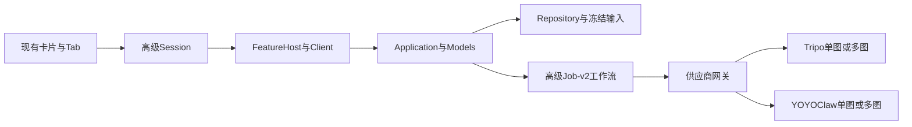

# 高级模式可变视角：软件开发设计

| 项目 | 内容 |
| --- | --- |
| 版本／日期 | V1.2／2026-11-24 |
| 主线／需求 | UX/ADVANCED-MULTIVIEW-20261107；ADV-FLEX-01～03 |
| 设计基线 | codex/team/integration；d7f04859f65ddbb180b15094f196c242f5cbe586 |
| 输入决定 | 原可变视角规则；本轮补充两项缺陷修复及系统视角名称统一为“主视角” |
| 文档性质 | R01～R12为原实施设计；第12节／R13～R15为本轮待确认修改方案，用户确认后才实施；实际进度与证据只在主计划维护 |
| 验收定义 | [测试用例V1.2](2026-11-24-advanced-flexible-views-test-cases.md)：原92条＋本轮24条补充定义 |
| 状态唯一入口 | [主计划当前项](../2026-09-25-product-convergence-and-lightweight-plan.md#advanced-flexible-views-review-20261124)；本文不维护执行进度 |

## 1. 目标和范围

在现有高级创作的 Session、Application、Repository、Job-v2 和供应商网关接缝上调整业务逻辑。保留主／左／后／右四个上传槽位、现有中央卡片、黄色选中边框、角落对勾、单击／双击、Tab、确认弹窗和“重新生成”入口。清空图片沿用现有空位表现，卡片不重排，不新增按钮、选图区、锁图标、页面或视觉样式。

纯文字生成四图及左侧描述框本轮保持；未来删除描述框另行处理。智能模式、工作台编辑、原生导入、切片、预设、输出目录、账号与旧任务恢复政策不借此扩展。

V1.2新增范围为第12节的三项补修，其中视角命名只更新现有系统标签、标题与确认文字，不新增布局、控件或操作步骤。本轮交付方案与用例，产品修改须等待用户确认。

### 1.1 需求及不可破坏的规则

| 规则 | 归属 | 必须实现的行为 |
| --- | --- | --- |
| R01 | ADV-FLEX-01 | 有图片输入时，只生成实际上传方向的设计图，最多4张；不补齐未上传方向。 |
| R02 | ADV-FLEX-01 | 无图片且有效文字输入时，显式生成保持四图；删除全部原图不自动启动文字生成。 |
| R03 | ADV-FLEX-01 | 删除或替换原图，立即清空对应当前设计图并退出3D候选；替换后新图成功可用才显示。失败、停止、轮询、重开及晚到回调不能回填失效旧图。 |
| R04 | ADV-FLEX-02 | 首次空白创作及每次新建后，首次目标图全部成功、可用后自动切3D；部分失败不跳，切页不自动提交3D。 |
| R05 | ADV-FLEX-02 | 同一创作最多自动跳一次；用户从3D主动返回2D后不再自动跳。新建重置，历史打开不触发该引导。 |
| R06 | ADV-FLEX-03 | 首次建立3D选择时默认全选当前可用图；可用主图必选、不能取消；缺主图不能建模，不将辅助图提升为主图。 |
| R07 | ADV-FLEX-03 | 用户明确选择要保留；普通Tab往返、轮询、同视角重新生成、供应商切换不重置选择。首次新增可用方向默认选中，失效方向退出有效候选。 |
| R08 | ADV-FLEX-03 | 仅主图使用所选供应商单图能力；主图加1～3张辅助图使用该供应商多图能力。Tripo、YOYOClaw均须覆盖1／2／3／4张。 |
| R09 | ADV-FLEX-03 | 首次建模前在3D Tab现有卡片选图；已有3D内容后，返回2D明确改选，再切回3D使用原“重新生成”。 |
| R10 | ADV-FLEX-03 | 2D局部重绘允许仅选辅助图；3D主图必选不能扩散为2D必选。普通切页不将2D自动选择覆盖到3D。 |
| R11 | ADV-FLEX-02／03 | 2D操作结束后，主图及实际所选图有效，即可手动建模；未选辅助图普通失败不阻断。自动跳转仍要求全部目标成功。 |
| R12 | 三项共同约束 | 保留忙碌、只读、未决提交、版本、幂等、确认和任务身份保护；保留原文件、不可变设计版本及已有模型历史。 |
| R13 | ADV-FLEX-03／点云补修 | 等待点云消费者兼容合法v1四图与v2可变视角冻结输入，读取本Job冻结主图；合法可提取主体的图片可进入主体轮廓动效，错误绑定或无可靠主体时保留原回退。 |
| R14 | ADV-FLEX-03／选择补修 | 已选辅助设计图普通失败、待更新或缓存失败后，允许用户明确取消；未选不可用图不能加入，主图仍必选，保护与确认修订不变；覆盖首次建模及已有模型后的既有改选路径。 |
| R15 | ADV-FLEX-03／UX文案补充 | 软件系统生成的“正视角”显示名统一为“主视角”，覆盖描述框标签、中央卡片、2D／3D确认、上传文件对话框和设计图大图；仅替换展示名称，保持内部front身份及用户原文。 |

## 2. 设计基线与实施落点

下表记录设计基线d7f04859f65d在实施前的行为，以及本设计要求的修改落点，不将基线行为当作当前工作树现状。实际实施、源码／运行身份和验证证据沿主计划记录；本表不代替完成证明。

| 实施前基线 | 设计要求／修改落点 |
| --- | --- |
| [advanced_multiview_application.py](../../../tools/ai/advanced_multiview_application.py) 的 prepare，初次固定 selected=VIEWS，编辑合并全部 pending_views | 初次、编辑、失败后新操作及原重试接缝统一按有效目标过滤，删除方向不因pending或主图依赖再次补生成。 |
| [advanced_multiview_repository.py](../../../tools/ai/advanced_multiview_repository.py) 的 replace_inputs 保留旧current；保存也拒绝缺主图或空输入 | 允许保存中间草稿；删除／替换时原子清空对应current指针，保存与生成校验分开。历史版本不删。 |
| [AdvancedCreationSession.cpp](../../../src/slic3r/GUI/AI/ModelGeneration/AdvancedCreationSession.cpp) 只有2D选图；空选择解释为四图；apply_snapshot可保留旧可用位图 | 增加Session内3D选择语义、显式用户动作及输入失效处理；旧位图复用不得跨删除／替换边界。 |
| 同文件已有 Unarmed／Pending／Consumed 引导，但消费要求四图都可用 | 对首次受理计划的实际目标集合判断；新建与主动返回动作显式处理。 |
| [AdvancedCreationFeatureHost.cpp](../../../src/slic3r/GUI/AI/ModelGeneration/AdvancedCreationFeatureHost.cpp) 的 generate_model 不发送选图，确认匹配不检查选择 | 发送实际所选方向和可见版本，绑定3D选择修订；保留原任务回执与guard。 |
| [AdvancedCreationWorkspace.cpp](../../../src/slic3r/GUI/Redesign/AdvancedCreationWorkspace.cpp) 在3D且has_content时隐藏卡片网格 | 首次无3D内容直接复用卡片；已有内容后沿原返回2D改选流程。按上下文投影选择，不增加UI状态所有者。 |
| [advanced_multiview_models.py](../../../tools/ai/advanced_multiview_models.py)、[model_contracts](../../../tools/ai/advanced_multiview_model_contracts.py)、[model_workflow](../../../tools/ai/advanced_multiview_model_workflow.py) 固定四图资格、快照和multiview提交 | 将资格、冻结、校验和路由贯通为1～4张；单图仍保留高级来源和独立Job-v2。 |
| [Tripo网关](../../../tools/ai/model_provider_gateway.py)要求四图；[Tripo客户端](../../../tools/ai/tripo_client.py)已接受主图加至少一张辅助图 | 放开网关到合法具名子集，仅上传选中图，复用现有单图和多图客户端方法。 |
| [YOYOClaw网关](../../../tools/ai/yoyoclaw_provider_gateway.py)及[客户端](../../../tools/ai/yoyoclaw_client.py)多图均要求四图 | 调整为主图加实际辅助图；两／三图协议及服务接受必须验证，不能由四图成功推定。 |
| [model_job_repository.py](../../../tools/ai/model_job_repository.py)保存／读取高级Job时调用approved_paths | 同步兼容新旧输入快照，防止新单图高级Job误入智能模式或旧单图恢复链。 |

## 3. 状态所有者和依赖方向

| 状态／责任 | 唯一所有者 | 消费者／边界 |
| --- | --- | --- |
| 桌面草稿、可见设计版本、2D选择、3D选择偏好、一次性引导 | AdvancedCreation::Session | Host驱动命令，Workspace读取投影；UI不另存业务选图数组。 |
| 请求epoch、持久回执、服务查询、缓存准备及确认适配 | AdvancedCreationFeatureHost／AdvancedMultiviewClient | 不根据控件显隐重建业务选择。 |
| 有效目标、生成计划、输入资格、计划过期及提交原子性 | AdvancedMultiviewApplication／AdvancedMultiviewModels | HTTP只解析和传递契约；计划由应用层生成。 |
| 原图、当前设计指针、不可变版本、组修订和操作记录 | AdvancedMultiviewRepository | 删除输入只改变当前关系，不清除历史证据。 |
| 冻结建模输入、任务／产物／尝试记录 | 既有Job-v2及Repository／Workflow | 历史和工作台读取不可变输入来源，不能回读实时UI选择。 |
| 供应商能力和请求序列化 | 既有Provider Gateway／Client | 业务层传具名输入；供应商字段、方向顺序留在适配器。 |

沿[平台状态所有权](../../architecture/PLATFORM_ARCHITECTURE.md#业务状态真值与源码)与既有集成锁渐进修改，不向libslic3r引入GUI或供应商依赖，不创建第二工作台、另一套生成服务或全局选择仓库。

## 4. 目标、有效图片和选择语义

### 4.1 集合定义

统一方向顺序为 front、left、back、right，记为V。它是方向域和显示槽位，不等于每次请求集合。

- U：本次保存输入中的已上传方向。有图片时，设计目标T=U；无图片且显式选择有效文字生成时T=V。
- O：本次2D计划实际目标，写入既有plan.targets／operation.targets；首次O=T；编辑O为“用户重绘范围与需更新范围的并集”再与T相交。
- A：当前允许建模的可用设计图。要求当前关系未清空、版本与输入匹配、文件验证通过、桌面解码完成、无display_error／asset_pending，且不是该视角的未决结果。
- S2：2D局部生成选择，沿现有行为管理，但“未选默认全范围”只取当前有效T。
- P3：Session保留的3D选择偏好；实际请求集合S3=P3与A的交集，且必须包含可用front。提交时不隐式删除用户选中的无效图后继续，必须先完成资格校验并让当前投影与确认一致。

输入删除／替换使该方向立即离开A；同方向重新生成完成后保留原选择偏好。用Session中的“首次见到的可用方向”集合区分新增方向与原方向恢复：首次出现默认选中，曾被用户取消的方向恢复时仍取消。该偏好不是有效性事实，不能使失效图进入S3。

服务快照可增加有效目标／可用方向的只读投影；旧all_views_available仍表示四图齐全，不静默改义。新资格不得继续依赖它。

### 4.2 选择动作

| 动作 | 2D范围 | 3D偏好／有效范围 |
| --- | --- | --- |
| 首次建立当前创作的3D选择 | 不改S2 | 对A默认全选；有front则固定选中。 |
| 3D Tab单击辅助图 | 不改S2 | 在P3中切换；front单击不取消；失效卡片不能加入有效请求。 |
| 普通切页、刷新、双击大图、自动pending变化 | 沿原业务投影 | 不重置P3。 |
| 已有3D内容后，在2D完成一次明确的卡片改选 | 正常更新S2，可只选辅助图 | 将本次明确选择映射为下一次3D偏好，并始终包含可用front；切回3D本身不再次推导。 |
| 同一方向重新生成成功 | 原2D选择逻辑 | 更新版本，不覆盖该方向人工偏好。 |
| 删除／替换原图 | 清空对应显示，重绘目标按新T处理 | 该方向退出A；front失效则阻止提交，保留其它偏好。 |
| 新建／打开另一创作 | 依新创作初始化 | 不跨组带入偏好；历史查看从冻结来源读取，不触发生成。 |

延迟单击须携带发生时的操作上下文，切Tab、提交、双击或新建前沿原规则结算／取消；不能让2D待处理单击在切到3D后被解释为另一个动作。显式卡片改选须有独立动作来源及3D选择修订，不能以现有selection_revision变化推断，因为上传、风格变化和快照恢复也会改变它。

### 4.3 建模资格

保留当前活动任务、工作台占用、只读、未决受理和防重保护。生成资格检查当前草稿与已生成设计的共同条件，以及S3中每个视角的当前输入／版本有效性；普通失败的未选辅助图不再要求齐全，不把全部pending_views非空直接当全局拒绝条件。风格、描述等共同输入发生变化时，仍按原规则要求生成匹配结果，不能借选图绕过。

尚未解决的提交不明确状态继续按原保护阻止新的3D付费任务；R11中的“辅助图失败”指明确结束的普通失败，不表示放开未知是否受理的提交。缺front、所选图缺失、尚在下载／解码或确认前输入改变均不可提交。按钮是否可点击与生成是否合格继续分离，复用已有Toast和确认框说明原因。

### 4.4 拟调整的数据接缝

以下为实现建议名，均归现有类型，不表示已经存在；可沿项目命名细化，语义必须保持。

| 既有类型／拟接缝 | 数据及责任 |
| --- | --- |
| Session：model_selection_preferences／model_seen_views | 两个固定四位集合，分别保存人工偏好及曾出现过的方向；有效选择由偏好与当前可用性计算，Workspace只读取。 |
| Session：model_selection_revision | 只随影响3D意图的明确选图或新建／换组等动作变化；与原2D selection_revision分开，确认匹配必须包含此修订。 |
| Session：toggle_model_view／effective_model_views | 3D上下文切换辅助方向，front保持必选；返回规范顺序的有效集合；不调用原2D空选择默认四图。 |
| Session：apply_explicit_design_selection | 仅在已有3D内容后的明确卡片改选时映射下一次建模偏好；上传、恢复、风格更新及轮询不能调用此动作。 |
| Session：guidance_targets／guidance_input_epoch | 与既有引导状态一起绑定获受理的实际目标和输入；新建清除，历史打开不arm。 |
| GroupSnapshot／Client投影 | 加入应用计算的当前有效目标和清空后可用版本；不把current=null解析成“沿用上次可见”，不在Client重新实现计划规则。 |
| 既有PendingClick／CommandContext | PendingClick捕获动作上下文；3D命令上下文加入model_selection_revision，保留原callback、draft、group修订。 |

模型偏好随既有桌面创作缓存保存／恢复时以组为范围；Session仍是运行时唯一可写所有者，缓存只是其序列化。新增字段缺失时按首次初始化处理，不把旧2D选择当新3D偏好；只读历史优先展示模型冻结来源，不能反向改写当前创作选择。

## 5. 原图变更与2D生成

### 5.1 保存和立即失效

1. Session接受删除／替换时，使用原draft_revision及输入缓存记录草稿，立即清空该方向DesignView的当前显示／可用投影、取消旧图片展示请求，更新选择有效性及命令修订。
2. Host沿既有inputs保存入口传递完整当前槽位，防止把部分请求误当全量删除。组尚未创建时只保存桌面草稿，不为删除动作创建生成组。
3. Repository在同一事务中保存上传关系、input_epoch／revision及对应current_version_id=null。不可变原图、设计版本、旧操作和模型关联保留。
4. 缺主图或空输入可以作为中间草稿保存；在prepare／execute动作入口执行生成资格校验。读取、multipart结构、大小、版本和文件校验仍保留，不能整体绕过draft_fields或图片验证。
5. 新快照、缓存解码及旧回调安装前核对组／epoch、捕获输入与本地草稿修订。apply_snapshot的“保留旧可用图”分支只适用于未失效输入，不能跨删除／替换恢复旧图。
6. 服务保存未确认时保留dirty草稿与失效标记，禁止沿旧图建模；保存失败沿原错误入口反馈。重开先应用已有桌面草稿中的未确认输入，不能被服务旧快照覆盖。本地草稿写入失败不宣称持久化成功；显式重载旧历史属于独立查看，不回填当前草稿。

删除方向从待生成集合移除，不能因changed_upload_views或pending_views重新加入。替换方向保留为新输入待生成。风格变化的待更新范围取当前有效T。保留现有输入／计划并发保护，不增加生成中自由改图能力；竞态测试通过既有Ports验证过期结果。

### 5.2 计划、调用与发布

初始、编辑和已有重试接缝共用目标计算，不在Host、HTTP或供应商中分别补图。计划确认显示实际方向、张数及最大新图调用数；纯图初次最多N次2D调用，最大新3D任务数为0。依赖只在有效目标和原规则内解析，不以辅助图需要主参照为由生成未上传方向。

冻结上传记录、输入epoch、可见基图版本和canonical publication base。发布继续比较当前操作、输入epoch、停止意图及发布基准。每个成功视角独立发布；失败只影响本次方向，删除／替换失效的方向不回退，未改输入的局部重绘保留原有旧图规则。

旧组、旧四图历史和旧模型快照读取不按“当年上传N张”反向裁剪；新规则用于当前显式生成／修改后的目标。历史文件不迁删，当前关系变更不能重写旧模型所用版本。

## 6. 首次完成的一次性导航

继续使用Session的Unarmed、Pending、Consumed，不以“当前在2D”或“3D没有模型”推断首次资格。

| 事件 | 状态／行为 |
| --- | --- |
| 空白进入／新建 | 清除上一组待消费对象及点击，epoch递增，状态Unarmed。 |
| 该创作首次2D计划确认并受理 | arm到Pending，绑定本次组、会话和实际目标T；请求未受理／确认取消不arm。 |
| 全部目标成功但部分图片尚在验证／解码 | 保持Pending，不切页。 |
| 本次操作结束且T全部成功、可用、输入匹配 | 仅在当前高级创作页面消费为Consumed并切3D一次；不调用model-jobs。 |
| 部分失败／停止 | 不跳转；Pending不算成功消费。后续显式补齐同一创作的目标后可消费，仍须全部成功且用户未主动返回。 |
| 用户手动进入3D再返回2D | 关闭本创作后续自动引导，标记Consumed；仅影响导航，不限制生成。 |
| 自动进入3D后主动返回2D | 保持Consumed，之后重绘不抢页。 |
| 打开历史／切组／旧回调 | 不arm当前历史；旧组不能消费新组资格。离开页面后后台刷新不切换当前页面。 |
| 再次新建 | 重新获得一次资格，不能沿用旧Consumed，也不能被旧回调重新arm。 |

目标绑定以已受理计划的完整`frozen.design_targets`为依据，不能用仅表示本次局部重绘范围的`targets`缩小首次成功门槛。例如F已成功、L失败时，只重绘F仍要等待L；显式补齐L后，当前完整目标全部成功才可跳转。重试或新2D计划因显式修改输入改变完整目标时，在同一Pending引导中采纳已确认的新目标与新输入epoch，不能只因删除失败方向就由一次轮询触发跳转。导航检查须等到该新操作成功结束。新建后不跳转的旧反馈按NAV用例复现并记录组／operation／epoch／目标／引导状态，实际结论见主计划。

## 7. 建模契约、快照和任务

### 7.1 桌面到应用

复用POST /groups/{id}/model-plans及model-jobs。拟扩展model-plans请求为：原command_id、expected_group_revision、draft、provider和模型选项，加selected_views、visible_versions和expected_input_epoch。

| 字段 | 规则 |
| --- | --- |
| selected_views | 无重复的具名方向列表；规范顺序front／left／back／right；包含front，数量1～4。 |
| visible_versions | 仅包含selected_views，每项为version_id及sha256；必须与已验证可见版本和服务current一致。 |
| expected_input_epoch | 与当前组输入一致，防止删除／替换前确认继续提交。 |
| 原参数 | 保持现有供应商、模型、面数、几何／纹理质量、格式语义，YOYOClaw使用供应商默认面数。 |

应用不信任客户端的“可用”或input_mode；独立校验选择、当前关系、版本、哈希、busy／未决／草稿及能力。新客户端必须发送明确集合；缺字段的旧请求仅沿旧完整四图兼容路径，不将缺字段解释为任意默认单图。

Host对3D使用独立选择修订匹配命令。确认前结算待处理点击；确认中改选、改图、换供应商／模型、切组／新建或输入修订变化均使旧确认失效。原确认样式不变，内容显示实际张数／方向、单图或多图、供应商及真实预算上限。

### 7.2 冻结契约与兼容

保留Job version=2、creation_kind=advanced_multiview_v1、workflow_mode=advanced和approved_multiview_snapshot字段，不因选一张而降为旧智能单图Job。拟新增嵌套快照schema=approved-multiview-input-v2，model-plan schema同步为advanced-multiview-model-plan-v2。

| 快照字段 | 内容 |
| --- | --- |
| schema／group_id／snapshot_id | 明确v2及本次组、命令身份。 |
| selected_views | 实际获确认的方向列表。 |
| input_mode | 1张为image，2～4张为multiview，必须与集合一致。 |
| input_epoch | 获确认时的输入身份。 |
| views | 仅所选方向；每项version_id、inputs/{view}.png及sha256。 |
| fingerprint | 使用原规范fingerprint机制覆盖全部字段，排除fingerprint自身。 |

v1读取器继续严格要求四图；v2要求front、1～4个合法唯一方向、selected_views与views完全相等、模式与张数相符。保留原路径限制、哈希、20MiB单文件校验和目录内解析；不得删除或弱化旧快照验证来接受新格式。

prepare在锁外查询能力、锁内核对修订并冻结；execute沿原两阶段能力复查和原子受理，重新检查确认、当前输入／版本及能力，之后仅复制所选图到独立Job输入目录。创建目录／复制／持久化失败不提交供应商任务。每个确认计划最多1个新模型任务、0个新2D调用；转换任务沿原输出格式规则单独记录。

提交后，模型输入以冻结快照为准；后续删除原图不破坏已受理模型或历史。历史／预览的主图仍来自inputs/front.png。模型展示、工作台导入、LibraryCommit和历史恢复读取本次不可变来源，不能因当前选择变化改写旧结果归属。

### 7.3 单图和多图分派

高级Workflow读取已校验快照后：
- input_mode=image：构造ModelTaskRequest(source=image, image_path=front)，不携带辅助图。
- input_mode=multiview：构造ModelTaskRequest(source=multiview, image_paths=所选具名图)，只含2～4张。
- 两条路径都复用原网关、授权、尝试记录、轮询、下载、格式转换、拓扑／面数建议、ColorIntent、原子发布及工作台交接；不走智能2D准备，不额外补图或多次单图拼模型。
- attempt记录provider、model、input_mode、selected_views、快照指纹和提交图哈希，不写图片正文、Data URL或凭据。

幂等键继续绑定command／plan和完整确认指纹。重复execute不得再上传或创建第二付费任务；换图／换模式不能复用旧task_id。reconcile只修复回执关系，停止／重启不自动重发生成；新生成仍需新的明确计划。

## 8. Tripo和YOYOClaw供应商适配

### 8.1 能力投影

当前four_view_model／named_four_view_model不足以表达单图和两／三图。拟在既有能力契约中增加单图支持状态、具名多图支持状态和支持张数，保留旧四图字段兼容旧消费者。状态区分supported、unsupported、unknown；判断绑定所选provider／model及输入张数，prepare和execute都复查。

目录出现某个模型不等于该模型支持全部张数。YOYOClaw继续原实时目录、数字版本选择与admitted_models规则，确认后冻结具体模型；目录刷新不能在execute中静默换成另一个新版本。普通能力变化不重置用户勾选。

### 8.2 请求映射

| 提供商／模式 | 正式适配入口 | 请求内容／断言 |
| --- | --- | --- |
| Tripo／1张 | upload_image → create_image_task；/generation/image-to-model | 只上传front，input为其token；沿原几何／纹理／面数、original_image和禁用autofix参数。 |
| Tripo／2～4张 | upload_image → create_multiview_task；/generation/multiview-to-model | 仅上传选中方向；inputs为front／left／back／right过滤后的具名token列表；无未选图、空token或重复图填充。 |
| YOYOClaw／1张 | submit_3d → 原chat/completions入口 | model冻结；image_base64仅front；没有multi_view_images字段，不发送face_limit或目标面数。 |
| YOYOClaw／2～4张 | submit_multiview_3d → 同一原chat/completions入口 | image_base64为front；multi_view_images只包含所选辅助方向，每项view_type和view_image_base64；沿当前适配器left／right／back顺序过滤。 |

供应商采用不同辅助图序列，必须显式映射，不能将UI数组下标直接串成服务字段。单图请求不调用多图方法；多图请求不循环调用单图方法。GLB／OBJ、下载／转换、供应商默认面数和原质量约束保持原规则，不统一各供应商的参数。

### 8.3 协议证据与待验证项

Tripo的直接协议落点是项目tripo_client.py及既有test_obj_generation.py、test_generation_options.py：底层多图方法已接受front加至少一个辅助视角，单图／多图分别调用不同生成路径。2026-11-24补充取得[Tripo官方多图生成文档](https://docs.tripo3d.ai/model-generation/multiview-to-model-v3-0-v3-1.html)，明确主图必填、left／back／right为可选方向，并分别定义单图与多图能力。官网openapi/v2/task的files示例固定四个位置，缺失辅助图使用空对象；本项目已部署generation网关使用过滤后的具名输入列表，两者wire格式不能混用。本轮复用现有generation路径，不据官网示例直接迁移协议。部署模型、当前网关请求格式和服务接受分别由隔离载荷及真实主窗口矩阵验证。

YOYOClaw单图与多图沿既有Client和test_yoyoclaw.py的代理字段。两／三图按混元3D具名辅助图契约扩展，并从真实主窗口验证代理接受、任务成功和产物归属，保留脱敏请求结构与真实任务ID。

用户已明确YOYOClaw实际使用混元3D，本专项多视图范围为2～4张且必须包含主图。2026-11-24读取[腾讯云官方SDK的AI3D请求定义](https://github.com/TencentCloud/tencentcloud-sdk-python/blob/master/tencentcloud/ai3d/v20250513/models.py)中的SubmitHunyuanTo3DProJobRequest和ViewImage，并核对[腾讯云官方专业版任务接口](https://cloud.tencent.com/document/product/1804/123447)正文（旧120826入口当前已跳至产品首页）：主图进入ImageBase64／ImageUrl，辅助图进入MultiViewImages，并以ViewType标明left／right／back；3.1还支持部分其它拍摄角度，但不扩展本次四槽位范围。专业版接口列出的主图格式为JPG／PNG／WEBP，长边分辨率128～5000；3.1的辅助图可用JPG／PNG，3.0辅助图要求PNG。项目继续统一归一化为PNG，满足本次输入契约，不能将这一实现选择写成所有版本均仅支持PNG。官方主图字段说明所有图片大小合计不超过8M；ImageBase64要求编码前图片不超过6M，辅助图Base64字段同样列出编码前6M上限。编码前字节数、请求图片合计限制与本地快照20MiB单文件完整性上限分别核对，不将6M解释为像素，也不把本地上限当作服务接受上限。本轮未在这两份当前来源中核实独立的“主图600万像素”上限，不将其作为已证实契约。真实代理是否透传这些限制须按实际响应核对。现有YOYOClaw代理继续使用上表的snake_case字段和原认证／路由，不直接改接腾讯云签名接口；供应商默认面数保持，官方能力声明不代替部署接受的G证据。

若实际代理不接受两／三图，记录具体失败并修复适配；不得隐式补图、复制主图、降级单图、换供应商或以“提示不支持正常”作为该能力通过。用户已另行授权本专项2D与YOYOClaw不限、Tripo新生成累计不超过15次，失败提交同样计数；与此前Toast额度独立。异常提示用例只证明拒绝保护。

## 9. 错误、恢复和兼容

| 场景 | 必须保留的结果 |
| --- | --- |
| 缺主图／所选图不可用／旧版本 | 原Toast／确认入口反馈，不提交新模型，不清除已有成果。 |
| 能力未知、目录故障、模型下架 | 当前操作拒绝并保留选择；恢复配置后重新准备和确认，不自动换服务或重发。 |
| 上传任一图失败 | 不创建模型任务；已上传token不代表生成成功，调用事实单独记录。 |
| POST超时／无合法task_id | 保留不明确回执和原尝试，沿原核对机制，不因重试按钮或重启重复付费。 |
| 轮询暂时错误／下载失败 | 沿原可恢复观察或本地下载规则，不创建另一生成任务。 |
| 停止、shutdown、新建、切组后晚到 | 记录归原任务；不能安装进新组、恢复清空图或抢Tab。 |
| v1旧四图Job、v2新1～4图Job、旧智能Job | 按各自schema和来源校验、展示与加载；不覆盖旧记录、不交叉恢复生成输入。 |
| 清空原图后看旧模型 | 旧模型仍以其冻结图片正常查看／进入工作台；新建模须满足当前输入规则。 |

## 10. 预计文件范围、实施顺序与验证

| 顺序 | 原有文件／模块 | 实施完成条件 |
| --- | --- | --- |
| D1 | AdvancedCreationTypes／Session；advanced_multiview_contracts／repository／application | 目标、失效和选择规则有单一所有者；保存中间草稿与生成资格分离；1～4目标和晚到结果逻辑通过。 |
| D2 | AdvancedMultiviewClient／FeatureHost／Workspace | 请求／解析新字段，保留3D偏好与动作来源；确认包含选图；首次引导及新建重置符合状态机；沿用原UX。 |
| D3 | advanced_multiview_model_contracts／models／model_workflow；model_job_repository | 新旧快照、计划、Job保存／恢复、精确版本冻结、单图／多图分派贯通；不借用智能来源。 |
| D4 | model_provider_gateway／tripo_client；yoyoclaw_provider_gateway／yoyoclaw_client；advanced_multiview_runtime | 两供应商1／2／3／4张能力、网关、协议映射及错误保护完整；确认后模型不漂移。 |
| D5 | 既有Python测试、test_advanced_creation.cpp及直接消费者 | 按配套用例进行定向自动、Windows匹配版本实窗和真实服务验证；如新建测试源则同步原CMake清单。 |
| D6 | 原创作使用／架构维护文档、review-map与本主计划／短状态 | 实施时同步当前行为与文档，保留旧证据与未结；不把本设计当实现证明。 |

定向验证优先使用本checkout的dev.ps1 Test文件模式与CppTest的AdvancedCreation标签，具体文件见测试文档。共享契约变更实施后运行scripts/verify_ai_integration.py --json；状态／能力锚点实际变化时维护review-map.json并运行scripts/architecture_review.py --readme update。只编写本设计时不提前改架构映射或运行构建。

真实Windows主窗口验收使用独立配置及样本副本、完整匹配EXE／DLL／资源／sidecar。两供应商每个正向路由必须有对应真实服务证据；预算不足的变体保留未执行，不因离线通过宣称完成。生成次数只在主计划及专项证据记录，旧Toast额度及验收不被本文件承接。

确认文字须完整显示本次模式、方向、张数、供应商、模型及最多任务数，复用既有确认框的内容适配／溢出处理；不能将尾部费用或任务说明裁掉。已有模型的提示使用“设计图版本”，不再将可选输入统称为四视角；不增加控件、样式或新的操作步骤。

## 11. 交付判定与文档同步

原R01～R12的实施交付须同时满足：规则追踪到用例；两供应商单图及2／3／4图实际成功；首次和新建后的导航、主动返回、删除／替换、选择保留、版本冻结与历史兼容通过。V1.2新增R13～R15的补修交付另按第12节。失败或缺少某层证据只能记失败／部分覆盖／未执行，不能以其它供应商或张数替代。

本次文档交付仅证明设计与用例已编写及内容／链接／diff复核，不证明产品实现、构建、自动回归、GUI、服务质量或视觉验收通过。执行结果只回写原主计划与既有专项证据／测试报告，不在本设计和用例中新增并行进度表。

## 12. V1.2待确认补修方案

### 12.1 本轮修改范围与落点

用户已于2026-11-24确认本节M1～M3及补充24条验收用例，现进入实施与验收。下表定义交付行为，实际分层结果统一记录于[当前主计划](../2026-09-25-product-convergence-and-lightweight-plan.md#advanced-flexible-views-review-20261124)，不因授权确认宣称修复通过。原92条定义、既有成果与未结验收保留。完成本步骤后再分析点选约2秒延迟，未提前改变原双击／单击交互。

| 修改项 | 当前证据／原因 | 拟修改落点 | 交付行为 |
| --- | --- | --- | --- |
| M1 等待点云兼容 | 新建模快照写v2，原读取器仍只接受v1；用户实际Tripo F+L任务有主图且摘要匹配，等待时仍回退Logo | [GenerationParticleImage.hpp](../../../src/slic3r/GUI/Redesign/GenerationParticleImage.hpp)、[test_generation_particles.cpp](../../../tests/slic3rutils/test_generation_particles.cpp)；必要时补充原展示准备原因 | 合法新旧任务均读取自己的冻结主图，兼容问题不再阻断主体准备；不因展示失败影响模型生成 |
| M2 失效辅助图可取消 | Session保留原选中偏好，却在取消时要求该图可用；已有模型后的DesignForNextModel又会被原2D pending取消保护提前拒绝 | [AdvancedCreationSession.cpp](../../../src/slic3r/GUI/AI/ModelGeneration/AdvancedCreationSession.cpp)、[test_advanced_creation.cpp](../../../tests/slic3rutils/test_advanced_creation.cpp)；沿原Host保存／确认消费 | 两个原有入口均能明确排除失效辅助图，再按剩余有效图确认建模；主图必选及其它保护保留 |
| M3 主视角命名统一 | 同文件title()仍为“正视角”，central_title()已为“主视角”，形成同一方向的两套显示名 | [AdvancedCreationWorkspace.cpp](../../../src/slic3r/GUI/Redesign/AdvancedCreationWorkspace.cpp)的现有显示名映射及调用；检查资源／翻译消费者 | 所有系统视角显示入口统一“主视角”；原卡片、标签、大图及确认框外观和交互保持 |

### 12.2 M1：冻结主图展示兼容

1. 在原粒子图片读取接缝中明确接受合法`approved-multiview-input-v1`和`approved-multiview-input-v2`，未知格式拒绝。v1保留旧四图语义；v2核对含主图的合法方向集合、selected_views与views一致及单图／多图模式一致，不通过忽略schema解除校验。
2. 保留Job身份、advanced来源、snapshot身份、`inputs/front.png`路径、主图版本和实际文件SHA绑定；不把组内后来生成的主图替代本Job冻结图。展示消费者只读，不迁移或改写原Job及快照。
3. 通过校验后沿现有解码、alpha／前景提取、主体点云流程。这里的轮廓来自冻结设计主图；图片确实不能解码或主体不可靠时仍允许原Logo回退。取消、切组、切模式和旧回调继续按原展示代次处理。
4. 两供应商、所有合法1～4图集合共用此入口；定向测试覆盖16个供应商／集合分支。真实窗口记录Logo、主体轮廓和完成模型的时序，不能仅凭模型成功或截图最终模型记动效通过。

### 12.3 M2：区分选入资格与取消意图

3D卡片的Model上下文：当前仍投影为选中的辅助图，即使pending、display_error或asset_pending，也可由用户明确取消；未选且不可用的图不能加入。删除／替换已隐藏的空槽位继续不作为可选有效图，不通过点击空位意外清除其保存偏好。主视角不能取消；缺少可用主图仍阻止提交。选中的无效图在用户取消前继续阻止提交，不自动缩减所选图片。

已有模型后的DesignForNextModel上下文：返回2D明确取消失效辅助图时，须在同一Session中更新现有卡片选择与下一次建模偏好，不能被`toggle()`的pending保护吞掉。这个例外只承接“已有模型后明确改选供下一次3D”的原入口；普通Design上下文及2D局部重绘规则不扩大。用户随后若点击2D重新生成，Application仍将有效pending方向并入原2D计划，确认框展示真实范围；取消3D输入不等于清除该方向的待重绘事实。

只有实际意图变化才递增相关选择修订，旧模型计划必须失效。Tab往返、轮询、重开创作和同方向恢复均保留明确取消后的偏好；普通首次失败、从未成为可用候选的图仍不默认选中。忙碌、只读、未决提交、共同草稿变化和版本保护不能被取消辅助图绕过。供应商选择、实际集合冻结和路由仍由原Host／Application／Gateway接缝消费，不新增另一份选择状态。

### 12.4 M3：显示名盘点与统一

本轮检索`src`、`resources`、`localization`、`tools`和`tests`中的简体、繁体及Unicode转义旧名称，产品命中为`AdvancedCreationWorkspace.cpp:50`的一处旧常量。问题来自该常量被多个界面复用；中央卡片另有已改成“主视角”的映射。没有启动应用，本表是源码调用盘点，最终可见效果仍须匹配版本实窗验收。

| 界面位置 | 当前调用位置 | 修改及验收要求 |
| --- | --- | --- |
| 描述框里的视角标签 | title()；初始构造约1377行、刷新约2256行 | 主图单独选择或与辅助图混选时均显示“主视角”，刷新不回旧名；原“全部视角”聚合标签保留 |
| 中央2D／首次3D设计图卡片 | central_title()；约1574行 | 归并到同一个方向显示名来源，避免两份名称再次分叉 |
| 3D生成计划确认范围 | title()；约1975行 | 两供应商、单图与多图均显示“主视角”，方向／张数及任务数完整可见 |
| 2D生成计划确认范围 | title()；约2000行 | GPT／YOYOClaw图片生成均使用“主视角”，实际生成方向不变 |
| 主图上传文件选择框 | title()；约2027行 | 标题为“选择主视角”；辅助方向及原选择流程不变 |
| 查看设计图大图 | 对话框title()约2066行、内层ViewCard标题约2072行 | 外层窗口标题和图内标题同时为“主视角”；新设计及历史组均覆盖 |

拟将现有方向显示名归并到一个入口，删除或转发重复的central_title()映射；不只修改中央标题。实施时再检索实际UX源码、资源和运行可达入口，防止转义或资源遗漏。描述正文、用户自定义创作名称、历史原始记录中的用户文字保留原样；内部`ViewId::Front`、`front`、`inputs/front.png`、供应商字段及缓存身份均保持，不能对全仓库执行语义不分的批量替换。既有“主视图”“主参考图”和“全部视角”按原含义保留，描述框本身不删除。

### 12.5 实施顺序、验证与结束条件

确认后先补能暴露M1／M2的定向行为回归，再修复原接缝并统一M3显示名；复核diff后使用本checkout的`dev.ps1`增量构建完整Windows运行树。运行与变更对应的GenerationParticles、AdvancedCreation及Python冻结输入／网关用例，不启动全量测试或冷构建。若实施确实改变共享契约或runtime，执行工程规定的集成检查；不因写方案提前改接口或架构映射。

补充用例为[测试文档第12节](2026-11-24-advanced-flexible-views-test-cases.md#12-v12补修测试用例24条待确认)，PAR 8、AUX 10、NAME 6，共24条，均为待实施验收定义。原92条及86证据齐全／6部分的原审计口径单独保留，不能把新增定义或前轮缺陷复现算作补修通过。

真实生成拟用同一新版本的4个3D任务：Tripo单图1次、多图1次；YOYOClaw单图1次、多图1次。单图承接取消失效辅助图后只保留主图，多图承接排除失效辅助图后仍含主图及其它有效辅助图；同次任务复用选择、名称、冻结输入、动效、完成及历史证据。其它合法子集采用定向离线矩阵并保留原16种成功任务证据，不为文案额外生成。2D前置尽量复用已有非私人设计图及副本，确需重绘时沿原2D预算登记实际调用。执行时核对原专项实际剩余额度，不扩大预算或重跑无关历史验收；生成须待本方案确认进入实施阶段。

结束条件为R13～R15逐条具备规定层次证据，原缺陷分支不再复现、错误输入保护不退化、两供应商单／多图通过、原有入口的系统视角名称一致。任何分支未覆盖时如实保留，不将离线通过写成真实界面或动效已验收。
