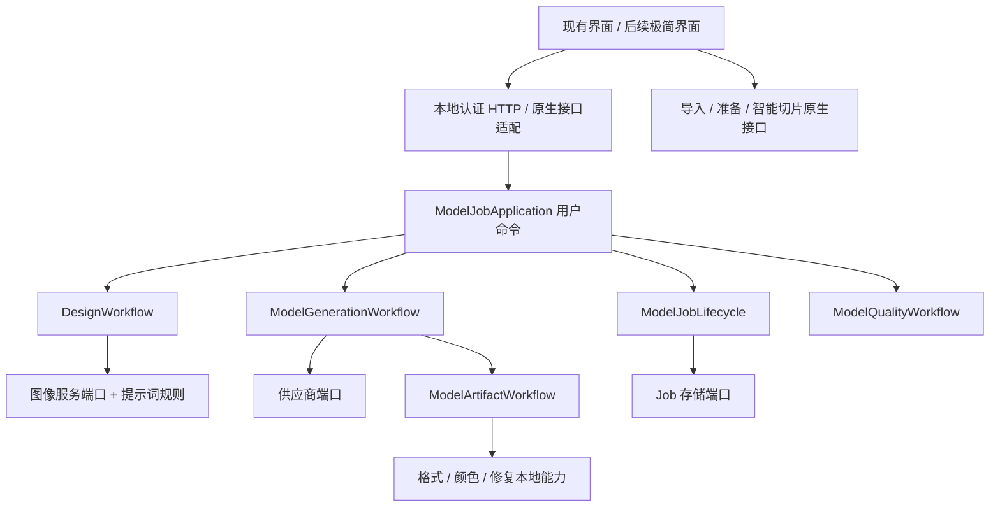

# 原子能力与界面组合

这次以 PR24 的集成版本为基线，将模型生成后端实现从 `orca_ai_sidecar.py` 拆到独立文件。既有 HTTP 接口实际调用新应用层；旧函数名保留兼容转发。这里的“独立”指模块可通过显式输入和端口调用、测试，不依赖 HTTP Handler 或旧面板，不代表每个能力都需要独立进程。

## 实际边界

| 能力 | 实现入口 | 输入 → 输出 | 当前状态 |
|---|---|---|---|
| 类型、结构与打印规则 | `image_preprocessing_policy.py` | 描述/风格/打印参数 → 策略 | 独立函数 |
| 人像及各类别提示词 | `image_preprocessing_prompts.py`、`openai_preprocessor.py::build_geometry_reference_prompt_layers` | 策略 → 精确规则层 | 独立调优；详见 [前处理说明](README_image_preprocessing.md) |
| 图像/文字设计生成 | `design_workflow.py::DesignWorkflow` | Job/输入 → 等待确认的设计 | 独立应用能力；图像服务通过端口注入 |
| 高级四视角设计 | `advanced_multiview_application.py`、`advanced_multiview_design_workflow.py`、`advanced_multiview_image_gateway.py` | 0～4具名上传／正文／完整图像模型ID → 四图组／当前图编辑；每目标一次生图 | 复用原单图image-to-3D核心提示；GPT保持原多参考规格，YOYOClaw三种已验证白名单模型接收最多三张有序参考图；operation冻结供应商与模型，下载恢复不重复提交；高级独立组、版本及计划确认，智能仍沿原Job流程 |
| 高级四图建模 | `advanced_multiview_models.py`、`advanced_multiview_model_workflow.py` | 冻结的正左后右四图 → 一个Job-v2 | Tripo具名多图；恢复原task，未核实能力禁止单图降级 |
| 3D 生成/保留几何贴图 | `model_generation_workflow.py::ModelGenerationWorkflow` | 确认的 Job/授权 → 3D Job | 独立应用能力；供应商/下载/执行通过端口注入 |
| 请求与选项校验 | `model_request.py` | 字段/图片 → 合法值或 RequestError | 无 HTTP、队列或生成调用 |
| 已有模型/参考质量 | `model_quality_workflow.py::ModelQualityWorkflow`、`nonportrait_reference.py` | 已注册模型/参考 → 报告 | 独立检查；可选付费视觉复核单独注入 |
| 下载/转换/产物准备 | `model_artifact_workflow.py::ModelArtifactWorkflow` | 任务/文件 → 归一化产物 | 独立编排；供应商和历史记录通过端口注入 |
| 模型安全读写与格式校验 | `model_obj_io.py`、`glb_artifact.py` | 显式文件 → 模型/校验结果 | 独立本地能力 |
| 色彩距离/贴图烘焙/区域整理 | `model_color_space.py`、`model_texture_baking.py`、`model_color_regions.py` | 文件/色板 → 顶点色/整理报告 | 算法与文件处理独立；写入只针对调用方给定文件 |
| 局部网格修复 | `model_mesh_repair.py` | OBJ/报告路径 → 修复结果 | 独立；不自动创建 3D 或修复历史模型 |
| 旧人像几何、材质与多视图 | `portrait_geometry_reference.py`、`portrait_model_materials.py`、`portrait_multiview_workflow.py` | 显式参考/文件/Job → 参考/产物 | 从主入口移出；旧历史和显式开关保留 |
| 任务 DTO、创建、恢复、取消与状态 | `model_contracts.py`、`model_job_lifecycle.py` | 请求/目录/任务 → Job/状态 | 独立；默认恢复不创建新付费任务 |
| 历史落盘与相对路径 | `model_job_repository.py` | Job ↔ 有界 job.json | 独立；存储回调可替换 |
| 用户命令与确认 | `model_job_application.py::ModelJobApplication` | 命令/字段/Job ID → ApplicationResult | HTTP 和新界面共用的应用入口 |
| 配置建议 | `config_proposal.py` | 允许项/建议 JSON → 受约束提案 | 提示词与白名单验证独立；调用服务仍由 host 组装 |
| 原生模型导入 | `AI/Contracts/IModelArtifactConsumer.hpp`、`GUI/AI/Orca/OrcaWorkspaceAdapter.*` | ModelImportRequest → ModelImportResult | 既有中立接口；实际应用仍需原生工作区/线程/撤销事务 |
| 尺寸与底座 | `GUI/AI/Orca/OrcaModelPreparation.*` | source/options → proposal；source/proposal → apply | 既有计算与应用两步；提案不改变原件，应用需原生快照 |
| 智能切片 | `AI/SmartSlicing/Application`、`Domain`、`Ports` | 工作区快照 → 风险/候选/比较/应用 | 既有独立 CMake 核心；GUI 通过工作区和试切片接口连接 |
| 美颜工作台 | `GUI/AI/Model`、`BeautyWorkbenchSession.hpp` | 原模型/色板/操作 → 配色和编辑状态 | 算法、候选及撤销会话已独立；复杂美颜布局继续作为兼容视图 |
| 资源图库与重设计外壳 | `ModelLibraryApplication`、`ModelWorkspaceFeatureHost`、`GUI/Redesign` | 用户动作/状态 → 视图 | 图库与配色有独立组合入口；现有生成外壳通过适配器接入 |

## 依赖方向



应用能力通过各自 `*Ports` 数据类声明依赖。`orca_ai_sidecar.py` 负责组装存储、任务注册表、锁、提供商和执行器，并负责认证、进程寿命和 HTTP。原子模块不导入它，不复制 host 的全局命名空间。工作流之间通过端口组合，本地算法使用显式参数，算法的阈值和旧历史兼容行为保持。

## 极简界面如何组合

高级多视角使用独立 `AdvancedCreationSession`／`AdvancedCreationFeatureHost`／`AdvancedCreationWorkspace`。侧车由 `advanced_multiview_runtime.py` 组装应用、仓库及供应商端口，认证入口是 `/v1/orcaslicer/advanced-multiview`，不经旧单图创建设计接口：

- `GET /capabilities` 查询当前模型的具名多参考、当前图编辑和四图建模能力；无法核实不宣称支持。
- YOYOClaw图像目录来自实时白名单。桌面仅在选择YOYOClaw时显示模型下拉框，保存完整canonical ID而只在界面移除`-PC-YOYO`；新草稿仅在精确`image-model-library/Qwen-Image-3.0-PC-YOYO`存在时默认选择它，不回落到其它模型。目录未配置、空或失败时不回落GPT并禁止2D生成。
- `POST /groups` 接受JSON纯文字或multipart具名 `front_image/left_image/back_image/right_image`；`front_image`是兼容字段名，语义为必填主参考相机0°，其它字段为相对左转90°／反向180°／右转90°，各槽一张，受原20MiB及解码校验约束。
- `POST /groups/<id>/plans` 准备2D范围及最大调用数；显式确认后用 `/operations` 执行。首次始终正左后右，操作冻结主参考0°、俯视顺时针90°左、180°后、逆时针90°右及每个目标当前图／只读上下文。每个目标最多一次图像创建调用；失败后只有用户显式重试才产生新调用。
- 每次新生成计划使用当前选择的完整供应商和模型ID，同组单张／多张／全部重生均可换模型；已发出的请求内容不变。统一入口按目标分别编辑可见旧图或补生成缺图，必要主视角依赖列入确认范围和最大次数；旧失败／未知结果不全局阻止新2D意图，不自动重发。YOYOClaw的Doubao、Hy、Qwen继续按各自官方请求携带0～3张有序参考，尺寸最大边1024；GPT全部参数不变，编辑保持`size=auto`、`input_fidelity=high`。
- 所有路径复用原单图`build_geometry_reference_prompt`／`build_text_geometry_reference_prompt`，保留主体隔离、原场景背景替换为统一不透明纯色棚拍背景、无纹理／渐变／阴影／光晕、完整轮廓与四周留白、几何、身份、风格、光照、支撑、裁切和单主体规则；`background=opaque`是原传输契约，不代表保留来源背景，也不输出透明alpha。
- 首次有对应方向上传图时只用该图生成对应设计，保持其形状、姿势、相机、构图和裁切。缺少对应方向时最多使用主参考上传图与已生成主设计图，并只覆盖原合同中的相机位置／不可见区域两项：说明目标旋转角度、保持主体形状和姿势、不可见区域可合理推理；不引入其它方向上传图或复杂姿态校验。局部编辑以当前目标设计图为第一参考，对应上传图仅作第二参考。
- 高级2D不执行自动视觉复核、best-of、质量纠偏或第二次生图。完整校验保存的新结果才按目标发布；失败保留旧图／空槽并显示“生成失败”，均可选择后使用主按钮重新确认生成。卡片不再提供恢复／重试控件。下载恢复只复用已取得响应，不创建新图。
- YOYOClaw响应先保存受限响应信封再下载，下载失败恢复时不重复购买生成。失败记录和脱敏日志保存HTTP状态、供应商错误码、限长message、requestId、operation／attempt／view／provider／model、耗时及retryable／ambiguous；不保存Token、Prompt、Data URL或原始响应体。
- `PUT /groups/<id>/draft` 保存正文／参数并返回完整运行快照；`GET /groups/<id>` 暴露可选`execution_state`（queued／running等），保留全局串行，排队显示等待原因。单个桌面资产失败不吞掉整组终态：Session保留已验证可见版本，计划`base_versions`固定该基图，`publication_bases`固定服务端current进行发布比较，3D仍拒绝未展示的错图。
- “新建创作”立即重置本地工作区／epoch，不等待草稿、轮询或配置；历史／原件／文件／日志保留。桌面回执保存为`advanced-cache/pending-submissions/<operation-id>.json`并兼容读取旧`pending-submission.json`，仅核对／归档对应操作。停止意图可先于受理写入`stopped-submissions/<operation-id>.json`，后到POST不得发旧任务后续请求；旧回调不修改新会话或释放其忙碌。已提交请求可仍计费，其晚到候选只归旧组。保留内部旧retry/recover合同，但统一新生成入口不沿旧模型重试或复用候选。
- `/model-plans` 与 `/model-jobs` 将完整四图冻结到同一Job-v2。`resume/reconcile/stop` 始终沿原身份处理，未知提交阻止新创建；旧单图路由拒绝重生带高级四图来源的Job。

组文件位于用户模型目录 `advanced-multiview/<group-id>`；原件、设计版本与操作收据分别持久化。桌面选择仅影响2D目标，不过滤3D四图。旧Job-v1单图历史保留显式入口；新高级工作台使用独立宿主，导入仍走原生应用保护。实际类型／路由与失败恢复详见[架构实施对照](../../Docs/plans/ui-redesign/2026-11-07-advanced-multiview-architecture.md#实施对照2026-11-08)、[详细设计](../../Docs/plans/ui-redesign/2026-11-07-advanced-multiview-detailed-design.md)及[逐项测试报告](../../Docs/plans/ui-redesign/2026-11-08-advanced-multiview-test-report.md)。

运行恢复限制：侧车单独重启后，现有桌面认证nonce会失效；本轮真实验证通过正常重启应用、打开原组并显式恢复原3D任务继续，保持同一远端task且不新建。不能把此路径描述为服务自动重连；共享会话认证的变更不属于高级业务隔离范围。GPT和Tripo保留既有真实证据；YOYOClaw三种白名单图像模型已有官方协议和三参考图中转验证，其中Doubao样本曾在输出内容审核阶段失败，不能把审核通过或所有输入内容可用性写成已保证。

`capability_catalog.py` 给出稳定能力 ID、源码入口、输入/输出、作用范围及确认点。离线查看：

```text
python tools/ai/capability_catalog.py --json
```

运行服务提供 `GET /v1/orcaslicer/capabilities`。它沿用会话证明及原生客户端认证，只发现能力，不执行清单中的入口。供应商可用性取本地配置；原生工作区可用性为 `null`，必须由原生 host 确认。目录中的文件和类名用于开发，不应直接成为产品交互文案。

现有 HTTP 创建设计、生成、停止、复用、选项、检查等接口继续有效。Job 命令统一交给 `ModelJobApplication.execute_job(command, job_id, request)`，只接受明确的命令白名单。新界面可通过既有 AISidecarClient/AIModelGenerationClient 复用认证和协议，也可在同进程注入自己的端口直接使用应用类。

```python
# application 已由当前宿主组装；这里不依赖 Handler 或 wxWindow。
draft = application.create_text_job({"request_id": request_id, "prompt": text, "style": "realistic"})
job_id = draft.payload["job"]["id"]
# 等待该 Job 进入 awaiting_confirmation，展示设计并取得用户确认后：
result = application.execute_job("generate", job_id, {"prepared_prompt": reviewed_prompt})
```

这段分阶段组合不会跳过 Job 校验、付费授权、重复提交保护、已有任务恢复和取消逻辑。恢复有供应商任务 ID 的任务使用原有 `resume_existing`，不能拿新任务代替恢复。界面改成一个输入框/少量按钮时，仍应保留设计确认和原生候选应用的必要决策。

目录提供四种组合清单：图片到模型、文字到模型、已有模型到切片候选、本地资产到配色。清单不是自动执行器：客户端按阶段状态组织交互，通过原生接口完成导入/准备/切片；Sidecar 不宣称原生能力可以经 HTTP 执行。

## 原生配色、图库与极简 GUI

| 能力 / 分工文件 | 自己持有的状态 | 外部依赖与消费者 |
|---|---|---|
| `ColorMatchingSession.hpp` | 草稿、确认结果、撤销/重做、工作线程/取消/操作版本、目标身份值 | 不持有 Plater 或窗口；现有 LocalPrintColorPanel 使用同一会话，结果按源/几何/操作版本发布，确认按当前材料/工艺校验 |
| `ColorMatchingComputation.hpp/.cpp` | 单次冻结请求与计算结果 | 显式源文件、拓扑、色板、识别配置/临时目录、取消；可同步或在调用方线程运行，不发 GUI 回调 |
| `BeautyWorkbenchSession.hpp` / `BeautyCandidateSnapshot.hpp` | 原始/候选快照、候选及已接受文件、事务历史、会话和人像草稿基点 | 快照校验、预览恢复、候选文件移除由显式 Ports 提供；旧美颜窗口已接回同一会话 |
| `ModelLibraryEntry.hpp` / `ModelLibraryRepository.hpp/.cpp` | 资产列表投影、读取器的摘要缓存 | 输入根目录和取消；可维护根目录内的摘要缓存，不读 GUI 配置、不创建面板。投影不代替完整历史/草稿文档 |
| `ModelLibraryLoader.hpp` / `ModelLibraryLoaderFactory.*` | 一个扫描/缩略图工作线程、排队/取消、带版本结果 | 读取和缩略图解码 Ports；只传普通像素，UI 主动取结果，坏缩略图不移除资产 |
| `ModelLibraryApplication.hpp` | 当前列表、过滤、操作版本/资产 ID | 替换许可和命令 Ports，过期令牌/未完成编辑不调用动作；打开图/模型、导入、换贴图、删除由接入方提供 |
| `ModelLibraryPanel.*` | 搜索、分类、选择、按钮和布局 | 只接应用/加载器；导出沿用独立 ModelLibraryExport，原件保持 |
| `ColorMatchingFeatureHost.*` | 配色窗口生命周期、共享会话 | 原生 Plater 适配器与导航回调；可单独创建，关闭视图保留草稿，再次进入同源保留编辑 |
| `ModelWorkspaceCapabilities.hpp` / `ModelWorkspaceFeatureHost.*` | 组合生命周期 | 前者组合库应用和配色会话，后者装配可替换原生视图；不导入/创建 ModelGenerationPanel |

现有 `ModelGenerationFeatureHost` 的资产挂载与本地配色入口实际调用上述独立组合宿主。旧生成/复杂美颜布局仍是兼容视图适配器；新界面浏览资产、打开本地配色不需要构造它。新的设计确认/付费生成仍使用前述客户端/API，完整美颜交互可使用 `BeautyWorkbenchSession` 配合自己的预览恢复端口。原生预览、工程导入与撤销必须在当前工作区/UI 线程通过 Orca 适配器完成。

资产动作的写入、收费确认与删除确认由接入方的动作端口负责；应用层的有效令牌只证明当前选择仍有效。宿主卸载或动作策略替换会使旧令牌失效，许可回调返回后也会重新检查列表身份。

```cpp
// container 是新界面自己的 wxWindow，需已设置 sizer。
// workspace 是当前 Orca 工程；无需创建旧生成面板。
ModelWorkspaceFeatureHost features(model_root, workspace, navigate_to_prepare);
features.mount_assets(container);
// 默认“打开模型”直接打开独立配色视图。
// 需要设计图、美颜、导入等动作时，注入 ModelLibraryApplication::Ports。
```

核心能力不创建 wxWindow。资产/预览投影的显示字符串沿用 wxString，与旧历史文案兼容；这不是完全去除 wx 基础库的 SDK。新组合构造、取消/过期结果、材料/工艺变化、撤销失败和已接受文件保护见 `tests/slic3rutils/test_atomic_model_capabilities.cpp`。实现状态、匹配构建和真实主窗口证据维护在主计划/短状态，示例本身不等同 GUI 验收。

独立组合用例见 `test_atomic_capabilities.py`：无 HTTP/旧面板导入，真实本地设计文件生成，等待确认，确认后仅排队一个模型任务，授权未消费，再次提交被拒。提供商被隔离，不代表新的真实 3D 或 GUI 验收。

## 分工与守卫

| 现有开发线 | 可独立修改的文件范围 | 需要协商的边界 |
|---|---|---|
| 模型生成 | 前处理规则、design/model 工作流、Provider Gateway、本地模型/颜色/修复能力、Job 生命周期/仓储 | 公共 DTO、API 字段、安装组件清单 |
| 智能切片 | SmartSlicing Domain/Application/Ports 与自己的 GUI 适配器 | 工作区快照、导入结果、原生应用/撤销接口 |
| 维护与集成 | Sidecar/桌面组合、GUI 外壳、运行时、CMake、集成/架构检查 | 三方共享契约和图谱 |

同模块可继续按表中的文件分给不同开发者：调提示词的人无需修改 HTTP，修网格的人无需修改 Job/界面，写新交互的人通过应用/API 和原生端口组装。该表是文件边界说明，不代替团队负责人协调，也没有自动给同事派任务。

`model_runtime_files.cmake` 明确列出新的生产模块，主 CMake 和快捷刷新均使用该组件。集成校验检查入口存在、打包成员一致、循环依赖、host/UI 反向依赖及动态命名空间注入；单个能力文件上限 1500 行，Sidecar 上限由 9450 降为 2000 行。现有 upstream/shared/native 门禁保留。架构映射支持从多个文件提取同一 Job 状态，移动文件不再误报状态删除。

`ModelWorkspaceSources.cmake` 显式列出原生能力与兼容视图成员，共享 CMake 预算不放宽。原生核心文件禁止导入旧面板/宿主及窗口/工程状态，视图适配器也禁止导入旧生成面板；每个新增能力文件上限 500 行。相关检查：`scripts/verify_ai_integration.py --json`、`test_atomic_capabilities.py`、`test_packaged_sidecar.py`、`scripts/test_atomic_capabilities_architecture.py`、`scripts/test_architecture_review.py` 与原生 AtomicModelCapabilities/配色/图库/美颜回归。完整部署和集成 CI 状态另行记录于主计划和短状态。
